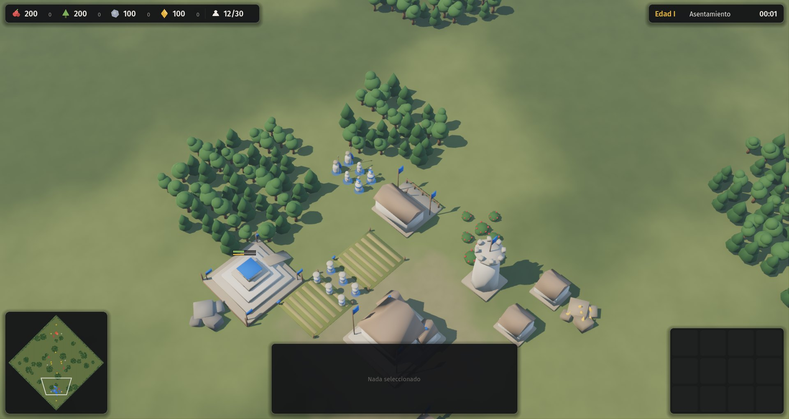
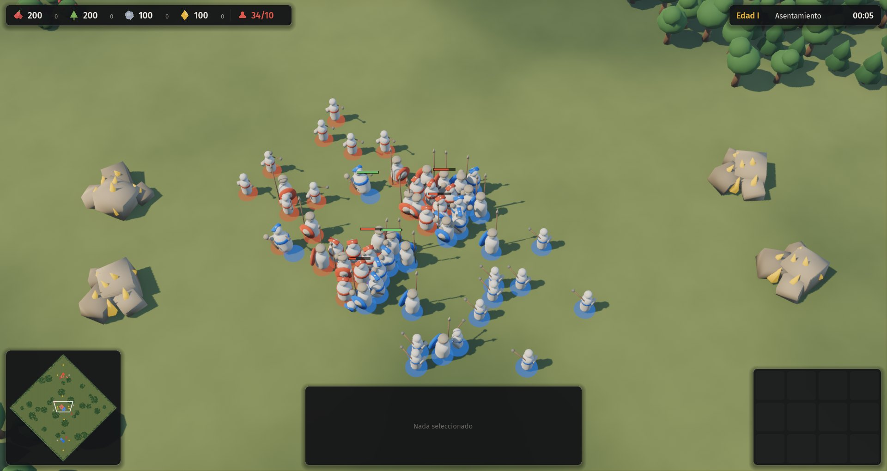

# Proyecto Sur

*Nombre provisional (A-005).*

RTS histórico con asimetría radical, protagonizado por civilizaciones del sur global, c. 1400–1800: Tawantinsuyu, mapuches, guaraníes y Etiopía. Hecho en Godot por una persona con agentes de IA.

**Estado:** prototipo gris de H1 jugable. Ver [`docs/09-estado.md`](docs/09-estado.md).




## Jugar

Requiere Godot 4.7.

```
godot --path .
```

| Acción | Entrada |
|---|---|
| Seleccionar | Clic izquierdo o arrastrar; doble clic para todas las del mismo tipo |
| Orden contextual | Clic derecho (mover, atacar, recolectar, construir) |
| Construir | Seleccionar aldeanos y usar la grilla (`Q W E R` / `A S D F`) |
| Ataque en movimiento | `A` y clic |
| Grupos | `Ctrl + 1…9` y `1…9` |
| Aldeano inactivo / centro | `.` / `H` |
| Cámara | Flechas, bordes de pantalla, botón del medio, rueda |
| Velocidad / pausa | `F3` / `Esc` |

## Documentación

Todo el diseño vive en [`docs/`](docs/00-indice.md). Empezar por el índice y el registro de decisiones. Los números de balance están en [`data/`](data/).

## Pruebas

```
godot --headless --path . -s tests/test_determinism.gd
godot --headless --path . -s tests/bench.gd
godot --headless --path . -s tests/ai_match.gd -- --seed=7 --minutes=30
godot --path . -- --autotest
```

## Licencias

La fuente Fira Sans se distribuye bajo la SIL Open Font License (`assets/fonts/OFL.txt`).
