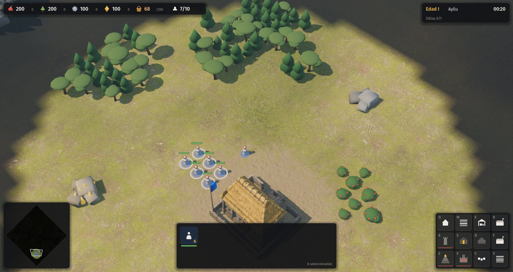
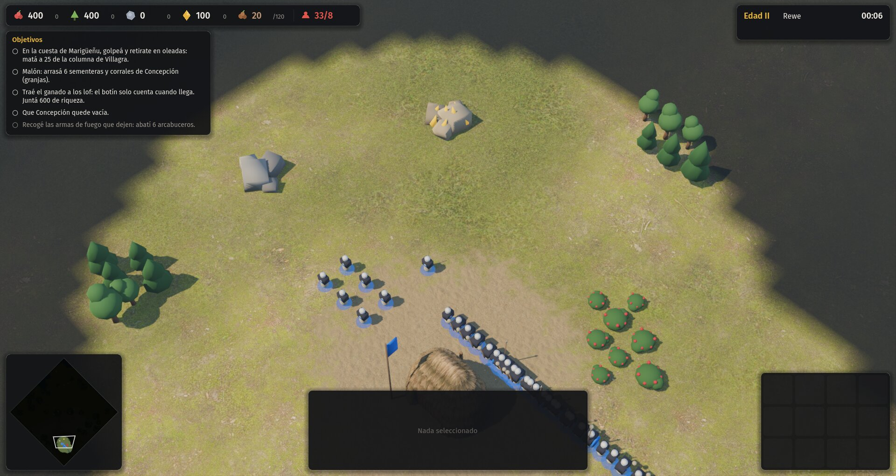
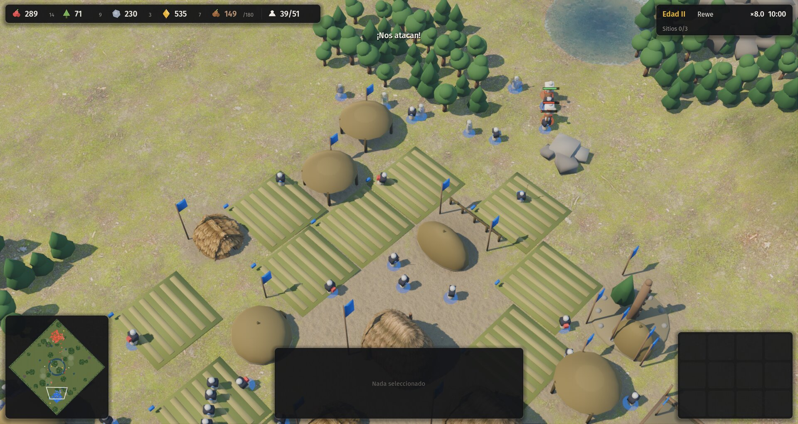
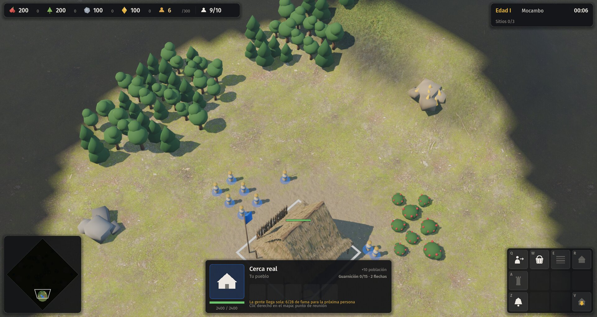
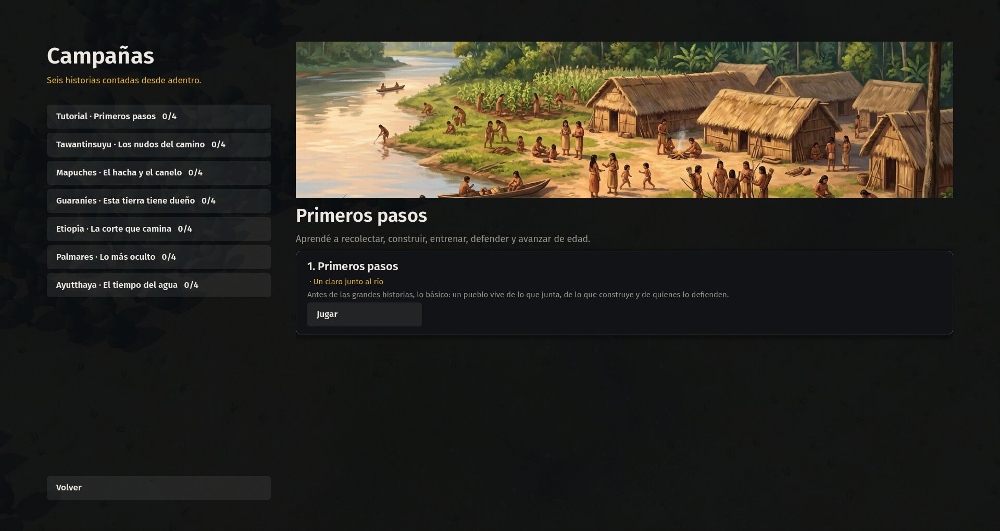

# Auditoría de la interfaz (segunda tanda)

Auditoría de UX de la interfaz de Raíces al 2026-11-13, comparada con Age of Empires IV y, cuando sirve, con AoE2 DE, StarCraft II y Company of Heroes. No es una decisión: es la lista de trabajo para la segunda tanda de mejoras de interfaz. La guía de estilo vigente es `../../07-arte-y-ui.md`.

**Qué queda afuera.** Hay tres agentes trabajando en paralelo en:

| Agente | Alcance | En este documento |
|---|---|---|
| A1 | Fichas al pasar el mouse, con retrato | No se proponen fichas nuevas. Se señala dónde la ficha no alcanza |
| A2 | Paneles de economía, de edad, registro de eventos y estadísticas | No se proponen esos paneles. Se marca "coordinar con A2" donde se tocan |
| A3 | Información en el mundo (sobre unidades y edificios) y minimapa | No se toca el minimapa ni lo que se dibuja sobre el mapa |

Todo lo que sigue es **lo demás**: estructura del HUD, grilla de comandos, panel de selección, avisos, entrada y cursores, menús, campañas, opciones y accesibilidad.

**Cómo se miró.** Lectura de `src/game/hud.gd`, `controller.gd`, `menu.gd`, `campaign_ui.gd`, `minimap.gd`, `main.gd`, `palette.gd` y `glyphs.gd`, más 14 capturas a 1920×1020 de menú, escaramuza con cinco civilizaciones, selección de aldeanos, explorador, capital y ejército, campaña, tutorial, introducción de misión y medio juego (IA contra IA a ×8, minuto 10). Los comandos para repetirlas están en el apéndice. Las cinco capturas clave están en `../../../proceso/15-interfaz/auditoria/`.

Las afirmaciones sobre AoE4 y los otros juegos describen la convención del género tal como se ve en sus versiones actuales; no copian piezas (`07`, "Interfaz").

---

## 1. Inventario

### 1.1 Escaramuza



| Pieza | Dónde | Qué muestra | Código |
|---|---|---|---|
| Barra de recursos | Arriba a la izquierda, 760×46 px | Cuatro recursos con ícono de color, cantidad (19 px) y aldeanos en cada uno (13 px, gris, sin rótulo). Recurso propio de la civ con tope (`68 /250`). Población `actual/tope`, en rojo si está llena | `TopBar` |
| Reloj y edad | Arriba a la derecha, 330×76 | `Edad I` en dorado, nombre de la edad, reloj, multiplicador de velocidad (`×8.0`), segunda línea con `Sitios 0/3` | `ClockBar` |
| Minimapa | Abajo a la izquierda, 250×250 | Rombo orientado como la cámara, niebla, entidades, encuadre de cámara, pings de ataque. Clic izquierdo mueve la cámara; clic derecho mueve la selección | `Minimap` (A3) |
| Panel de selección | Abajo al centro, 600×172 | Una entidad: retrato (glifo), nombre, dueño, vida, cuatro estadísticas, función, estado, carga. Edificio: cola de 5 casillas, guarnición, población, punto de reunión. Varias: un ícono por tipo con cantidad y vida sumada | `SelectionPanel` |
| Grilla de comandos | Abajo a la derecha, 4×3 casillas de 62 px | Glifos blancos, letra del atajo arriba a la izquierda (12 px), raya roja de 2 px si no alcanza, ícono apagado si está bloqueado, progreso de la cola en la casilla del producto | `CommandCard` |
| Ficha de comando | Sobre la grilla | Nombre, `[atajo]`, costo con faltante en rojo, descripción, motivo del bloqueo | `Tooltip` (A1 la reemplaza) |
| Avisos | Arriba al centro, una línea | Texto de 19 px con sombra, sin fondo; dura 2,6 s (5 s la edad) | `_notice` |
| Objetivos | Debajo de la barra de recursos (solo campaña) | Lista con `○ ✓ ✗`, secundarios en gris | `ObjectivesPanel` |
| Diálogo | Arriba al centro (solo campaña) | Quién habla y el texto; avanza solo entre 5 y 14 s | `_dialog` |
| Pausa | Diálogo modal (Esc, F10, Pausa) | Reanudar, Cómo se juega, Opciones, Nueva partida, Menú principal, Salir | `_menu` |
| Opciones | Modal | Tres volúmenes, pantalla completa, desplazamiento por bordes | `_build_options` |
| Ayuda (F1) | Modal | Ficha de la civilización y un bloque de texto con los controles | `_build_help` |
| Fin de partida | Modal | Victoria o derrota, una línea de estadísticas, cuatro botones | `_show_end` (A2 hace las estadísticas) |

### 1.2 Fuera de la partida

| Pantalla | Qué tiene |
|---|---|
| Menú principal | Título, cinco desplegables (tu pueblo, rival, dificultad, estilo de IA, mapa), descripción y lámina de la civ elegida, tres botones grandes, semilla, "Ver la última partida", Salir y dos líneas de atajos a 14 px. De fondo, una partida IA contra IA |
| Campañas | Lista de siete entradas a la izquierda con progreso `n/4`; a la derecha, lámina, resumen y tarjetas de misión con "Jugar" o "Se desbloquea al ganar la misión anterior" |
| Introducción y epílogo | Página de texto sobre la lámina oscurecida, año y lugar, título, párrafos, fuentes (en el epílogo) y dos botones |

### 1.3 Entrada

Atajos de `07` más algunos que no están en esa tabla: `Supr` borra la selección sin confirmar, `Mayús` + entrenar encola cinco, `Mayús` mantiene el modo de construcción y el ataque en movimiento, doble toque de un grupo centra la cámara, `F1` ayuda, `F3` velocidad, `F10` pausa. La cámara se mueve con flechas, bordes y botón del medio, porque `Q W E R / A S D F / Z X C V` son de la grilla.

---

## 2. Problemas, ordenados por impacto

Escala: **Alto** = hace perder partidas o deja a alguien afuera; **Medio** = confunde o cuesta tiempo; **Bajo** = pulido.

### Alto

**P1. La interfaz no escala.** `project.godot` no define `window/stretch/mode`, y todo el HUD está en píxeles fijos (`SLOT := 62.0`, barra de 760 px, fuentes de 12 a 19 px). A 1440p el HUD ocupa un 25 % menos de pantalla y a 4K, la mitad: las letras de atajo de 12 px pasan a medir 6 px físicos efectivos. Tampoco hay un control de escala en Opciones. AoE4, AoE2 DE, SC2 y CoH3 tienen un control deslizante de escala de interfaz.

**P2. Los colores de equipo chocan con los recursos y entre sí.** Distancias de color (ΔE en CIELAB; por debajo de 10 se confunden, por debajo de 20 cuesta distinguirlos de un vistazo):

| Par | Visión normal | Deuteranopía | Protanopía |
|---|---|---|---|
| Equipo rojo `d4553a` / alimento `d9534f` | **11** | 9 | 12 |
| Equipo ocre `c9a227` / riqueza `e3b23c` | **8** | 7 | 7 |
| Equipo rojo / equipo verde `3aa36b` | 94 | 28 | **17** |
| Vida buena `6cc46a` / vida mala `e0564a` | 99 | **13** | 33 |
| Alimento / madera | 84 | **8** | 32 |

Los dos primeros pares violan la regla 4 de `07` ("ningún recurso se confunde con un color de equipo") para cualquier jugador. El resto deja afuera a cerca del 8 % de los varones. Con el plan de hasta 8 jugadores (`../../11-partidas-de-muchos-jugadores.md`) la paleta de cuatro colores no alcanza.

**P3. Los estados de la grilla casi no se ven.** "No alcanza" es una raya roja de 2 px y el glifo al 80 %. "Bloqueado" es el glifo al 45 %, con un contraste de 2,2:1 contra el fondo (el mínimo de WCAG para elementos gráficos es 3:1). No se distingue "no alcanza" de "falta edad" sin pasar el mouse. El aviso dice "Recursos insuficientes" sin decir cuál falta (`controller.gd`, `run_command` y `_place`). AoE4 oscurece la casilla y pone en rojo el recurso faltante; AoE2 además lo dice en voz y en texto ("necesitás más madera").

**P4. La grilla del aldeano cambia de lugar según la civilización.** `07` pide que "la posición de un comando sea estable entre unidades y edificios". Hoy:

| Ranura | Tawantinsuyu | Etiopía | Guaraníes (tutorial) |
|---|---|---|---|
| A | Torre | Torre | vacía |
| F | edificio propio | granja propia | vacía |
| C / V | edificio propio / granja | empalizada / puerta | empalizada / puerta |

`villager_slots()` reparte en orden los edificios que no tienen `ranura` y los manda a la primera libre. Quien juega dos civs aprende dos teclados. Además, varios glifos se repiten: las dos opciones de hito de cada edad (Z y X) tienen el **mismo** ícono; la granja común y la propia de Etiopía y Tawantinsuyu son las mismas rayas horizontales; el retrato del centro y el de la casa son la misma casita. `Glyphs` tiene 37 glifos para todas las civs.

**P5. El HUD tapa la base y bloquea clics aunque esté vacío.** Con la cámara inicial, la capital queda a medias debajo del panel de selección (capturas 02, 06, 11, 12). Sin nada seleccionado, el panel muestra "Nada seleccionado" y la grilla doce casillas vacías, pero los dos siguen bloqueando el mapa: unos 600×172 + 278×210 + 250×250 px, el 10 % de la pantalla, sin información. En campaña, además, los objetivos (440 px de ancho, cinco renglones) tapan la esquina superior izquierda y no se pueden plegar.



**P6. Los avisos no tienen jerarquía.** "¡Nos atacan!", "Grupo 1 asignado", "No hay aldeanos inactivos" y "Edad II alcanzada" salen igual: blanco, 19 px, sin fondo, en el mismo lugar, y cada uno **pisa** al anterior. Sobre pasto claro o nieve se lee mal (captura 08). No hay tecla para ir al último aviso: hay que buscar el ping en el minimapa. AoE2 tiene `Inicio` para eso y SC2, `Espacio`. CoH pone los eventos como íconos clicables al costado de la pantalla. (El registro de eventos lo hace A2; acá se trata del aviso en el momento y del salto.)



**P7. No hay cursores contextuales.** El cursor es la flecha del sistema todo el tiempo, salvo una cruz en el ataque en movimiento (`Input.CURSOR_CROSS`). Antes del clic derecho no se sabe si se va a atacar, recolectar, construir, reparar, alojar o solo mover. En AoE4, AoE2, SC2 y CoH el cursor cambia de forma en cada caso; es la mitad de la información de un RTS y no ocupa pantalla.

### Medio

**P8. Texto pisado en el panel de la capital de Palmares.** "La gente llega sola: 6/28 de fama…" se dibuja en `y = 140` y "Clic derecho en el mapa: punto de reunión" en `y = 152`, ambos de 13 px (`hud.gd`, `_single`).



**P9. La población excedida no se explica.** En la misión 2 de los mapuches se arranca con `33/8` en rojo y en la demo de batalla, `35/10`. No hay aviso de por qué ni de qué hacer. Lo mismo en escaramuza: solo el panel del edificio que produce dice "Población llena: construí casas", y únicamente si está seleccionado.

**P10. El recurso propio no se entiende.** Es un ícono y un número sin nombre (`68 /250`, `6 /300`, `20 /120`). En Palmares, el ícono de fama es una persona naranja que se confunde con el de población, que está al lado. La cantidad de aldeanos por recurso (`0`, 13 px gris, sin rótulo) se lee como parte del número. (A2 hace el panel de economía y A1 las fichas: este punto es solo la barra en sí.)

**P11. Grupos de control invisibles.** `Ctrl + n` asigna y avisa "Grupo n asignado", pero no hay ningún lugar que muestre qué grupos existen ni cuántas unidades tienen. No hay `Mayús + n` para agregar a un grupo, ni forma de sacar unidades de un grupo sin reasignarlo. SC2 muestra una fila de grupos con conteo sobre el panel de selección; es la referencia del género.

**P12. El panel de selección múltiple desperdicia el espacio y no deja operar.** Con diez lanceros muestra un ícono, un `10` y una barra. No hay una casilla por unidad con su vida, ni `Tab` para recorrer subgrupos, ni `Mayús + clic` para sacar un tipo, ni `Ctrl + clic` para quedarse solo con un tipo (hoy el clic selecciona el tipo, sin aviso de que se puede).

**P13. Las estadísticas de unidad no dicen lo que importa.** `Alcance 0.4`, `Velocidad 2.10`: decimales sin unidad que no se comparan con nada. No aparece el triángulo de contadores, que es la regla central del combate (`../../05-mecanicas-nucleo.md`): "vence a la distancia, pierde contra la línea" solo está en la descripción del botón de entrenar. AoE4 muestra, en el panel, armadura cuerpo a cuerpo y a distancia por separado, y "fuerte contra / débil contra" con íconos. (Si A1 pone el contador en la ficha flotante, igual conviene que esté fijo en el panel: la ficha desaparece cuando el mouse va al mapa.)

**P14. El menú principal no tiene jerarquía ni salida a Opciones.** Los tres botones grandes pesan lo mismo, y "Mirar IA contra IA" compite con "Escaramuza". La semilla queda entre los botones. **No hay Opciones ni Ayuda desde el menú**: hay que entrar a una partida y pausar. Los atajos van en dos renglones de 14 px al pie. No hay vista previa del mapa ni del rival.

**P15. Las opciones no se guardan y son pocas.** No hay `ConfigFile`: el volumen y la pantalla completa vuelven a su valor al reiniciar. Faltan escala de interfaz, tamaño de texto, modo de color, velocidad de cámara, reasignación de teclas, invertir botones del mouse y barras de vida siempre visibles.

**P16. Campañas: errores y huecos.**
- El tutorial tiene una sola misión y la lista dice `0/4` (el `/4` está fijo en `campaign_ui.gd`).
- Si la misión no tiene año, el subtítulo empieza con `· ` (`· Un claro junto al río`).
- No se elige dificultad para campañas.
- La introducción no adelanta los objetivos ni el pueblo que se juega.
- El diálogo en partida avanza solo (5 a 14 s): no se puede adelantar, repetir ni pausar. Si coincide con un ataque, se pierde.
- En campaña, el reloj deja vacía su segunda línea.



**P17. La colocación de edificios no dice por qué no.** El fantasma se pinta verde o rojo y el aviso dice "No se puede construir ahí". No distingue terreno, roca, agua, superposición, niebla o recursos. Tampoco muestra el alcance de la torre ni la distancia al recurso más cercano para un depósito. Los RTS de referencia marcan la parte de la huella que choca y, en varios casos, muestran alcances o áreas de influencia mientras se coloca.

### Bajo

**P18.** Las letras de atajo de la grilla (12 px, gris al 90 %) quedan encima del glifo y se pierden en casillas activas. AoE4 las pone en una esquina con fondo propio.

**P19.** La ayuda (F1) es un bloque de texto de seis renglones con separadores `·`, sin tabla ni secciones. No menciona `Mayús + entrenar` (×5), `Mayús` para encadenar construcciones ni el doble toque de grupo.

**P20.** `Esc` primero cancela el modo, después deselecciona y recién después pausa. Es correcto, pero el tercer `Esc` llega por sorpresa; conviene decirlo en la ayuda y dejar `F10` como la tecla de menú que siempre funciona (ya existe).

**P21.** "Sitios 0/3" no dice qué es ni para qué sirve.

**P22.** `Supr` borra la selección sin confirmar. En AoE2 también es así, pero borrar el centro con un toque es un error caro. Basta con pedir doble toque solo para edificios.

**P23.** El fin de partida dice "Seguir mirando" pero no muestra quién ganó por qué (conquista, sitios, objetivo). Las estadísticas son de A2; el motivo de la victoria, no.

**P24.** Durante la pausa no hay ninguna marca de "en pausa" fuera del diálogo; si se cierra Opciones o Ayuda con el juego en pausa, no queda claro el estado.

---

## 3. Comparación punto por punto con AoE4

| Pieza | AoE4 | Raíces hoy | Brecha y referencia de otros RTS |
|---|---|---|---|
| **Barra de recursos** | Bloque compacto junto al minimapa, abajo a la izquierda: los cuatro recursos con aldeanos por recurso, población y botón de aldeanos inactivos con contador | Arriba a la izquierda, con aldeanos por recurso en gris chico, sin botón de inactivos, recurso propio sin nombre | Falta el botón de **aldeanos inactivos** visible y clicable (AoE2 DE, AoE4). La ubicación arriba está bien (AoE2, SC2); lo que falta es jerarquía. Coordinar con A2 si su panel de economía incluye los inactivos |
| **Panel de selección** | Retrato, nombre, vida, armaduras cuerpo a cuerpo y a distancia, ataque, fuerte y débil contra. Selección múltiple con una casilla por unidad, agrupadas por tipo; `Tab` recorre subgrupos | Una entidad: bien resuelto. Varias: un ícono por tipo. Sin contadores ni grupos de control | SC2 es la referencia de selección múltiple: una casilla por unidad con vida y clics con modificadores. CoH agrega veteranía y estado (suprimida, en cobertura). P12, P13, P11 |
| **Grilla de comandos** | 5×3. Dos esquemas: clásico y en grilla. Los edificios del aldeano van en submenús (económicos y militares), lo que deja lugar a todos | 4×3 plana, posicional. Doce lugares para todos los edificios más dos hitos: las civs con más edificios corren las posiciones | **Submenús de construcción** como AoE4 y AoE2 (Q: economía, W: militar, E: hitos) devuelven la estabilidad que pide `07`. SC2 también usa "construcción básica / avanzada". P3, P4, P18 |
| **Fichas** | Costo, tiempo, descripción, contadores | Costo, descripción, motivo del bloqueo | A1 |
| **Minimapa** | Rombo, botones de señal y filtros al costado | Rombo sin botones | A3 |
| **Avisos** | Texto con fondo en el centro superior, sonido distinto por tipo, ping en el minimapa, tecla para ir al último evento | Un renglón sin fondo que se pisa; ping solo para ataques | Jerarquía por color e ícono, cola de hasta tres, tecla de salto (AoE2 `Inicio`, SC2 `Espacio`), íconos clicables al costado como CoH. P6 |
| **Cursores** | Distinto para atacar, recolectar cada recurso, construir, reparar y alojar | Flecha del sistema | P7. Es la mejora de más impacto por línea de código |
| **Menús** | Menú principal con jerarquía clara (un botón principal), opciones completas desde el inicio, vestíbulo de escaramuza con vista previa del mapa | Una columna plana, sin opciones fuera de la partida | P14, P15. AoE2 DE y CoH3 separan "Jugar" del armado de la partida en un vestíbulo |
| **Pantalla de puntaje** | Resumen, puntajes por rubro, línea de tiempo con las edades, producción | Una línea de números | A2. Falta, además, el motivo de la victoria (P23) |
| **Tutoriales** | Campaña de aprendizaje y desafíos "Art of War" con medallas; consejos en la pantalla de carga | Una misión de tutorial con objetivos que dicen la tecla | Falta resaltar en la interfaz lo que pide el objetivo (que titile la casilla Q cuando dice "tecla Q"). SC2 y AoE4 lo hacen. Desafíos cortos por civ (abrir con la mecánica propia) serían el equivalente barato al "Art of War" |
| **Consejos** | Consejos al cargar y avisos de ayuda la primera vez que pasa algo (población llena, aldeano inactivo) | No hay | Consejos contextuales de primera vez, que se pueden apagar |
| **Accesibilidad** | Escala de interfaz, modos de daltonismo, colores de jugador elegibles | Nada | Sección 5 |
| **Velocidad y pausa** | Pausa con cartel; velocidad solo en partidas contra la IA | F3 recorre ×1, ×2, ×4, visible en el reloj | Bien resuelto. Falta el cartel de pausa (P24) |

---

## 4. Mejoras para la segunda tanda

Costo en tiempo de un agente, con pruebas y capturas: **C** = menos de 2 h, **M** = de 2 a 6 h, **G** = más de 6 h. El orden es el sugerido para implementar: primero lo de más impacto y menos costo.

| # | Mejora | Resuelve | Costo | Notas de implementación |
|---|---|---|---|---|
| 1 | **Escala de interfaz.** `window/stretch/mode="canvas_items"` con base 1920×1080 y un control de 75 % a 150 % en Opciones (`get_tree().root.content_scale_factor`) | P1 | M | Solo afecta al 2D. Revisar `Minimap._draw` y `Controller`, que mezclan coordenadas de pantalla con `get_visible_rect()` y `ground_at()`: con escala distinta de 1 hay que convertir |
| 2 | **Opciones guardadas** en `user://opciones.cfg` y accesibles desde el menú principal | P14, P15 | C | Volúmenes, pantalla completa, bordes, escala, modo de color, velocidad de cámara |
| 3 | **Paleta de equipos segura** y regla 4 de `07` cumplida: equipos de 8 colores tomados de una paleta apta para daltonismo (Okabe-Ito o similar) y probados contra los cuatro recursos; opción "yo / aliados / rivales" (azul, verde azulado, naranja) como el modo de colores de equipo de SC2 | P2 | M | Los colores viven en `palette.gd`. Se mide con el mismo cálculo de ΔE de esta auditoría y se deja como prueba |
| 4 | **Cursores contextuales**: mover, atacar, recolectar (uno por recurso), construir, reparar, alojar, punto de reunión, no permitido | P7 | M | `Controller._process` ya calcula `hovered`; falta decidir la acción y llamar a `Input.set_custom_mouse_cursor`. Los cursores se dibujan como glifos en una textura |
| 5 | **Grilla estable con submenús de construcción**: el aldeano muestra `Q` Economía, `W` Militar, `E` Defensa, `Z`/`X` hitos; dentro de cada submenú, posiciones fijas por función para las seis civs; `Esc` o clic derecho vuelve | P4 | M | Cada edificio de `data/civs/*.json` declara su submenú y su ranura; nada de reparto automático. Actualizar el tutorial (hoy dice "tecla Q y clic") |
| 6 | **Estados de la grilla legibles**: "no alcanza" con el borde y el costo faltante en rojo sobre la casilla; "bloqueado" con candado y número de edad; el aviso dice qué falta ("Faltan 40 de madera") | P3 | C | `CommandCard._draw` y `run_command` |
| 7 | **Avisos con jerarquía**: fondo propio, ícono, color por tipo (ataque, logro, error, información), cola de hasta tres, y tecla `Espacio` para ir al último aviso con lugar | P6 | M | Coordinar con A2: el registro guarda la historia; esto es el aviso del momento |
| 8 | **Botones fijos de aldeano inactivo y ejército inactivo** con contador, junto a la barra o el minimapa; `Ctrl + .` para unidades militares inactivas | P10 | C | Si A2 ya pone los inactivos en su panel, reusar esa pieza |
| 9 | **Fila de grupos de control** sobre el panel de selección, con ícono del tipo mayoritario y cantidad; `Mayús + n` agrega, `Alt + n` quita al grupo y asigna | P11 | M | `Controller.groups` ya existe |
| 10 | **Selección múltiple operable**: una casilla por unidad con vida (hasta 30, después agrupa), `Tab` para recorrer subgrupos con la grilla del subgrupo activo, `Mayús + clic` saca y `Ctrl + clic` deja solo ese tipo | P12 | M | Como SC2 |
| 11 | **Contadores en el panel**: "vence a / pierde contra" con los glifos de función, y estadísticas en palabras o con barras relativas en vez de decimales | P13 | C | Los textos salen de los datos (D-008). Coordinar con A1 para no duplicar el diseño de la ficha |
| 12 | **HUD que se achica cuando no hay selección**: sin selección, la grilla se oculta y el panel de selección se reduce a una tira; cámara inicial con la capital por encima del panel | P5 | C | `blocks()` debe usar el rectángulo visible real |
| 13 | **Objetivos plegables** (tecla `O`) con aviso cuando cambian, y diálogo que se puede adelantar (clic o `Enter`) y volver a ver | P5, P16 | C | |
| 14 | **Arreglos de campaña**: progreso `n/N` real, subtítulo sin `· ` suelto, dificultad para campañas, objetivos y civ en la introducción, segunda línea del reloj con el nombre de la misión | P16 | C | `campaign_ui.gd` y `ClockBar` |
| 15 | **Colocación que explica**: la casilla que choca en rojo, motivo en el aviso ("Hay agua", "Fuera de la vista"), alcance de torres y centros al colocar | P17 | M | `Sim.can_place` tendría que devolver el motivo; ojo con el determinismo: es solo lectura |
| 16 | **Población explicada**: aviso único al llenarse ("Población llena: construí casas", con el botón de casa titilando si hay aldeanos seleccionados) y, en campaña, la causa cuando se arranca por encima del tope | P9 | C | |
| 17 | **Menú principal con jerarquía**: un botón principal ("Jugar"), un vestíbulo de escaramuza con vista previa del mapa y de las dos civs, y "Opciones", "Ayuda" y "Créditos" en el menú | P14 | M | La lámina ya existe por civ |
| 18 | **Barra de recursos legible**: nombre del recurso propio, aldeanos por recurso con su propio ícono o casilla, ícono de fama distinto del de población | P10 | C | Coordinar con A2 |
| 19 | **Tutorial que señala**: el objetivo resalta la casilla, el recurso o el edificio que menciona; consejos de primera vez (aldeano inactivo, población llena, primer ataque) que se apagan en Opciones | Sección 3 | M | El motor de escenarios ya emite eventos de objetivo |
| 20 | **Ayuda (F1) en pestañas**: Controles en tabla, Tu civilización, Contadores; incluye los atajos que hoy faltan | P19 | C | |
| 21 | **Reasignación de teclas** y esquema alternativo (WASD para la cámara con la grilla en otra fila) | P15 | G | `SLOT_KEYS` es una constante; pasarlo a `InputMap` y guardarlo en `opciones.cfg` |
| 22 | **Pulido**: letras de atajo con fondo propio, cartel "En pausa", "Sitios" con ficha o nombre completo, doble `Supr` para edificios, motivo de la victoria al final, texto pisado de la capital de Palmares | P8, P18, P21–P24 | C | P8 es un error: arreglarlo primero |

**Si hay que elegir cinco:** 1 (escala), 3 (paleta), 4 (cursores), 5 (grilla estable) y 7 (avisos). Son las que cambian la sensación de "juego terminado" y las que más le cuestan a quien juega por primera vez.

---

## 5. Accesibilidad

### Daltonismo

- **Hoy no hay ningún modo**, y el juego depende del color para equipos, vida (verde o roja según el tercio), fantasmas de construcción (verde o rojo), recursos y "no alcanza" (raya roja). La tabla de P2 muestra que, con deuteranopía, la vida buena y la mala quedan a ΔE 13 y alimento y madera, a ΔE 8.
- **Qué hacer.** (a) Paleta de equipos segura (mejora 3). (b) Nunca solo color: la vida baja se marca también con el largo de la barra (ya está) y con un parpadeo bajo el 25 %; el fantasma inválido lleva una cruz; "no alcanza" lleva el costo faltante escrito. (c) Los recursos ya se distinguen por la forma del glifo en la barra; falta lo mismo en el mundo y en el minimapa (A3). (d) Opción "yo / aliados / rivales".
- **Cómo probarlo.** Guardar el cálculo de ΔE con simulación de deuteranopía, protanopía y tritanopía como prueba de la paleta, con un umbral mínimo de 20 entre equipos y de 25 entre equipo y recurso.

### Tamaño de texto

- Tamaños actuales a 1080p: 12 px (letras de atajo, rótulos de estadísticas), 13 px (aldeanos por recurso, tope del recurso propio, ayudas del panel), 14 a 15 px (objetivos, estados), 16 a 19 px (números principales). Con P1 sin resolver, a 4K los de 12 px quedan ilegibles.
- Contraste: `UI_TEXT` 15:1 y `UI_DIM` 6,1:1 están bien; "Nada seleccionado" (`UI_DIM` al 60 %) da 3,0:1 y los íconos bloqueados (al 45 %), 2,2:1, por debajo del mínimo.
- **Qué hacer.** Mínimo de 14 px a escala 100 % para todo texto que haya que leer; opción "Texto grande" (+25 %) independiente de la escala del HUD; el diálogo de campaña con tamaño propio y fondo más opaco; nada de información solo en texto atenuado.

### Escala de la interfaz

- Mejora 1. Rango sugerido de 75 % a 150 %, con vista previa en vivo en Opciones. Al 150 % sobre 1920×1080, el panel de selección (900 px) y la grilla (420 px) siguen entrando; hay que revisar que la barra de recursos (1140 px) no choque con el reloj (495 px): a esa escala conviene partir la barra en dos renglones o mover el reloj al centro.
- Probar las capturas a 1366×768 (laptop común), 1920×1080 y 2560×1440. `--resolution` no sirve hoy para la captura porque el modo de ventana es maximizado: conviene agregar a `main.gd` un `--ventana=ANCHOxALTO` para las pruebas.

### Otros

- Teclas reasignables y botones del mouse invertibles (mejora 21).
- Diálogo de campaña que no se pierde (mejora 13) y que deja leer al ritmo propio.
- Sonido con su par visual: hoy el ataque tiene ping; la edad, la investigación terminada y la población llena solo tienen texto.
- Opción para reducir el movimiento de la cámara del menú de fondo, que se mueve sola.

---

## Apéndice: capturas

En `proceso/15-interfaz/auditoria/`: `03-aldeanos-tawa`, `06-centro-palmares`, `07-campana-mapuches`, `08-medio-juego` y `09-campanas`. Las demás quedaron en el área temporal de la sesión; se repiten con:

```
godot --path . -- --menu --mute --shot=01-menu.png --shot-at=3
godot --path . -- --civ=tawantinsuyu --terreno=valle --mute --shot=03.png --shot-at=20 --select=aldeano
godot --path . -- --civ=etiopia --terreno=llano --mute --demo=batalla --shot=04.png --shot-at=8 --select=lancero
godot --path . -- --civ=ayutthaya --terreno=llano --mute --demo=base --shot=05.png --shot-at=4
godot --path . -- --civ=palmares --terreno=llano --mute --shot=06.png --shot-at=6 --select=centro
godot --path . -- --campana=mapuches --mision=1 --mute --shot=07.png --shot-at=6
godot --path . -- --aivai --civ=mapuches --rival=etiopia --terreno=llano --speed=8 --mute --shot=08.png --shot-at=600
godot --path . -- --menu --abrir=campanas --mute --shot=09.png --shot-at=3
godot --path . -- --campana=tutorial --mision=0 --mute --shot=10.png --shot-at=10 --select=aldeano
godot --path . -- --civ=etiopia --terreno=llano --mute --shot=12.png --shot-at=4 --select=aldeano
godot --path . -- --menu --abrir=intro --mute --shot=13.png --shot-at=3
godot --path . -- --civ=mapuches --terreno=llano --mute --shot=14.png --shot-at=4 --select=explorador
```

No se pudo capturar el menú de pausa, la ayuda ni el fin de partida: `--shot` desactiva la entrada y no hay un argumento que los abra. Sumar `--abrir=pausa|ayuda|fin` a `main.gd` dejaría revisarlos en cada tanda.
