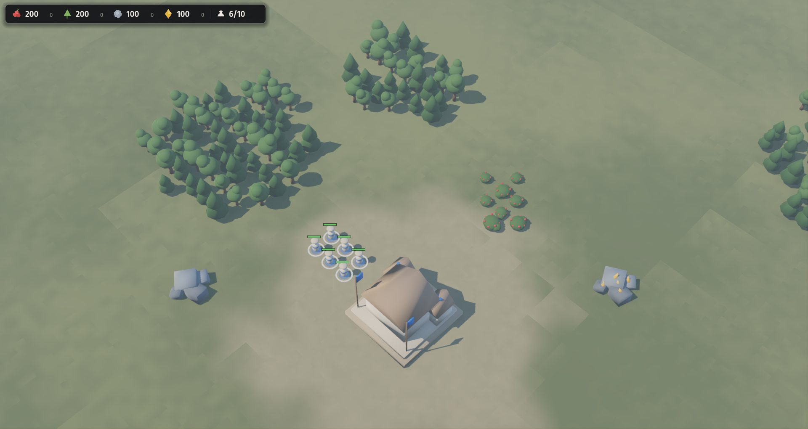
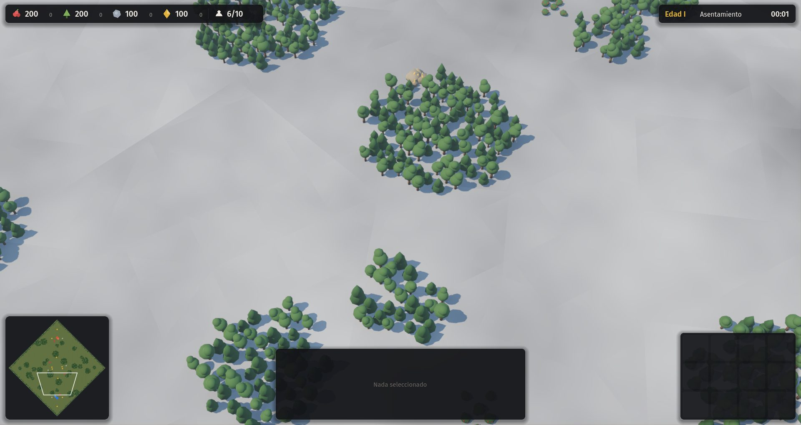
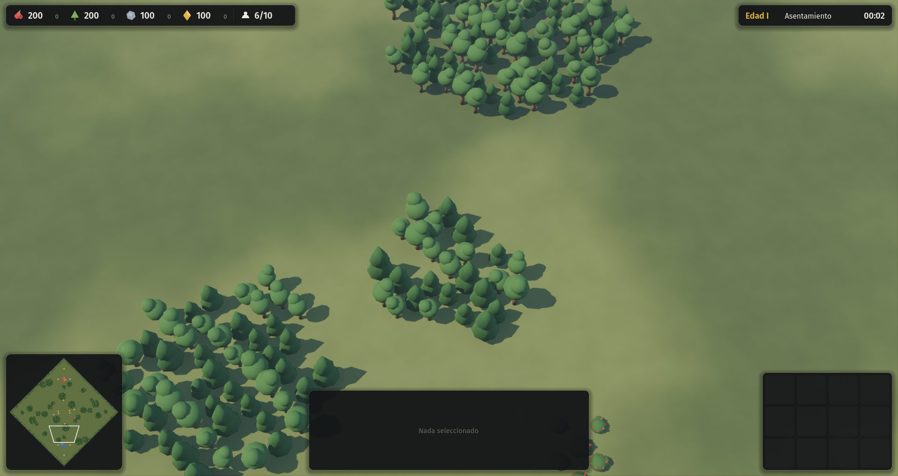
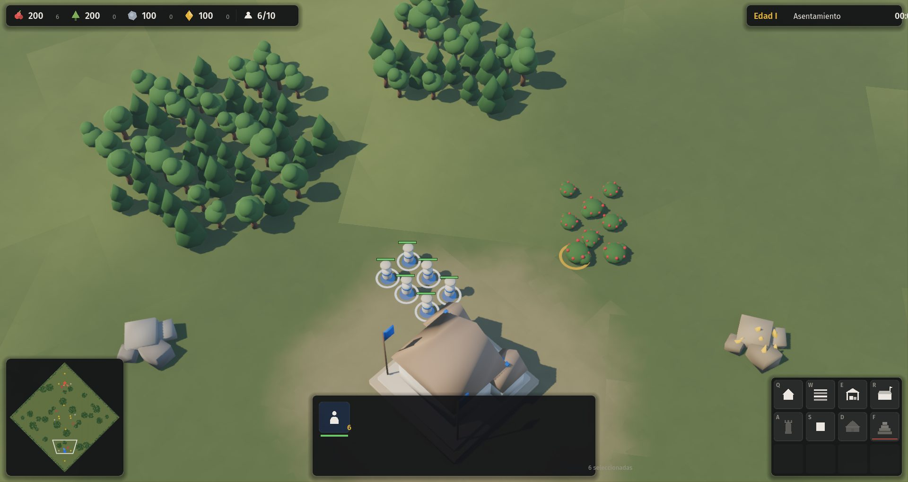
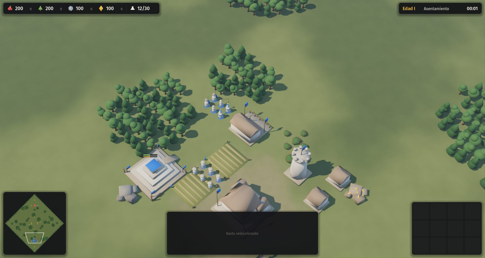
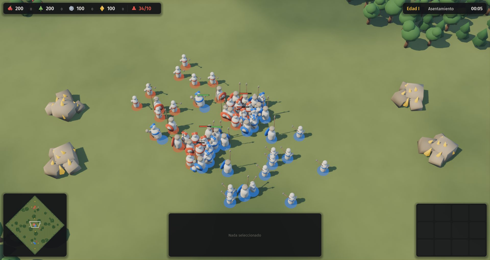
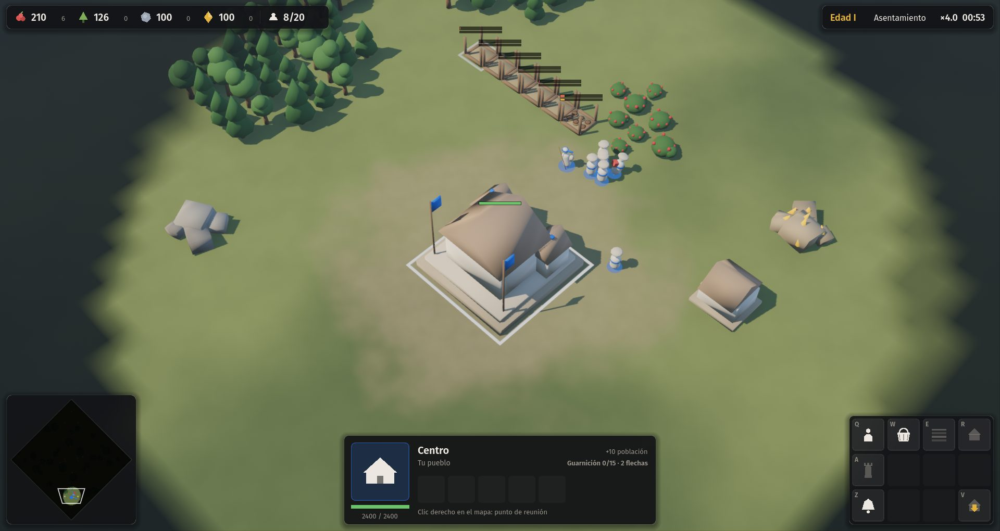

# 01 · Fundación (2026-11-10)

## Punto de partida
Cinco documentos de diseño (índice, visión y pilares, alcance, matriz de roles, decisiones) y un repositorio vacío. Motor elegido: Godot (D-010).

## Paso a paso
1. **Documentos faltantes de H0.** Mecánicas núcleo (05), arquitectura (06), arte e interfaz (07), IA rival (08), estado (09), plantilla y fichas de civilización. Las decisiones técnicas quedaron como propuestas P-001 a P-005.
2. **Datos de balance en JSON** (`data/`), todo en enteros: milésimas de casilla y milisegundos.
3. **Simulación determinista** en `src/sim/`: comandos con número de tick, economía, construcción, combate con triángulo, edades por hito y victoria. Mapa simétrico por semilla.
4. **Primer problema de rendimiento.** 5 ms por tick con solo 16 unidades. Causa: se recorrían los 2.000 árboles en cada tick. Se separaron entidades activas de recursos y se agregó una grilla espacial; quedó diez veces más rápido.
5. **IA de escaramuza.** Al principio no avanzaba de edad: le faltaba alimento por caminar demasiado. Se agregó un depósito de alimento cerca de los recursos y un reparto dinámico de aldeanos. Después se trababa ahorrando para un hito imposible; se corrigió.
6. **Estética de maqueta.** Modelos procedurales fusionados por color, luz de tarde, sombras y oclusión.
7. **Interfaz.** La primera imagen mostraba solo la barra superior (captura 01): `set_anchors_preset` conserva el tamaño cero en Godot 4.
8. **Suelo con facetas.** El ruido de valor dejaba triángulos (captura 02); se reemplazó por una textura de ruido del motor (captura 03).
9. **Autotest de controles** con eventos reales de mouse y teclado (captura 07).

## Resultado
Partida completa contra la IA, 200 unidades a 4 ms por tick, determinismo verificado.

## Capturas
| | |
|---|---|
|  |  |
|  |  |
|  |  |
|  | |
