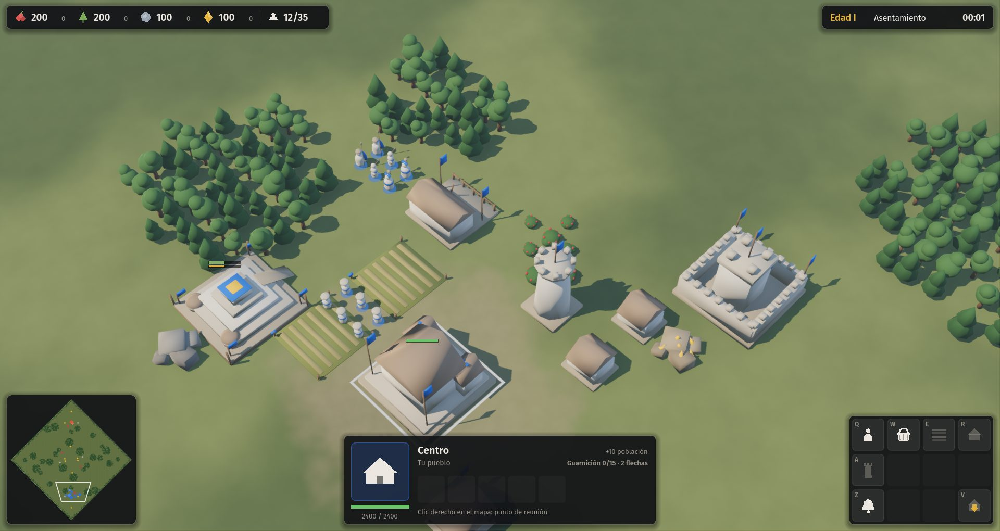
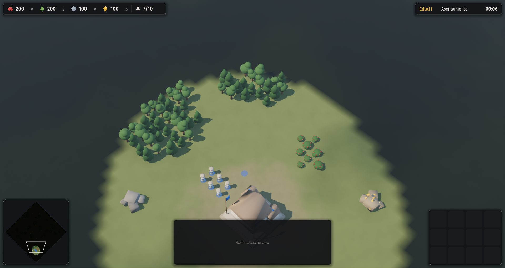
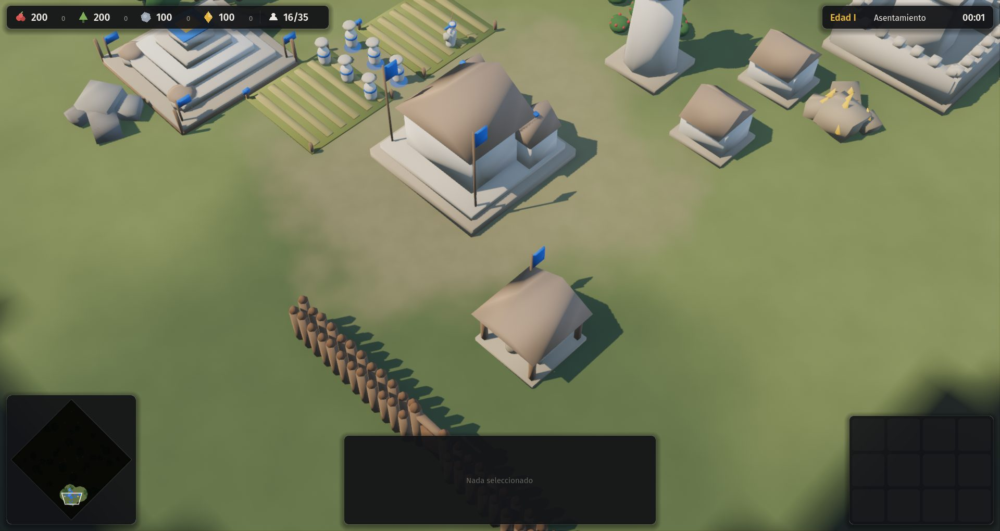
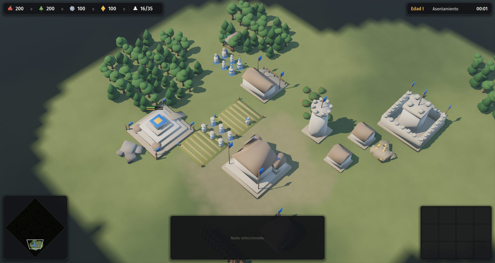
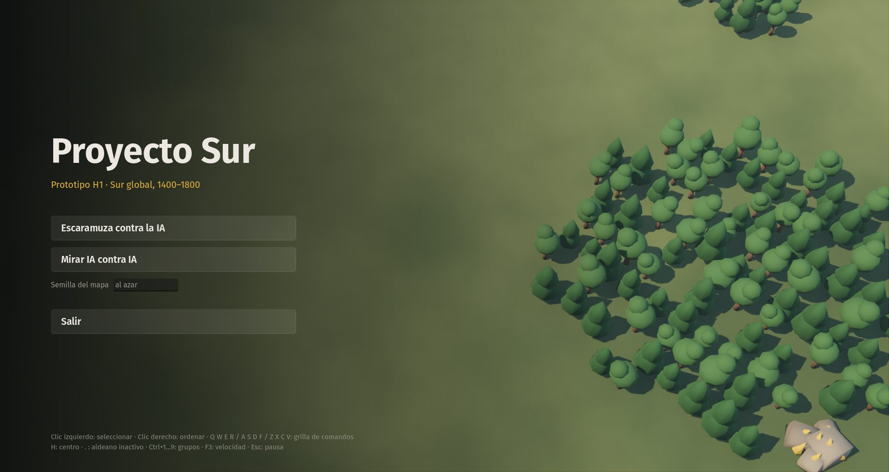

# 02 · Capa común (2026-11-11)

## Pedido del autor
"Alojar aldeanos en el centro, que el centro tire flechas para defender ataques tempranos, poder buscar economía sin tener que hacer soldados. Hacer el edificio de pasar de edad no me dio ningún beneficio."

## Paso a paso
1. **Guarnición y andanadas.** El centro, la torre y el hito de guerra alojan unidades, y cada una suma una flecha. Con la campana (Z) los aldeanos se refugian. Con la misma semilla en la que una IA caía a los 16 minutos, ahora resiste.
2. **Investigaciones** (`data/tecnologias.json`). 17 en total, con efectos como módulo de tipos fijos. Los textos de la interfaz se generan desde los datos.
3. **Dos hitos por edad**: abundancia y guerra, con efecto permanente (captura 04).
4. **Agentes de investigación.** Cinco en paralelo: uno por civilización y uno para la capa común de AoE4. Resultado en `docs/investigacion/`, con 15 contradicciones detectadas.
5. **Niebla de guerra y explorador** (captura 02). La visión por jugador se calcula en la simulación.
6. **Empalizadas por arrastre, puertas y ariete** (captura 03). Las puertas obligaron a tener una grilla de caminos por jugador.
7. **Menú de inicio** sobre una partida IA contra IA de fondo (captura 05).
8. **Reglas tomadas de AoE4**: solo la capital cuenta como hito, y construir con más aldeanos rinde cada vez menos.

## Hallazgo
Las IA ya resisten la presión temprana, pero no cierran las partidas: a los 40 minutos no hay ganador.

## Capturas
| | |
|---|---|
|  |  |
|  |  |
|  | |
