# 03 · Seis civilizaciones y el juego completo (desde 2026-11-13)

## Pedido del autor
Completar el juego como "un Age of Empires 4 indie del sur global": arte, animaciones, campaña para cada civilización y dos civilizaciones más (una de Brasil o la Amazonía y otra a elección, quizás de Asia), cada una completamente distinta. Subir todo de a poco y registrar el proceso.

## Paso a paso
1. **Decisiones delegadas cerradas** (`docs/04-decisiones.md`, D-012 a D-028): las seis propuestas técnicas, las preguntas abiertas que tenían recomendación fundada y la corrección de documentos según las fuentes. Las preguntas que son gusto del autor van a `CONSULTAS.md`.
2. **Civilizaciones nuevas elegidas**: Quilombo dos Palmares (Brasil, 1605–1694) y Ayutthaya (Siam, 1351–1767). Se descartaron los maratas porque se superponían con Etiopía (fuertes de montaña) y con los mapuches (incursiones).
3. **Cuatro agentes en paralelo**: investigación de Palmares, investigación de Ayutthaya, campañas de las cuatro civilizaciones originales en un formato de datos ejecutable, y audio y texturas CC0.
4. **Relieve y agua (D-027).** Cada casilla tiene una altura entera. Hay ríos con vados y lagunas, y cuatro tipos de mapa: llano, montaña, río y bosque, con simetría entre las bases.
   - En la simulación, quien dispara desde más alto pega más fuerte y ve más lejos, y solo se construye en terreno parejo.
   - En la imagen, el terreno es una malla con laderas de roca y el agua está animada.
   - Tropiezos: el plano exterior tapaba el cauce del río, y por error se invirtió el orden de los vértices. Se resolvió mirando las capturas una por una.

| Río con vados | Mesetas de montaña |
|---|---|
| 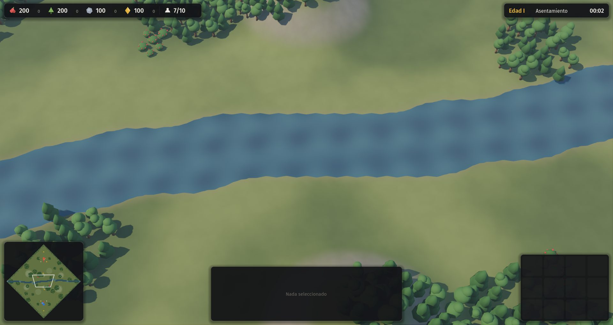 | 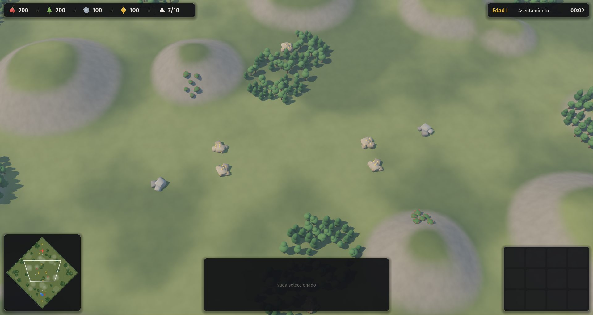 |
5. **Sistema de civilizaciones.** Cada civilización es un JSON en `data/civs/` que reemplaza y agrega sobre la capa común. La simulación pide la tabla de cada jugador con `dp(pid)`, sin código propio por civilización (test del módulo).
6. **Módulos con parámetros** (`src/sim/sim_mods.gd`): recurso propio (mit'a, kulliñ, fama), caminos con bono de conexión, saqueo, liberación, acogida, sigilo con emboscada, relevo, obra colectiva (potirõ) y defensa en altura. Varias mecánicas son propiedades de datos, como la renta del gult, la base móvil de la corte etíope, la roza que deja un yerbal y los elefantes con daño en área.
7. **Seis civilizaciones jugables** contra la IA, que también aprendió a jugarlas: encuentra su capital, usa sus hitos, entrena desde cualquier edificio militar y construye los edificios propios de cada una. La prueba de humo (`tests/civ_smoke.gd`) detectó y corrigió dos fallas: la IA buscaba lugar sin mirar el relieve, y la fama de Palmares estaba mal calibrada.
8. **Arte por civilización** (`src/game/civ_meshes.gd`): arquitectura, vestimenta, caballo, elefante y corte en marcha.
9. **Menú** con elección de pueblo y rival, y descripción de cada civilización.
10. **Seis campañas en datos** (`data/campanas/`, 24 misiones), escritas por agentes con el mismo esquema ejecutable y narradas desde adentro.

| Tawantinsuyu | Mapuches |
|---|---|
| 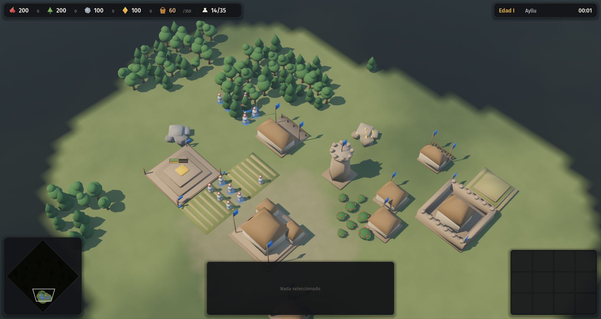 | 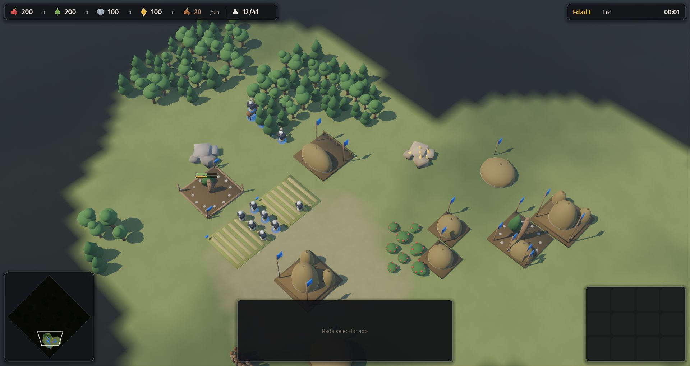 |
| **Guaraníes** | **Etiopía** |
| 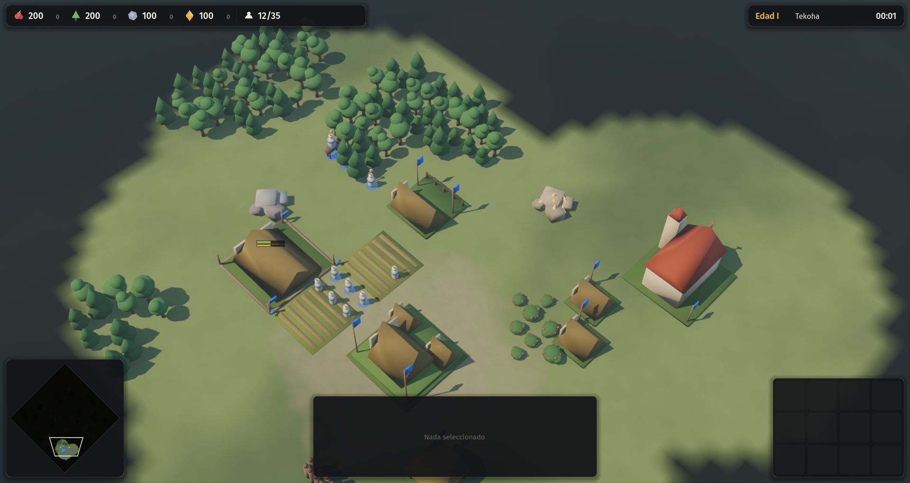 | 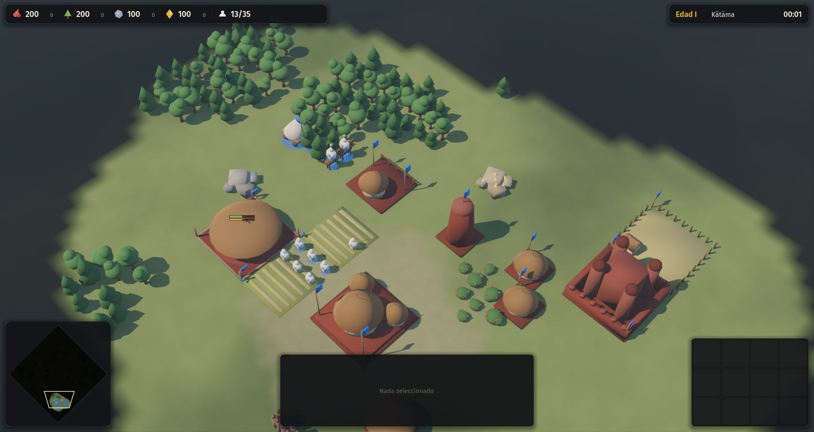 |
| **Palmares** | **Ayutthaya** |
| 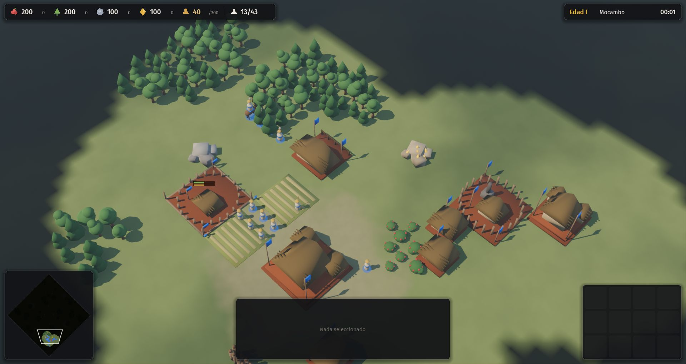 | 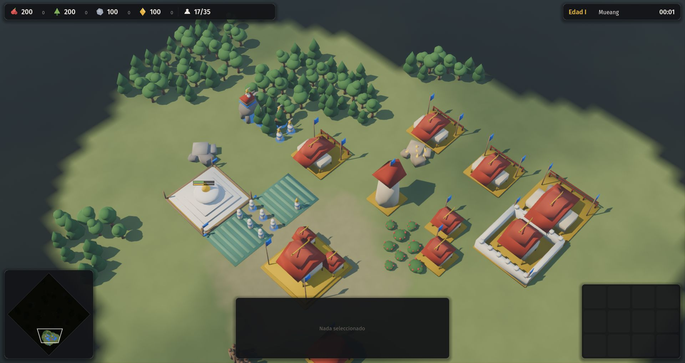 |
11. **Motor de escenarios** (`src/sim/sim_scenario.gd`): ejecuta las 24 misiones dentro de la simulación, así que también son deterministas. Arma bases para hasta cuatro jugadores, evalúa los nueve tipos de objetivo y dispara diálogos, refuerzos, ataques desde el borde, recursos, revelado del mapa y objetivos nuevos. Las misiones nombran edificios genéricos ("depósito" por lof), y cada civilización declara sus equivalencias. Con `tests/campaign_smoke.gd` las 24 se arman y corren sin errores.
12. **Facción `invasores`** (solo IA, D-018): huestes, terços y bandeiras, con caballería y pólvora desde temprano.
13. **Interfaz de campañas**: menú con progreso guardado, introducción a página completa, panel de objetivos, caja de diálogo con el nombre de quien habla, y epílogo con fuentes al ganar.

| Misión en juego | Menú de campañas | Introducción |
|---|---|---|
| 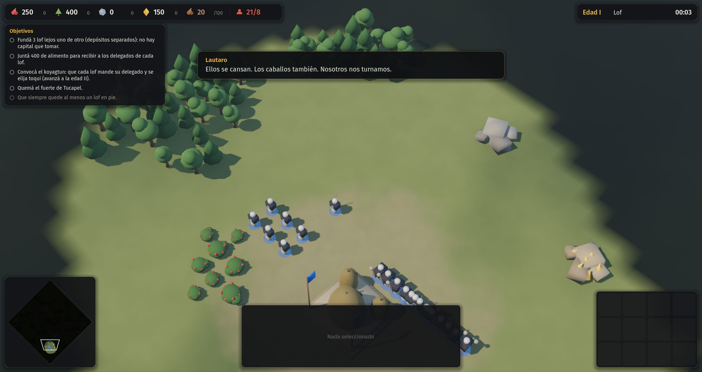 | 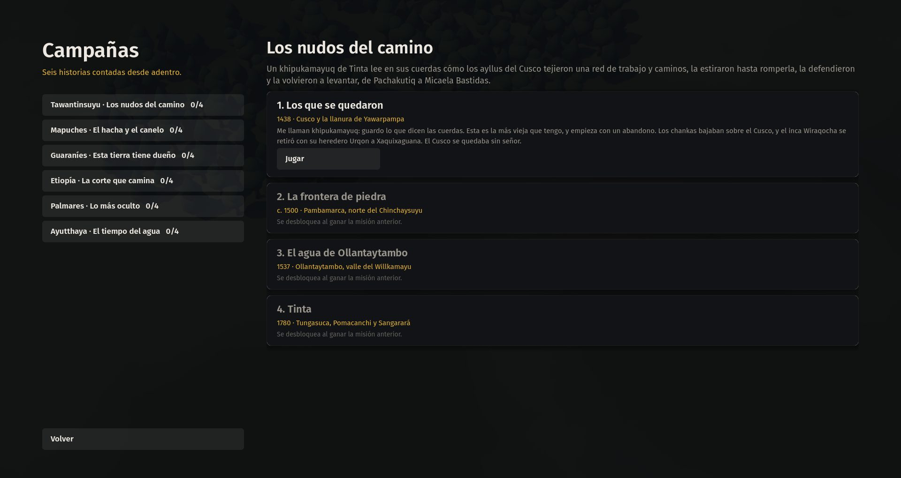 | 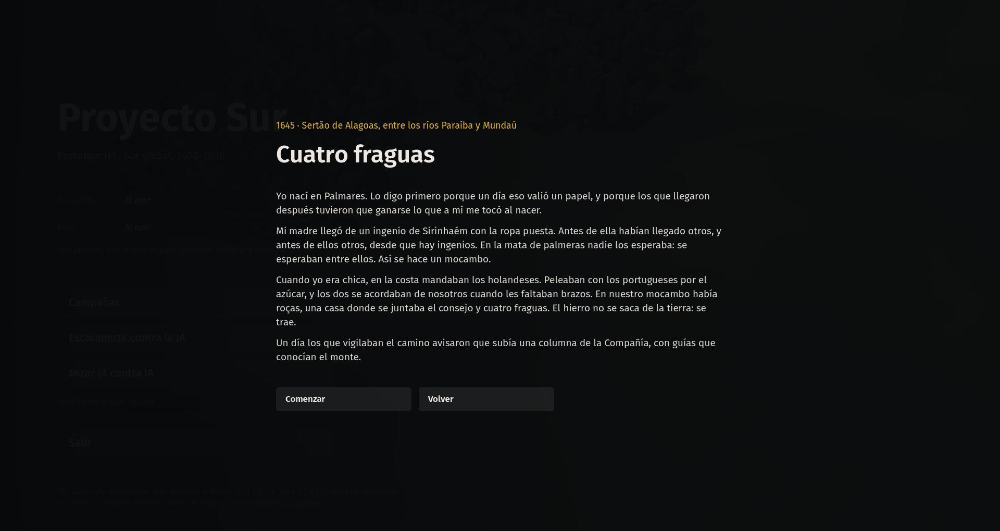 |
