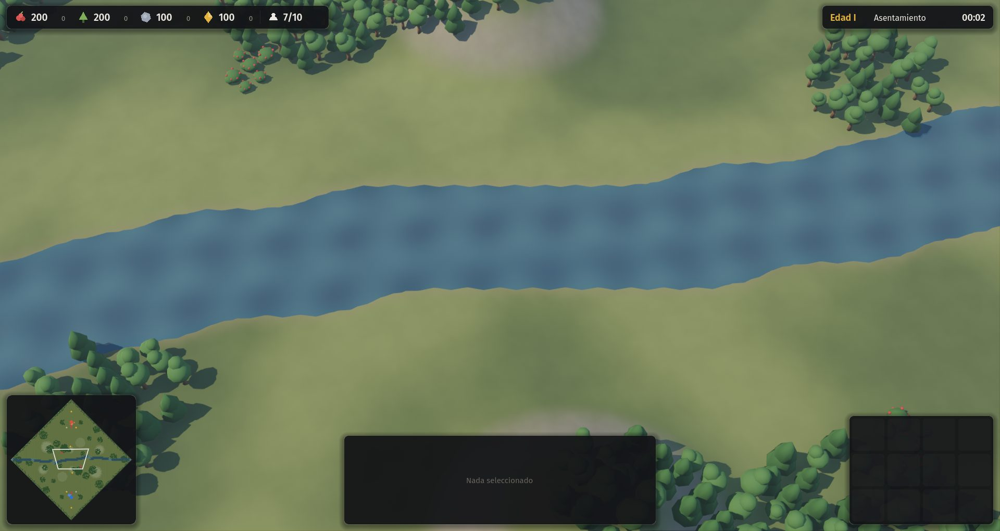
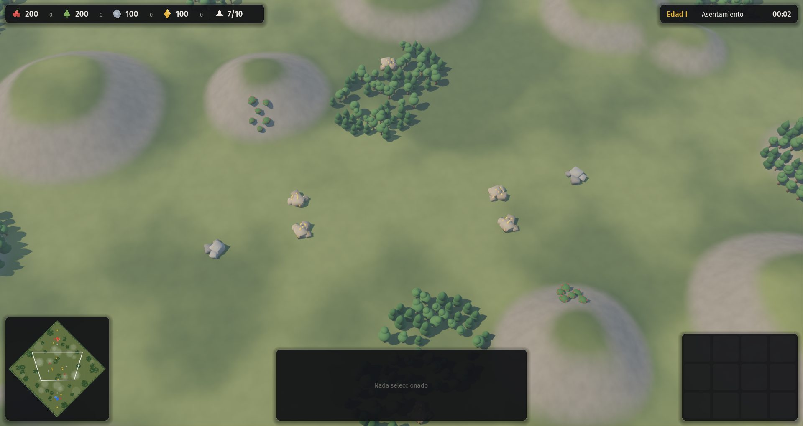

# 03 · Decisiones delegadas y relieve (2026-11-13, 00:30 a 00:38)

Commits: `7ae3700`, `bd6019e`.

## Pedido del autor
"Utilizá todos estos documentos y creá lo mejor que se te ocurra (...) completá el juego, con campaña para cada civilización (...) sumale 2 civilizaciones más (...) que cada una sea completamente diferente."

## Paso a paso
1. **Decisiones.** El autor delegó el diseño, así que las propuestas técnicas P-001 a P-006 pasaron a cerradas (D-012 a D-017). También se cerraron las preguntas abiertas que tenían una recomendación fundada en la investigación, y se sumaron D-025 a D-028. Las preguntas que dependen del gusto del autor van a `CONSULTAS.md`.
2. **Civilizaciones nuevas.**
   - **Quilombo dos Palmares** (Brasil): su forma de crecer y resistir no se parece a ninguna otra.
   - **Ayutthaya** (Siam): tiene elefantes, arroz de inundación y puerto. Se la eligió antes que a los maratas porque estos se superponían con Etiopía (fuertes de montaña) y con los mapuches (incursiones).
3. **Cuatro agentes en paralelo**: investigación de Palmares, investigación de Ayutthaya, campañas de las cuatro civilizaciones originales y audio CC0.
4. **Relieve y agua** (D-027), necesarios para los andenes, la altura etíope y los ríos.
   - En la simulación: altura entera por casilla, ríos con vados y cuatro tipos de mapa. Disparar desde más alto hace más daño y da más visión, y solo se construye en terreno parejo.
   - En la imagen: una malla de terreno con laderas de roca y agua animada.

## Tropiezos
- El plano exterior del mapa estaba a −0,05 y tapaba el cauce del río, que va a −0,9. Al principio el problema parecía estar en la malla del terreno.
- Por error se invirtió el orden de los vértices de la malla. Las normales quedaron hacia abajo y todo el suelo se pintó como roca. Se volvió al orden original.
- Las lomas apenas se veían. Se subió la altura por nivel y se suavizaron las laderas.

| Río con vados | Mesetas de montaña |
|---|---|
|  |  |
