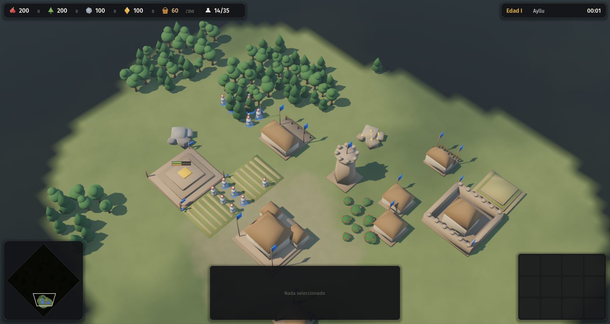
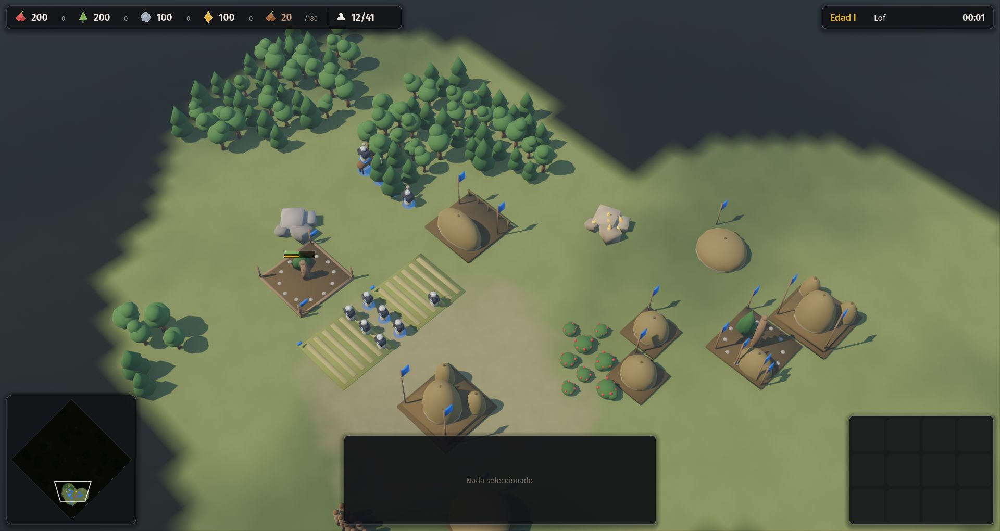
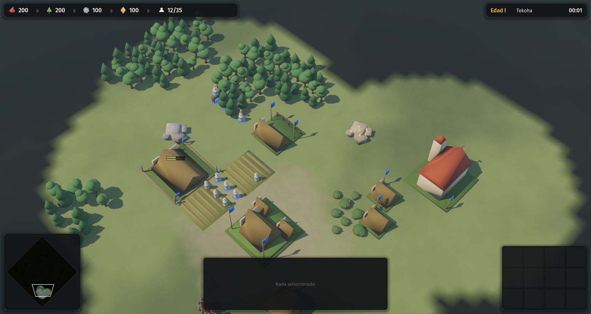
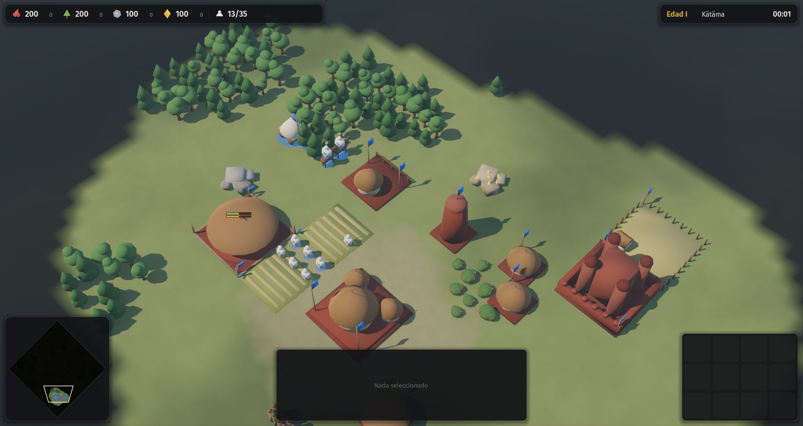
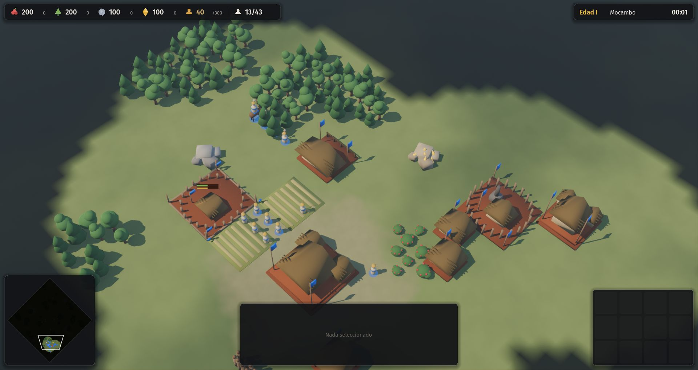
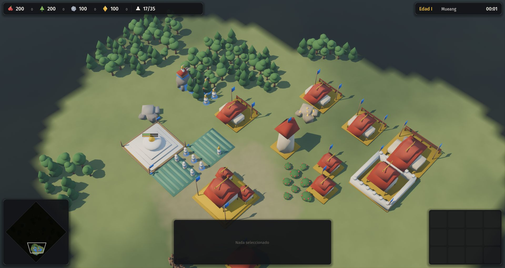

# 04 · Seis civilizaciones jugables (2026-11-13, 00:38 a 01:04)

Commit: `eed4743`.

## Paso a paso
1. **Sistema de civilizaciones.** Cada civilización es un JSON en `data/civs/` que reemplaza y agrega sobre la capa común. `SimData._merge` arma una tabla completa por civilización y la simulación la consulta con `dp(pid)`. No hay código propio por civilización: así se cumple el test del módulo de `01`.
2. **Módulos con parámetros** (`src/sim/sim_mods.gd`): recurso propio (mit'a, kulliñ, fama), caminos, saqueo, liberación, acogida, sigilo con emboscada, relevo, obra colectiva (potirõ) y defensa en altura. Varias mecánicas son propiedades de datos sin módulo: la renta del gult, la corte etíope que se desarma, la roza que deja un yerbal, los andenes, los arrozales, el daño en área del elefante, las boleadoras, el cañón de tacuara con munición limitada y la cerca con estrepes.
3. **IA para cualquier civilización.** Encuentra su capital aunque no se llame "centro", usa los hitos de su civilización, entrena desde cualquier edificio militar y construye los edificios propios.
4. **Arquitectura por civilización** (`src/game/civ_meshes.gd`), reconocible por silueta:

| Civilización | Arquitectura y monumento |
|---|---|
| Inca | Piedra con techo de paja a cuatro aguas; ushnu escalonado |
| Mapuche | Ruka ovalada; rewe con canelo |
| Guaraní | Casa larga con techo hasta el suelo; iglesia de misión |
| Etiopía | Tukul redondo; iglesia circular y castillo |
| Palmares | Chozas de palma con cercas en anillo |
| Ayutthaya | Techos rojos escalonados; chedi blanco |

Se sumaron modelos de caballo, elefante y corte en marcha.
5. **Menú** con elección de pueblo y de rival.

## Tropiezos
- **Palmares no crecía**: la fama llegaba demasiado lento. Al corregirlo, creció sin freno. El ajuste de los números no alcanzó: el buscador de lugar de la IA ignoraba el relieve y le rechazaban los hitos en los mapas de montaña.
- **Tawantinsuyu no avanzaba de edad**: gastaba la mit'a en levas antes de juntar lo de la obra estatal.

| Tawantinsuyu | Mapuches |
|---|---|
|  |  |
| **Guaraníes** | **Etiopía** |
|  |  |
| **Palmares** | **Ayutthaya** |
|  |  |
