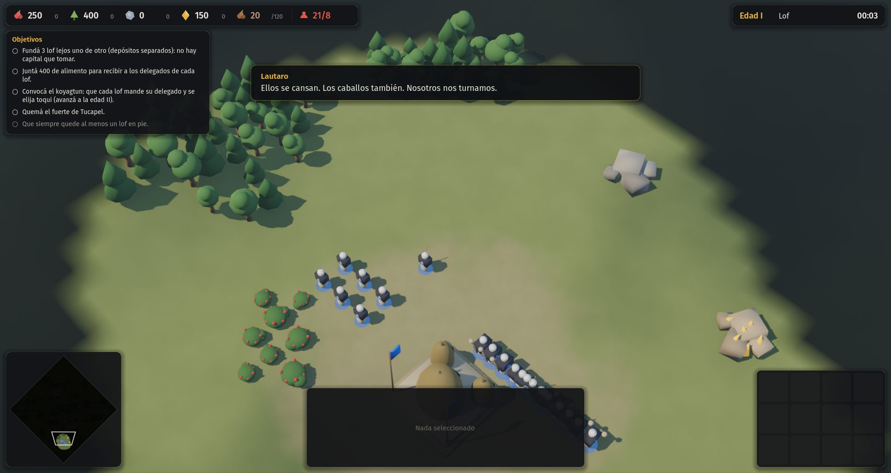
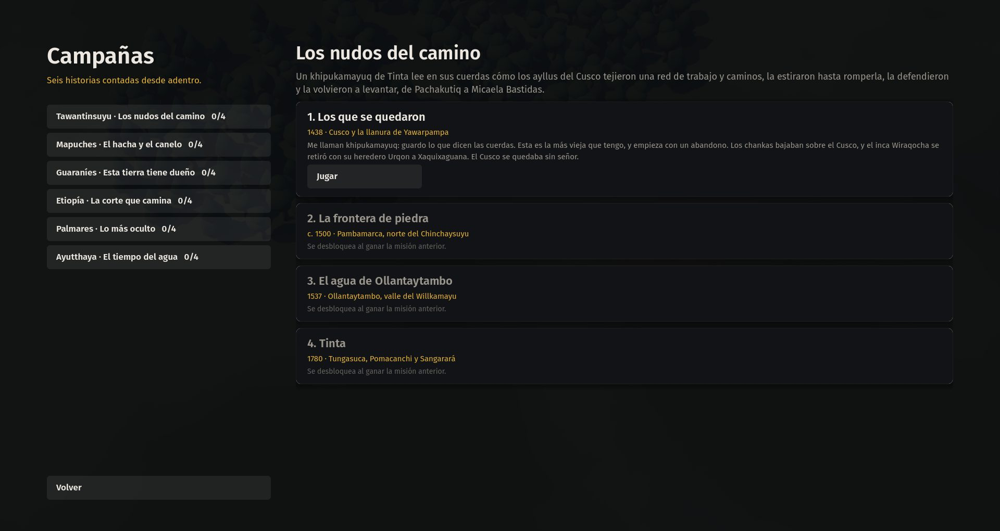
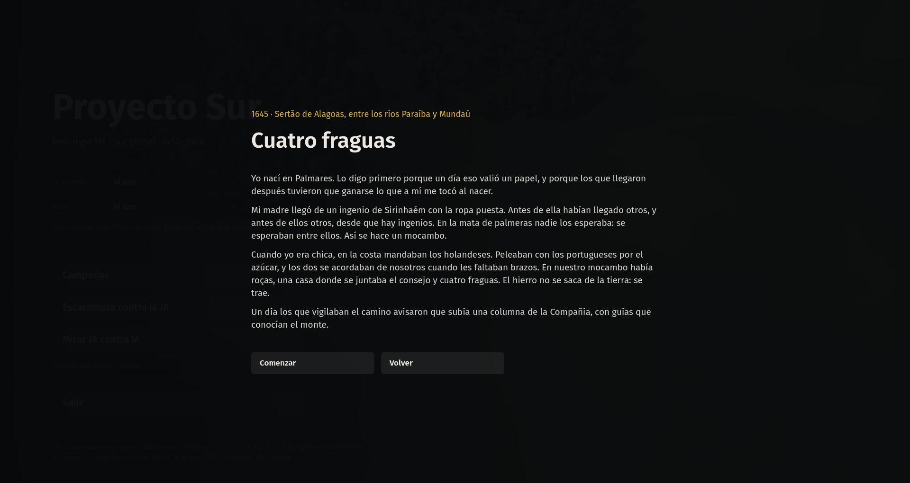

# 05 · Campañas jugables (2026-11-13, 01:04 a 01:11)

Commit: `ea39e94`.

## Paso a paso
1. **Seis campañas de cuatro misiones** (`data/campanas/`), escritas por agentes con un esquema de datos que el motor ejecuta tal cual. Cada una tiene un narrador propio:
   - un khipukamayuq para Tawantinsuyu,
   - una tejedora de Purén para los mapuches,
   - un escribano del cabildo para los guaraníes,
   - un escriba de Gondar para Etiopía,
   - una anciana nacida en Palmares,
   - un escribano del almacén real de Ayutthaya.
2. **Motor de escenarios** (`src/sim/sim_scenario.gd`), dentro de la simulación, así que es determinista.
   - Arma bases para hasta cuatro jugadores.
   - Evalúa nueve tipos de objetivo.
   - Dispara diálogos, refuerzos, ataques desde el borde, recursos, revelado del mapa y objetivos nuevos.
3. **Facción `invasores`**, solo para la IA (D-018): huestes, terços y bandeiras.
4. **Equivalencias**: las misiones nombran edificios genéricos y cada civilización declara a cuáles equivalen; por ejemplo, el lof mapuche cuenta como depósito.
5. **Interfaz**: menú de campañas con progreso guardado, introducción a página completa, panel de objetivos, caja de diálogo y epílogo con fuentes.
6. **Revisión cruzada**: dos objetivos pedían empalizadas a civilizaciones que no las tienen y se adaptaron.

| Misión en juego | Menú de campañas | Introducción |
|---|---|---|
|  |  |  |
