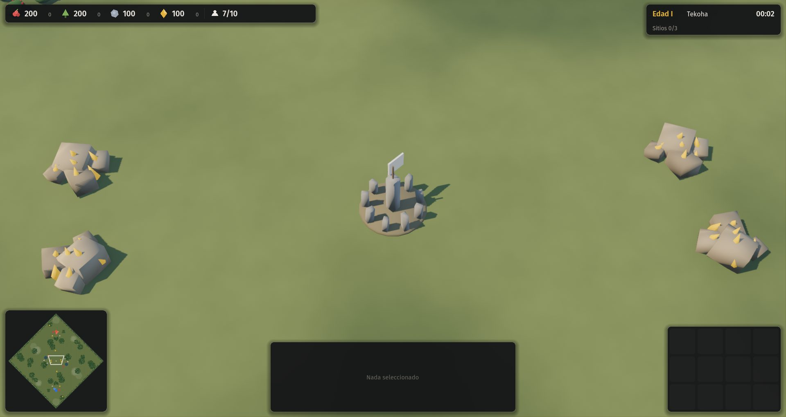
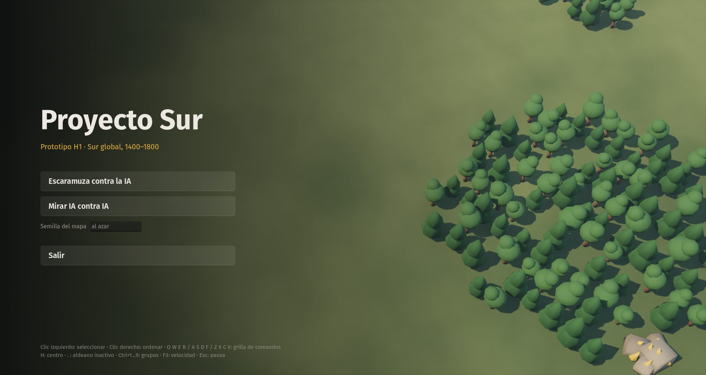
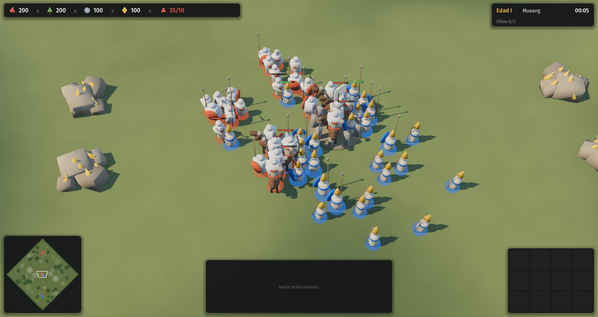

# 06 · Capa común completa (2026-11-13, 01:11 a 03:00)

Commits: `61c173e` (sonido), `beed851` (mercado), `5148411` (sitios sagrados y dificultades), `ac6e9a5` (opciones y ayuda), `6aa61b1` (repeticiones), `4b1811e` (animación), `0e44a8e` (rendimiento).

## Paso a paso
1. **Sonido** con los 54 archivos CC0 del agente: interfaz, sonidos del mundo que bajan con la distancia a la cámara, trabajo de los aldeanos, ambiente y música de paz o de combate.
2. **Mercado** (edad II): compra y venta por riqueza, con precios que se mueven. La IA lo usa.
3. **Sitios sagrados**: tres sitios neutrales que se capturan con presencia exclusiva y rinden riqueza. Quien sostiene todos durante cinco minutos gana. La IA los disputa.
4. **Tres dificultades de IA** definidas en los datos, sin trampas.
5. **Opciones** (volumen, pantalla completa, cámara por bordes) y **ayuda en partida (F1)** con el resumen de la civilización propia.
6. **Repeticiones**: se graban solo los comandos humanos. Una prueba confirma que la partida reproducida llega al mismo estado final.
7. **Animación**: galope, peso del elefante y tensión antes del disparo.
8. **Rendimiento**: unos 140 cuadros por segundo a velocidad ×6 con 170 entidades.

## Tropiezos
- El botón "Refugiarse" ocupaba la ranura 7 de la grilla del aldeano y tapaba el edificio propio de varias civilizaciones.
- La tecla H y la campana buscaban un edificio llamado "centro". El lof mapuche no se llama así, y ahora se busca la capital.
- El autotest daba por sentado que había seis aldeanos, pero en Palmares la gente llega sola. Ahora se corrió con las seis civilizaciones.

## Video y capturas
Video: [`01-batalla-ayutthaya-vs-etiopia.mp4`](01-batalla-ayutthaya-vs-etiopia.mp4).

| Sitio sagrado | Menú de inicio | Batalla |
|---|---|---|
|  |  |  |
