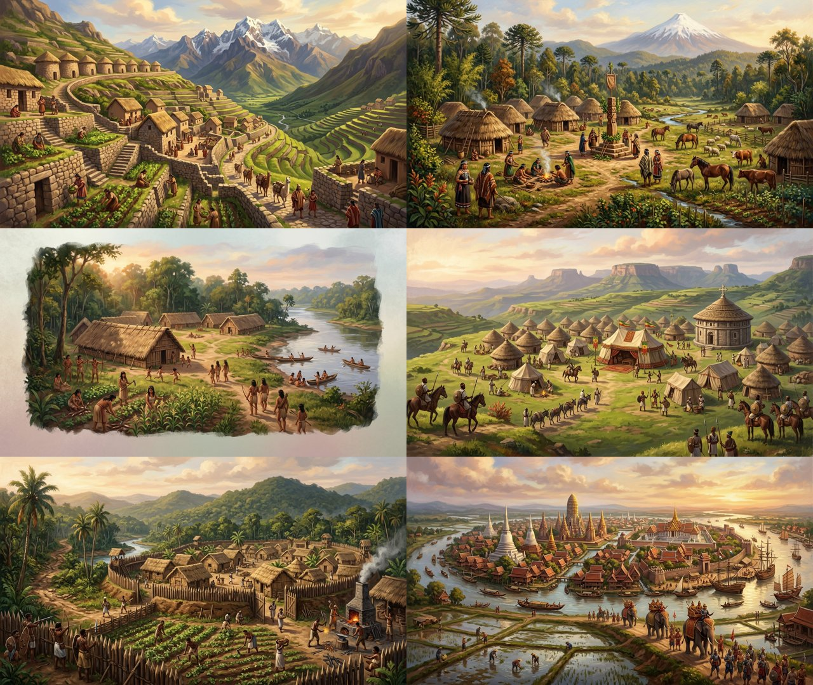
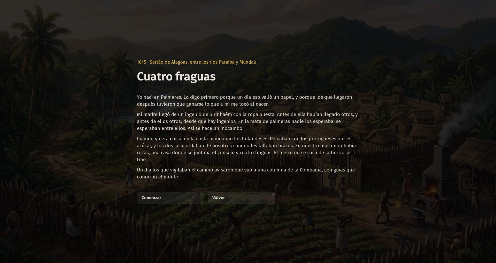
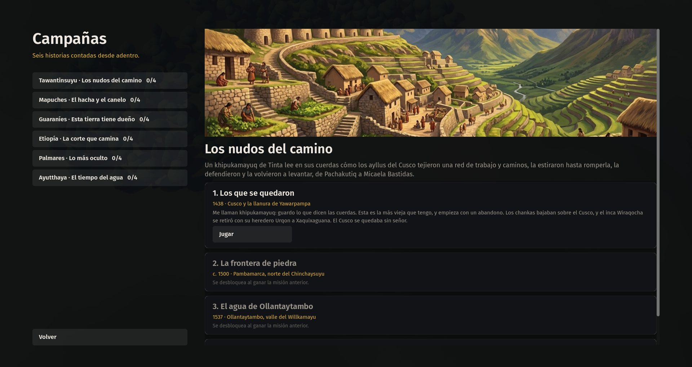
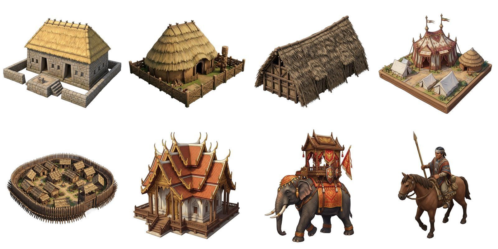
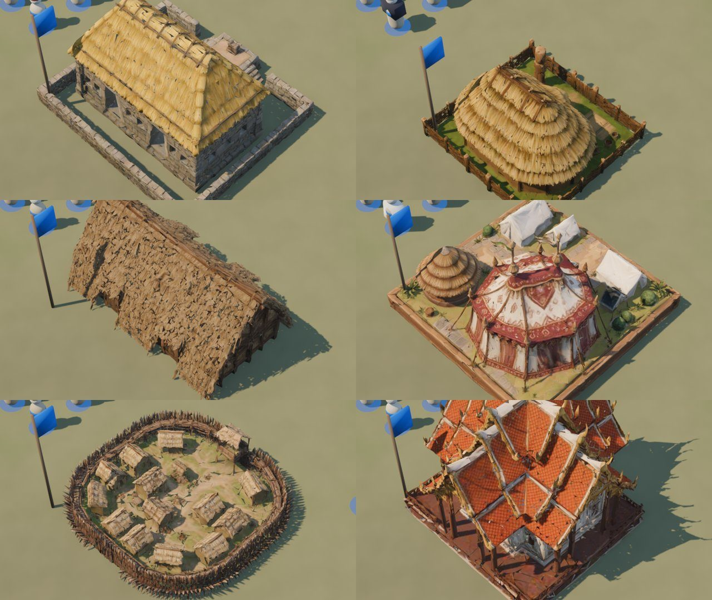
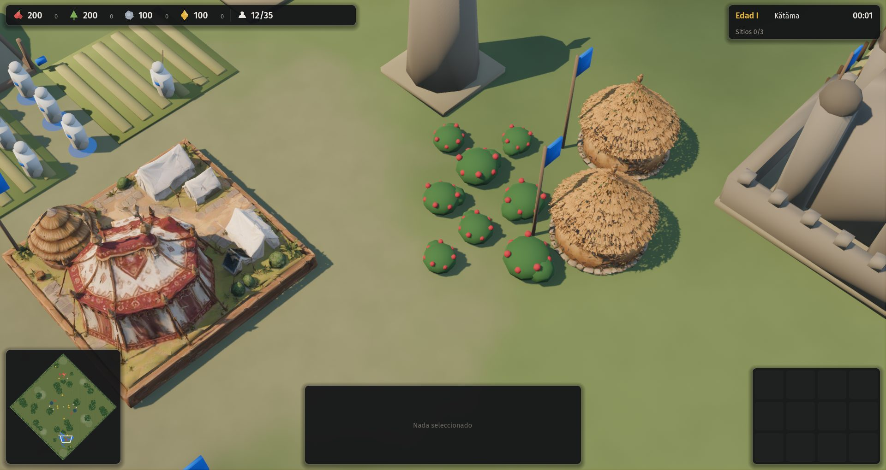

# 08 · Arte generado con IA (2026-11-13, 08:50 a 09:51)

Commits: `3e60416`, `3a53ef7`, `30e94a4`, `b762edb`.

## Pedido del autor
"Podés generar imágenes con IA con Meshy, tenemos la opción, y la API key la usamos en ../open-apex."

## Paso a paso
1. **Cliente de Meshy** (`tools/meshy_api.py`), copiado de apex-open. La clave se lee de allá y nunca entra a este repositorio. Cada tarea, con su prompt y sus créditos, queda en `assets/generados/registro.jsonl`.
2. **Seis láminas de civilización** (`tools/generar_laminas.py`), con una dirección de arte común: ilustración pintada, luz cálida y la gente como protagonista. Se usan en el menú de campañas, en la introducción y el epílogo de las misiones y en la elección de pueblo.
3. **Modelos 3D** (`tools/generar_modelos.py`). El flujo es texto → concepto aislado → modelo 3D. Se hicieron las seis capitales, el elefante, el kona y cinco casas.
4. **Optimización** (`tools/optimizar_glb.py`, con Blender). Los originales pesaban entre 27 y 312 MB; los versionados quedaron en 29 MB entre todos. En el juego se ven con material mate, de doble cara, escalados a su huella y con el estandarte del equipo.

## Tropiezos
- **La primera lámina guaraní** salió con borde de papel y se rehízo (6 créditos).
- **A 9.000 triángulos** los modelos se rompieron, con agujeros y astillas. Con 30.000 para edificios, 15.000 para unidades y doble cara se ven enteros.
- **La casa guaraní** tenía 7,7 millones de polígonos en piezas sueltas de paja y no bajaba de 179.000. Quedó procedural.
- **Créditos**: se usaron unos 590 de 1.442. El saldo es compartido con apex-open (consulta C-05).

| Láminas | Introducción | Campañas |
|---|---|---|
|  |  |  |
| **Conceptos** | **Capitales en el juego** | **Corte etíope y tukuls** |
|  |  |  |
