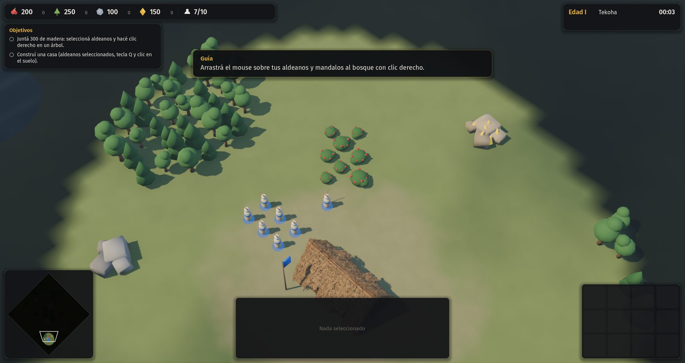

# 09 · Tutorial y prueba de campañas (2026-11-13, 09:30 a 10:00)

Commits: `5bc5c3d`, `b762edb`.

## Paso a paso
1. **Tutorial "Primeros pasos"**: la primera entrada del menú de campañas. Los objetivos aparecen de a uno y una guía habla en diálogos: recolectar, casa, aldeanos, cuartel, defenderse de una incursión y avanzar de edad.
2. **Prueba de campañas con IA en el lugar del jugador** (`tests/campaign_smoke.gd --ia-jugador`). El resultado está en `campanas-con-ia.txt`.
   - La IA ganó Palmares 1 y 3.
   - En el resto pierde lo que debe proteger o no persigue los objetivos, porque no los conoce.
   - Sirve para encontrar errores y misiones trabadas, no como prueba de que se pueden ganar.
3. **Error encontrado y corregido**: la acogida de Palmares no informaba el tipo de unidad, y el motor de escenarios fallaba en cada tick.

