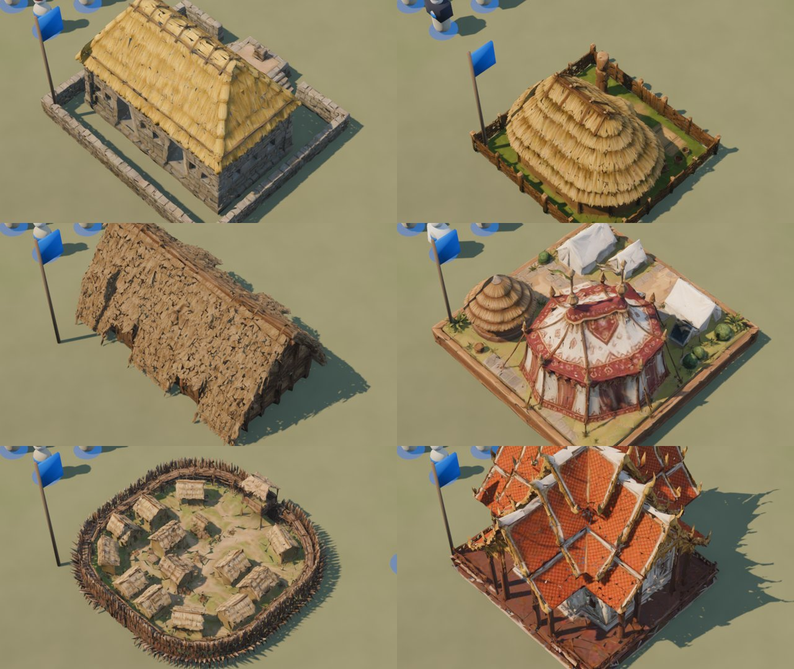

# 10 · Terreno y mapas (desde 2026-11-13)

Plan: [`docs/10-terreno-y-mapas.md`](../../docs/10-terreno-y-mapas.md).

## Pedido del autor
"Mejorar muchísimo el terreno y los tipos de mapa; que los mapas se parezcan a sitios reales (…), en la campaña algo más realista (…), que en lugar de ser un bloque que sobresale del piso se note como continuación, como en el Age."

Respuestas a las consultas el mismo día:
- Nombre: **Raíces**.
- Civilizaciones: aprobadas.
- Música: conseguir lo que se pueda.
- Meshy: gastar lo necesario, de forma eficiente.
- Prioridad: arrancar con el terreno (C-06).

## Punto de partida
Los edificios generados se apoyan sobre un pasto uniforme y parecen bloques sueltos.

## Paso a paso
1. **Respuestas de las consultas** registradas y aplicadas: el juego pasa a llamarse Raíces (D-029) y se usa Meshy según haga falta (D-030). Se lanzó un agente para buscar música libre por región.
