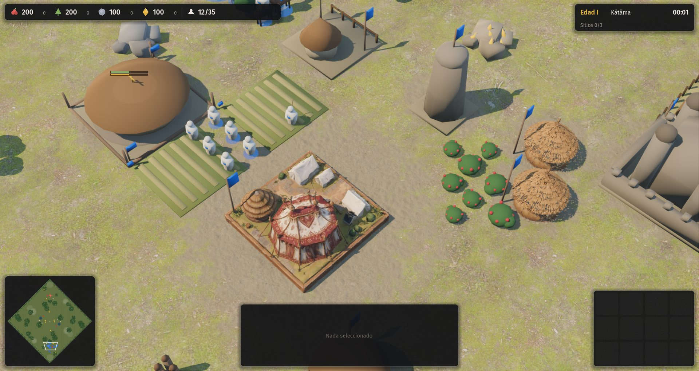
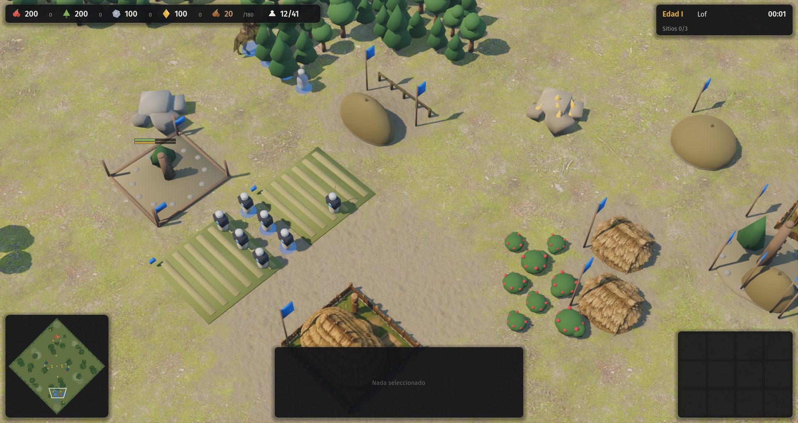
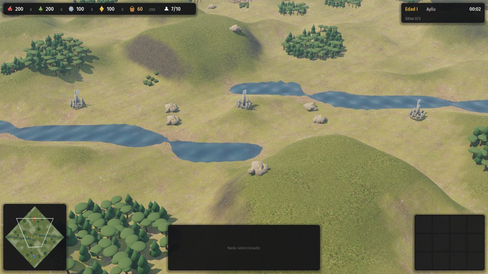
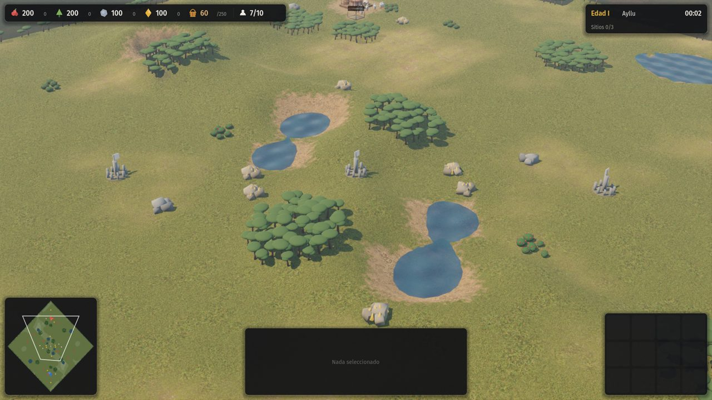
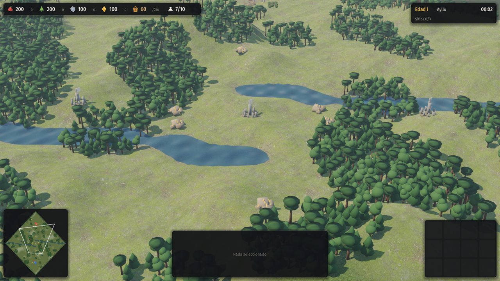
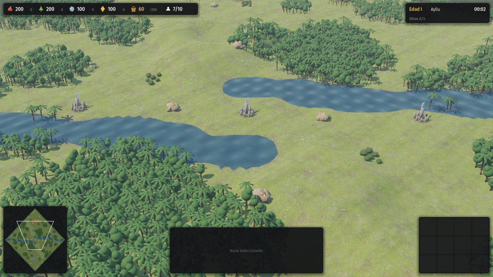
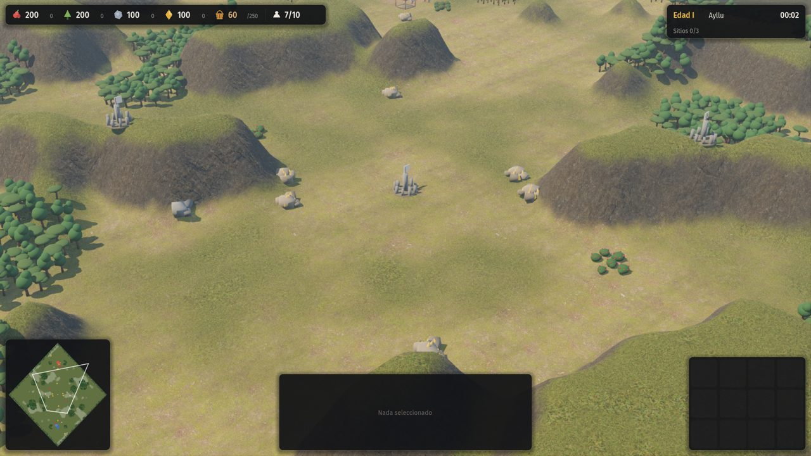
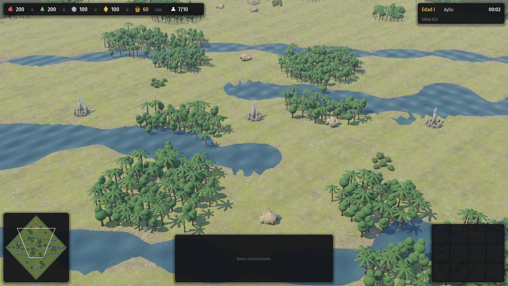
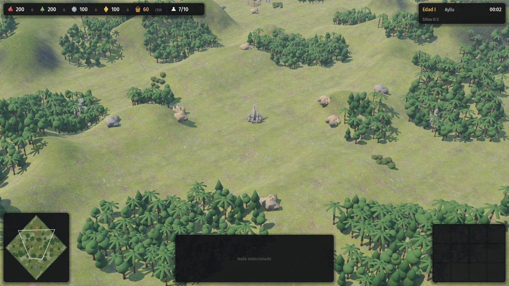
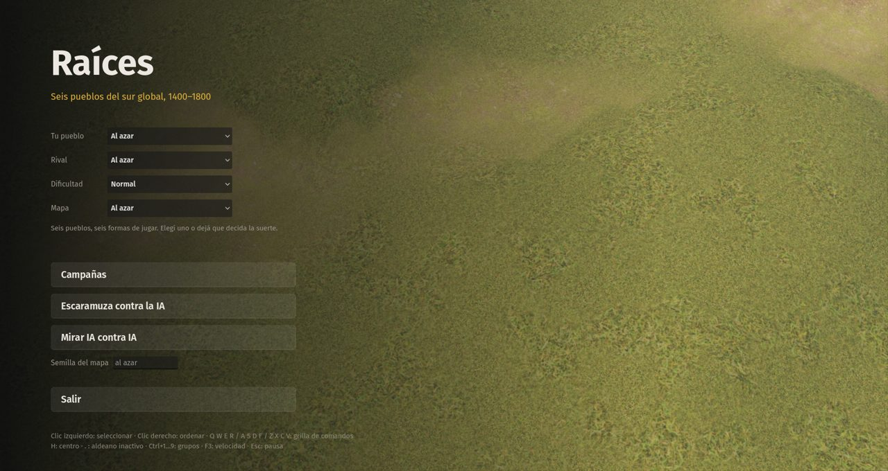

# 10 · Terreno y mapas (desde 2026-11-13)

Plan: [`docs/10-terreno-y-mapas.md`](../../docs/10-terreno-y-mapas.md).

## Pedido del autor
"Mejorar muchísimo el terreno y los tipos de mapa; que los mapas se parezcan a sitios reales (…), en la campaña algo más realista (…), que en lugar de ser un bloque que sobresale del piso se note como continuación, como en el Age."

Respuestas a las consultas el mismo día:
- Nombre: **Raíces**.
- Civilizaciones: aprobadas.
- Música: conseguir lo que se pueda.
- Meshy: gastar lo necesario, de forma eficiente.
- Prioridad: arrancar con el terreno (C-06).

## Punto de partida
Los edificios generados se apoyan sobre un pasto uniforme y parecen bloques sueltos.

## Paso a paso
1. **Respuestas de las consultas** registradas y aplicadas: el juego pasa a llamarse Raíces (D-029) y se usa Meshy según haga falta (D-030). Se lanzó un agente para buscar música libre por región.
2. **Materiales del suelo.** Cinco juegos de texturas CC0 de ambientCG (pasto, pasto seco, tierra, barro y roca), reducidos a 512 px (1,1 MB). El shader nuevo hace cuatro cosas:
   - Mezcla el pasto a dos escalas para que no se note la repetición.
   - Pone pasto seco según el bioma y la altura.
   - Pone barro en las orillas.
   - Aplica roca triplanar en las laderas.

   Lo que es tierra pisada se pinta en un mapa de mezcla de 2 píxeles por casilla.
3. **Edificios integrados al suelo.** Cada edificio pinta tierra pisada a su alrededor al aparecer, lleva una sombra de contacto y los modelos generados se hunden unos centímetros. Se sacaron las bases grises de los edificios procedurales, que se veían como baldosas. Pendiente: regenerar sin base de diorama los modelos de Meshy que la traen, como la corte etíope.

| Antes | Suelo con texturas | Sin plintos |
|---|---|---|
|  |  |  |
4. **Tipos de mapa definidos en datos.** `reglas.json` → `terrenos` pasa de una lista de nombres a una tabla con los parámetros de cada tipo: relieve, río, brazos, lagunas, bosques, matorral, borde boscoso, suavizado, tinte, sequedad y especies de árbol. A los cuatro tipos clásicos se suman siete inspirados en geografías reales, sin nombre propio en la escaramuza:

   | Tipo | Inspirado en | Qué lo distingue |
   |---|---|---|
   | Valle de altura | Valle Sagrado, Urubamba | Cordillera en las dos esquinas sin base; el río baja de las cumbres y abre una quebrada |
   | Altiplano | Collao, Titicaca | Pampa alta y seca, lagunas salobres con orilla de barro, árboles de copa plana (queñua) |
   | Bosque templado | Araucanía | Lomas húmedas, araucarias, un estero y lagunas |
   | Selva y río | Paraguay, Paraná | Monte cerrado de palmeras; río ancho con pasos frecuentes |
   | Mesetas | Ambas etíopes | Umbrales de altura juntos: cimas planas con paredes a pique |
   | Delta | Chao Phraya | Tres brazos de río con vados frecuentes e islas bajas |
   | Sierra | Serra da Barriga | Serranía quebrada con monte espeso |

   El relieve nuevo usa ruido de valor **entero** en dos octavas, sin flotantes en la simulación, así que el determinismo se mantiene. Se corta en niveles por umbrales y respeta la simetría puntual. Las bases quedan llanas, con una rampa suave alrededor. El río baja el terreno a su paso y deja un cauce llano con barranca escalonada.
5. **Relieve continuo en la imagen.** Sobre los niveles de la simulación se suma una ondulación suave (±0,22 m) que solo se ve, salvo junto al agua; el llano deja de parecer una mesa. Las unidades usan la misma altura que se dibuja. Cada tipo de mapa elige cuánto se suaviza: las mesetas conservan las paredes y el altiplano se redondea.
6. **Árboles por bioma.** Hay tres especies nuevas, araucaria, palmera y árbol de copa plana, que se suman al pino y al árbol de hoja ancha. Cada tipo de mapa elige las suyas.
7. **Menú y campañas.** La escaramuza tiene un selector de mapa, con la descripción del tipo como ayuda. Las 24 misiones usan ahora el tipo que corresponde al lugar:
   - Ollantaytambo: valle de altura.
   - Tinta: altiplano.
   - Amba Wehni y Gondar: mesetas.
   - La boca del río, los veintisiete fuertes y la otra orilla de Ayutthaya: delta.
   - Palmares: sierra.
   - Lambaré y la defensa guaraní: selva y río.
   - Curalaba: bosque templado.
8. **Pruebas.**
   - Nueva `tests/mapas_smoke.gd`: IA contra IA, 20 minutos en cada uno de los 11 tipos. Nadie se traba: todos pasan a la edad II o más y levantan su aldea.
   - Determinismo: OK.
   - Humo de campañas: 25 de 25 misiones arrancan.
   - Autotest en selva: OK.

| Valle de altura | Altiplano |
|---|---|
|  |  |
| **Bosque templado** | **Selva y río** |
|  |  |
| **Mesetas** | **Delta** |
|  |  |
| **Sierra** | **Menú con selector de mapa** |
|  |  |

Pendiente en esta etapa:
- Relieve real (DEM) para las misiones con nombre.
- Modelos de Meshy sin base.
- Objetos sueltos en el suelo.
- Música por civilización: el agente ya la trajo y falta integrarla.
