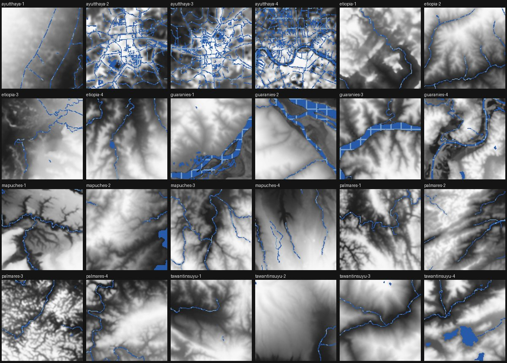
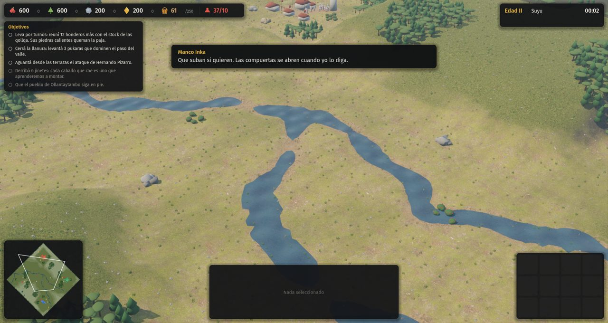
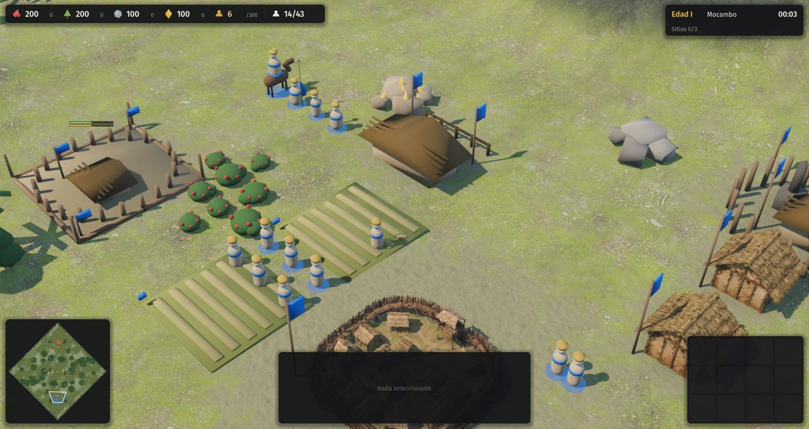
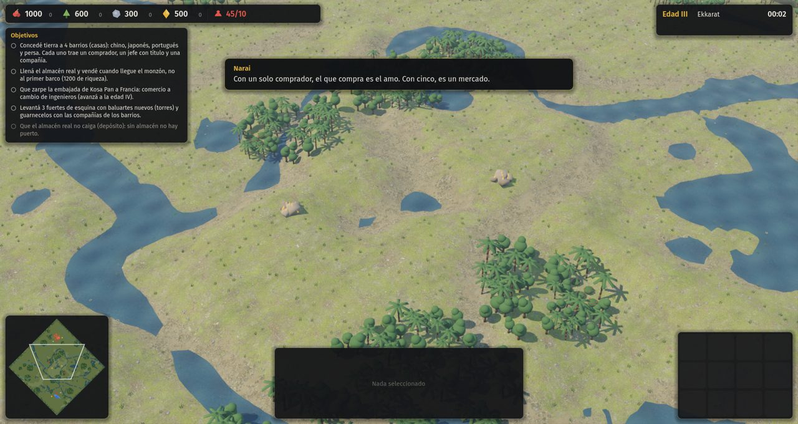
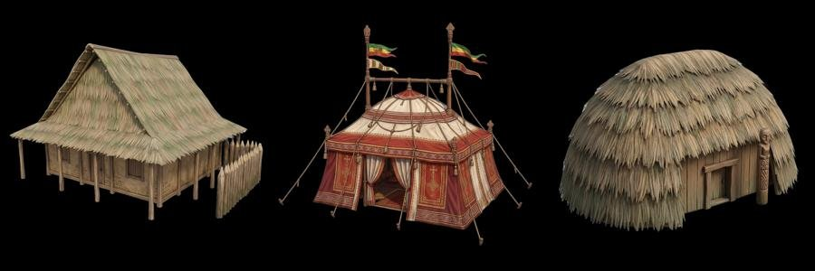
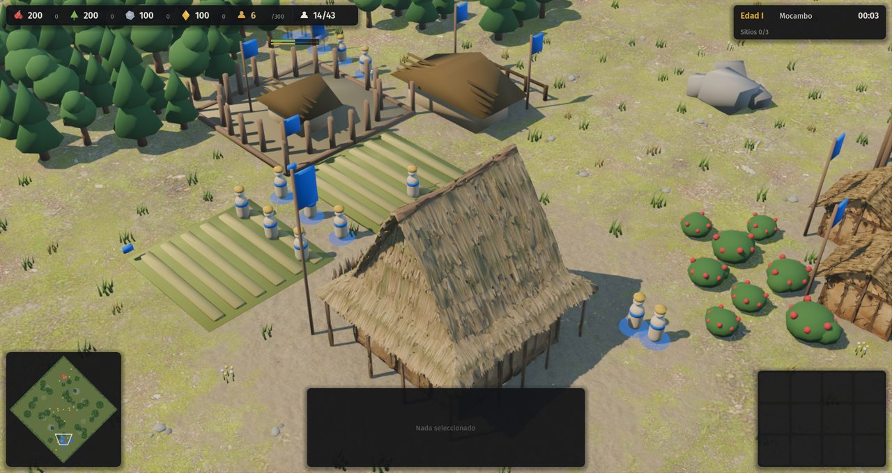
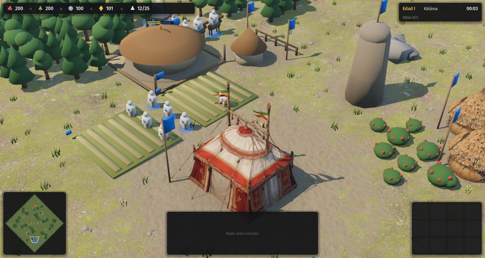
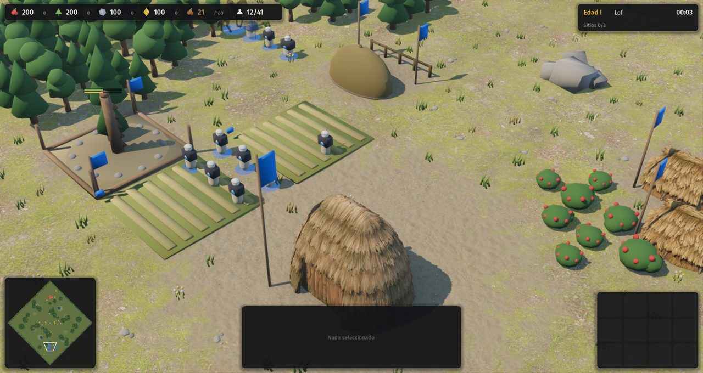

# 10 · Terreno y mapas (desde 2026-11-13)

Plan: [`docs/10-terreno-y-mapas.md`](../../docs/10-terreno-y-mapas.md).

## Pedido del autor
"Mejorar muchísimo el terreno y los tipos de mapa; que los mapas se parezcan a sitios reales (…), en la campaña algo más realista (…), que en lugar de ser un bloque que sobresale del piso se note como continuación, como en el Age."

Respuestas a las consultas el mismo día:
- Nombre: **Raíces**.
- Civilizaciones: aprobadas.
- Música: conseguir lo que se pueda.
- Meshy: gastar lo necesario, de forma eficiente.
- Prioridad: arrancar con el terreno (C-06).

## Punto de partida
Los edificios generados se apoyan sobre un pasto uniforme y parecen bloques sueltos.

## Paso a paso
1. **Respuestas de las consultas** registradas y aplicadas: el juego pasa a llamarse Raíces (D-029) y se usa Meshy según haga falta (D-030). Se lanzó un agente para buscar música libre por región.
2. **Materiales del suelo.** Cinco juegos de texturas CC0 de ambientCG (pasto, pasto seco, tierra, barro y roca), reducidos a 512 px (1,1 MB). El shader nuevo hace cuatro cosas:
   - Mezcla el pasto a dos escalas para que no se note la repetición.
   - Pone pasto seco según el bioma y la altura.
   - Pone barro en las orillas.
   - Aplica roca triplanar en las laderas.

   Lo que es tierra pisada se pinta en un mapa de mezcla de 2 píxeles por casilla.
3. **Edificios integrados al suelo.** Cada edificio pinta tierra pisada a su alrededor al aparecer, lleva una sombra de contacto y los modelos generados se hunden unos centímetros. Se sacaron las bases grises de los edificios procedurales, que se veían como baldosas. Pendiente: regenerar sin base de diorama los modelos de Meshy que la traen, como la corte etíope.

| Antes | Suelo con texturas | Sin plintos |
|---|---|---|
|  |  |  |
4. **Tipos de mapa definidos en datos.** `reglas.json` → `terrenos` pasa de una lista de nombres a una tabla con los parámetros de cada tipo: relieve, río, brazos, lagunas, bosques, matorral, borde boscoso, suavizado, tinte, sequedad y especies de árbol. A los cuatro tipos clásicos se suman siete inspirados en geografías reales, sin nombre propio en la escaramuza:

   | Tipo | Inspirado en | Qué lo distingue |
   |---|---|---|
   | Valle de altura | Valle Sagrado, Urubamba | Cordillera en las dos esquinas sin base; el río baja de las cumbres y abre una quebrada |
   | Altiplano | Collao, Titicaca | Pampa alta y seca, lagunas salobres con orilla de barro, árboles de copa plana (queñua) |
   | Bosque templado | Araucanía | Lomas húmedas, araucarias, un estero y lagunas |
   | Selva y río | Paraguay, Paraná | Monte cerrado de palmeras; río ancho con pasos frecuentes |
   | Mesetas | Ambas etíopes | Umbrales de altura juntos: cimas planas con paredes a pique |
   | Delta | Chao Phraya | Tres brazos de río con vados frecuentes e islas bajas |
   | Sierra | Serra da Barriga | Serranía quebrada con monte espeso |

   El relieve nuevo usa ruido de valor **entero** en dos octavas, sin flotantes en la simulación, así que el determinismo se mantiene. Se corta en niveles por umbrales y respeta la simetría puntual. Las bases quedan llanas, con una rampa suave alrededor. El río baja el terreno a su paso y deja un cauce llano con barranca escalonada.
5. **Relieve continuo en la imagen.** Sobre los niveles de la simulación se suma una ondulación suave (±0,22 m) que solo se ve, salvo junto al agua; el llano deja de parecer una mesa. Las unidades usan la misma altura que se dibuja. Cada tipo de mapa elige cuánto se suaviza: las mesetas conservan las paredes y el altiplano se redondea.
6. **Árboles por bioma.** Hay tres especies nuevas, araucaria, palmera y árbol de copa plana, que se suman al pino y al árbol de hoja ancha. Cada tipo de mapa elige las suyas.
7. **Menú y campañas.** La escaramuza tiene un selector de mapa, con la descripción del tipo como ayuda. Las 24 misiones usan ahora el tipo que corresponde al lugar:
   - Ollantaytambo: valle de altura.
   - Tinta: altiplano.
   - Amba Wehni y Gondar: mesetas.
   - La boca del río, los veintisiete fuertes y la otra orilla de Ayutthaya: delta.
   - Palmares: sierra.
   - Lambaré y la defensa guaraní: selva y río.
   - Curalaba: bosque templado.
8. **Pruebas.**
   - Nueva `tests/mapas_smoke.gd`: IA contra IA, 20 minutos en cada uno de los 11 tipos. Nadie se traba: todos pasan a la edad II o más y levantan su aldea.
   - Determinismo: OK.
   - Humo de campañas: 25 de 25 misiones arrancan.
   - Autotest en selva: OK.

| Valle de altura | Altiplano |
|---|---|
|  |  |
| **Bosque templado** | **Selva y río** |
|  |  |
| **Mesetas** | **Delta** |
|  |  |
| **Sierra** | **Menú con selector de mapa** |
|  |  |

9. **Música por pueblo.** Un agente juntó 12 pistas CC0 o de dominio público, con créditos en `assets/CREDITOS.md` y detalle en `assets/audio/musica/README.md`:
   - Tawantinsuyu: flauta de pan y charango.
   - Mapuches: pifilka en combate.
   - Palmares: berimbau, ijexá y tambores.
   - Ayutthaya: xilófono y la banda de 1934.
   - Guaraníes: una pista genérica de selva.
   - Etiopía: nada todavía.

   `audio.gd` hace sonar la música del pueblo el doble que la general y no repite la misma pista dos veces seguidas. Nadie la escuchó aún, así que se espera la opinión del autor.
10. **Observaciones del autor** al mirar la prueba de Palmares en la sierra:
    - Los edificios chicos se ven diminutos al lado de aldeanos gigantes, y el centro generado se ve grande.
    - Los aldeanos se mueven extremadamente rápido. Esa prueba corre a ×4, pero igual se mide a ×1.

    Quedan registradas en `docs/10` (sección 4 y paso 5 del orden) y en `docs/09-estado.md`. Se ajustan cuando se regeneren los modelos: una tabla de alturas de referencia en `data/` y cada modelo escalado por altura, no solo por huella.

11. **Relieve real para las 24 misiones** (`tools/relieve_real.py`, `data/relieve/`).
    - **Elevación**: Copernicus GLO-30, 30 m, de cada lugar, recortado de 8 a 16 km de lado según la misión.
    - **Suelo desnudo**: Copernicus es un modelo de superficie, con techos y árboles. Por eso de cada casilla se toma el percentil 25 de sus 16 muestras, y en las llanuras se suaviza más.
    - **Forma y cantidad**: cada casilla guarda su percentil, de 00 a 99. El tipo de mapa de la misión decide cuánto terreno alto hay; la forma sale del lugar real.
    - **Agua**: ríos, canales y lagos de OpenStreetMap (ODbL), por la API de Overpass con reintentos. Si OSM no tiene nada, se usa la acumulación de flujo sobre el relieve.
    - **Vados**: en franjas cada 16 casillas. Si las bases no quedan conectadas, se achican las franjas y, como último recurso, se ponen también sobre los ríos anchísimos (el Paraguay, el Uruguay).
    - **Orientación**: se prueban las 8 del recorte y gana la que deja las bases en terreno parejo y seco.
    - **Simulación**: lee las filas de texto sin flotantes y sin simetría, y mantiene la rampa llana alrededor de cada base. La atribución está en `assets/CREDITOS.md`.
    - **Tropiezos**:
      - Muchos arroyos de una casilla partían el mapa en franjas: se subió el umbral de cuenca.
      - La ciudad de Ayutthaya salía como "relieve" por los techos: se pasó al percentil 25 y a suavizar más.
      - El servidor público de Overpass devolvía 502: se agregaron reintentos y tres espejos.
      - Los vados de ríos angostos quedaban por encima del agua y cortaban el río en charcos: se bajaron en la imagen.
      - Ayutthaya salía como un laberinto por los cientos de canales de riego de OSM. Ahora solo quedan los canales de más de 25 casillas, como agua baja que se vadea.
    - **Prueba**: humo de campañas con la IA jugando por el jugador, 8 minutos por misión. Las 25 misiones corren y en todas se cumplen objetivos.
12. **Huella aplanada.** La malla del terreno ahora va en trozos de 16×16 casillas, con normales calculadas del campo de alturas, así no hay costuras. Al levantarse un edificio:
    - El suelo se aplana bajo su huella y se funde en dos casillas alrededor; las orillas no se tocan.
    - Solo se reconstruyen los trozos afectados.
    - Las unidades y el detalle del suelo siguen la nueva altura.
13. **Detalle del suelo.** Matas verdes y secas, piedritas en las laderas y flores donde no es seco, según el bioma. Son instanciadas, se dibujan hasta 70 m y desaparecen bajo los edificios. El primer tamaño quedó tan grande como un aldeano y se bajó.

| Relieve real de las 24 misiones (gris = percentil de altura, azul = agua, celeste = vado) |
|---|
|  |

| Ollantaytambo con su relieve | Referencia para la escala (paso 10) |
|---|---|
|  |  |

| La isla de Ayutthaya entre sus tres ríos |
|---|
|  |

14. **Escala, velocidad y modelos sin base** (la observación del paso 10).
    - **Medición**: el aldeano medía 0,92 casillas, las casas entre 1,1 y 2,0, y el centro de Palmares 1,0, porque era un diorama de una aldea entera dentro de una empalizada.
    - **Tabla de escala** en `reglas.json` → `escala_visual`:
      - Las unidades se dibujan al 82 %.
      - Cada edificio llega al menos a la altura mínima de su categoría: casa 2,2; producción 2,7; capital 3,6; hito 3,8; torre 4,2. Para eso se estira en vertical hasta un 170 %.
      - Una casa mide así unas tres veces un aldeano.
    - **Velocidad**: `velocidad_pct` = 90 para todas las unidades. Además, el paso de la animación sigue a la distancia recorrida y no al reloj, así que la zancada coincide a ×1 y a ×4, y nadie patina. El autotest corre a ×4, y eso explicaba buena parte de la velocidad que se vio.
    - **Meshy sin base**: el estilo decía "miniature diorama look" y eso traía losas de terreno. Se cambió por "un solo edificio a escala real, sin base ni plataforma ni suelo" y se regeneraron tres modelos por 108 créditos:
      - Palmares: la casa de consejo del quilombo, en lugar de la aldea en miniatura.
      - Etiopía: la tienda imperial sola, sin la losa con carpas.
      - Mapuches: la ruka grande con su rewe, sin el cerco sobre una placa.

      Los viejos quedan en `.cache/meshy/viejos`.
    - **Pruebas**: determinismo OK; humo de civilizaciones sin errores; autotest OK. El torneo de balance con la velocidad nueva está en curso.

| Conceptos nuevos, sin base | Palmares |
|---|---|
|  |  |
| **Etiopía** | **Mapuches** |
|  |  |

Antes y después de la escala, en Palmares: [paso 10](11-escala-aldeanos-vs-casas-palmares.jpg) → [ahora](16-escala-nueva-palmares.jpg).
