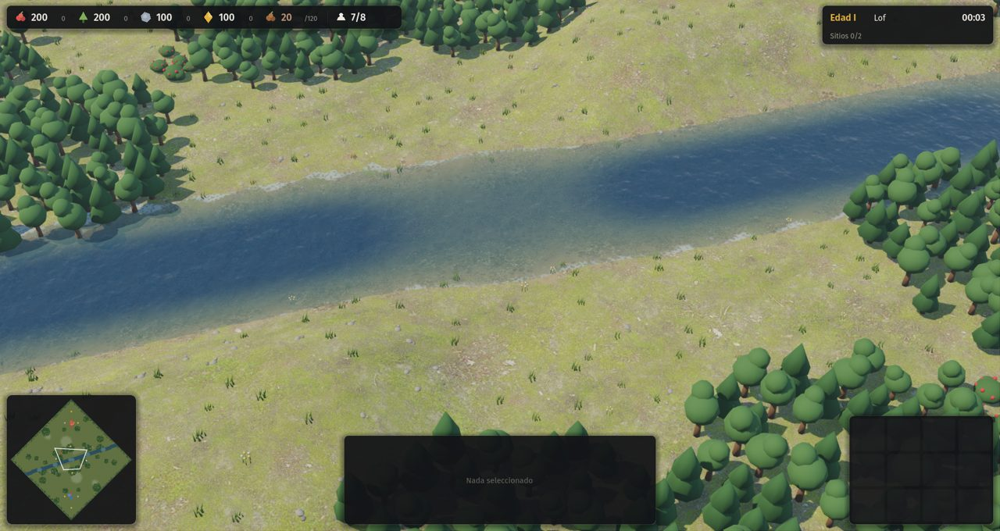
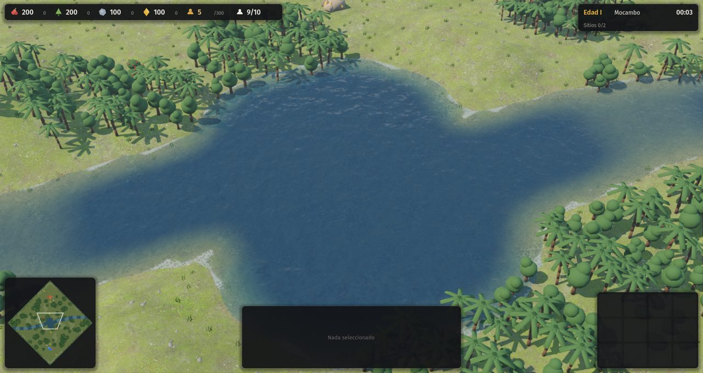
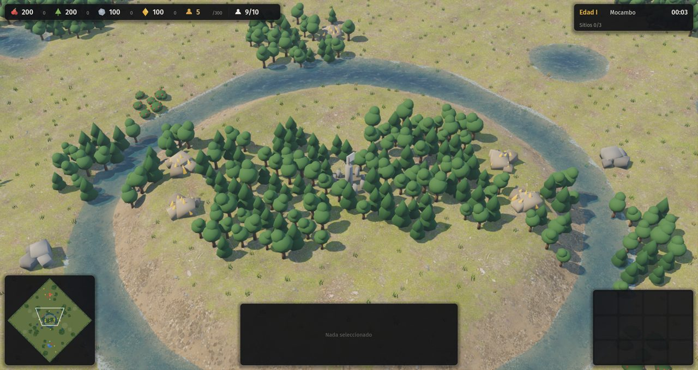
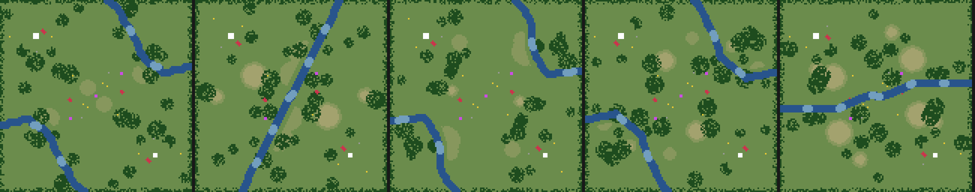
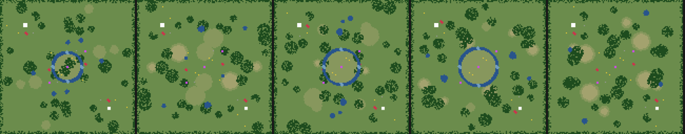
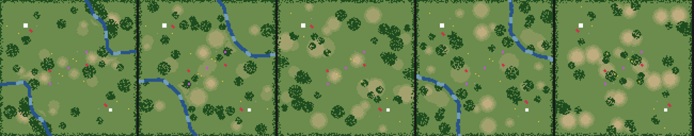
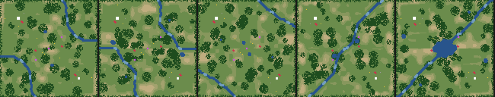
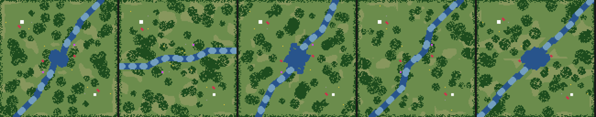
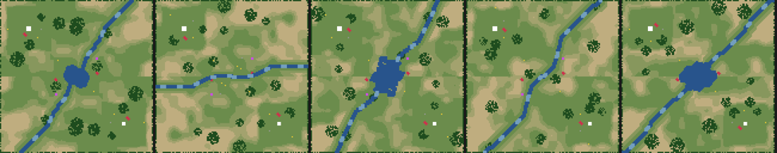

# 12 · Formas de mapa y agua (2026-11-13)

## Pedido del autor
> "El agua está más o menos, ¿podemos hacer algo mejor? Los ríos todos atraviesan parecido el mapa, ¿no? Deberíamos tener mapas más randómicamente creados. Los de la campaña deben ser súper específicos, y los demás tener diferentes modos y generarse random, pero con ciertas formas específicas, como en AoE4."

## Punto de partida
- En todos los mapas con agua, el río cruzaba por la misma antidiagonal con un vaivén de ±6 casillas.
- Las lagunas eran círculos.
- El agua era un plano azul con una onda senoidal.

## Paso a paso
1. **Formas de agua por tipo de mapa** (`reglas.json` → `terrenos.*.rio.formas`). En cada semilla se elige una forma al azar entre las del tipo, como los mapas de AoE4: la misma idea con otra forma.

   | Forma | Qué hace |
   |---|---|
   | `cruce` | Un río pasa por el centro con un ángulo al azar entre cinco (diagonal, dos oblicuos, horizontal y vertical) y con meandros con inercia |
   | `lago` | Un lago central de borde irregular, de 9 a 13 casillas de radio, con el río que lo atraviesa |
   | `costados` | Dos ríos espejados que encierran las esquinas sin base y dejan recursos detrás |
   | `anillo` | Un foso alrededor de una loma central, con cuatro vados ("rey de la colina") |
   | `brazos` | Delta con un brazo central y dos paralelos |
   | `ninguno` | Sin agua |

   Qué formas puede tocar cada tipo de mapa:

   | Tipos de mapa | Formas posibles |
   |---|---|
   | Llano | Sin agua o anillo |
   | Montaña | Sin agua o costados |
   | Río, bosque y bosque templado | Cruce, lago o costados |
   | Valle y selva | Cruce o lago |
   | Delta | Brazos |

2. **Simetría y equidad.** Cada casilla de agua se pinta junto con su espejo, y los vados nunca se vuelven agua profunda. Si el agua deja aislada una base, se agregan vados en franjas simétricas hasta que haya paso. Las lagunas tienen el borde irregular (ruido de valor) y los ríos rebajan el terreno a su alrededor.
3. **Agua nueva** (`water.gdshader`):
   - **Profundidad real**, tomada de la malla del terreno: clara y transparente en la orilla, oscura en el centro. Los ríos tienen un borde turbio.
   - **Corriente:** sigue el trazo de cada río, que la simulación guarda solo para la imagen. Usa dos fases cruzadas para que la textura no se estire. Los lagos solo tienen ondas de viento.
   - **Espuma** irregular en la orilla, que se mueve con la corriente.
   - **Brillos del sol:** rugosidad baja.

   La primera espuma quedó como una línea blanca pareja que parecía hielo; se hizo más tenue y despareja.
4. **Herramienta `tools/vista_mapas.gd`:** dibuja desde arriba los mapas de varias semillas (relieve, agua, vados, árboles, bases y recursos) para revisar variedad y equidad sin abrir el juego.
5. **Las campañas** siguen con su relieve real (etapa 10): esta variedad es solo para la escaramuza.

## Pruebas
- Determinismo: OK.
- `tests/mapas_smoke.gd`: IA contra IA en los 11 tipos con las formas nuevas; nadie se traba.
- Autotest: OK.
- Humo de campañas: 25 de 25.

## Capturas
| Río con corriente y orilla | Lago central (selva) | Foso en anillo (llano) |
|---|---|---|
|  |  |  |

Cinco semillas por tipo de mapa, vistas desde arriba ([formas sorteadas](formas-por-semilla.txt)):

| Río | Llano |
|---|---|
|  |  |
| **Montaña** | **Bosque templado** |
|  |  |
| **Selva** | **Valle** |
|  |  |
