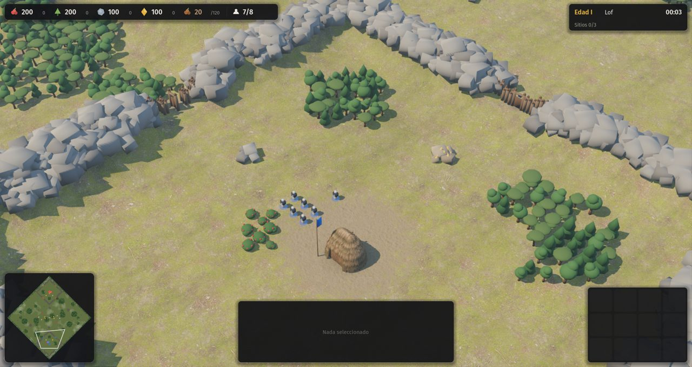
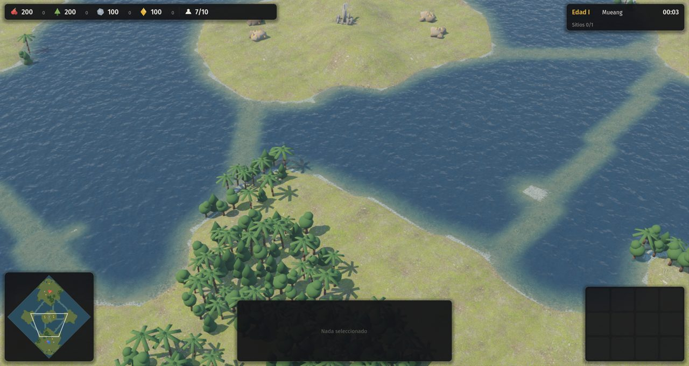
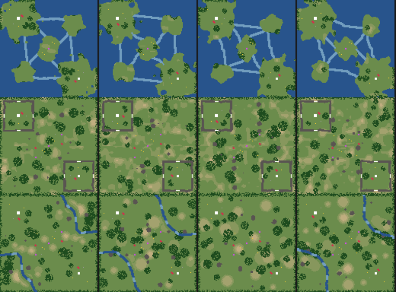
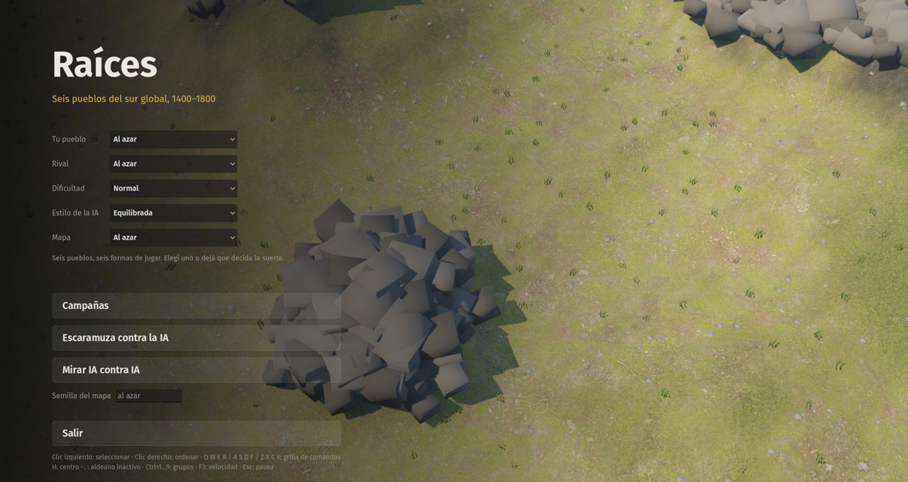

# 13 · Mapas Islas y Fortines, peñascos y estilos de la IA (2026-11-13)

## Pedido del autor
> "Quiero dos mapas más: uno de islas, y algo como Hill and Dale de AoE4. El fortín tiene que ser como Hill and Dale: lo que rodea tu base es un espacio casi cuadrado bordeado por algo natural, como una zanja o piedra que no se pasa. También tienen que estar en el mapa esas rocas que tiene AoE. Se puede empezar con las murallas y la puerta de cada civ en los lugares por donde se pasa, cubriendo casi todo con la barrera natural y dejando 4 lugares para entrar o salir."

> "Para la IA quiero algo que Age no tiene. Solo tiene dificultad; quiero también agresividad o estilo de juego. Poder elegir que la IA juegue muy bien pero no ataque (que igual cubra el mapa, pero no ataque tu base principal), o que no ataque y juegue mal, o que ataque y juegue mal, o que ataque y juegue muy bien."

## Paso a paso
1. **Peñascos: roca que no se pasa** (`SimMap.rock`, `set_rock`). Es sólida para todos, no se edifica y no es agua. En pantalla se ve como un escalón alto con roca triplanar y bloques de piedra oscura. El minimapa la muestra en gris.
2. **Fortines** (`terrenos.fortines`):
   - Cada base queda en un recinto casi cuadrado de peñas, de radio 18 y grosor 3, con el borde irregular salvo junto a las salidas.
   - Tiene **4 salidas de 5 casillas**, una por lado.
   - Las salidas arrancan cerradas con la **empalizada y la puerta de cada civ** (las de Palmares tienen espinas). Todo es simétrico.
3. **Peñascos sueltos** en montaña (6), sierra (5), mesetas (5), valle (4), altiplano (3), llano (2) y fortines (6). Son manchones de 1 a 3 casillas, lejos de las bases y del centro.
4. **Islas** (`terrenos.islas`, forma de agua `islas`):
   - Cada base tiene su isla grande, y hay una isla al centro y dos a los costados.
   - Las islas se unen por **bajíos que se vadean**: el juego no tiene barcos (D-020).
   - En pantalla, los vados se ven como agua baja y clara.
5. **Estilos de la IA** (`reglas.json` → `estilos_ia`), independientes de la dificultad. Hay un selector nuevo en el menú y `--estilo=` en la línea de comandos, y quedan grabados en la repetición.

   | Estilo | Qué hace |
   |---|---|
   | Pacífica | Nunca ataca tu base. Quien entra en el radio de la base rival vuelve. Igual controla el mapa: ocupa el centro y los sitios sagrados, y pelea afuera |
   | Equilibrada | Oleadas cuando junta ejército (lo de antes) |
   | Acosadora | Incursiones cada 45 s sobre tus aldeanos y recursos. Entra, golpea y sale; nunca va con todo |
   | Agresiva | Ataca temprano y seguido |

   Combinado con la dificultad, salen las cuatro combinaciones que pidió el autor, por ejemplo "Difícil + Pacífica".
6. **Tropiezos:**
   - **Pantalla gris.** Un error de tipos en el código nuevo de la IA impedía cargar el juego, y el autor vio una pantalla gris en el menú. Se arregló y se agregó la verificación de que el menú cargue antes de dejarlo abierto.
   - **Errores viejos de la IA.** El test de estilos encontró errores anteriores a esta etapa: las incursiones (malón, correrías), el control del mapa, los caminos incas y la toma de sitios sagrados dependían de un tick exacto que no coincidía con los momentos en que la IA piensa. Las incursiones nunca se disparaban, y **el jugador 2 nunca hacía caminos ni iba a los sitios sagrados** con dificultad Normal o Fácil. Esto sesgó los torneos anteriores. Ahora todo se mide por tiempo transcurrido.
   - **Acosadora se veía igual que Pacífica:** la correa que saca al ejército de la base rival también cortaba la incursión. Ahora solo vuelve quien ya terminó.
7. **Menú:** el texto de controles se pisaba con "Salir"; ahora va dentro de la columna.

## Pruebas
- Determinismo: OK.
- Autotest: OK.
- [`tests/estilos_ia.gd`](../../tests/estilos_ia.gd), nuevo: cada estilo contra una IA que no ataca, 20 minutos, 2 semillas. [Resultado](pruebas/estilos-ia.txt), en tiempo del ejército dentro de la base rival:

  | Estilo | Semilla 3 | Semilla 11 |
  |---|---|---|
  | Pacífica | 0 | 0 |
  | Acosadora | 40 | 87 |
  | Equilibrada | 13 | 152 |
  | Agresiva | 3 | 329 |

  [Antes del arreglo de incursiones](pruebas/estilos-ia-antes-del-arreglo-de-incursiones.txt), Acosadora daba 0 como Pacífica.
- `tests/mapas_smoke.gd` con 13 tipos de mapa ([resultado](pruebas/mapas-smoke.txt)): Islas y Fortines sin trabas. El aviso de valle es una paliza de Palmares a los mapuches, no una IA trabada.
- **Observación:** con el estilo Pacífica la IA igual puede ganar por sitios sagrados, porque controla el mapa. Queda como consulta (C-21).

## Capturas
| Fortines | Islas |
|---|---|
|  |  |

Vistas desde arriba de Islas, Fortines y Montaña (con peñascos):

Menú con el estilo de la IA:

