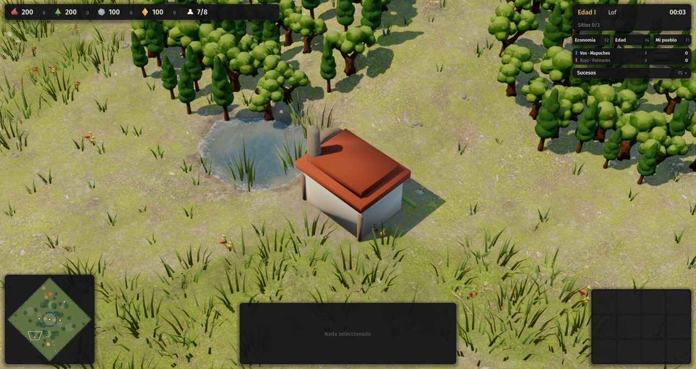

# 14 · Implementación de la economía nueva (desde 2026-11-13)

Diseño: [`docs/diseno/revision-economia/v3/04-diseno-final.md`](../../docs/diseno/revision-economia/v3/04-diseno-final.md). Plan en 7 etapas (§9.1), cada una con su compuerta numérica.

## Pedido del autor
> "Dale, después de la economía, diseñalo pensando en 6 o más incluso, y pensando en equipos, pero continuá con todo. Agregá esto al plan y continuemos."

- Plan de muchos jugadores y equipos en [`docs/11-partidas-de-muchos-jugadores.md`](../../docs/11-partidas-de-muchos-jugadores.md). Va después de la economía, y la economía se implementa pensando en N jugadores.
- **Decisiones pendientes (C-14 a C-20).** Mientras el autor no conteste, se aplica la opción recomendada de cada una. Todas quedan en datos (`reglas.json`, `data/civs/`), así que se pueden revertir sin tocar código.

## Paso a paso
1. **Etapa 0, medición.** Herramientas para medir antes de cambiar nada:
   - **Libro de ingresos por origen** en la simulación (`Sim.ledger`, solo estadística): casa, disputado, granja, sitios, saqueo, mercado, renta y motor propio.
   - **Conteo de órdenes por tipo y por jugador.**
   - **Modo "paz" de la IA** para las pruebas: no ataca ni hace incursiones.
   - **`tests/economia.gd`:** 12 partidas de 30 minutos, con riqueza a los 5, 10, 20 y 30 minutos, origen de la riqueza, momento de cada edad y órdenes por minuto.
   - [Línea de base en paz](pruebas/00-linea-de-base-paz.txt).
2. **Lo que encontró la línea de base:**
   - La IA repetía decenas de veces por minuto órdenes que el juego rechazaba: mapuches, 44 arietes por minuto sin tener asedio; Ayutthaya, 29 guerreros por minuto. Pedía unidades que ese edificio no produce. Se arregló.
   - El motor propio aporta 0 % de la riqueza (esperado con el diseño viejo).
   - Los sitios sagrados dan entre 10 y 16 %.
3. **Etapa 1, IA común:**
   - Hitos elegidos por eje: cada hito declara `"eje": "economia" | "militar"` en los datos. Antes elegía por el orden de la lista, y por eso los mapuches tomaban siempre el rewe militar.
   - Reserva del recurso propio (mit'a, fama, kulliñ) para el próximo hito.
   - Campana parcial: como máximo 3 aldeanos refugiados por enemigo, y se levanta a los 5 s de calma. Antes vaciaba toda la economía.
   - Amenazas: solo cuentan soldados y exploradores.
   - Caminos incas por búsqueda en anchura, que rodean lo ocupado. Si no hay paso, se reintenta a los 2 minutos.
   - `is_military()` por lista blanca.
   - Al cancelar se devuelve lo pagado.
   - El hash del estado incluye todos los recursos y el terreno.
4. **Compuerta de la etapa 1: no se cumple.** La edad II tiene que llegar entre 6:30 y 9:00; la medición dio:

   | | En paz | Con guerra |
   |---|---|---|
   | Edad II | 8:00 a 10:35 | 7:37 a 12:42 |
   | Peores | — | Etiopía 12:42, mapuches 10:55 |

   [Medición en paz](pruebas/01-etapa1-paz.txt) · [con guerra](pruebas/01-etapa1-guerra.txt). Queda por investigar por qué la IA avanza tarde. Es lo próximo, antes de seguir con los motores.
5. **Etapa 2, capa común** (implementada, sin medir todavía):
   - **Arcilla (barreal) con dueño:** base 2×900, flanco 1500 a 18 casillas y centro 1000 por jugador.
   - **Techo de lo disputado:** 15 / 40 / 80 / 120 r/min por edad, en una ventana de 5 baldes de un minuto. Con el techo lleno no se extrae arcilla ajena ni del centro, y los aldeanos no van a buscarla.
   - **Hito II:** 500 de alimento + 300 de riqueza.
   - **Mercado:** piso 40, paso 3; los precios vuelven solos hacia 100.
   - **Sitios sagrados:** renta decreciente de 18 / 12 / 8.
   - **Hitos sin renta de riqueza:** puerto real, junco, monasterio, misión, parlamento, Cucaú y aqllawasi. Macaco baja a 20 de fama; el ushnu y la guerra de Zumbi quedan sin renta.
   - **Piezas de motor:** máximo por edad (`maximo_por_edad`), separación mínima y piezas extra que dan los hitos (`maximo_extra`).
6. **Etapa 3a, Tawantinsuyu** (empezada, sin probar):
   - Taller de tejido: 120 de madera + 20 de mit'a. Consume 30 de mit'a por minuto y da 24 de riqueza; si falta mit'a, rinde 1/3. Máximo 2 / 3 / 4 / 5, y uno más con el aqllawasi.
   - Mit'a de 4 por runa en las edades I y II y de 3 desde la III.
   - Reserva de mit'a (comando `reserve`).
   - Tecnología común "Oficio maestro" (+25 % al motor, edad III, en el mercado).
   - Reglas de IA: taller si sobra mit'a, reserva de 60 al ahorrar para un hito y la tecnología del motor primero.
   - Falta: la capa 1 (arcilla unida por camino, +20 %) y el regalo de cumbi, que necesita los ingenios de la etapa 4.

## Decisiones aplicadas por defecto
El autor no contestó todavía C-14 a C-20, así que se aplicó la opción recomendada de cada una. Todas están en datos y se pueden revertir. La más visible es el hito II en 500 + 300 (C-15).

## Tropiezo de proceso
El autor preguntó en qué punto estaba la economía: se había avanzado varias horas sin documentar ni subir nada. Desde ahora, cada compuerta se documenta y se sube antes de seguir, con un resumen corto para el autor.

## Compuertas (actualización)
7. **Por qué la IA avanzaba tarde.** Una traza minuto a minuto mostró que el alimento era el cuello de botella: la IA lo gastaba en tropas y aldeanos y solo ahorraba cuando cada recurso cubría la mitad del hito (Etiopía tenía 300 de riqueza en el minuto 5 y el alimento entre 0 y 100). Ahora, en la edad I, ahorra apenas tiene 13 aldeanos y manda a la gente a lo que falta para el hito.
8. **Medición de la etapa 2** ([paz](pruebas/02-etapa2-paz.txt), [guerra](pruebas/02-etapa2-guerra.txt)), con la capa común y el taller inca:

   | | Antes (etapa 1) | Ahora |
   |---|---|---|
   | Edad II | 8:00–10:35 en paz, 7:37–12:42 con guerra | 5:40–7:25 en paz, 5:40–7:42 con guerra |
   | Edad III | 12:35–17:12 | 11:02–16:42 |

   - **El taller inca ya rinde:** el motor propio da 35 % de la riqueza inca en paz y 24 % con guerra.
   - **Fuera de la banda de la edad II (6:30–9:00):** guaraníes 5:40 y mapuches 6:05. El arreglo de la roza guaraní (tasa y costo) está en su etapa, la 3d.
   - **Para vigilar:** la IA saca entre 22 % y 43 % de su riqueza vendiendo en el mercado, más que lo que piensa el diseño ("caro pero seguro"). Se revisa con los motores puestos.
   - **Lo disputado da 0 %:** la IA no va a la arcilla del centro. Llega en la etapa 4, con los ingenios.
9. **Etapa 3a, Tawantinsuyu (compuerta cumplida).** Con un solo taller en la edad I aunque se esté ahorrando para el hito, como pide la regla 4 de la IA. Traza en paz, 25 minutos:

   | Medida | Resultado |
   |---|---|
   | Edad II | 7:15 |
   | Talleres en la edad III | 4 |
   | Motor entre los minutos 15 y 25 | ~54 % de la riqueza (banda 45–65 %) |
   | Mit'a | por debajo del tope todo el tiempo (318 / 350 en el minuto 10) |

   Falta, porque depende de los ingenios (etapa 4): la capa 1 (arcilla unida por camino, +20 %) y el regalo de cumbi.
10. **Etapa 3b, Palmares: oficios.**
    - **Puestos:** 3 por mocambo y 2 en la cerca real, de 15 de riqueza por minuto cada uno. El tope por edad es 4 / 7 / 8 / 8.
    - **Cómo se llenan:** con la gente que llega, en el edificio más cercano a la capital. Los oficios van separados de la guarnición: la campana no los vacía.
    - **Cuándo paran:** cuando el edificio pierde el 2 % de su vida en 5 s o hay 3 o más soldados enemigos a 6 casillas. Así, un arquero solo no los apaga.
    - **Botón para el jugador:** "Vaciar oficios", con el conteo y el aviso de parada.
    - **Mocambo:** ya no es oculto.
    - **Fama:** arranca en 90, y el hito II pide 90 de fama. "Guardar fama para el hito" está prendido por defecto para el jugador; la IA lo prende solo mientras ahorra para el hito. Prendido todo el tiempo, casi no llegaba gente: de 8 a 13 personas en 6 minutos y la edad II en el minuto 11.
    - **Liberación:** solo de edificios habitados. Por encima del techo de población, cada persona da 28 de fama: esto arregla el 159/156 que vio el agente de paneles. Los liberados vuelven caminando a la capital.
    - **Traza en paz:** edad II a las 8:05 y motor al 35 % en el minuto 15.
    - **Falta:** +5 de fama por mocambo junto al monte, y las incursiones a los ingenios (etapa 4).
11. **Otro reloj desalineado en la IA** (`_engine`): se pasó a tiempo transcurrido, igual que las incursiones de la etapa 13.
12. **Etapa 3c, Etiopía (primera parte):**
    - **La corte extrae riqueza sin aldeanos:** 12 / 16 / 20 / 24 por minuto según la edad, de la arcilla propia o del centro a 12 casillas. Nunca de la del rival, y lo del centro cuenta para el techo de lo disputado.
    - **Gult rebalanceado:** cuesta 100 de madera + 40 de alimento y rinde 3 de alimento + 17 de riqueza, o 21 de riqueza si está a 14 casillas o menos de la corte. Máximo 2 / 3 / 4 / 6 y separación de 6 casillas. La tecnología del motor lo mejora.
    - **IA:** construye las piezas de motor hasta el máximo de la edad. Antes, una lista fija de los datos la dejaba en 2 gult.
    - **Traza en paz:** edad II a las 6:49 y motor (corte + gult) ~49 % de la riqueza entre los minutos 15 y 25. Compuerta cumplida.
    - **Falta (segunda parte):** fundar una corte nueva (sin la carpa en escaramuza), la fiesta de llegada, la opción señor o regimiento y Gondar como capital fija.
    - El autotest con Etiopía falló una vez justo después de este cambio y pasó en las tres corridas siguientes. Parece intermitente (el autotest usa el mouse y el juego del autor está abierto en la misma pantalla). Queda anotado para vigilarlo.
13. **Etapa 3d, Guaraníes: roza → yerbal → roza.**
    - **Roza:** cuesta 90 de madera, tiene 500 de alimento y tasa 1000.
    - **Al agotarse** deja un yerbal del dueño, de 300, y **el mismo aldeano sigue ahí** (se arregló la trampa 5: antes se iba a buscar otra cosa).
    - **El yerbal agotado** reabre la roza en el mismo lugar si hay madera, dejando 100 de reserva. Si no, avisa "Rozas en espera".
    - **Topes:** yerbales activos 3 / 4 / 4 / 4; por encima, la roza deja capuera (40 de madera).
    - **Modo del monte:** "dejar crecer" por defecto, o "quemar", que reabre la roza al 60 % sin yerbal (comandos `modo_monte` y `resiembra`).
    - **Semilla:** un yerbal viejo de 100 junto a la base.
    - **El yerbal cuenta como motor propio** en el libro de ingresos.
    - **IA:**
      - quema solo si falta alimento para el hito;
      - hace rozas nuevas solo si hay gente del alimento sin roza y el alimento no sobra (la primera versión hacía demasiadas y juntaba 6000 de alimento sin riqueza);
      - **compra en el mercado lo que falta para el hito** con la riqueza que sobra. Se trababa en la edad II por 100 de piedra, con 2463 de riqueza en el banco.
    - **Traza, 3 semillas:**

      | | Resultado | Banda |
      |---|---|---|
      | Edad II | 5:58–6:26 | 6:30–9:00 |
      | Edad III | 11:57–14:23 | desde 12:30 |
      | Motor entre los minutos 15 y 25 | 66–83 % | hasta 65 % |

      La edad II queda apenas antes de la banda y el motor queda arriba del tope. Es el punto que el diseñador líder dejó declarado fuera de banda: cuando se agota la arcilla de casa, casi todo sale del motor. Probar con una tasa de yerba más baja **subió** la proporción (83 %), así que se volvió a la tasa de la arcilla (800) y queda separada para poder ajustarla en el balance de la etapa 6.
14. **Etiopía, compuerta.** Edad II a las 6:49 y motor ~49 %: dentro de la banda.
15. **Etapa 3e, mapuches: el ganado es la riqueza** (C-12 por defecto: el kulliñ se fusiona con la riqueza).
    - **Datos:** sin recurso propio. Lo que costaba kulliñ (kona, costos extra de los rewe) ahora cuesta riqueza. Las rentas de kulliñ del lonko y del parlamento pasan a efectos sobre el motor: cría cada 35 s, y un corral más.
    - **Corral:** 120 de madera, 600 de vida y separación de 8 casillas. Tiene de 1 a 5 cabezas, o 6 en pradera sin árboles a 3 casillas; nace una cada 45 s y cada cabeza da 4 de riqueza por minuto. Cada 25 % de vida perdida mata una cabeza, nunca por debajo de 1, y reparar no las devuelve. El máximo es 2 / 3 / 4 / 5.
    - **Kawiñ (la fiesta):** 30 de alimento por cabeza, menos una que queda; después, 120 s sin cría. Una vez por corral y por edad, y nunca en combate. Botón en el corral con el conteo de cabezas y el motivo si no se puede. La IA lo usa solo si ahorra para el hito y le falta alimento.
    - **Malón = arreo:**
      - cada 150 de daño a granjas, casas o corrales suelta una **cabeza**: unidad de 60 de vida, sin ataque, que no ocupa población;
      - la cabeza **camina sola** al corral propio y, al llegar, entra (o da 40 de alimento si no hay lugar);
      - como máximo 3 por minuto, y cada una cuenta 16 para el techo de lo disputado;
      - el rival la puede matar en el camino.
    - **Traza en paz, 2 semillas:** de 4 a 6 cabezas por corral (compuerta: 4 o más). Motor entre los minutos 15 y 25: **42–44 %** (dentro de la banda).
    - **Para el balance:** avanzan rápido (edad II 5:31–6:05, III 10:52–11:03).
    - **Falta:** que los lof extra entrenen aldeanos con +50 % de tiempo, y probar el arreo con guerra.
16. **Etapa 3f, Ayutthaya: el monte paga al rey.**
    - **Elefante del rey:** unidad no militar que se entrena en el palacio: 80 de alimento + 80 de madera, 45 s, 600 de vida, sin ataque, población 2. Es **depósito que camina** de madera, alimento y piedra (la simulación ahora acepta unidades como depósito, trampa 6).
    - **El tributo:** al entregarle una carga, entra además como riqueza el 30 % de la madera, los arbustos y la piedra, y el 15 % de la granja. Se cuenta según el origen de la carga (`carry_src`). El tope es de 20 / 30 / 40 / 45 por minuto por elefante, y +4 con el junco de tributo.
    - **Límites:** si dos elefantes propios están a menos de 8 casillas, cobra uno solo. El máximo es 1 / 2 / 3 / 4 elefantes, y uno más con el puerto real (límite de unidades por edad, nuevo en la simulación).
    - **Sin depósito común.** Los barrios ya no dan renta y el arrozal junto al agua pasa de +45 % a +25 %.
    - **IA:** entrena elefantes hasta el máximo de la edad y cada 30 s los lleva junto a su grupo: el primero a la madera, el segundo al alimento y el tercero a la piedra.
    - **Primer ajuste:** con 25 % / 10 % y topes de 16 / 24 el motor daba 17–23 %. La depuración mostró que los elefantes **sí** llegaban al tope; el problema era que la IA cargaba la arcilla de más.
17. **Aldeanos virtuales para las seis civs** (crítica 03, regla 3): la riqueza por minuto del motor propio cuenta como gente ya puesta en riqueza, así la IA manda menos aldeanos a la arcilla.
18. **Vista de conjunto de los seis motores** (traza en paz, una semilla, 25 minutos):

    | Civ | Edad II | Edad III | Motor min 15–25 | Riqueza total |
    |---|---|---|---|---|
    | Ayutthaya (antes del último ajuste) | 7:42 | 15:59 | 21 % | 4618 |
    | Tawantinsuyu | 7:15 | 13:40 | 47 % | 4299 |
    | Mapuches | 5:46 | 9:51 | 37 % | 4589 |
    | Guaraníes | 5:58 | 13:50 | 70 % | 4012 |
    | Etiopía | 5:45 | 13:41 | 42 % | 4340 |
    | Palmares | 7:53 | 16:44 | 34 % | 4272 |

    **La riqueza total a los 25 minutos queda pareja (±7 %) entre las seis**, aunque cada una la consigue distinto: es lo que buscaba el diseño. Fuera de banda para el balance de la etapa 6:
    - Ayutthaya, con el motor bajo (después se subieron los topes de las edades III y IV y un elefante más en la IV);
    - guaraníes, con el motor alto;
    - mapuches, que llegan muy rápido a la edad III;
    - Palmares, en el borde.

    Sigue la medición completa (12 partidas en paz y 12 con guerra).
19. **Etapa 4, lo disputado: los ingenios neutrales.**
    - **Hostilidad en una sola función** (`Sim.hostile`): enemigo es el de otro jugador o un neutral marcado `hostil`. Se usa al apuntar y al buscar enemigos; los neutrales nunca pelean entre sí. Así se resolvió la trampa 4: antes nada sin dueño se podía atacar.
    - **Ingenio:** edificio neutral de 3×3 con 1500 de vida y 2 flechas (6 de daño a 6 casillas). Dispara a quien se acerque y no persigue. Hay uno por jugador, espejado, en la esquina sin base de su lado, y solo en escaramuza. Se le hizo un modelo procedural: casa de molienda, teja, rueda, chimenea y fardos de caña.
    - **Al destruirlo**, botín único de riqueza según la edad de quien lo destruye (150 en la II, 100 en la III, 50 en la IV), que cuenta para el techo de lo disputado. Los mapuches arrean 2 cabezas y Palmares libera 2 / 2 / 1 / 0 personas.
    - **Se rehace a los 6 minutos** si no hay unidades a 12 casillas.
    - **IA:** desde la edad II, con 8 soldados o más y lugar en el techo, cada 90 s manda un grupo a asaltar el ingenio más cercano.
    - **Traza:** en 25 minutos, los mapuches destruyeron ingenios 3 veces (se rehicieron), con 300 de botín y ganado arreado que se volvió alimento porque los corrales estaban llenos.

    
20. **Etapa 5 (primera parte), interfaz.** Cada recurso de la barra superior tiene una ayuda al pasar el mouse. La riqueza aparece con el nombre doble de cada pueblo y cómo la consigue en palabras llanas:

    | Civ | Nombre |
    |---|---|
    | Tawantinsuyu | Cumbi (tela) |
    | Mapuches | Kulliñ (ganado) |
    | Guaraníes | Ka'a (yerba) |
    | Etiopía | Amole (sal) |
    | Palmares | Oficios |
    | Ayutthaya | Tributo del rey |

    Los botones nuevos de motor (Vaciar oficios y Kawiñ) ya estaban en las etapas 3b y 3e.
21. **Etiopía (segunda parte): señor o regimiento.** Desde la edad II, un gult se puede dar a un regimiento, sin vuelta atrás: deja de pagar tributo y, a cambio, los jinetes que se entrenan a 14 casillas o menos cuestan 15 % menos por cada gult, hasta 30 %. Lleva botón en el gult con su motivo si no se puede. El precio con descuento queda guardado en la cola, así cancelar devuelve lo pagado (la trampa del costo de la crítica 03b). Falta fundar la corte nueva con su fiesta y Gondar como capital fija.
22. **Etiopía (tercera parte): la corte se funda en otro lugar** (C-17 por defecto: sin carpa en escaramuza).
    - **Cimiento "Corte nueva":** cuesta 150 de madera, se levanta solo en 60 s y nace con 25 % de vida. Al terminar, la capital se muda ahí con el porcentaje de vida de la vieja, que desaparece.
    - **Límites:** una cada 5 minutos; nunca a menos de 20 casillas de bases militares rivales (o de edificios que cuesten 150 o más), ni con combate a 15 casillas.
    - **Fiesta de llegada:** si la corte nueva queda a 25 casillas o más de la anterior y junto a arcilla con 300 o más, los gult cercanos rinden el doble durante 60 s. Una vez por arcilla en toda la partida.
    - **Gondar (edad IV):** capital fija que extrae 24 por minuto a 16 casillas. Ya no se funda otra corte.
    - **IA:** funda la corte cuando a la arcilla junto a ella le quedan menos de 100, al lado de la arcilla propia con más riqueza (o la del centro desde la edad III).
    - **Traza de 30 minutos:** dos mudanzas (11:34 y 18:39), la segunda con fiesta.
    - **De paso:** el modo "paz" de las pruebas ya no asalta ingenios, para no contaminar la medición de lo disputado.
23. **Tawantinsuyu, capa 1:** la arcilla que toca la red de caminos unida a la llaqta se saca un 20 % más rápido (`caminos.arcilla_pct`). La red se calcula con la misma búsqueda que la conexión de edificios. La IA todavía no traza caminos hacia la arcilla: el beneficio es para el jugador.
24. **Humo de campañas** con todos los cambios de la economía: las 25 misiones arrancan, y ninguna menciona el kulliñ como recurso.
