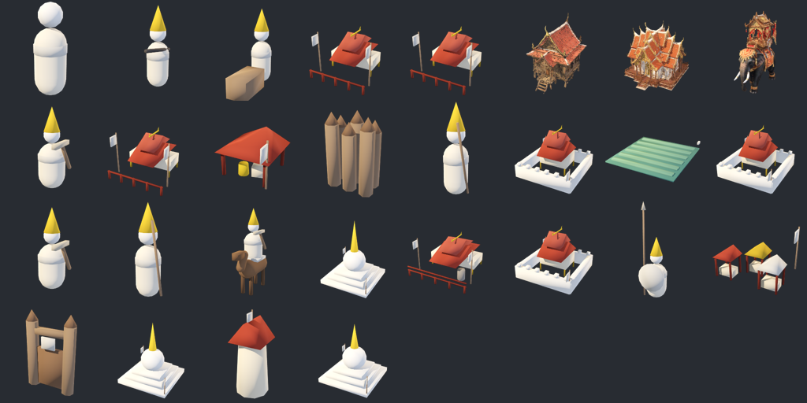
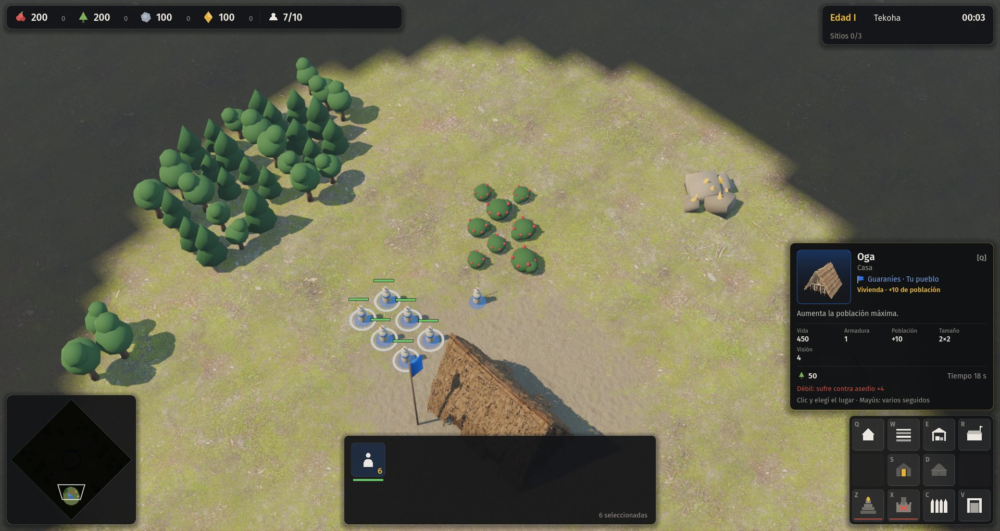
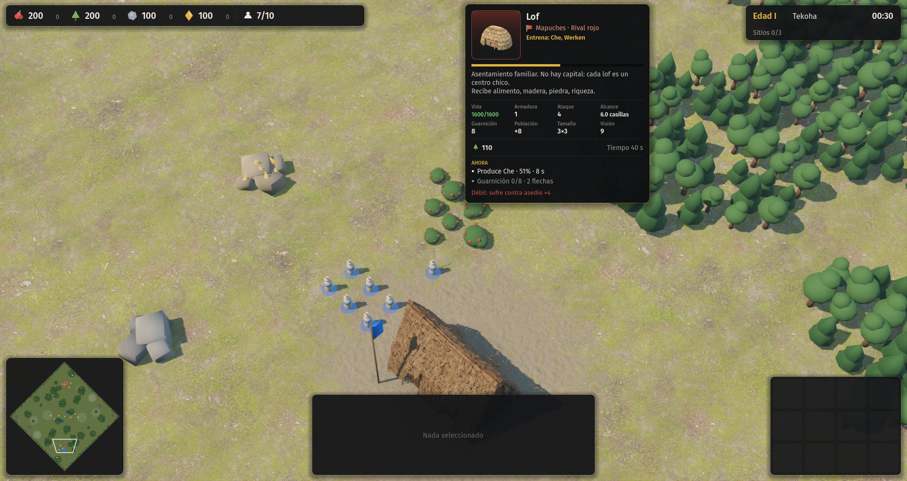
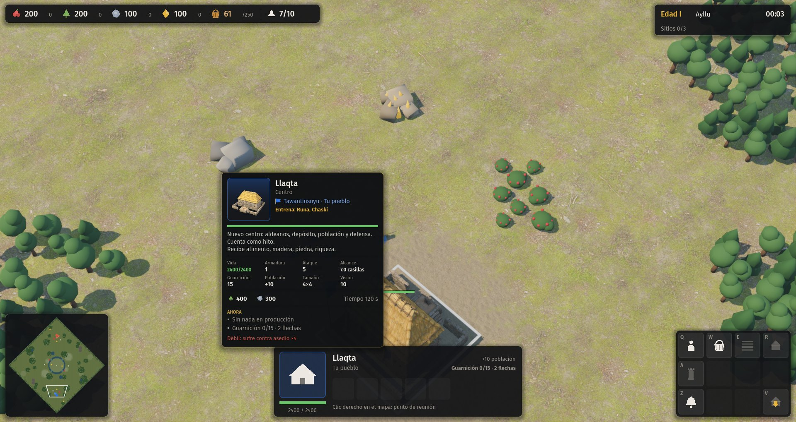

# 15.01 — Fichas al pasar el mouse, con retrato

## Pedido

> "Mejorar la interfaz todo lo posible: agregar fichas al pasar el mouse que muestren una imagen del lugar o la cosa sobre la que estás, con más detalle, y que expliquen qué hace, la civilización, etc. […] darle al jugador mucha más información de lo que está pasando en el juego."

Esta parte: las fichas y sus retratos. Las otras partes de la etapa 15 las hacen otros agentes en paralelo.

## Qué se hizo

### 1. Retratos (`tools/render_retratos.gd`)

Script de Godot que arma un SubViewport fuera de pantalla (fondo transparente, MSAA 8×, SSAO), con luz de estudio (principal cálida, relleno frío y contraluz), y fotografía cada unidad, edificio y recurso con **los mismos modelos del juego**: el GLB generado si la civilización lo declara en `estilo.modelos` (con los materiales mates de `WorldView._matte`), y si no, la malla de `CivMeshes` o la de `Meshes` de la capa común. Encuadre por la caja del modelo, tres cuartos: las unidades más de frente, los edificios más desde arriba.

- Salida: `assets/generados/retratos/<civ>/<tipo>.png`, 256×256. `comun/` guarda la capa común sin civilización, el sitio sagrado y los recursos del mapa (árbol, arbustos, piedra, arcilla, yerbal), que no son de ningún pueblo.
- 192 imágenes, 4,4 MB. Color de equipo neutro (arcilla): el dueño se marca en la ficha con el borde, el degradado y la bandera.
- Uso: `godot --path . -s tools/render_retratos.gd [-- --civs=a,b --tipos=x,y]` y después `godot --headless --path . --import`. Necesita GPU (sin `--headless`).

### 2. Ficha (`src/game/ui/ficha.gd`, clase `Ficha`)

Aparece:

- sobre **entidades del mundo**: unidades, edificios, recursos y sitios sagrados, propios o ajenos (usa `WorldView.hovered`, que ya calcula el Controller; los sitios sagrados son transitables y el pick no los ve, así que la ficha los busca por casilla);
- sobre los **botones de la grilla** de construir, entrenar e investigar (reemplaza al tooltip para esos tres; el resto de los comandos sigue con el tooltip de antes);
- sobre los **retratos de la selección** (individual y grupos) y sobre los **elementos de la cola** de producción.

Contenido, todo leído de `data/` y de la simulación (sin tocar `src/sim/`):

- retrato (o el glifo, si no hay), con degradado del color del dueño;
- nombre en la lengua del pueblo y, debajo, el castellano llano de la capa común si difiere (Oga guasu / Centro, Runa / Aldeano, Che / Aldeano);
- bandera del color del jugador y pueblo (Guaraníes · Tu pueblo, Mapuches · Rival rojo, Naturaleza);
- función en una línea (por `funcion` en unidades; en edificios, deducida: qué entrena, motor, renta, depósito, defensa, hito, vivienda);
- descripción (`desc` del dato o `Controller.DESCS`; los depósitos agregan qué reciben);
- estadísticas: vida (actual), ataque y armadura con las mejoras investigadas, alcance, velocidad, cadencia, visión, población, carga, munición; en edificios: guarnición, población, tamaño, alcance;
- costo con íconos (en rojo lo que no alcanza, en los botones) y tiempo;
- **Ahora**: qué hace la unidad y contra quién o en qué (combate contra X de Y, recolecta madera en Árbol, construye Casa 45 %), qué carga, si está frenada, disparos que le quedan; en edificios: obra con % y constructores, cola con % y segundos restantes y lo que sigue, población llena, guarnición y flechas, granja trabajada o no, renta por minuto, motor de conversión (cuánto consume y rinde, si le falta insumo y rinde el piso, mejora de motor); en recursos: cuánto queda, cuántos aldeanos trabajan, de quién es la arcilla; en sitios: quién lo controla, quién lo está tomando y cuánto le falta, renta, y el reloj de victoria si alguien tiene todos;
- **fuerte contra / débil**, calculado de `reglas.json → contadores` (por ejemplo, Guerrero: fuerte contra distancia ×2, asedio ×1,5; débil: sufre contra línea ×2,25);
- en los botones: atajo, cuántos tenés, cuántos en cola, máximo por edad, y el bloqueo en rojo.

Comportamiento: retraso de 0,45 s en el mundo, 0,22 s en la selección y 0,1 s en la grilla; aparición con fundido; se ubica abajo a la derecha del cursor y, si no entra, a la izquierda o arriba, siempre dentro de la pantalla; las de la interfaz se anclan arriba del panel. Se oculta con un menú abierto, mientras se arrastra una selección o se coloca un edificio. Lo que está bajo niebla muestra solo los datos fijos ("fuera de la vista").

Para capturas: `-- --ficha=tipo` (la fija sobre la primera entidad de ese tipo), `-- --ficha=cmd:N` (ranura N de la grilla, con `--select`) y `-- --ficha=zona:N` (retrato N de la selección).

### 3. Enganches

- `hud.gd`: bloques marcados `# --- ficha ---`: la variable, la creación después del tooltip, el desvío en `show_tip`/`hide_tip`, y cuatro líneas en `SelectionPanel` que registran zonas (`zones_begin` al empezar a dibujar, `zone` en el retrato individual, en cada grupo y en cada elemento de la cola). No se movió código.
- `controller.gd`: no hizo falta tocarlo; la ficha lee `view.hovered`, `mode`, `dragging` y `mouse_pos()`.

## Pruebas

- `godot --path . -- --autotest --civ=guaranies --terreno=llano --mute` → `AUTOTEST: OK`.
- `godot --path . -- --autotest --civ=tawantinsuyu --terreno=llano --mute` → `AUTOTEST: OK`.
- Capturas con `--ficha` para unidad, edificio propio y rival, recurso, sitio sagrado, botón de construir, investigación bloqueada y retrato de la selección.

## Tropiezos

- El worktree no tenía `.godot/`: hubo que importar el proyecto antes de que los `class_name` existieran para el script de retratos.
- Los PNG nuevos necesitan su `.import` para cargarse con `load()`; la ficha también cae a `Image.load_from_file` si falta.
- `match` no acepta un enum guardado en variable local: el `const O := SimEntity.Order` tiene que ir a nivel de clase.
- Primer intento: el sitio sagrado mostraba "Vida 1/1" y "débil contra asedio": se ocultan las estadísticas de combate para los sitios.
- La barra de producción tapaba la de vida: ahora la vida va siempre y el progreso (obra, cola, captura) va en una barra fina debajo.
- Los recursos no están en `sim.actives`: la ficha fijada para capturas recorre `sim.entities`.
- "cuerpo a cuerpo" no entraba en la columna de alcance: quedó "contacto".

## Pendiente

- La cifra de ataque no incluye el bono por edad ni el de altura (sí las mejoras investigadas).
- Los retratos son de la maqueta; cuando lleguen modelos GLB nuevos, volver a correr `tools/render_retratos.gd`.
