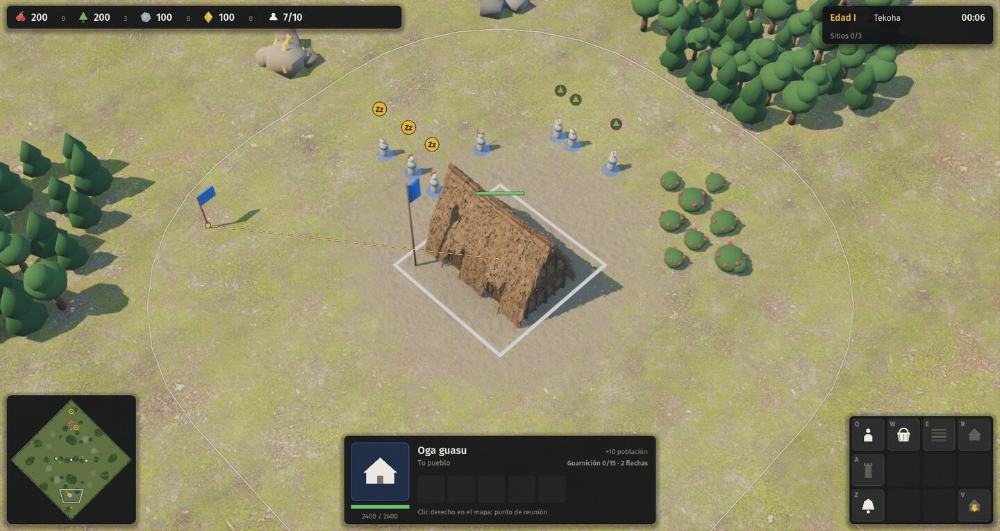
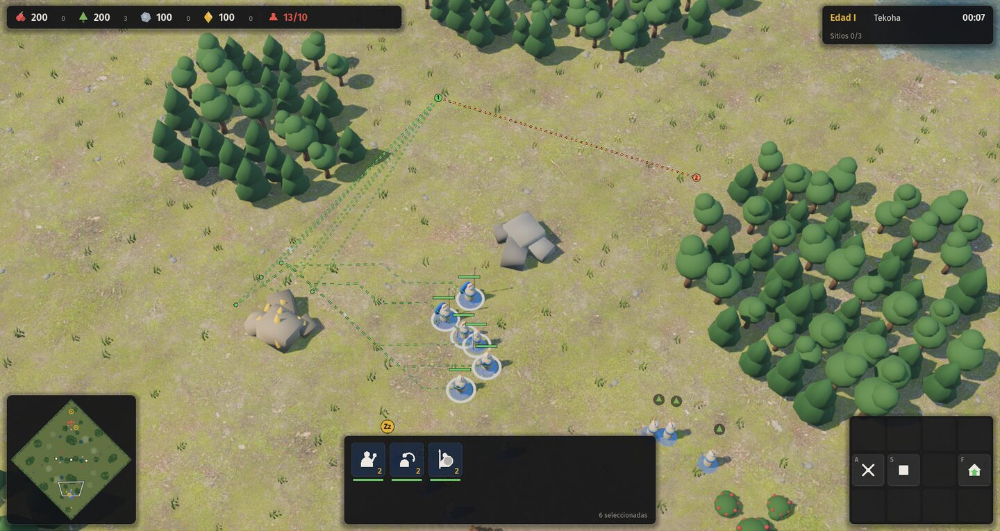
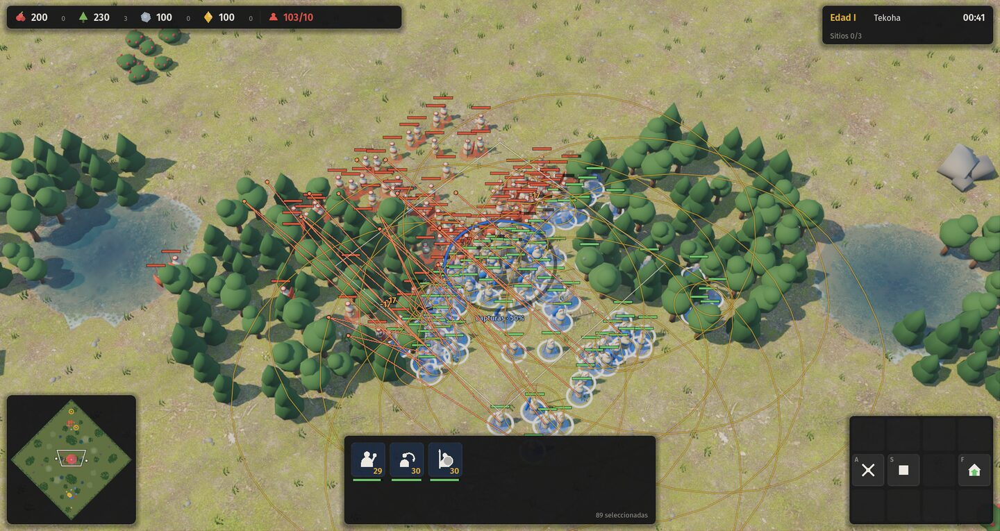
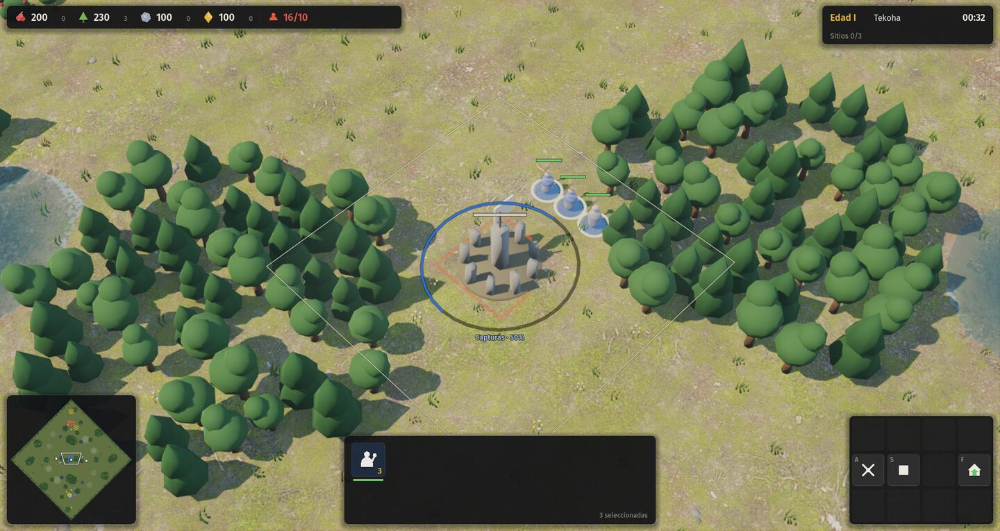
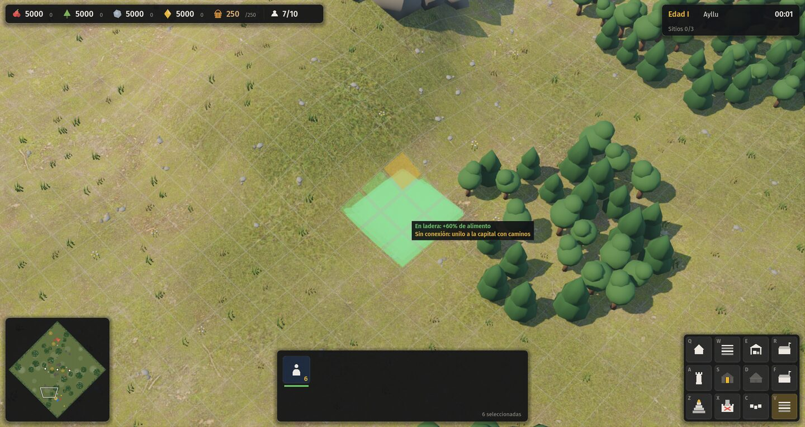
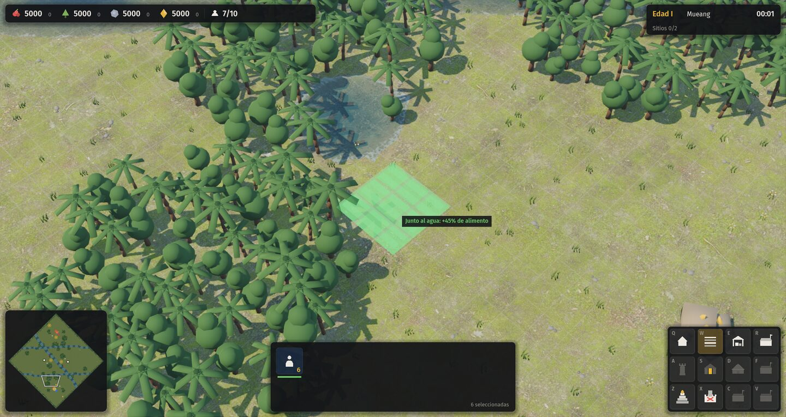
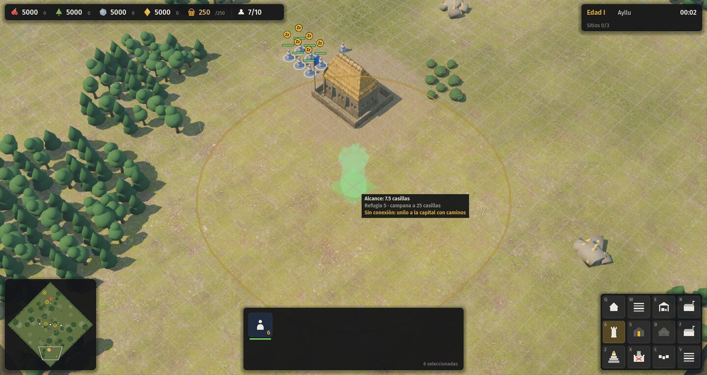
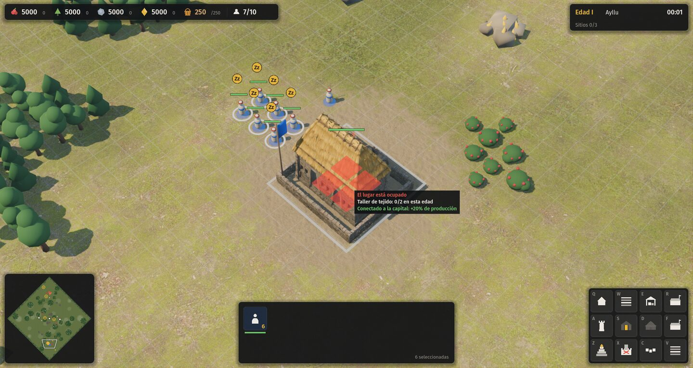
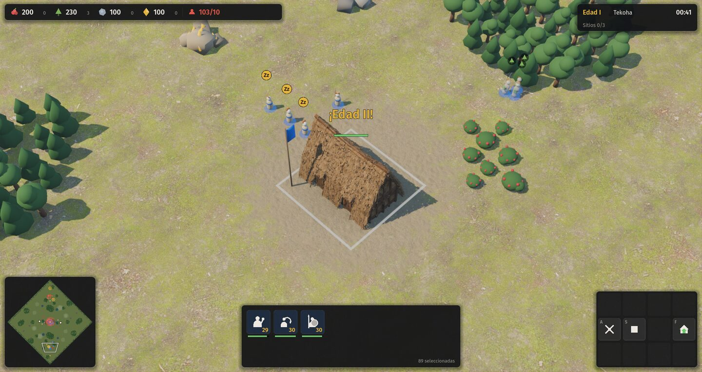
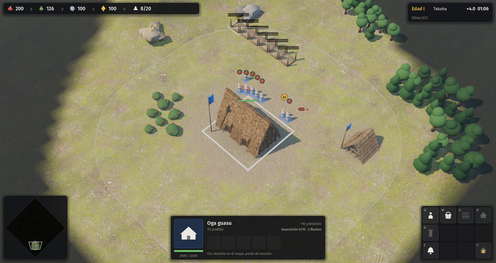

# 15 · Interfaz — 03 · Información en el mundo y en el minimapa

## Pedido

> "Mejorar la interfaz todo lo posible, no solo mover o mejorar lo que ya hay, sino darle al jugador mucha más información de lo que está pasando en el juego."

Esta parte cubre lo que se ve **sobre el mapa 3D y en el minimapa**. Las fichas al pasar el mouse y los paneles de economía, edad, registro y estadísticas los hacen otros dos agentes.

## Qué se hizo

Todo vive en archivos nuevos `src/game/ui/mundo_*.gd`; los enganches en el código existente son cortos y están marcados con `# --- mundo ---`.

| Archivo | Qué hace |
|---|---|
| `src/game/ui/mundo_capa.gd` | Capa 2D encima del mundo: proyecta puntos del suelo (sigue el relieve) y dibuja alcances, órdenes, íconos, textos flotantes, sitios sagrados y la vista previa de colocación. No agrega nodos 3D. |
| `src/game/ui/mundo_colocacion.gd` | Motivo de "no se puede construir" (mismo orden de chequeos que `Sim.can_place`), estado de cada casilla, máximo por edad, separación, bono del lugar (llama a `Sim._site_bonus` con una entidad de prueba: el número es exactamente el de la simulación) y conexión por caminos. |
| `src/game/ui/mundo_cola.gd` | Órdenes en cola con mayúsculas, del lado del cliente (ver "Tropiezos"). |
| `src/game/ui/mundo_minimapa.gd` | Capas del minimapa: destellos, sitios sagrados, arcilla disputada, aldeanos ociosos. |
| `tests/mundo_capturas.gd` | Capturas reproducibles de cada función, prueba de mayúsculas + clic derecho con eventos reales y medición de cuadros por segundo con 200 unidades. |

Enganches: `hud.gd` (crear la capa y pasarle los eventos: 2 bloques), `controller.gd` (cola en clic derecho, en ataque en movimiento y en Detener; motivo al fallar la colocación), `minimap.gd` (capas extra, destello, clic derecho), `overlay.gd` (Alt muestra todas las barras; porcentaje y constructores en obra).

### 1. Barras de vida
Ya existían (dañados, seleccionados, bajo el mouse, progreso de obra). Se agregó: **porcentaje de obra y cantidad de constructores** al pasar el mouse o seleccionar, y **todas las barras** mientras se mantiene `Alt`.

### 2. Texto flotante
- "+N" con el ícono del recurso en cada entrega en un depósito propio. Entregas seguidas en el mismo lugar **se suman** en un solo número; tope de 10 a la vez.
- Golpes fuertes (≥ 12 % de la vida máxima del blanco, visibles): rojo si es tuyo, naranja si es del rival; tope de 8.
- "¡Edad II!" grande sobre el hito que hizo avanzar (o la capital).

### 3. Al colocar un edificio
- Alcance de torres y centros (forma exacta: la huella agrandada, porque la simulación mide al borde), con el alcance de las defensas propias ya hechas en tenue.
- Radio de la campana para todo edificio con guarnición.
- Cada casilla de la huella: verde libre, **dorada** si es ladera que rinde (andenes), **roja** si bloquea.
- Recuadro junto al cursor (encima de los paneles) con: motivo en rojo ("Hay recursos en el lugar", "Terreno en pendiente: buscá un llano", "Máximo de la edad alcanzado: 3/3", "Falta 40 de madera"…), "Taller de tejido: 0/2 en esta edad", "En ladera: +60 % de alimento", "Junto al agua: +45 % de alimento", "Conectado a la capital: +20 % de producción" / "Sin conexión: unilo a la capital con caminos", alcance y refugio.
- El aviso al hacer clic donde no se puede ya no dice solo "No se puede construir ahí": dice el motivo.
- Separación mínima (`separacion`): se dibuja la zona prohibida alrededor de cada pieza del mismo tipo. Hoy ningún edificio la usa en los datos, pero queda lista.

### 4. Indicadores
- "Zz" sobre los aldeanos ociosos (también en el minimapa).
- Ícono chico del recurso que recolecta cada aldeano (martillo si construye). Se ocultan al alejar mucho la cámara.
- Punto de reunión con línea punteada desde el edificio (para todos los seleccionados, no solo uno).
- Orden en curso de la selección como línea punteada del color de la orden (verde mover, naranja ataque en movimiento, rojo atacar, color del recurso al recolectar), siguiendo el camino calculado cuando hay pocas unidades. Con más de 12 seleccionadas solo se marcan los destinos de movimiento (si no, es una maraña).
- Órdenes en cola numeradas (1, 2, …) desde el destino actual.
- `Alt`: alcance de la selección (uno por grupo de iguales a menos de 2 casillas) y de las defensas enemigas a la vista. Las torres y centros seleccionados muestran su alcance siempre.

### 5. Minimapa
- Destello rojo donde golpean algo tuyo (uno por zona de 8×8 cada 2,5 s), además del aviso grande "¡Nos atacan!" que ya existía.
- Sitios sagrados como rombo con el color de quien lo tiene y un arco con el progreso de quien lo toma.
- Arcilla disputada (riqueza que no es de tu casa) con un aro dorado que late.
- Aldeanos ociosos con un aro que parpadea.
- Clic derecho: mover; con `A` activo, ataque en movimiento; con mayúsculas, encola; con un edificio seleccionado, fija el punto de reunión.
- Vista de la cámara con contorno oscuro para que se lea sobre el pasto claro.

### 6. Sitios sagrados en el mundo
Zona de captura (el cuadrado real de `reglas.sitios.radio`) con el color de quien lo tiene, y anillo de progreso con el color de quien captura y el texto "Capturás · 50 %" / "Te lo toman · 50 %".

## Capturas

| | |
|---|---|
|  Ociosos (Zz), aldeanos cortando madera, reunión del centro y su alcance |  Camino en curso y dos órdenes en cola (la 2 es ataque en movimiento) |
|  200 unidades con `Alt`: alcances agrupados, golpes fuertes, destellos en el minimapa |  Sitio sagrado en captura |
|  Andén en ladera (casilla dorada, +60 %), sin conexión por caminos |  Arrozal junto al agua (+45 %) |
|  Torre: alcance, campana, conexión |  Lugar ocupado: casillas rojas y motivo; cupo 0/2 |
|  "¡Edad II!" |  Fin del autotest |

## Pruebas

- `godot --path . -- --autotest --civ=guaranies --terreno=llano --mute` → **AUTOTEST: OK** (13/13).
- `godot --path . -s tests/mundo_capturas.gd -- --escena=batalla --civ=guaranies --terreno=llano --nofog --mute --seed=7` → `OK mayúsculas + clic derecho encola la orden (6)`; la cola se vacía sola (`cola pendiente tras 20 s: 0`).
- Mismo comando con `--escena=incas --civ=tawantinsuyu --terreno=montana` y `--escena=arrozal --civ=ayutthaya --terreno=delta`.
- **Rendimiento** (RTX 2060 SUPER, 1920×1080, sin vsync, 208 entidades peleando, 100 seleccionadas): la capa cuesta ~1,3 ms de CPU por cuadro en el peor caso (1 ms son las líneas de orden de 100 unidades). Los cuadros por segundo medidos alternando capa encendida y apagada quedan dentro del ruido de la pelea (48–61 con la capa, 51 sin ella). Para llegar a eso: las líneas punteadas se juntan por color y se dibujan con un solo `draw_multiline`, los sitios se buscan una vez por tick y los alcances de formaciones iguales se dibujan una sola vez.
- No se tocó `src/sim/`.

## Tropiezos

- **La simulación no tiene cola de órdenes**: guarda una sola orden por unidad. En vez de cambiarla, la cola vive en el cliente (`mundo_cola.gd`): con mayúsculas la orden se guarda y se manda como comando común cuando la unidad queda ociosa. Las unidades que reciben el mismo paso a la vez van en un único comando, así conservan la formación. La repetición graba solo comandos comunes: el determinismo no cambia. Límite: tras una orden de recolectar la unidad nunca queda ociosa, así que lo encolado después no se cumple (igual que en otros juegos del género).
- Primero los textos y los números se dibujaban debajo de los paneles; el recuadro de colocación pasó a una capa hija con `z_index` alto.
- `PackedVector2Array` guardado en un diccionario se copia en cada `append` (copia al escribir): con 100 unidades costaba O(n²). Se juntan en `Array` y se convierten una vez.
- Con 100 seleccionadas, una línea a cada blanco o un círculo de alcance por unidad tapaban la pelea; se agrupan y se omiten.

## Pendiente / para el líder

- Agregar esta etapa al índice `proceso/README.md` junto con las otras dos partes de la interfaz (no lo toqué para no chocar).
- `docs/07-arte-y-ui.md`: se agregó la sección "Información en el mundo" y dos filas de controles (`Alt`, mayúsculas + clic derecho).
- La tecla de información es `Alt` (`TECLA_INFO` en `mundo_capa.gd`) por si choca con algo de las otras partes.
