# 16 · Paisaje — 01 · Modelos de árboles, arbustos, rocas y arcilla (2026-11-13)

## Pedido del autor
"Continuá con la generación de modelos que sigan mejorando la apariencia. El agua, los árboles, todo lo que se ve en el paisaje le falta mucho trabajo."

Esta parte cubre **los modelos del paisaje**. El agua y el suelo los hace otro agente, en otra parte de esta etapa.

## Paso a paso
1. **Conceptos** (`tools/generar_naturaleza.py imagenes`). Diez imágenes con un estilo común: low-poly estilizado, mate, aislado y sin suelo. El flujo es el mismo de `generar_modelos.py`. Se revisaron todas antes de pagar el 3D, que es la parte cara.
   - Árboles, uno por especie de `reglas.json → terrenos.*.arboles`: ciprés andino (0), latifoliada de monte (1), araucaria (2), pindó (3) y queñua de copa plana (4).
   - Mata de arbustos con frutos.
   - Afloramiento de piedra.
   - Barreal con vasijas apiladas, para «Arcilla (barreal)».
   - Peñasco.
   - Yerbal (capuera), que hasta ahora se dibujaba como una roca gris.
2. **Modelos 3D** (`… modelos`): `multi-image-to-3d` sobre cada concepto. Meshy ignora `target_polycount` si no se le pide remesh, así que los crudos llegaron con entre 175.000 y 600.000 triángulos y texturas de 2048 px. Quedan en `.cache/meshy/naturaleza/` y no se versionan.
3. **Optimización** (`tools/optimizar_glb.py`, con tres mejoras):
   - suelda los vértices antes de diezmar;
   - diezma en pasos de a la mitad y, si se estanca, suelda con más distancia;
   - con `solo_color`, descarta los mapas normal y de metal/rugosidad.
4. **Remesh en Meshy** (`… remesh`, 5 créditos cada uno) para los modelos de hoja fina, que Blender no podía bajar sin romperlos: palmera, araucaria, copa plana, arbusto y yerbal.
5. **Integración** (`src/game/meshes.gd`):
   - `nature_mesh(nombre)` carga el GLB y hornea su transformación. Lo escala para que entre en un alto y un ancho máximos (`NATURE`), lo centra, lo apoya en y = 0 y lo hunde unos centímetros.
   - El material es mate, de doble cara y con el color de instancia como multiplicador, así la niebla sigue atenuando.
   - Se generan niveles de detalle (`ImporterMesh.generate_lods`).
   - `tree_mesh`, `bush_mesh` y `rock_mesh` usan el modelo si existe; si falta, queda el procedural de siempre.
   - Al arbusto se le suman once bayas para que se lea como alimento.
   - La arcilla se estira en vertical (×1,6) para que las vasijas se vean desde la cámara del juego.
   - El respaldo procedural de la arcilla ya no es una roca con cristales dorados: es un montículo rojizo con vasijas.
6. **MultiMesh por trozos** (`world_view.gd → _make_mm`). Árboles y arbustos se parten en trozos de 16×16 casillas, uno por especie y por trozo. Así se descarta lo que queda fuera de cámara y cada trozo elige su nivel de detalle con `lod_bias = 0.2`. Cada instancia varía en escala, giro y alto, se inclina un poco y se apoya en la altura real del terreno. Todo proyecta sombra. Los peñascos usan `lod_bias = 0.3`.

## Triángulos finales

| Modelo | Triángulos | Textura | Uso |
|---|---|---|---|
| pino (ciprés) | 1.372 | 512 | especie 0 |
| latifoliada | 1.398 | 512 | especie 1 |
| araucaria | 1.292 | 512 | especie 2 (remesh) |
| palmera (pindó) | 1.437 | 512 | especie 3 (remesh) |
| copa plana (queñua) | 1.387 | 512 | especie 4 (remesh) |
| arbusto | 888 + bayas | 256 | arbustos (remesh) |
| roca | 2.399 | 512 | afloramiento de piedra |
| arcilla | 2.999 | 512 | arcilla (barreal) |
| peñasco | 1.800 | 512 | casillas de roca infranqueable |
| yerbal | 1.386 | 512 | yerbal (capuera) (remesh) |

En el repositorio, entre todos ocupan unos 1,4 MB (GLB y texturas extraídas).

## Rendimiento
Se midió con `--perf`, cámara a zoom 70 sobre el centro del mapa y semilla 3, promediando un minuto. El autor tenía el juego abierto en la misma GPU, así que las cifras varían de una corrida a otra.

| Variante | bosque_templado | selva |
|---|---|---|
| Antes (procedurales, un MultiMesh por especie) | 75 fps (mediana) | ~78 |
| Modelos nuevos, sin trozos ni LOD | ~46 | ~48 |
| Modelos nuevos, por trozos con `lod_bias` 0,2 y sombra | 70 | 69 |

## Créditos
Saldo inicial: 788. Se gastaron **385**:
- 10 conceptos a 6 créditos: 60;
- 10 modelos 3D a 30: 300;
- 5 remesh a 5: 25.

Saldo final: 403. Todo queda anotado en `assets/generados/registro.jsonl`.

## Tropiezos
- **Astillas en el diezmado**. Meshy parte los vértices en cada costura de UV y el diezmado no puede colapsar a través de ellas: los árboles quedaron hechos astillas (`08`). Soldar los vértices primero lo resolvió para los árboles de copa redonda.
- **Troncos que desaparecían**. En araucaria y palmera, el diezmado gastaba los triángulos en las frondas y se comía el tronco entero. Se resolvió con el remesh de Meshy, que sí respeta el pedido de polígonos y vuelve a hornear la textura.
- **La arcilla se leía como una mancha naranja**: las vasijas eran chicas al lado del barreal. Se estiró en vertical y se bajó la saturación con un tinte (`NATURE_TINT`).
- **Los arbustos perdieron las bayas** al bajar de polígonos. Se suman bayas procedurales encima del modelo.
- **El rendimiento bajó a 46 fps** con los modelos tal cual. Un MultiMesh que cubre todo el mapa no se descarta y elige un solo LOD para todas sus instancias. Con los trozos y el `lod_bias` volvió a unos 70.
- **La clave de Meshy no se encontraba desde una copia de trabajo (worktree)**. `meshy_api.py` busca `../apex-open/.secrets/meshy.env` relativo al repositorio, y desde `.claude/worktrees/…` esa ruta no existe. Se corrió con `MESHY_ENV` apuntando a la ruta de siempre.

## Capturas

| Antes | Después |
|---|---|
| 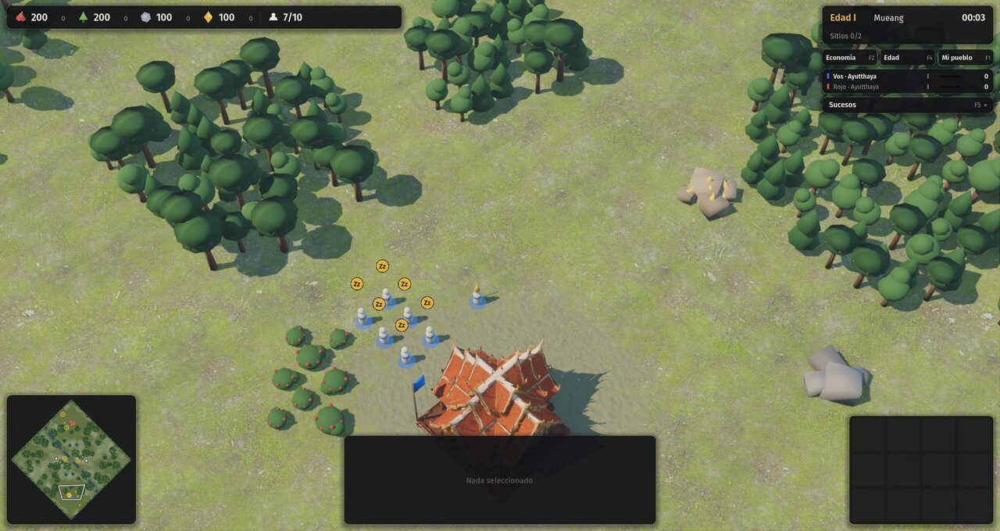 | 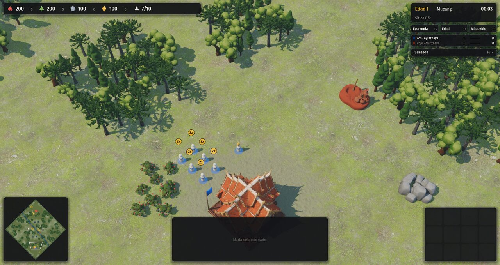 |
| 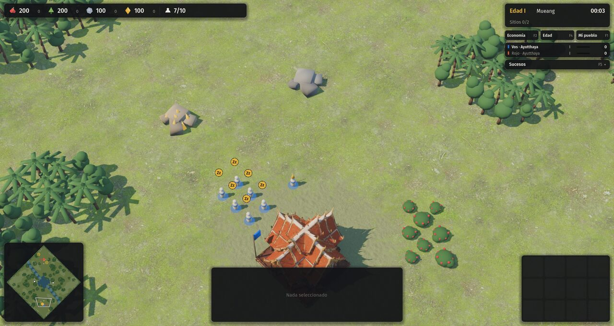 | 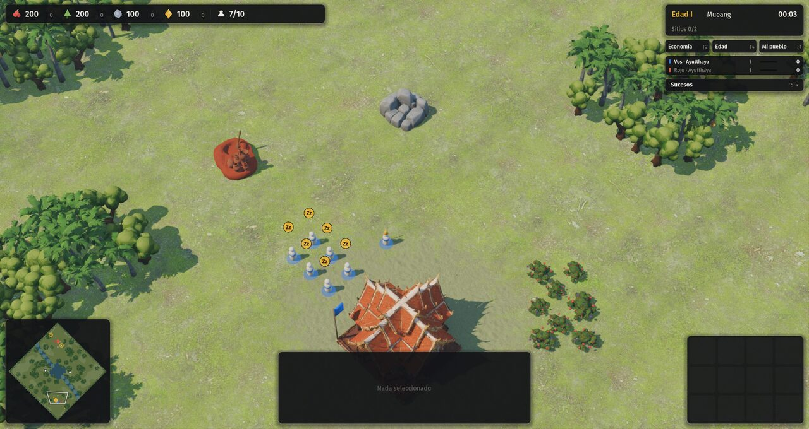 |
| 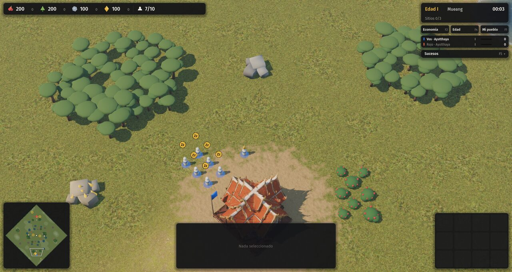 | 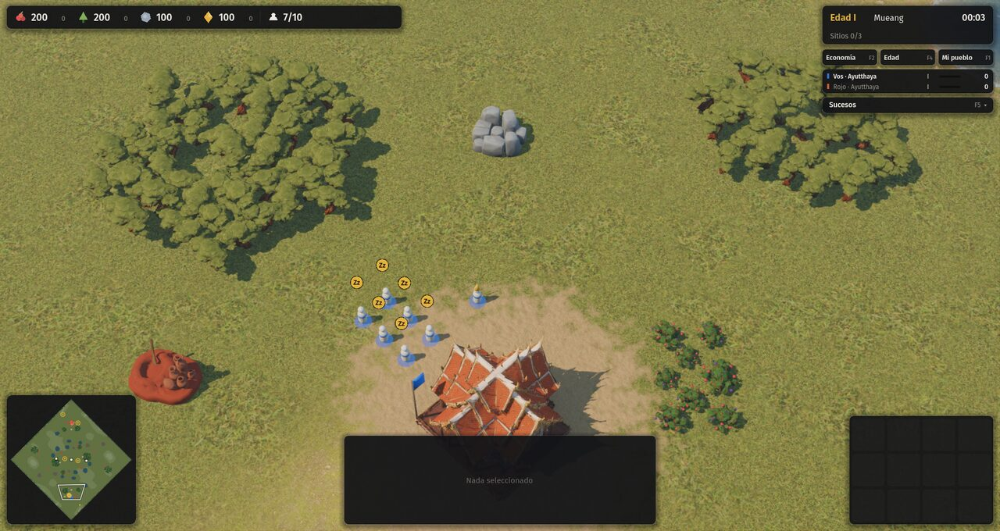 |

| Arcilla y roca de cerca | Diezmado sin soldar (descartado) |
|---|---|
| 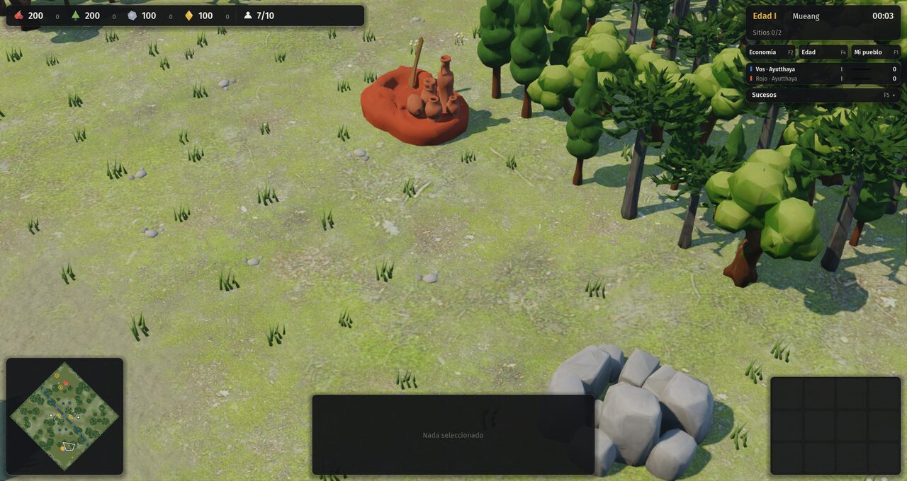 | 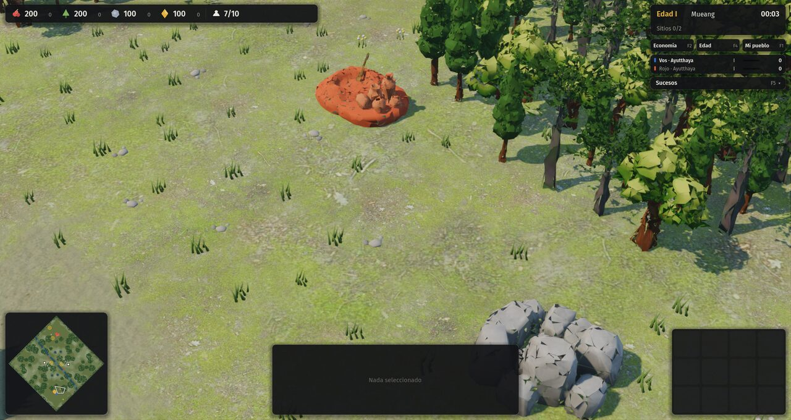 |
| **Conceptos** | **Modelos optimizados** |
| 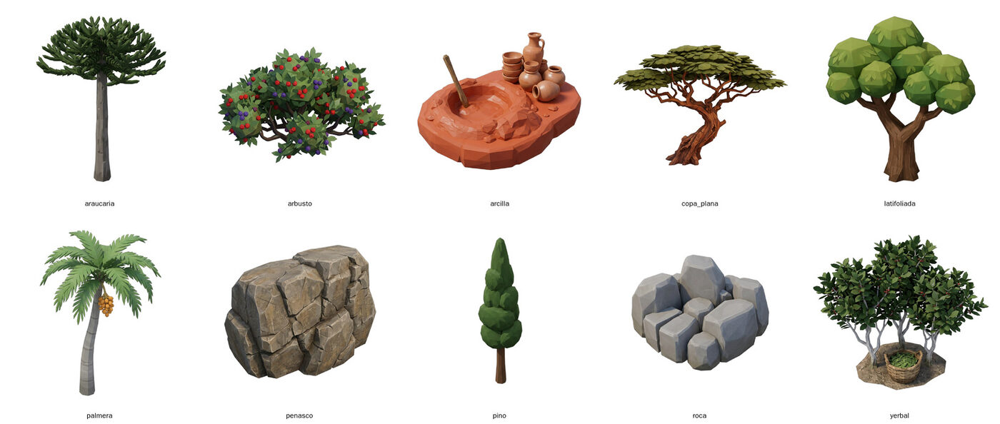 | 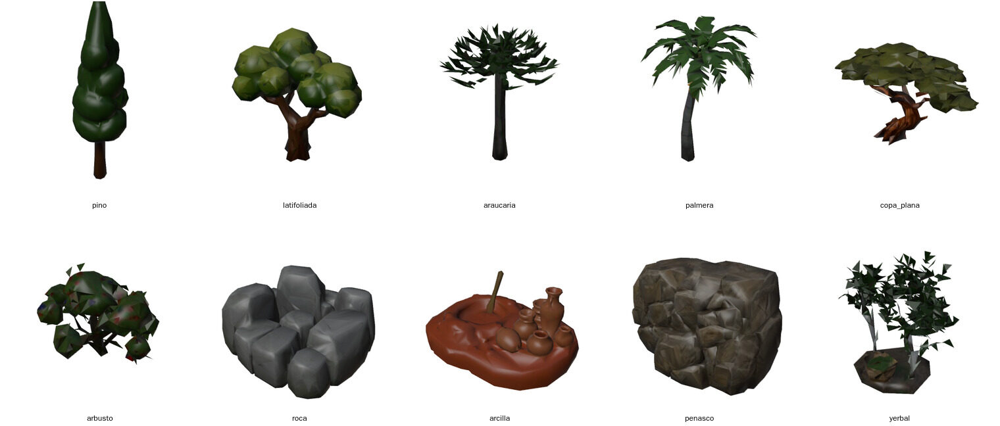 |
| **Peñasco en Mesetas** | |
| 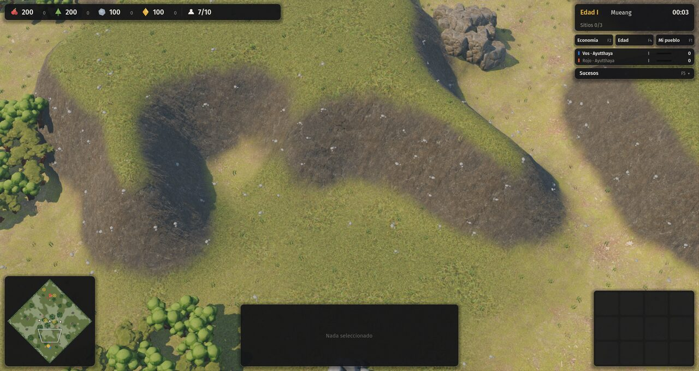 | |

## Pruebas
- `godot --path . -- --autotest --civ=guaranies --terreno=llano --mute`: AUTOTEST: OK.
- No se tocó `src/sim/`.

## Pendiente
- La copa plana del altiplano se ve como una masa en los bosquecillos densos. Se podría bajar el ancho o mezclar con arbustos.
- Se podrían sumar variantes por bioma, por ejemplo una segunda latifoliada para la selva, cuando haya créditos.
