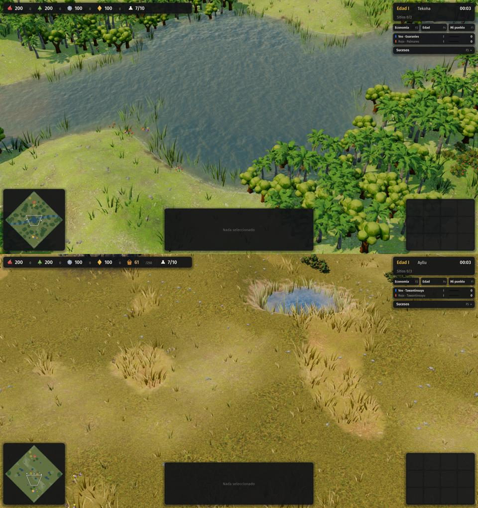

# 16 · Paisaje (2026-11-13)

## Pedido del autor
"Continuá con la generación de modelos que sigan mejorando la apariencia. El agua, los árboles, todo lo que se ve en el paisaje le falta mucho trabajo."

## Partes
- [01 · Modelos](01-modelos.md): árboles, arbustos, rocas, arcilla con vasijas, peñascos y yerbal generados con Meshy, optimizados y en MultiMesh por trozos. Se gastaron 385 créditos.
- El agua y el suelo (shaders, malla del terreno y detalle del suelo) van en otra parte de esta etapa.

## Commits
- Modelos del paisaje: el commit «Paisaje: modelos de árboles, arbustos, rocas, arcilla y peñascos generados con Meshy».

## Integración (líder)
- **Agua, orillas, suelo y atmósfera:** se fusionaron sin conflictos con los modelos ([02-agua-y-suelo.md](02-agua-y-suelo.md)). Agua con reflejo del cielo, color por bioma, olas en la orilla, vados claros y ondas alrededor de las unidades. Orillas sin escalones, con barro húmedo y juncos o totora. Pasto que se mueve con el viento y que la niebla de guerra oculta. Sol, cielo y niebla por bioma.
- **Pruebas tras fusionar:** autotest OK y determinismo OK.
- **Captura integrada** (selva arriba, altiplano abajo):

