# 17 · Parte A: escala, paleta y opciones

Primera de las dos partes de la segunda tanda de interfaz. Resuelve, de la auditoría [`docs/diseno/interfaz/00-auditoria.md`](../../docs/diseno/interfaz/00-auditoria.md):
- **P1:** la interfaz no escala;
- **P2:** los colores de equipo chocan con los recursos y entre sí;
- **P3**, solo la parte visual: el contraste de "bloqueado" y "no alcanza";
- **P14 y P15**, solo las opciones: no se guardan y no hay acceso desde el menú;
- la sección 5, Accesibilidad.

La parte B, que hace otro agente en paralelo, se ocupa de los cursores, la grilla estable, los avisos y los errores puntuales. Esta parte no toca esos temas.

## Pedido

> Que la interfaz escale con la resolución (1366×768, 1920×1080 y 4K), con una opción "Escala de interfaz". Paleta apta para daltonismo: equipos y recursos distinguibles, modos para deuteranopía, protanopía y tritanopía, y vida buena contra mala distinguible. Contraste de 4,5:1 en lo bloqueado y en el "no alcanza". Menú de opciones desde el menú principal y desde la pausa, guardado en `user://opciones.cfg`. Argumento `--ventana=ANCHOxALTO` para sacar capturas.

## Paso a paso

### 1. `--ventana=ANCHOxALTO` y capturas de "antes"

- **El problema:** `project.godot` arranca la ventana maximizada (`window/size/mode=2`), así que `--resolution` de Godot no tiene efecto. Así no se podía sacar una captura a otra resolución.
- **Qué se hizo:** `main.gd` (bloque `# --- escala ---`) lee `--ventana=1366x768`, pasa a modo ventana y fija el tamaño.
- **Tropiezo:** KDE recorta la ventana al tamaño del escritorio. Con dos monitores de 1920×1080, la ventana de 1920×1080 quedó en 1920×1052 (le resta el panel) y la de 3840×2160 también.
- **Cómo se resolvió:** las capturas de 1920×1080 y de 4K se sacan dentro de `gamescope --backend headless`, un compositor sin pantalla que acepta cualquier tamaño:

  ```
  gamescope --backend headless -w 3840 -h 2160 -W 3840 -H 2160 -- \
    godot --path . -- --ventana=3840x2160 --civ=guaranies --terreno=llano --mute --seed=7 --shot=x.png --shot-at=4 --select=aldeano
  ```

  - La de 1366×768 sale en una ventana común.
  - Con 1366 de ancho, `gamescope` se colgó: el ancho impar de la salida le resulta raro.

Antes, con los aldeanos guaraníes seleccionados:

| 1366×768 | 1920×1080 |
|---|---|
| 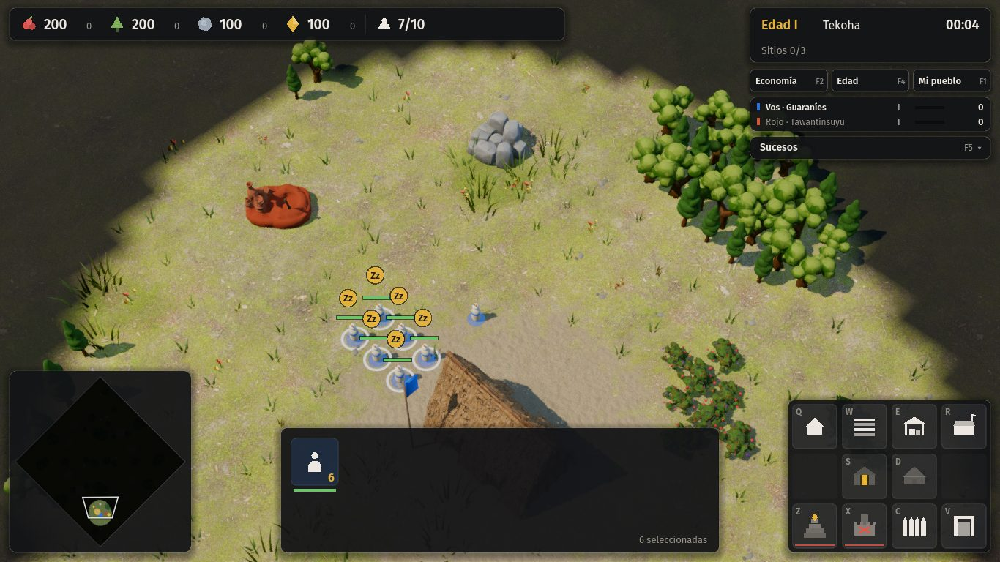 |  |

A 3840×2160, reducida a 1920 para el documento, el HUD ocupa un cuarto de lo que ocupa a 1080p:

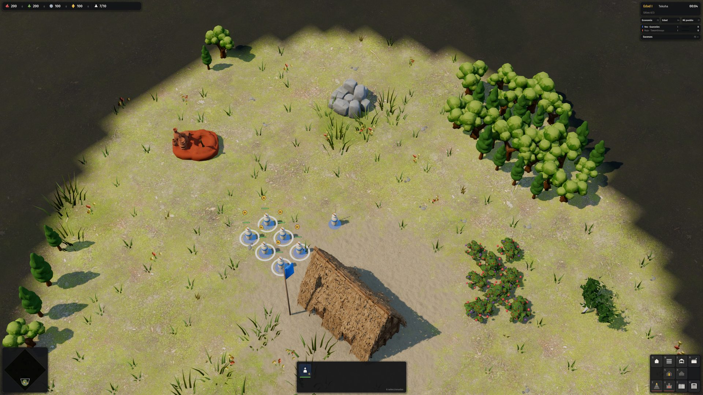

Recorte a tamaño real de la esquina de la grilla a 4K. Las letras de atajo miden 12 px físicos, en una pantalla de 27″ y 160 ppp:

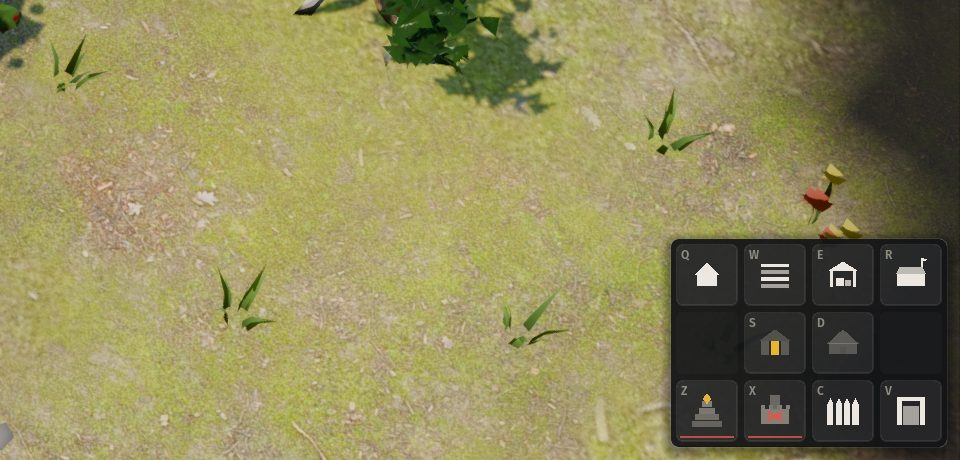

### 2. Paleta apta para daltonismo

- **Cómo se midió:** con el mismo cálculo de la auditoría.
  - Distancia ΔE CIE76 en CIELAB.
  - Daltonismo simulado con las matrices de Machado, Oliveira y Fernandes (2009) a severidad total.
  - El script reproduce exactamente la tabla de P2 (11, 8, 17, 13 y 8).
- **Hallazgo nuevo:** además de lo que dice la auditoría, en tritanopía se confunden madera y piedra (ΔE 12).
- **Umbrales** (sección 5 de la auditoría):

  | Par | ΔE mínimo |
  |---|---|
  | Equipo con equipo | 20 |
  | Equipo con recurso | 25 |
  | Recurso con recurso | 25 |
  | Vida buena con vida mala | 40 |

  Se miden en las cuatro visiones: normal, deuteranopía, protanopía y tritanopía.

**Cómo se eligieron los colores.** Una búsqueda en Python recorrió dos conjuntos:
- cada recurso dentro de su "color natural" (regla 4 de `07`): alimento rojo baya, madera verde, piedra gris azulada y riqueza dorada;
- unos 2.000 candidatos para los equipos, con luminosidad entre 35 y 80.

Con esa elección se maximizó la menor distancia en las cuatro visiones. Después se bajó la saturación de cada color mientras siguiera cumpliendo los umbrales.

**Resultado** (paleta segura, la de siempre):

| | Antes | Después |
|---|---|---|
| Alimento | `d9534f` | `bf4a6c`, rojo frambuesa: se separa del verde en deuteranopía porque lleva algo de azul |
| Madera | `7fae5a` | `46bf5a` |
| Piedra | `9aa4b2` | `bacad1`, más clara: se separa de la madera en tritanopía |
| Riqueza | `e3b23c` | `e8d317`, más amarilla: se separa del ocre y del naranja |
| Equipos 1 a 4 | Azul, Rojo terracota, Verde, Ocre | Azul `336ccb`, Rojo `ff0000`, Violeta `7f00ff`, Ciruela `7c3f8c` |
| Equipos 5 a 8 | (no había) | Rosa, Oliva, Celeste, Magenta |
| Vida buena / mala | `6cc46a` / `e0564a` | `85f2c4` (verde agua claro) / `ff5a26` (rojo anaranjado): se distinguen también por la luminosidad |

Peor caso de cada regla con la paleta nueva (salida de `tests/test_paleta.gd`):

| Regla | Antes | Después |
|---|---|---|
| Equipos 1 a 4 entre sí, las cuatro visiones | 17 (rojo y verde, protanopía) | **20,9** |
| Equipo con recurso, las cuatro visiones | 7 (ocre y riqueza) | **28,5** |
| Recursos entre sí, las cuatro visiones | 8 (alimento y madera, deuteranopía) | **30,4** |
| Vida buena con mala, las cuatro visiones | 13 (deuteranopía) | **50,6** |
| Contraste de "malo" sobre la casilla | 3,9:1 | **4,75:1** |

**Por qué el rojo de equipo es tan puro.**
- La búsqueda no encontró un rojo terracota que quedara a 25 del alimento en las cuatro visiones.
- Hay dos salidas:
  - mover el alimento hacia el frambuesa y llevar el rojo de equipo al extremo saturado (la elegida);
  - sacar el rojo de los equipos.
- `07` pide "Jugador 2: rojo terracota". Se cambia por "rojo", y queda anotado en `07`.

**Modos de color** (`Palette.aplicar(modo)`):
- **Segura (por defecto):**
  - los equipos 1 a 4, los recursos y la vida cumplen los umbrales en las cuatro visiones;
  - los equipos 5 a 8 cumplen 18 y 22 en visión normal y con deuteranopía, la forma más común.
- **Deuteranopía, protanopía y tritanopía:**
  - dejan iguales los equipos 1 a 4, para que nadie cambie de color al pasar de un modo a otro;
  - eligen los equipos 5 a 8 para esa visión.
  - Con ocho colores no hay espacio para que todos cumplan 20 en las cuatro visiones a la vez. Recién importa con las partidas de hasta 8 jugadores (etapa 18).
- **Yo, aliados y rivales**, como el modo de colores de equipo de StarCraft II:
  - vos en azul, tus aliados en violeta y los rivales en rojo;
  - es lo más seguro con muchos jugadores;
  - `Palette.es_aliado` queda como gancho para que el modo por equipos de la etapa 18 diga quién es aliado. Sin ese gancho, todos los demás son rivales.

**Código:**
- **Variables estáticas:** `TEAM`, `TEAM_NAMES`, `RES`, `UI_GOOD` y `UI_BAD` pasan de `const` a `static var`. Se leen igual en todo el código (`Palette.RES["madera"]`), así que no hubo que tocar ninguno de los 25 archivos que las usan.
- **Cuándo se aplica:** el cambio de modo se ve al instante en la interfaz, el minimapa y las barras. Los modelos 3D toman el color de equipo al crearse, así que en el mundo se ve desde la próxima partida.

**Prueba nueva:** `godot --headless --path . -s tests/test_paleta.gd`.
- Implementa en GDScript la simulación de daltonismo y el ΔE.
- Recorre los cinco modos, imprime el peor caso de cada regla y falla si alguna queda por debajo del umbral.
- Resultado: `PALETA: OK` ([salida completa](pruebas/a-test_paleta.txt)).

### 3. Escala de la interfaz

**Cómo se estira:**
- `project.godot` pasa a `window/stretch/mode="canvas_items"` con base 1920×1080 y aspecto `expand`.
- El 2D (HUD, menú, diálogos, barras) se dibuja en unidades de una pantalla de 1080 y Godot lo estira a la ventana real.
- El 3D no cambia: se dibuja siempre a la resolución nativa.

**La opción "Escala de la interfaz"** (`src/game/ui/opciones.gd`, `Opciones.aplicar_escala`) multiplica ese estiramiento con `content_scale_factor`:
- **Automática:** 100 % desde 1080p para arriba.
  - Por debajo no deja que la interfaz baje de 0,85 píxeles reales por unidad, así que a 1366×768 queda en 120 %.
  - Sin ese piso, el estiramiento puro daría 0,71, y las letras de 12 px quedarían en 8,5 px reales.
  - Tampoco agranda tanto que la pantalla lógica quede por debajo de 1280×720: ahí todavía entran el panel de selección, la grilla y el minimapa en una fila.
- **Manual:** 80 %, 100 %, 125 % y 150 %, relativos al tamaño que tendría a 1080p.
- El cambio se ve en vivo, sin reiniciar. Si la ventana cambia de tamaño, la escala se recalcula.

**Tropiezo: la prueba de punta a punta falló con la escala.**
- Cinco pasos daban `FALLO`: la selección por arrastre, la recolección, el ✕ del panel y el registro.
- **Causa:** `Input.parse_input_event` toma las posiciones en píxeles de la ventana, pero la prueba las calculaba con `unproject_position`, que devuelve unidades de la interfaz.
- **Arreglo:** `_mouse` en `main.gd` (bloque `# --- escala ---`) las convierte con `get_viewport().get_final_transform()`.
- Con eso da `AUTOTEST: OK` a la escala por defecto y también con `--ventana=1366x768 --escala=1.5`.
- El juego en sí no tenía el problema: los eventos reales del mouse ya llegan convertidos, y la auditoría temía por el minimapa y el `Controller`, pero `project_ray_*` y `unproject_position` trabajan en las mismas unidades que el mouse.

**Después**, con la escala automática:

| 1366×768 (automática, 120 %) | 3840×2160 (automática, 100 % = ×2) |
|---|---|
| 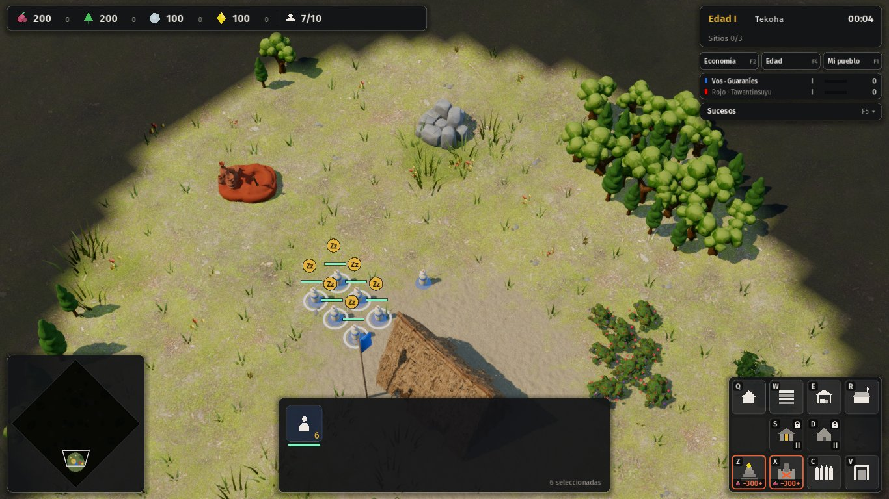 |  |

La misma esquina de la grilla a 4K, en tamaño real (compárese con el recorte de "antes"). El texto queda nítido: Godot rasteriza las fuentes al tamaño final, no estira una textura:

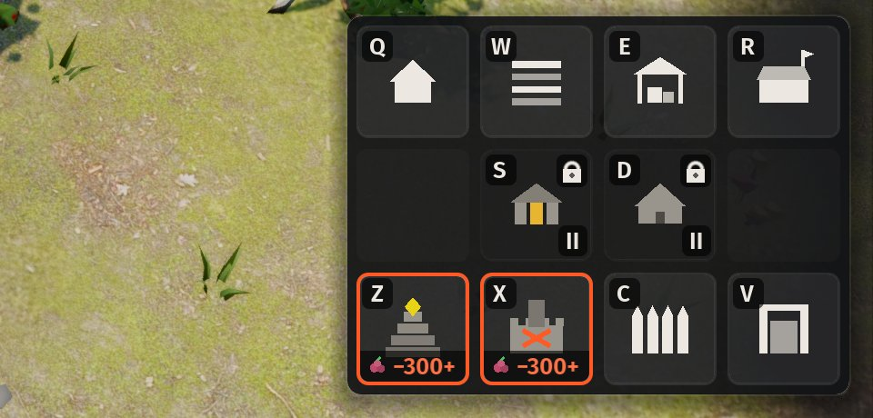

### 4. Menú de opciones guardado

**Dónde vive:** `src/game/ui/opciones.gd` (`class_name Opciones`), con dos partes:
- los valores, como variables estáticas;
- el diálogo, que se abre desde el menú principal (botón "Opciones", que comparte renglón con "Salir") y desde la pausa.
- `Hud._build_options` ahora solo llama a `Opciones.dialogo(self, main)`.

**Opciones:**

| Sección | Opción | Qué hace |
|---|---|---|
| Interfaz | Escala | Automática, 80 %, 100 %, 125 % o 150 % |
| Interfaz | Colores | Segura, deuteranopía, protanopía, tritanopía, o "yo, aliados y rivales", con una muestra de los equipos, los recursos y la vida |
| Interfaz | Barras de vida siempre visibles | Lo mismo que mantener `Alt` |
| Sonido | General, música, efectos y ambiente | De 0 a 100 %. El ambiente es nuevo: `GameAudio.set_ambient_volume` |
| Cámara | Mover con los bordes | Desplazamiento por borde de pantalla |
| Cámara | Velocidad | Del 50 al 200 %: multiplica el desplazamiento con teclado y bordes |
| Pantalla | Pantalla completa | Pantalla completa o ventana maximizada |

**Interruptores legibles.** Los `CheckButton` de Godot, apagados, eran un punto gris casi invisible sobre el panel oscuro. Se cambiaron por botones que dicen "Sí" o "No" y se pintan de dorado cuando están encendidos: se leen sin depender del color.

**Cómo se guarda:**
- En `user://opciones.cfg`, con `ConfigFile`, al cerrar el diálogo.
- Se lee al arrancar, en `main._opciones_al_arrancar()` (bloque `# --- opciones ---`).
- Las capturas (`--shot`) y la prueba de punta a punta (`--autotest`) no leen ni escriben el archivo, para que salgan siempre iguales y no pisen lo que el autor configuró.

**Argumentos nuevos para las capturas:**
- `--escala=auto|0.8|1|1.25|1.5`;
- `--paleta=<modo>`;
- `--barras=1`;
- `--abrir=opciones`.

El diálogo desde el menú principal, a 1366×768:

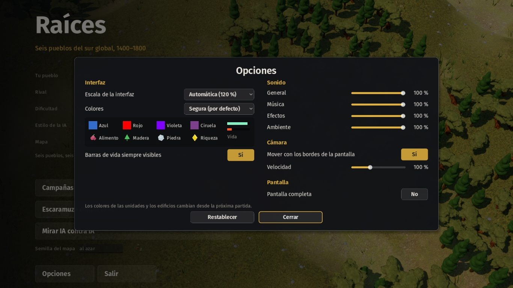

**Pendiente, para la parte B o la mejora 17 de la auditoría:** a 1366×768, el renglón de atajos del pie del menú principal queda por debajo del borde. Pasaba antes de este cambio, y peor: sin estiramiento, la columna medía lo mismo en una pantalla de 768. Lo resuelve el menú con jerarquía (P14), que reordena esa columna.

### 5. Contraste y estados de la grilla

**El problema (P3 y P18).**
- "No alcanza" era una raya roja de 2 px.
- "Bloqueado" era el glifo al 45 %, con un contraste de 2,2:1.
- No se distinguía uno de otro sin pasar el mouse.
- Las letras de atajo eran de 12 px, en gris al 90 % y encima del glifo.

**Qué se hizo.** Una pieza nueva, `src/game/ui/estado_casilla.gd` (`EstadoCasilla.dibujar`), dibuja la casilla. En `hud.gd`, `CommandCard._draw` la llama dentro de un bloque `# --- contraste ---`, y el resto del dibujo de la grilla, como el progreso de la cola, no cambia. Los tres estados:

| Estado | Antes | Después |
|---|---|---|
| Atajo | Letra de 12 px en gris al 90 %, encima del glifo | Pastilla oscura propia arriba a la izquierda, con la letra de 13 px en `UI_TEXT` (14:1) |
| No alcanza | Raya roja de 2 px y glifo al 80 % | Borde rojo de 2 px, glifo en `UI_DIM` (5:1) y una franja abajo con el glifo del recurso que falta y cuánto: "−300". Si falta más de uno, "−300+" |
| Bloqueado | Glifo al 45 % (2,2:1) | Casilla oscurecida, glifo en `UI_DIM` (5,6:1 sobre la casilla oscura), candado arriba a la derecha y la edad que pide ("II") abajo |

Los tres se distinguen por la forma (franja, candado), no solo por el color. La franja y el candado son el aviso en el lugar. El texto del aviso ("Faltan 40 de madera") es de la parte B.

| Antes (aldeano, 1080p, ×2) | Después (aldeano) | Después (cuartel etíope en edad I) |
|---|---|---|
| 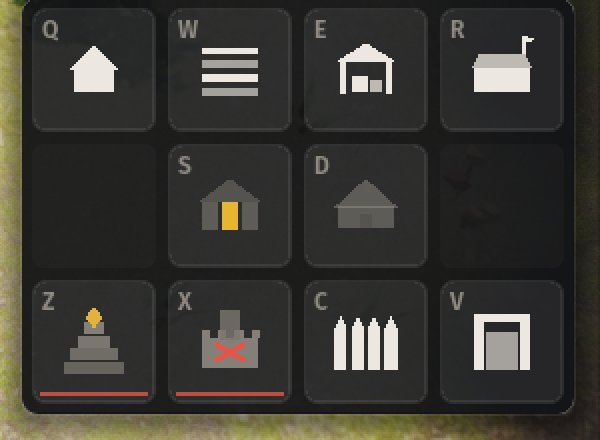 | 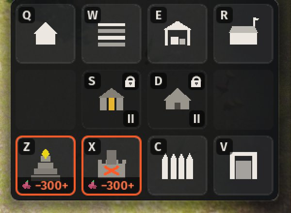 | 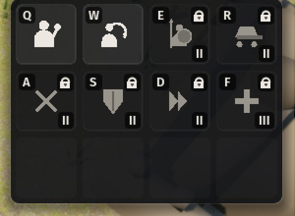 |

**Otros arreglos de contraste:**
- **"Nada seleccionado":** pasa de `UI_DIM` al 60 % (3,0:1) a `UI_DIM` lleno (5:1).
- **Vida baja:** por debajo del 25 %, la barra de vida sobre el mundo titila (`overlay.gd`, bloque `# --- contraste ---`). Así la vida baja no depende solo del color, como pide la sección 5 de la auditoría.

**Las cuatro visiones, antes y después.** Equipos 1 a 4, recursos y vida, con el daltonismo simulado. El par más cercano después es el azul con el violeta en deuteranopía (ΔE 21): se distinguen por la luminosidad, pero son lo más parecido de la paleta. Con 1 contra 1 (azul contra rojo) la diferencia es enorme en las cuatro visiones.

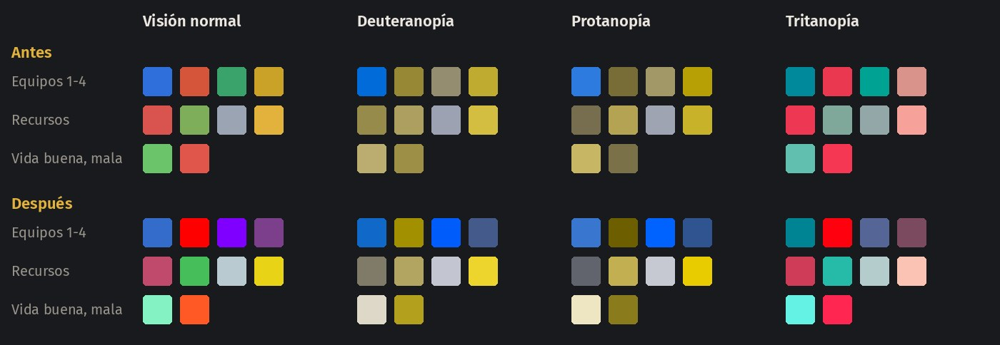

Batalla de prueba con `--barras=1` (barras siempre visibles). Las tuyas van en verde agua, las del rival en el rojo de equipo:

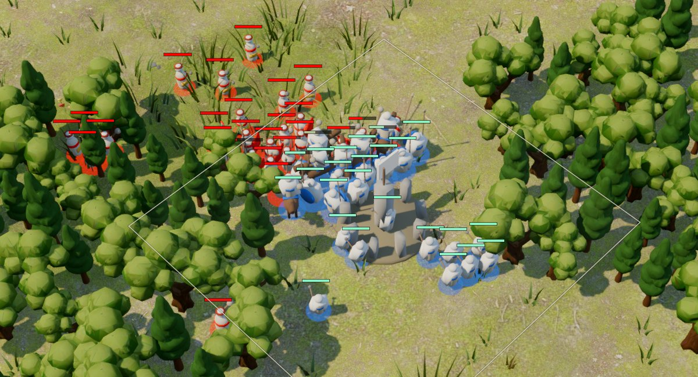

### 6. Pruebas

| Prueba | Resultado |
|---|---|
| `godot --headless --path . -s tests/test_paleta.gd` (nueva) | `PALETA: OK` ([salida](pruebas/a-test_paleta.txt)) |
| `godot --headless --path . -s tests/test_opciones.gd` (nueva: ida y vuelta por `ConfigFile` en un archivo de prueba, escala automática) | `OPCIONES: OK` ([salida](pruebas/a-test_opciones.txt)) |
| `godot --path . -- --autotest --civ=guaranies --terreno=llano --mute` | `AUTOTEST: OK` ([salida](pruebas/a-autotest-1080.txt)) |
| La misma, con `--ventana=1366x768` | `AUTOTEST: OK` |
| La misma, con `--ventana=1366x768 --escala=1.5` | `AUTOTEST: OK` |
| La misma, a 3840×2160 dentro de `gamescope --backend headless` | `AUTOTEST: OK` |

No se tocó `src/sim/`, así que no hacía falta correr ni la prueba de determinismo ni la de rendimiento.

**Antes y después a las tres resoluciones** (aldeanos guaraníes seleccionados, semilla 7):

| | Antes | Después |
|---|---|---|
| 1366×768 |  |  |
| 1920×1080 |  | 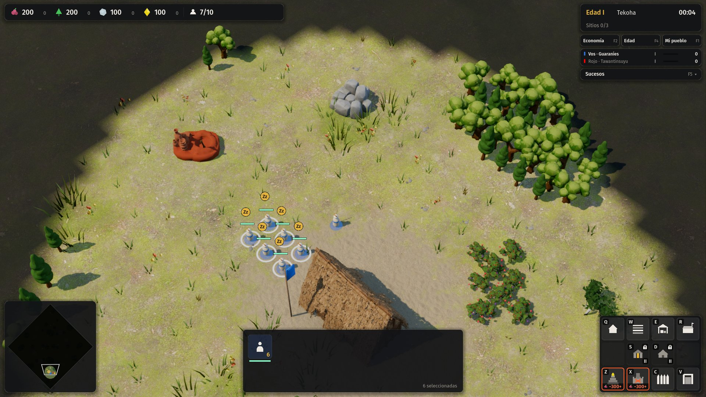 |
| 3840×2160 |  |  |

Opciones desde la pausa, a 4K y con la escala al 125 %. El diálogo se pone delante de los paneles F1–F6; antes, los paneles que se agregan después quedaban encima del fondo oscuro:

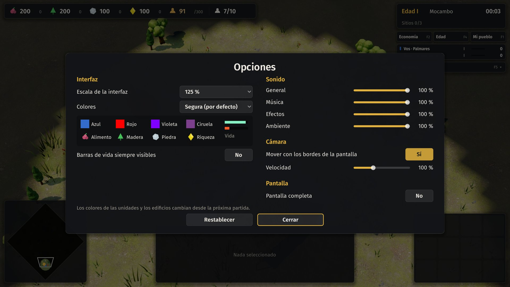

### Tropiezos

1. **`--resolution` no sirve:** la ventana arranca maximizada. Por eso hizo falta `--ventana`.
2. **KDE recorta la ventana al escritorio.** Las capturas de 1080p y 4K se sacan con `gamescope --backend headless`. Con 1366 de ancho, `gamescope` se cuelga, así que esa sale en una ventana común. El script de captura mata a `gamescope` por tiempo con `timeout -s KILL`, porque no responde a `TERM`.
3. **Sin el caché de clases, Godot no conoce las clases nuevas.** Con `class_name Opciones`, la primera corrida dio `Identifier "Opciones" not declared`: hay que correr `godot --headless --path . --import` una vez para que entre la clase.
4. **La prueba de punta a punta y la escala:** los eventos inyectados van en píxeles de la ventana. Se arregló en `_mouse` (paso 3).
5. **Un interruptor apagado no se veía:** el `CheckButton` apagado era casi invisible. Se cambió por un botón "Sí/No".
6. **Ocho colores no caben en las cuatro visiones:** no hay ocho colores de equipo que se separen 20 entre sí y 25 de los recursos en las cuatro visiones a la vez. Se garantiza para los equipos 1 a 4. Los 5 a 8 dependen del modo elegido.
7. **El diálogo de opciones quedaba debajo de los paneles F1–F6:** se agregaban después en el árbol y tapaban el fondo oscuro. El diálogo se pasa adelante al abrirse. El menú de pausa de `Hud` tiene el mismo problema y no se tocó: es de la parte B (P24, cartel de pausa).

### Pendiente

- **Menú principal a 1366×768:** el pie de atajos queda por debajo del borde (P14, menú con jerarquía).
- **Tamaño mínimo de texto:** varios textos de 12 y 13 px siguen dibujados a mano con `draw_string`, en los rótulos de estadísticas y la cantidad de aldeanos por recurso. La escala automática los deja en 10 px reales o más. La opción "Texto grande", independiente de la escala, queda para otra tanda.
- **Colores en el mundo:** el modo de colores se aplica en vivo en la interfaz y el minimapa, pero los modelos 3D lo toman desde la próxima partida.
- **Etapa 18:** cuando haya equipos, tiene que fijar `Palette.es_aliado` para que el modo "yo, aliados y rivales" pinte a los aliados.
- **Contraste en el resto de la interfaz:** los paneles de A1, A2 y A3 (fichas, F1–F6, información en el mundo) usan `Palette.UI_DIM` y los colores nuevos sin cambios. No se revisó su contraste uno por uno.

### Archivos

- **Nuevos:**
  - `src/game/ui/opciones.gd`;
  - `src/game/ui/estado_casilla.gd`;
  - `tests/test_paleta.gd`;
  - `tests/test_opciones.gd`.
- **Con bloques marcados** (`# --- opciones ---`, `# --- escala ---`, `# --- contraste ---`):
  - `main.gd`, `hud.gd`, `menu.gd`;
  - `overlay.gd`, `audio.gd`, `rts_camera.gd`.
- **`palette.gd`:** bloque `# --- paleta ---`.
- **`project.godot`:** modo de estiramiento.
- **`docs/07-arte-y-ui.md`:** paleta.

### Commits

1. `Interfaz A, paso 1: --ventana=ANCHOxALTO y paleta apta para daltonismo`
2. `Interfaz A, paso 2: escala de la interfaz y opciones guardadas`
3. `Interfaz A, paso 3: estados de la grilla legibles y vida baja que titila`
4. `Interfaz A, paso 4: pruebas, capturas finales y documentación`
