# 17 · Parte B: cursores, grilla de comandos, avisos y errores puntuales

Rama `worktree-agent-aa2e7448b89d81484`, 2026-11-14. Trabajo en paralelo con la parte A (escala, paleta para daltonismo, contraste y menú de opciones), que no se tocó: ni `palette.gd`, ni `menu.gd`, ni las opciones del HUD.

## Pedido

De la auditoría [`docs/diseno/interfaz/00-auditoria.md`](../../docs/diseno/interfaz/00-auditoria.md):

1. Cursores contextuales (P7, mejora 4).
2. Grilla de comandos estable como AoE4, con submenús de construcción y hitos con íconos distintos (P4, mejora 5).
3. Avisos con jerarquía, tecla de salto y grupos de control visibles (P6, P11, mejoras 7 y 9).
4. Errores puntuales: renglones pisados en la capital de Palmares (P8), "Tutorial 0/4" (P16), población 33/8 sin explicación (P9) y el "· " suelto (P16).
5. HUD vacío que no tape el mapa y cámara inicial que muestre la capital (P5, mejora 12).

## Qué se hizo y por qué

### 1. Cursores contextuales


*De izquierda a derecha: mover, atacar, recolectar alimento, madera, piedra y riqueza, construir, reparar, refugiarse, depositar, punto de reunión y no se puede. Ampliados al doble sobre pasto.*

- `src/game/ui/cursores.gd` dibuja los cursores **una vez al empezar la partida**, con las mismas primitivas que los íconos del HUD (`Glyphs`): un `SubViewport` de 64 px por cursor, un cuadro, y después se achican al tamaño de `data/interfaz.json → cursores.px` (32) por la escala de la interfaz. Así el recolectar lleva el ícono del recurso con su color, y todo queda en la línea gráfica del juego sin archivos de imagen nuevos.
- Cada cursor tiene contorno oscuro para leerse sobre pasto claro o nieve, y su punto activo propio (la punta de la flecha, la punta de la espada, la cabeza del martillo, el pie del mástil).
- `Controller.cursor_action()` decide qué haría el clic derecho **repitiendo las reglas de `Sim._cmd_target` sin tocar la simulación**: enemigo → atacar (o "no" si solo hay arietes y el blanco es una unidad); recurso → recolectar ese recurso si hay aldeanos; edificio propio en obra → construir; dañado → reparar; granja → recolectar; depósito que acepta la carga → depositar; con lugar → refugiarse (lleno → no); edificio productor seleccionado → punto de reunión. Al colocar un edificio: construir o "no se puede". El ataque en movimiento usa la espada (antes era la cruz del sistema).
- Sin ventana (pruebas sin pantalla) no se dibujan y el juego usa la flecha del sistema.

### 2. Grilla estable con submenús

| | Antes (Tawantinsuyu) | Ahora (Tawantinsuyu) | Ahora (Ayutthaya, militar) |
|---|---|---|---|
| | 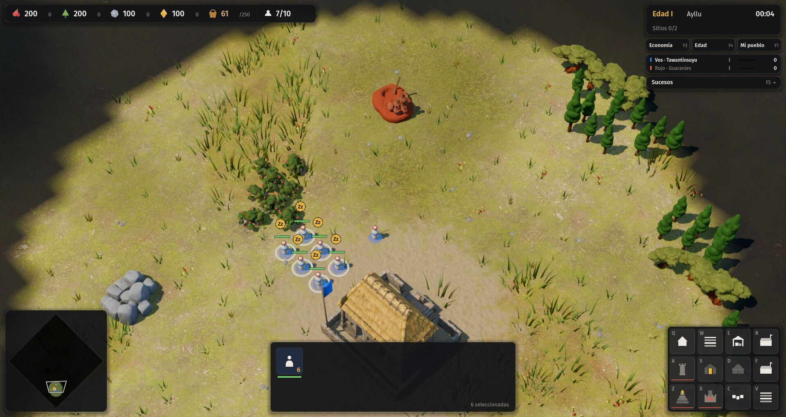 | 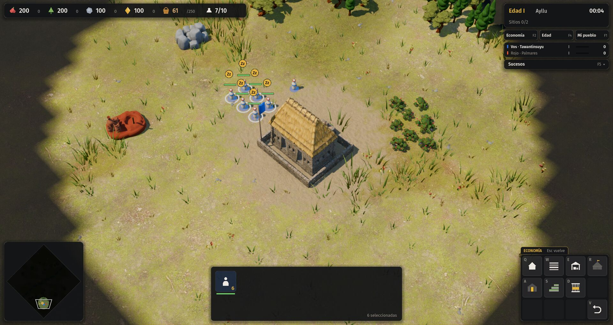 | 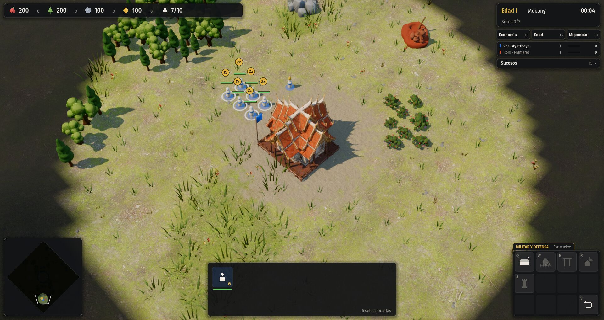 |

- El aldeano ya no reparte los edificios en orden en la primera casilla libre. La raíz muestra **`Q` Economía**, **`W` Militar y defensa**, `S` detener, `F` refugiarse (las mismas casillas que en las tropas) y los hitos: **`Z` siempre el de economía, `X` siempre el militar**, según el campo `eje` de los datos.
- Dentro de cada submenú, cada edificio tiene su casilla por función, **la misma en las seis civilizaciones**. La tabla vive en `data/interfaz.json → grilla` (no es balance: es diseño de interfaz), y `src/game/ui/grilla.gd` la lee:

| Tecla | Economía (`Q`) | Militar y defensa (`W`) |
|---|---|---|
| Q | Casa | Cuartel |
| W | Granja | Edificio militar propio (qollqa, kraal) |
| E | Depósito | Segundo propio (barrio japonés) |
| R | Centro (o lof) | Tercero propio (barrio portugués) |
| A | Mercado | Torre |
| S | Granja propia (andén, gult) | Empalizada |
| D | Motor propio (taller de tejido, corral) | Puerta |
| F | Asentamiento propio (corte nueva, mocambo) | Camino |
| V | Volver | Volver |

- Ejemplo del problema que señalaba la auditoría: la torre era `A` en Tawantinsuyu y en los guaraníes `A` estaba vacía. Ahora la torre es `W`, `A` en todas las civs que la tienen, y los guaraníes, que no tienen torre, dejan esa casilla vacía sin correr nada.
- `Esc`, `V` o clic derecho sobre la grilla vuelven a la raíz; colocar el edificio también vuelve. Encima de la grilla aparece una pestaña con el submenú abierto ("ECONOMÍA · Esc vuelve").
- Íconos distintos: los dos hitos de cada edad (antes, el mismo ícono en `Z` y `X`), y los edificios propios que se dibujaban como la granja o la casa común: andén (terrazas), gult (parcela con estandarte), taller de tejido (telar), corral, corte nueva (tienda), mocambo, qollqa, kraal, barrio japonés y barrio portugués. El centro lleva mástil con bandera para no confundirse con la casa. Íconos nuevos para los submenús y para "volver".
- Si `Recursos insuficientes` llega desde la grilla, ahora dice qué falta: "Faltan 40 de madera y 10 de piedra".
- Se actualizaron el tutorial (`data/campanas/tutorial.json`: "Q abre Economía, Q otra vez elige la casa"; "W abre Militar y Q elige el cuartel"), la ayuda F1, la tecla de cada hito en el panel de edad (F4) y `docs/07-arte-y-ui.md`.

### 3. Avisos con jerarquía, salto y grupos

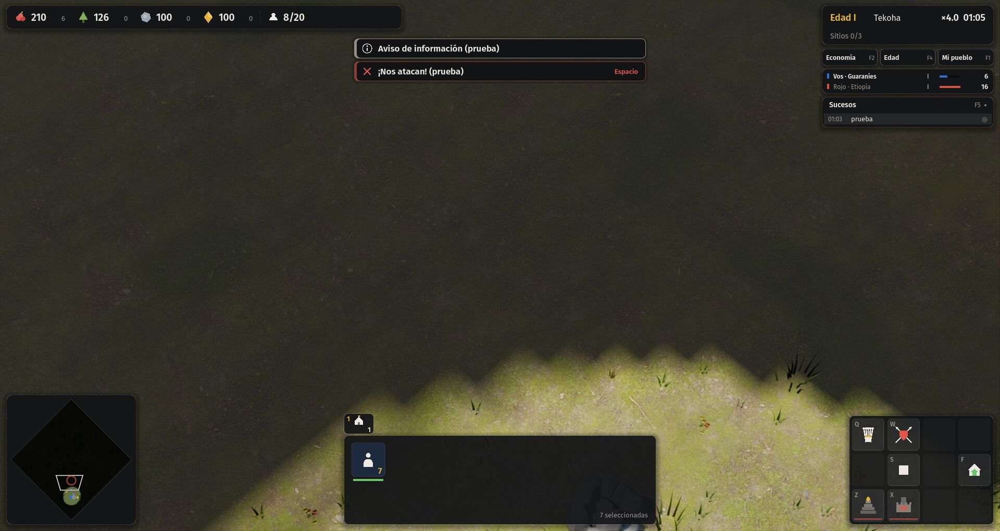

- `src/game/ui/avisos.gd` reemplaza el renglón suelto: cada aviso tiene **fondo propio, borde de color, ícono y tipo** — ataque (rojo, espada), decisión (ámbar, rombo con signo de exclamación), hito (verde, estrella) e información (claro, "i"). Se **apilan** arriba al centro, el más nuevo arriba, hasta cuatro, y no se pisan; si llega el mismo texto se suma (×2). La primera línea va en negrita y la segunda, más chica, se ajusta al ancho.
- Duraciones por tipo en `data/interfaz.json → avisos`.
- Los avisos con lugar en el mapa (ataques, sitios sagrados) se recuerdan: **`Espacio` lleva la cámara al último ataque** (o al último suceso si no hubo ataques) e **`Inicio` recorre los anteriores**. Un clic en el aviso también lleva la cámara. El aviso lo dice a la derecha ("Espacio", "clic").
- Los sucesos `notice` de la simulación (gult asignado, rozas en espera, corte asentada, ingenio destruido…) no se mostraban en ningún lado: ahora salen como información.
- El diálogo de campaña baja si la pila de avisos crece, para no quedar debajo.
- **Grupos de control visibles** (`src/game/ui/grupos.gd`): una fila de pestañas sobre el panel de selección, con número, ícono del tipo más numeroso y cantidad; la del grupo seleccionado se resalta. Clic selecciona; doble clic centra. Se sumó `Mayús + n` para agregar la selección a un grupo.

### 4. Errores puntuales

| | Antes | Después |
|---|---|---|
| Capital de Palmares | 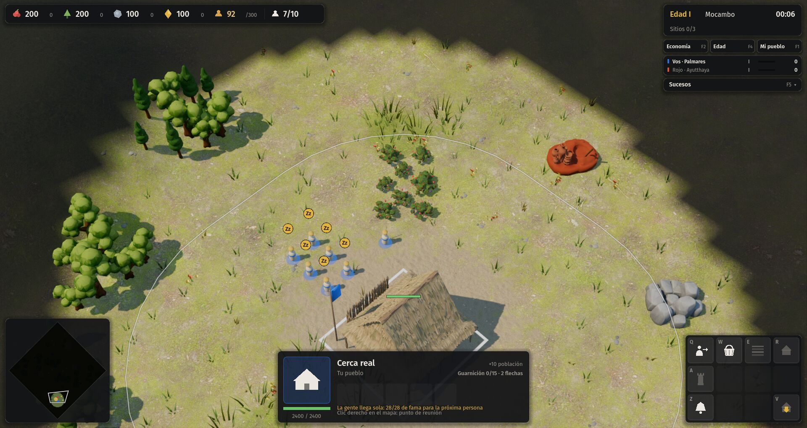 | 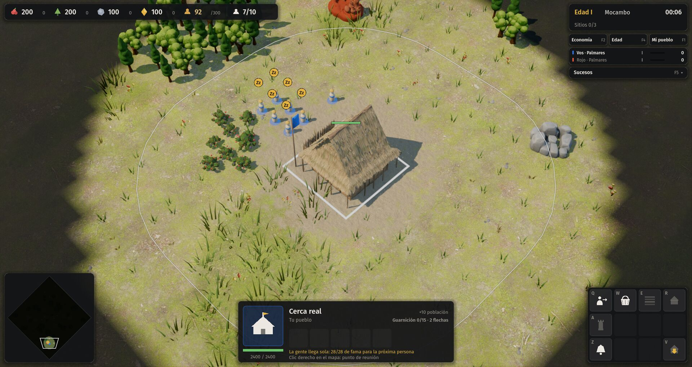 |
| Campañas | 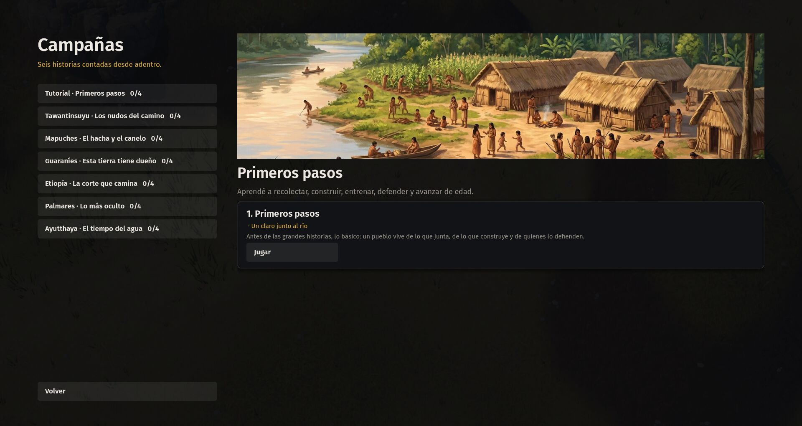 | 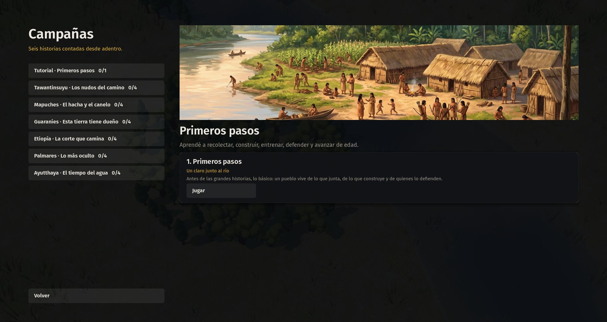 |
| Mapuches, misión 2 | 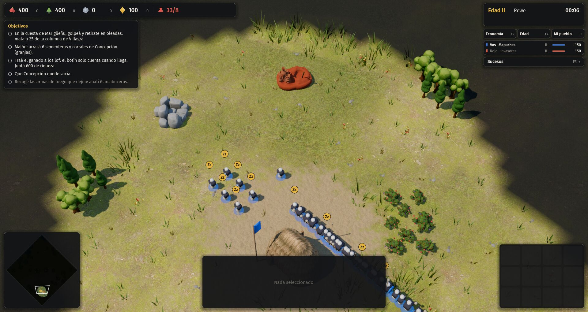 | 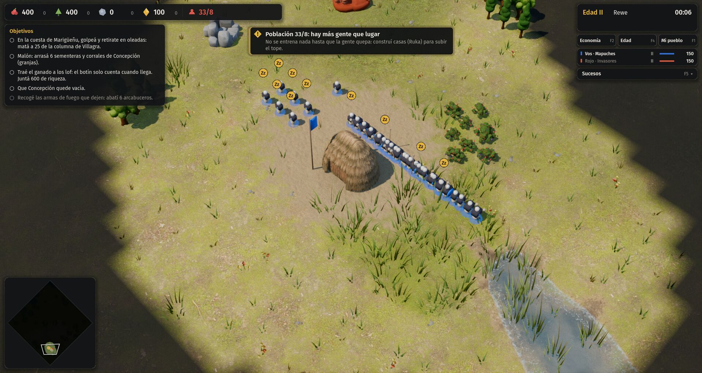 |

- **Palmares**: los renglones de ayuda bajo la cola ("La gente llega sola…", "Clic derecho en el mapa: punto de reunión", "Población llena") ahora se apilan a 16 px en vez de dibujarse a 12 px uno del otro.
- **Tutorial 0/4**: la lista usa la cantidad real de misiones de cada campaña (`0/1`).
- **"· " suelto**: el subtítulo de año y lugar se arma solo con lo que hay (`CampaignUI.subtitle`), en la lista y en la introducción.
- **33/8**: la misión mapuche 2 es un malón (10 aldeanos y 22 guerreros con un lof que da 8 de tope). El motor de escenarios no puede dar casas al jugador y `src/sim/` no se toca, así que **se explica**: al empezar por encima del tope sale un aviso de decisión, "Población 33/8: hay más gente que lugar. No se entrena nada hasta que la gente quepa: construí casas (Ruka) para subir el tope." En escaramuza, al llenarse, un aviso único: "Población llena (10/10). Construí casas (Oga) para seguir entrenando." Queda la consulta C-22 por si el autor prefiere corregir la misión.

### 5. HUD vacío y cámara inicial

| Antes | Después |
|---|---|
| 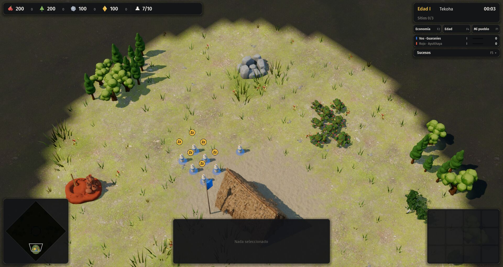 | 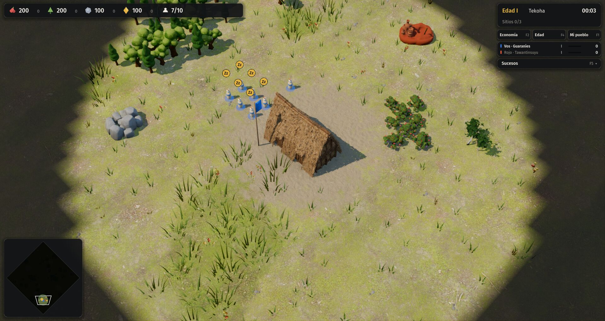 |

- Sin selección, el panel de selección y la grilla **se ocultan** (antes: "Nada seleccionado" y doce casillas vacías, unos 600×172 + 278×210 px que además bloqueaban clics). `Hud.blocks()` ahora ignora lo oculto. Los grupos bajan al borde.
- La cámara inicial mira a la capital (un poco por encima del centro de la pantalla), no a un punto corrido seis casillas: ya no queda a medias detrás del panel. Ver también el tutorial con su diálogo: 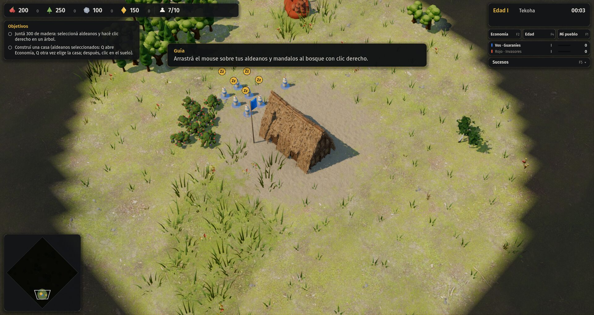

## Archivos

- Nuevos: `src/game/ui/grilla.gd`, `src/game/ui/cursores.gd`, `src/game/ui/avisos.gd`, `src/game/ui/grupos.gd`, `tests/grilla.gd`.
- Cambiados (en bloques `# --- grilla ---`, `# --- avisos ---`, `# --- cursores ---`, `# --- hud ---`): `src/game/controller.gd`, `src/game/hud.gd`, `src/game/glyphs.gd`, `src/game/main.gd` (cámara inicial, `--grilla=economia|militar` para capturas, autotest), `src/game/ui/panel_edad.gd` (tecla del hito), `src/game/campaign_ui.gd`.
- Datos: `data/interfaz.json` (`grilla`, `avisos`, `cursores`), `data/campanas/tutorial.json` (texto de dos objetivos).
- Documentos: `docs/07-arte-y-ui.md`, `docs/09-estado.md`, `proceso/CONSULTAS.md` (C-22).

## Pruebas

- `godot --headless --path . -s tests/grilla.gd` (nuevo): en las seis civilizaciones, cada edificio del aldeano tiene casilla en la tabla, ninguna se pisa ni ocupa "Volver", casa, granja, depósito, centro, mercado, cuartel, torre, empalizada y puerta caen en la misma tecla en todas, y los hitos de cada edad van en Z (economía) y X (militar) con íconos distintos. **GRILLA: OK.**

```
tawantinsuyu   eco[Q=casa W=granja E=deposito R=centro A=mercado S=anden D=taller_tejido]  mil[Q=cuartel W=qollqa A=torre F=camino]
mapuches       eco[Q=casa W=granja E=deposito R=lof A=mercado D=corral]  mil[Q=cuartel S=empalizada D=puerta]
guaranies      eco[Q=casa W=granja E=deposito R=centro A=mercado]  mil[Q=cuartel S=empalizada D=puerta]
etiopia        eco[Q=casa W=granja E=deposito R=centro A=mercado S=gult F=corte_nueva]  mil[Q=cuartel A=torre S=empalizada D=puerta]
palmares       eco[Q=casa W=granja E=deposito R=centro A=mercado F=mocambo]  mil[Q=cuartel S=empalizada D=puerta]
ayutthaya      eco[Q=casa W=granja R=centro A=mercado]  mil[Q=cuartel W=kraal E=barrio_japones R=barrio_portugues A=torre]
```

- `godot --path . -- --autotest --civ=<civ> --terreno=llano --mute` con las **seis civilizaciones: AUTOTEST OK** en todas. El autotest se adaptó a la grilla nueva (`Q`, `Q` para la casa; `W` y la casilla de la empalizada desde la tabla) y suma once comprobaciones: cursor de recolectar sobre el arbusto y de mover sobre el suelo, que se dibujen los doce cursores, `Q` abre Economía, `Esc` vuelve sin deseleccionar, la fila de grupos muestra el grupo 1, `Espacio` lleva la cámara al último ataque, los avisos se apilan, y el panel y la grilla se ocultan sin selección y vuelven con ella. Además guarda la hoja de cursores en `screenshots/cursores.png`.
- `tests/campaign_smoke.gd`: las 25 misiones cargan y corren tres minutos sin errores (cambió el texto de dos objetivos del tutorial).
- `src/sim/` no se tocó: no hace falta determinismo ni banco de pruebas.
- Capturas de este documento: los comandos del apéndice de la auditoría, más `--grilla=economia` y `--grilla=militar` para abrir un submenú.

## Tropiezos

- En el worktree recién creado no existía `.godot/`, y los scripts sueltos (`-s`) no conocían las clases globales (`SimData`, `Grilla`): hubo que correr `godot --headless --path . --import` antes de cada prueba con una clase nueva.
- La primera regla de "a qué submenú va un edificio sin tabla" mandaba el centro a Militar porque tiene flechas: el orden importa (primero población, depósito, granja, renta, motor o mercado → Economía; después producción, flechas o línea → Militar). Igual todo lo actual está en la tabla y la prueba falla si algo nuevo no lo está.
- El segundo renglón de los avisos se cortaba ("construí casas (Ruk"): pasó a ajustarse al ancho y la caja crece con el texto.
- Las cuatro flechitas del cursor de mover salían tan chicas que parecían un cuadrado; se agrandaron. La barra del cursor "no se puede" iba al revés de la señal convencional.
- Los clics en las cajas de avisos y de grupos no deben tapar el mapa entre caja y caja: las dos piezas definen `_has_point` solo sobre lo dibujado.

## Commits

- `008527f` Interfaz, parte B: cursores, grilla estable, avisos con jerarquía y errores puntuales.
- Este documento con el hash del commit anterior.
