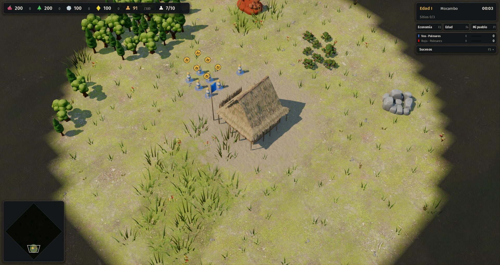

# 17 · Interfaz, segunda tanda (desde 2026-11-14)

## Pedido del autor
> "Move forward with 1, 3 and 4. Start 5 if you think you can. Don't stop and keep documenting in proceso, but for real this time."

El punto 3 es la segunda tanda de interfaz que propuso la auditoría ([`docs/diseno/interfaz/00-auditoria.md`](../../docs/diseno/interfaz/00-auditoria.md)):
- escala de la interfaz;
- paleta apta para daltonismo;
- cursores contextuales;
- grilla de comandos estable;
- avisos con jerarquía y tecla de salto;
- opciones accesibles desde el menú y guardadas;
- errores puntuales: texto pisado en la capital de Palmares, "Tutorial 0/4" y la población 33/8 de una misión mapuche.

## Paso a paso
1. **(09:05) Equipo.** Dos agentes, cada uno en su copia del repositorio, con temas separados para que no se pisen:
   - **A, escala, paleta y opciones:** escala de interfaz, paleta para daltonismo, contraste, menú de opciones guardado y `--ventana`. Escribe [01-escala-paleta-opciones.md](01-escala-paleta-opciones.md).
   - **B, cursores, grilla y avisos:** cursores contextuales, grilla estable con submenús, avisos con jerarquía y tecla de salto, grupos visibles, HUD vacío y los errores puntuales. Escribe [02-cursores-grilla-avisos.md](02-cursores-grilla-avisos.md).

   El líder integra las ramas, resuelve los conflictos y anota aquí cada fusión con sus pruebas.

- **Parte B · cursores, grilla de comandos, avisos y errores puntuales** → [`02-cursores-grilla-avisos.md`](02-cursores-grilla-avisos.md): doce cursores contextuales dibujados con los glifos del juego; grilla del aldeano con submenús Economía (Q) y Militar (W), casillas fijas por función en las seis civs e hitos Z economía / X militar con íconos distintos; avisos con fondo, color por tipo y pila, Espacio e Inicio para saltar; fila de grupos de control; HUD vacío que no tapa y cámara inicial sobre la capital; arreglos de Palmares, "Tutorial 0/1", 33/8 explicado y subtítulo sin "· " suelto. Autotest OK en las seis civs y prueba nueva `tests/grilla.gd`.

2. **(14:35) Fusión de la parte B** (rama del agente, commits `008527f` y `dd4e2e0`).
   - **Conflictos:** solo en documentos (`docs/09-estado.md`, el índice de `proceso/` y este README); se quedaron las dos versiones. El código entró sin choques.
   - **Pruebas sobre lo fusionado:** reimportación de clases, `tests/grilla.gd` OK y autotest OK en las seis civs, en terreno llano.
   - **Consulta nueva:** C-22, misión 2 mapuche (33/8 de población). La explica un aviso al empezar. Arreglarla de verdad pide que el motor de escenarios dé casas al jugador.

- **Parte A, escala, paleta y opciones** ([detalle](01-escala-paleta-opciones.md)):
  - escala de la interfaz automática o elegida (80 a 150 %), legible de 1366×768 a 4K;
  - paleta apta para daltonismo con modos y prueba propia;
  - estados de la grilla a 4,5:1;
  - menú de opciones guardado en `user://opciones.cfg`, desde el menú principal y la pausa;
  - `--ventana=ANCHOxALTO` para las capturas.

3. **(14:55) Fusión de la parte A** (rama del agente, commits `7042a26` a `5697c9b`).
   - **Conflictos:**
     - `src/game/main.gd`: solo la ayuda de argumentos; se quedaron los de las dos partes.
     - `CONSULTAS.md`: las dos partes numeraron su consulta como C-22. La de la paleta pasó a **C-23**.
     - Documentos: se reescribieron las filas de `docs/09` y del índice con las dos partes.
     - El resto (`hud.gd`, `CommandCard._draw`, `palette.gd`) entró sin choques.
   - **Pruebas sobre lo fusionado:** `grilla.gd`, `test_paleta.gd` y `test_opciones.gd` OK. Autotest OK en las seis civs a 1920×1080 y con guaraníes a 1366×768.
   - **Captura de lo integrado** (Palmares, segundo 3): HUD vacío sin panel, cámara sobre la capital y la paleta nueva en la barra de recursos y la lista de jugadores.

     
   - **Pendientes que quedan de la etapa:** atajos del pie del menú principal fuera del borde a 1366×768, opción de texto grande, menú de pausa debajo de los paneles F1–F6, y que los modelos 3D tomen el color nuevo sin reiniciar la partida.

4. **(17:45) Pendiente cerrado: la pausa quedaba debajo de los paneles F1–F6.** Los paneles se agregaban al HUD después que los diálogos. Ahora, al armar los paneles, los diálogos de pausa, opciones, ayuda y fin pasan al frente (`hud.gd`). Lo verifiqué con una captura con los paneles de economía y edad abiertos más las opciones encima. Autotest OK.
