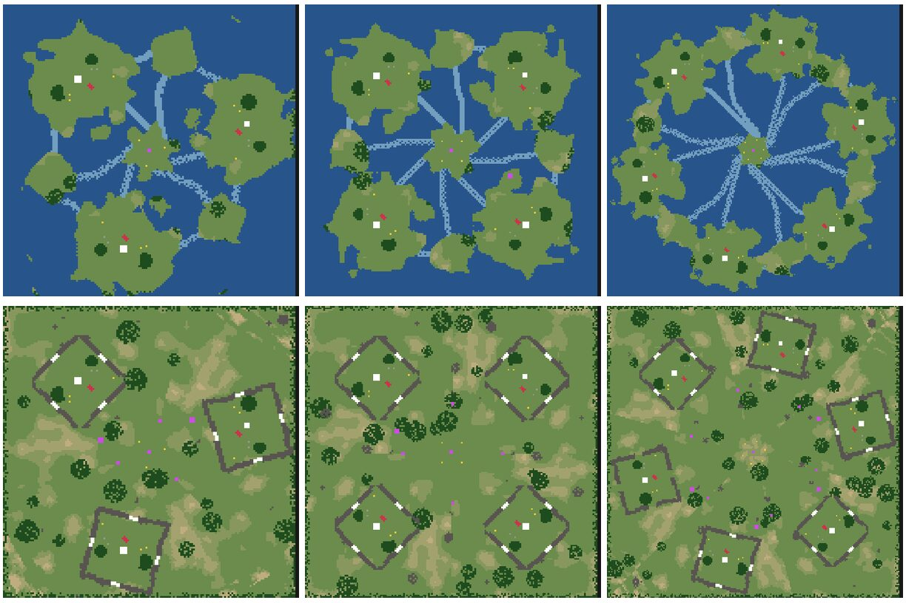
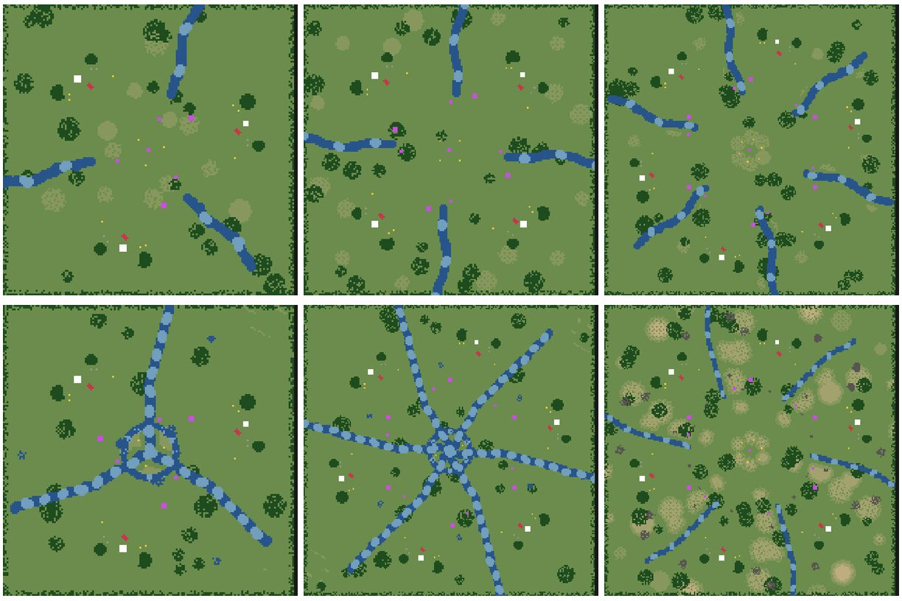
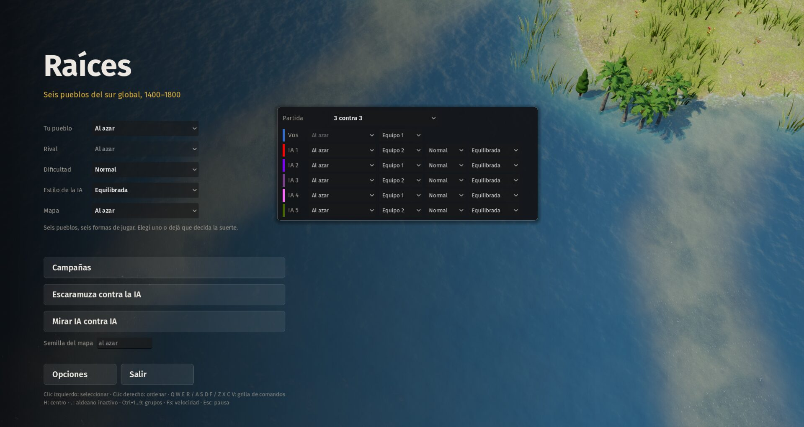
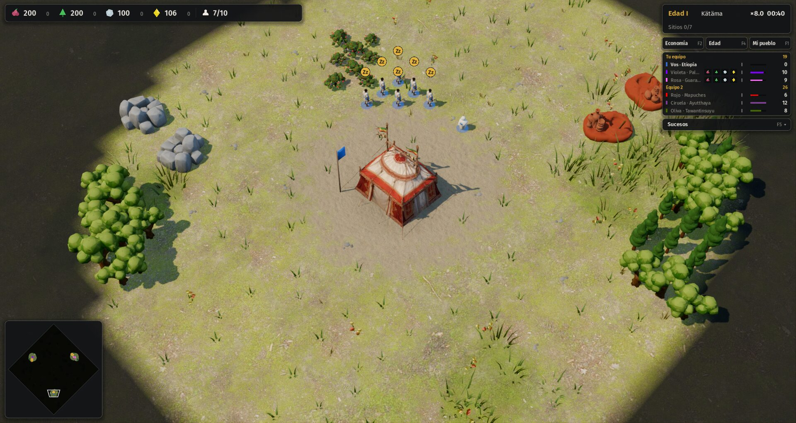
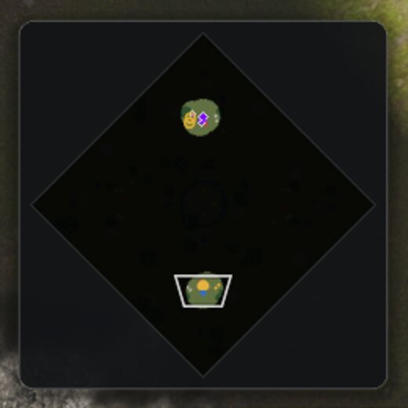

# 18 · Partidas de muchos jugadores y equipos (desde 2026-11-14)

## Pedido del autor
> "Que se pueda jugar de a más de 2 civs en un mismo mapa, pensando en 6 o más, y en equipos. Después de la economía."
> "Move forward with 1, 3 and 4."

Plan: [`docs/11-partidas-de-muchos-jugadores.md`](../../docs/11-partidas-de-muchos-jugadores.md), en seis pasos:
1. Equipos en la simulación.
2. Generador para N bases.
3. Formas de agua y mapas especiales para N.
4. IA en equipo y tributo.
5. Menú de lugares e interfaz.
6. Rendimiento con 6 jugadores.

## Paso a paso
1. **(10:30) Paso 1, equipos en la simulación.**
   - **Equipo de cada jugador:** `players[i].equipo` (opción `equipos` de la partida). Por defecto cada jugador es su propio equipo, así que el 1 contra 1 no cambia.
   - **Hostilidad en una sola regla:** `Sim.team_of` y `Sim.enemies(a, b)`. Pasan por ahí la búsqueda de blancos, el daño en área, la campana, los oficios, el arreo, las bajas, la corte etíope y toda la IA (8 lugares). Los aliados no se atacan.
   - **Visión compartida** con el equipo (`reglas.json → equipos.vision_compartida`).
   - **Victoria por equipo:** termina cuando queda un solo equipo en pie (`Sim.winner_team`).
   - **Sitios sagrados por equipo:** los aliados no se los disputan, y la victoria por sitios cuenta los del equipo.
   - **Prueba nueva `tests/equipos.gd`:** dos 2v2 de IA de 30 minutos ([resultado](pruebas/01-equipos-2v2.txt)). **Cero fuego amigo** en 1346 bajas, y las dos partidas terminan con un equipo ganador.
   - **Pendiente:**
     - en las dos ganó el equipo 0, porque el mapa todavía no es justo para 4 (las bases extra reciben recursos sin simetría): es el paso 2;
     - las puertas de un aliado todavía no lo dejan pasar;
     - el tributo entre aliados llega en el paso 4.

2. **(14:10) Paso 2, generador para N bases.**
   - **Bases en círculo:** con más de 2 jugadores, `Sim._generate_map_n()` reparte las bases sobre un círculo de radio `n/2 − 24`. Las direcciones salen de `reglas.json → bases_circulo` (coseno y seno ×1000 para 3 a 8 jugadores, sin trigonometría en la simulación). El tamaño del mapa crece con `mapa_tam_por_jugadores`.
   - **El mismo juego de recursos para cada base,** medido en casillas "hacia el centro" y "de costado" con `Sim._local()`: arbustos, dos bosques, dos rocas, dos barreales propios de 900, uno de flanco de 1500 y un ingenio a 30 casillas. Si un lugar está ocupado, `_res_at` busca en espiral hasta 5 casillas, así ninguna base se queda sin su pieza.
   - **Lo compartido:** un sitio sagrado al centro y uno entre cada par de bases vecinas; barreal central de 1000 por jugador en anillo; bosques al azar y borde de árboles.
   - **Agua todavía limitada:** con N bases, las formas costados, islas y brazos caen en lago, y fortines no pone anillos. Es el paso 3.
   - **La IA** busca la base enemiga más cercana, no "la otra".
   - **Prueba nueva `tests/equidad.gd`:** de 3 a 8 jugadores mide el camino promedio de cada base a las otras y los recursos a 20 casillas ([resultado](pruebas/02-equidad.txt)).
   - **Tropiezos:**
     - La primera versión medía el camino al centro, pero el centro puede ser un lago: se cambió por el camino promedio a las otras bases.
     - El punto de partida usaba siempre base + (3, 3), que para la base de abajo a la derecha caía del lado de afuera.
     - Rocas y barreales a veces no aparecían porque el lugar estaba ocupado: de ahí la espiral.
     - Los árboles daban hasta 74 % de diferencia entre bases: los bosques propios eran al azar y los bosques sueltos podían caer a 18 casillas de una base. Ahora los propios tienen forma fija (`_blob_fixed`) y los sueltos quedan a más de 27 casillas. Bajó a 8–27 %.
   - **Resultado:** camino entre 3 y 14 % de diferencia (14 % solo con 3 jugadores), arbustos, rocas y barreal 0 %, árboles 8–27 %. Determinismo OK.
   - **El 2v2 otra vez** ([resultado](pruebas/02-equipos-2v2-mapa-n.txt)): cero fuego amigo y ganó el equipo 0 en las dos. Con el mapa ya parejo, sospecho de los cruces de civs (en las dos el jugador 2 llegó a edad IV). Queda para el paso 4: repetir con los equipos invertidos y más semillas.
   - **Vista de los mapas** con `tools/vista_mapas.gd --jugadores=N`:

     | 4 jugadores, bosque | 6 jugadores, llano |
     |---|---|
     |  |  |

3. **(15:40) Paso 3, formas de agua y mapas especiales para N.**
   - **Simetría por giro.** Con 3 o más bases, el agua, los peñascos, las colinas y el relieve ya no usan el espejo de 2 jugadores, que con N bases favorecía a algunas. Se dibuja lo que corresponde a la base 0 y `Sim._sym_points()` lo copia al marco de cada base: tantas casillas "adelante" (hacia el centro) y tantas "de costado". El relieve hace lo inverso: cada casilla toma el ruido de su lugar girado al sector de la base 0 (`_to_frame0`).
   - **Formas con N bases:**
     - **cruce:** ríos desde el centro, uno entre cada par de bases vecinas, con vados;
     - **lago:** lo mismo, con un lago al centro;
     - **costados:** los mismos ríos, pero arrancan a un quinto del mapa: separan a los vecinos y dejan libre el centro;
     - **brazos:** foso en anillo más los ríos;
     - **islas** (`_islands_n`): cada base en su isla, una al centro y una entre cada par de vecinas, unidas por bajíos;
     - **fortines** (`_fort_rings_n`): el mismo cerco de peñas alrededor de cada base, en su propio marco, con salida adelante, atrás y a los costados.

     | Islas y fortines con 3, 4 y 6 jugadores | Río, delta y montaña |
     |---|---|
     |  |  |
   - **Tropiezos:**
     - **Fortines:** con el giro, una empalizada de una o dos casillas de fondo dejaba huecos en diagonal en algunas bases y en otras no. Ahora llena todo el grosor del cerco.
     - **La prueba de equidad medía mal,** por tres razones:
       - contaba las empalizadas retiradas como ocupadas (`remove_quietly` no libera la casilla; la prueba ahora llama a `map.clear`);
       - contaba pasos de camino, y en diagonal un paso es más largo (ahora mide 10 de lado y 14 en diagonal);
       - contaba recursos en un cuadrado, que girado no da lo mismo (ahora es un círculo de 22 casillas desde el centro de la base).
     - **Islas con 5 jugadores:** el barreal de flanco de una base caía al agua y la espiral de 5 casillas no alcanzaba para sacarlo. Ahora busca hasta 9 casillas.
   - **Resultado:**
     - **Equidad** con islas, fortines, río, delta, montaña, valle, llano y bosque, de 3 a 8 jugadores ([resultado](pruebas/03-equidad-agua.txt)):
       - camino entre 5 y 25 % de diferencia (25 % solo en islas con 8 jugadores);
       - arbustos, rocas y barreal 0 %;
       - árboles 0–16 %.
     - **`mapas_smoke` con 4 jugadores** (nueva opción `--jugadores`): los 13 terrenos, nadie trabado ([resultado](pruebas/03-mapas-4j.txt)). Con 6 jugadores ([resultado](pruebas/03-mapas-6j.txt)): un solo trabado, un segundo Palmares en selva, que sigue en edad I a los 15:00. Palmares es la civ que más tarda en la edad II aun en paz (8:10); queda anotado para el balance.
     - Determinismo OK.

4. **(16:20) Paso 4, IA en equipo y tributo.**
   - **Puertas aliadas:** `SimMap.teams` guarda el equipo de cada jugador, y una puerta solo cierra el paso a otros equipos. La prueba lo verifica en fortines 2v2: la puerta del aliado deja pasar y la del rival no.
   - **Tributo:** comando `tributo` (a un aliado, de alimento, madera, piedra o riqueza). Sale todo y llega con un 20 % de comisión (`reglas.equipos.tributo_comision_pct`). Queda anotado en el libro de ingresos.
   - **IA** (`sim_ai.gd`), con todos los números en `reglas.json`:
     - **rival:** el estilo elige el enemigo más cercano (`objetivo: cercano`, equilibrada) o el de menos ejército (`debil`, agresiva). Si un aliado ya va contra alguien, se suma (`focus`);
     - **defensa de aliados:** si atacan la capital de un aliado a menos de 70 casillas, va a ayudar (`ia_ayuda_radio`, `ia_ayuda_amenaza`);
     - **tributo:** cada minuto da 200 de lo que le sobra (más de 800) al aliado que tiene menos de 150 (`ia_tributo`);
     - **ataque:** se para del lado de quien llega, no "arriba o abajo según el jugador", que solo servía con 2.
   - **Prueba `tests/equipos.gd` ampliada:** puertas, 2v2 con los equipos cambiados de lado, 3v3 y todos contra todos con 6 ([resultado](pruebas/04-equipos.txt); completo).
     - En los dos 2v2, cambiar el número de equipo da exactamente la misma partida y ganan los mismos jugadores. Las victorias del "equipo 0" de antes venían de los lugares y las civs, no del número.
     - Cero fuego amigo.

5. **(16:50) Paso 5, menú de lugares e interfaz.**
   - **Menú:** columna nueva "Partida" con 1 contra 1, 2 contra 2, 3 contra 3, 4 contra 4 y todos contra todos con 4, 6 u 8. Cada lugar tiene civ, equipo, dificultad y estilo, y el primero es el tuyo. En el 1 contra 1 queda como antes.

     
   - **`main.gd`:**
     - arma la partida con los lugares, o con `--civs=a,b,… --equipos=0,1,…` para las pruebas;
     - la repetición guarda el estilo y la dificultad de cada IA y sirve para N jugadores;
     - `--partida=N` preelige el tipo en el menú.
   - **HUD:**
     - el puntaje (F6) agrupa por equipo, con el total de cada uno ("Tu equipo" primero);
     - en la fila de cada aliado hay cuatro botones de tributo (100 por clic, con la comisión en la ayuda);
     - avisos de "Atacan a tu aliado", del tributo recibido y de un sitio tomado por un aliado;
     - la victoria de un aliado cuenta como tuya;
     - la ficha dice "Aliado" en lugar de "Rival";
     - el modo de colores "yo, aliados y rivales" ya sabe quién es aliado (`Palette.es_aliado`).

     
   - **Minimapa:** los edificios de un aliado llevan borde claro (arriba, el violeta aliado; abajo, la base propia).

     
   - **Pruebas:** autotest OK en 1 contra 1, banco de 200 unidades sin cambios (9,7 ms por tick), y capturas de 2v2 y 3v3 en el segundo 40.

6. **(17:20) Paso 6, rendimiento con 6.**
   - **`tests/bench.gd -- --jugadores=6`:** 6 × 150 unidades que convergen al centro, y una partida de 6 IA de 20 minutos. A ×4 de velocidad entran 4 ticks en los 100 ms de presupuesto, así que cada tick tiene que quedar por debajo de 25 ms.
   - **Primera medición, con otras dos pruebas corriendo en la misma máquina** ([resultado](pruebas/06-bench-6.txt)):
     - batalla de 900 unidades: 46 ms por tick, peor 215 ms;
     - 6 IA: 21 ms de promedio, 35 en el último minuto y un pico de 782 ms. **No alcanza.**
   - **Perfil por partes con `tools/perfil_tick.gd`, batalla de 900 (ms por tick):**

     | Parte | Antes | Después |
     |---|---|---|
     | Unidades (casi todo el avance con ataque) | 20,5 | 16,5 |
     | Separación | 11,3 | 11,0 |
     | Niebla | 9,7 | 6,6 |
     | Resto | 4,5 | 4,8 |
   - **Arreglos:**
     - **equipos en un arreglo (`_teams`):** `enemies()` se llama por cada candidato de `find_enemy` y antes leía diccionarios;
     - **máscara de dueños por celda (`_emask`):** `find_enemy` saltea las celdas donde solo hay aliados, que mientras un ejército avanza son casi todas;
     - **niebla:**
       - no se vuelve a pintar el mismo círculo (misma casilla y radio) en un ejército apretado;
       - con visión compartida se calcula una vez por equipo y se copia a los aliados;
     - **consultas a celdas vacías** usan un arreglo constante en vez de crear uno nuevo.
   - **Separación cada 2 ticks** (`reglas.separacion_cada_ticks`): cada par de unidades encimadas se separa en ticks alternos, con el doble de empujón. Se separan igual de rápido con la mitad del trabajo: bajó de 11,0 a 5,9 ms en la batalla de 900. En el banco de 200 unidades, de 9,7 a 8,2 ms por tick.
   - Determinismo OK. **Falta:** la medición limpia, sin otras pruebas corriendo a la vez.

7. **(19:30) Resultados de los pasos 3 y 4, y equidad con 50 semillas.**
   - **Equipos** ([resultado](pruebas/04-equipos.txt)):
     - **3v3:** abierta a los 30:00, con 1119 bajas y 7 tributos de la IA;
     - **todos contra todos con 6:** 1080 bajas y un derrotado;
     - **en todas:** cero fuego amigo. Con los equipos cambiados de lado, la partida es idéntica.
   - **Equidad con 50 semillas,** como pedía el plan, en los 13 terrenos y de 3 a 8 jugadores. La primera corrida falló en islas (camino hasta 72 % de diferencia y barreal de flanco faltante en algunas bases). Tres causas:
     1. **Bajíos con agujeros:** se giraban casilla por casilla y quedaban huecos en diagonal. Ahora el mismo meandro se dibuja entero en el marco de cada base.
     2. **Árboles en la punta de los bajíos:** un bosque suelto que cae donde el bajío toca la isla la deja sin salida, y la imagen de alcance lo mostró enseguida. Con N bases, ningún árbol a menos de 2 casillas de un vado. En los mapas de 2 queda como estaba.
     3. **Barreal de flanco al borde:** estaba a 20 casillas y el redondeo del giro lo dejaba a 22 o 23 en algunas bases. Pasó a (11, −15). Además, los recursos de una base buscan lugar cerca y, si no hay, se acercan a la base, en vez de correrse afuera.
   - **Resultado** ([resultado](pruebas/03-equidad-50.txt)): camino entre 4 y 11 % de diferencia, arbustos, rocas y barreal 0 %, árboles 5–20 %. Determinismo OK.
   - **Torneo 1 contra 1 después de los cambios de IA,** 2 semillas, 10 partidas por civ ([resultado](pruebas/04-torneo-1v1.txt)):

     | Civ | Etapa 14 (5 semillas) | Ahora (2 semillas) |
     |---|---|---|
     | Ayutthaya | 40 % | 70 % |
     | Guaraníes | 40 % | 70 % |
     | Mapuches | 68 % | 50 % |
     | Etiopía | 60 % | 40 % |
     | Palmares | 40 % | 40 % |
     | Tawantinsuyu | 52 % | 30 % |

     Con 10 partidas el ruido es de unos ±15 puntos. Lo que sí cambia es que hay menos victorias por destrucción de hitos (16 de 30, antes 2 de cada 3), y puede venir del nuevo lugar del ataque. Lo confirmo con 5 semillas antes de tocar nada.

8. **(20:10) Paso 6, cierre: picos de la IA y medición limpia.**
   - **Medición sin otras pruebas en paralelo:** la batalla de 900 bajó a 32 ms por tick. En la partida de 6 IA aparecían picos de hasta 688 ms, un tirón visible.
   - **Búsqueda del pico:**
     - midiendo cada parte de `think()`, el tiempo estaba en el motor del Tawantinsuyu: unos 600 ms cada vez que pensaba, desde el minuto 12;
     - al llegar al máximo de talleres de la edad, buscaba lugar igual: `_site_near` probaba unos 3600 lugares y, en cada uno, `can_place` recorría todas las entidades para contar talleres, y todos fallaban;
     - el arreglo es `Sim.engine_room()`, que pregunta una vez si queda cupo y, si no queda, la búsqueda ni empieza. La IA hace lo mismo que antes, solo que se entera antes.
   - **Resultado** ([resultado](pruebas/06-bench-6-limpio.txt)):

     | Medida | Primera | Ahora |
     |---|---|---|
     | Batalla 6 × 150, promedio por tick | 46 ms | 32 ms |
     | 6 IA, 20 minutos, promedio | 21 ms | 18 ms |
     | 6 IA, último minuto | 35 ms | 28 ms |
     | 6 IA, peor tick | 782 ms | 140 ms |
   - **Lectura:** 4 ticks por cuadro piden menos de 25 ms por tick. Una partida de 6 IA entra en promedio a ×4. En los momentos más cargados (fin de partida y batallas de 900 unidades) entra a ×3, no a ×4. Lo anoto como deuda; el próximo paso sería caminos con caché por región, como decía el plan.
   - Determinismo OK.
