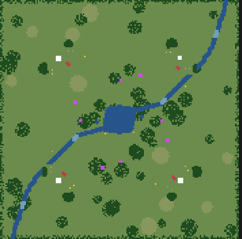
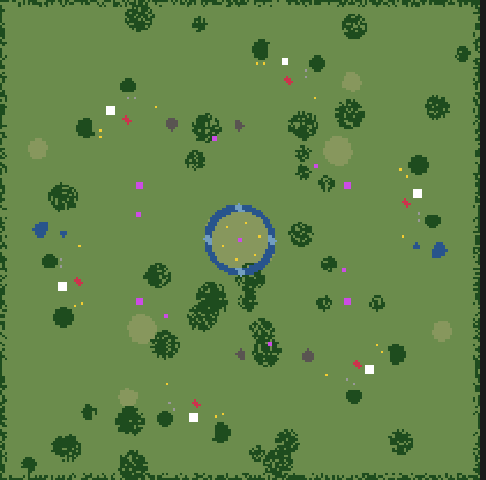

# 18 · Partidas de muchos jugadores y equipos (desde 2026-11-14)

## Pedido del autor
> "Que se pueda jugar de a más de 2 civs en un mismo mapa, pensando en 6 o más, y en equipos. Después de la economía."
> "Move forward with 1, 3 and 4."

Plan: [`docs/11-partidas-de-muchos-jugadores.md`](../../docs/11-partidas-de-muchos-jugadores.md), en seis pasos:
1. Equipos en la simulación.
2. Generador para N bases.
3. Formas de agua y mapas especiales para N.
4. IA en equipo y tributo.
5. Menú de lugares e interfaz.
6. Rendimiento con 6 jugadores.

## Paso a paso
1. **(10:30) Paso 1, equipos en la simulación.**
   - **Equipo de cada jugador:** `players[i].equipo` (opción `equipos` de la partida). Por defecto cada jugador es su propio equipo, así que el 1 contra 1 no cambia.
   - **Hostilidad en una sola regla:** `Sim.team_of` y `Sim.enemies(a, b)`. Pasan por ahí la búsqueda de blancos, el daño en área, la campana, los oficios, el arreo, las bajas, la corte etíope y toda la IA (8 lugares). Los aliados no se atacan.
   - **Visión compartida** con el equipo (`reglas.json → equipos.vision_compartida`).
   - **Victoria por equipo:** termina cuando queda un solo equipo en pie (`Sim.winner_team`).
   - **Sitios sagrados por equipo:** los aliados no se los disputan, y la victoria por sitios cuenta los del equipo.
   - **Prueba nueva `tests/equipos.gd`:** dos 2v2 de IA de 30 minutos ([resultado](pruebas/01-equipos-2v2.txt)). **Cero fuego amigo** en 1346 bajas, y las dos partidas terminan con un equipo ganador.
   - **Pendiente:**
     - en las dos ganó el equipo 0, porque el mapa todavía no es justo para 4 (las bases extra reciben recursos sin simetría): es el paso 2;
     - las puertas de un aliado todavía no lo dejan pasar;
     - el tributo entre aliados llega en el paso 4.

2. **(14:10) Paso 2, generador para N bases.**
   - **Bases en círculo:** con más de 2 jugadores, `Sim._generate_map_n()` reparte las bases sobre un círculo de radio `n/2 − 24`. Las direcciones salen de `reglas.json → bases_circulo` (coseno y seno ×1000 para 3 a 8 jugadores, sin trigonometría en la simulación). El tamaño del mapa crece con `mapa_tam_por_jugadores`.
   - **El mismo juego de recursos para cada base,** medido en casillas "hacia el centro" y "de costado" con `Sim._local()`: arbustos, dos bosques, dos rocas, dos barreales propios de 900, uno de flanco de 1500 y un ingenio a 30 casillas. Si un lugar está ocupado, `_res_at` busca en espiral hasta 5 casillas, así ninguna base se queda sin su pieza.
   - **Lo compartido:** un sitio sagrado al centro y uno entre cada par de bases vecinas; barreal central de 1000 por jugador en anillo; bosques al azar y borde de árboles.
   - **Agua todavía limitada:** con N bases, las formas costados, islas y brazos caen en lago, y fortines no pone anillos. Es el paso 3.
   - **La IA** busca la base enemiga más cercana, no "la otra".
   - **Prueba nueva `tests/equidad.gd`:** de 3 a 8 jugadores mide el camino promedio de cada base a las otras y los recursos a 20 casillas ([resultado](pruebas/02-equidad.txt)).
   - **Tropiezos:**
     - La primera versión medía el camino al centro, pero el centro puede ser un lago: se cambió por el camino promedio a las otras bases.
     - El punto de partida usaba siempre base + (3, 3), que para la base de abajo a la derecha caía del lado de afuera.
     - Rocas y barreales a veces no aparecían porque el lugar estaba ocupado: de ahí la espiral.
     - Los árboles daban hasta 74 % de diferencia entre bases: los bosques propios eran al azar y los bosques sueltos podían caer a 18 casillas de una base. Ahora los propios tienen forma fija (`_blob_fixed`) y los sueltos quedan a más de 27 casillas. Bajó a 8–27 %.
   - **Resultado:** camino entre 3 y 14 % de diferencia (14 % solo con 3 jugadores), arbustos, rocas y barreal 0 %, árboles 8–27 %. Determinismo OK.
   - **El 2v2 otra vez** ([resultado](pruebas/02-equipos-2v2-mapa-n.txt)): cero fuego amigo y ganó el equipo 0 en las dos. Con el mapa ya parejo, sospecho de los cruces de civs (en las dos el jugador 2 llegó a edad IV). Queda para el paso 4: repetir con los equipos invertidos y más semillas.
   - **Vista de los mapas** con `tools/vista_mapas.gd --jugadores=N`:

     | 4 jugadores, bosque | 6 jugadores, llano |
     |---|---|
     |  |  |
