# 19 · Arte y sonido — 01 · Modelos de unidades y música para Etiopía (2026-11-14)

## Pedido
Punto 5 del plan, en tres partes:
- **(a)** modelos generados con Meshy para las unidades que todavía eran la maqueta procedural: primero el aldeano de cada pueblo y, si alcanzaba, la unidad militar más característica de cada uno. Presupuesto: 350 créditos.
- **(b)** música para Etiopía, que no tenía ninguna, solo con licencia CC0 o de dominio público.
- **(c)** si quedaba tiempo, una animación más rica.

## (a) Modelos

### Paso a paso
1. **Conceptos** (`tools/generar_unidades.py imagenes`). Son nueve imágenes con el estilo del jinete mapuche y el elefante: personaje estilizado, mate, un solo personaje de cuerpo entero, pose neutra, sin base ni suelo. Se revisaron todas antes de pagar el 3D (`01-conceptos.jpg`).
   - Aldeanos, cada uno con su ropa y su herramienta:
     - **Runa**: unku con tocapu, manta anudada, llawt'u rojo y chakitaqlla al hombro.
     - **Che**: makuñ con grecas escalonadas, trarilonko, azada de palo y canasto.
     - **Ava**: pintura de urucum, faja de algodón, vincha de plumas, palo cavador y canasto ajaka a la espalda.
     - **Gäbbar**: shamma blanca con tibeb, hoz y bastón.
     - **Palmarista**: camisa y calzón de algodón, turbante ocre, azada de hierro y canasto de mandioca.
     - **Phrai**: chong kraben índigo, pha khao ma al hombro, sombrero cónico y azada.
   - Unidades características: el **hondero** inca (unku ajedrezado, chaleco acolchado y waraka), el **arquero** guaraní y el **jinete noble** etíope (capa de melena de león, escudo de cuero y caballo tordillo).
2. **Modelos 3D** (`… modelos`). Se usó `multi-image-to-3d` con **`should_remesh` en la misma tarea**, una opción nueva en `meshy_api.py` (`--remesh`). Así Meshy respeta `target_polycount` y entrega unos 2500 triángulos sin cobrar los 5 créditos del remesh aparte. Hacer el remesh por separado, como en la etapa 16, habría costado 45 créditos más.
3. **Optimización** (`tools/optimizar_glb.py`, sin cambios). Con la malla ya baja, Blender solo achica la textura a 512 px y descarta los mapas normal y de metal/rugosidad (`solo_color`). No hubo astillas, porque no hizo falta diezmar.
4. **Integración** (`data/civs/*.json → estilo.modelos` y `src/game/world_view.gd → _model_for`):
   - `aldeano` en los seis pueblos; `hondero` en Tawantinsuyu y Guaraníes; `guerrero` (jinete noble) en Etiopía.
   - **Escala por altura**: una figura de pie (más alta que 1,3 veces su ancho) se escala por el alto (`FIGURE_H` = 1,25 m, antes de `escala_visual.unidad_pct`). Con el método anterior, que ajustaba el lado horizontal mayor, el arco o la azada que sobresalían achicaban o agrandaban la figura según el modelo.
   - **Centrado en la cintura**: se calcula la mediana de los vértices a media altura, así la herramienta no corre la figura fuera de su disco.
   - **Faja del color del equipo**: un toro aplanado a la altura de la cadera, con los radios del percentil 70 de esos vértices. Es el mismo recurso del cinturón de la maqueta y se lee aunque el disco quede tapado por un campo o por otras unidades. Las unidades montadas siguen con el disco, que es más grande.
   - La animación procedural (paso, balanceo, inclinación al trabajar y estocada) se aplica igual, porque mueve el nodo que contiene al modelo.
   - **Retratos de las fichas**: se rehicieron los nueve con `tools/render_retratos.gd -- --tipos=aldeano,hondero,guerrero`.
5. **Cámara para capturas**: `--cam=bX,bZ,…` toma la posición relativa a la base propia, que cambia con la semilla (`src/game/main.gd`).
6. **Demo de rendimiento**: con `--demo=multitud`, 200 aldeanos se cruzan en el centro del mapa.

### Triángulos finales

| Modelo | Triángulos | Textura | Uso |
|---|---|---|---|
| tawantinsuyu_aldeano | 2.475 | 512 | Runa |
| mapuches_aldeano | 2.497 | 512 | Che |
| guaranies_aldeano | 2.495 | 512 | Ava |
| etiopia_aldeano | 2.458 | 512 | Gäbbar |
| palmares_aldeano | 2.475 | 512 | Palmarista |
| ayutthaya_aldeano | 2.471 | 512 | Phrai |
| tawantinsuyu_hondero | 2.707 | 512 | Hondero |
| guaranies_arquero | 2.666 | 512 | Arquero (tipo `hondero`) |
| etiopia_jinete | 3.036 | 512 | Jinete noble (tipo `guerrero`) |

En el repositorio ocupan 2,4 MB entre todos (GLB y texturas extraídas).

### Créditos
Saldo inicial: 403. Se gastaron **324** de los 350 asignados:
- 9 conceptos a 6 créditos: 54;
- 9 modelos 3D a 30, con el remesh incluido: 270.

Saldo final: 79. Todo queda anotado en `assets/generados/registro.jsonl`. El flecheiro de Palmares no entró: costaba 36 y quedaban 26 del presupuesto.

### Rendimiento
Se midió con `--demo=multitud --civ=tawantinsuyu --rival=guaranies --seed=3 --nofog --perf --cam=64,64,40`: 200 aldeanos caminando en cámara, más las bases. Cada corrida promedia 40 s. El autor tenía el juego abierto en la misma GPU, así que las cifras varían de una corrida a otra.

| Variante | Corrida 1 | Corrida 2 |
|---|---|---|
| Maqueta procedural | 50 fps (mediana) | 75 |
| Modelos generados | 92 | 92 |

Los modelos no cuestan más que la maqueta y hasta rinden mejor. Godot genera niveles de detalle al importar el GLB y cada modelo es una sola superficie, mientras que la maqueta une muchas piezas por color de equipo. Los objetos dibujados bajan de unos 2000 a entre 600 y 1000.

### Capturas

| | |
|---|---|
| **Conceptos** | **Modelos optimizados (render de Blender)** |
| 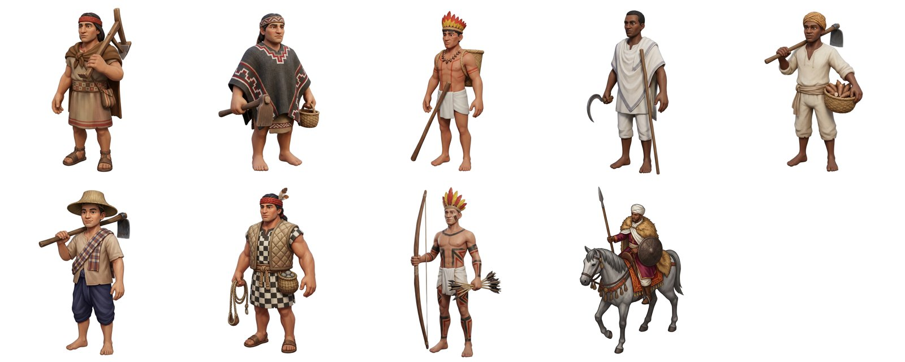 | 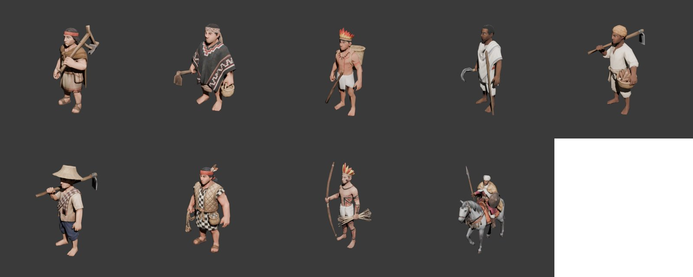 |

Antes (maqueta) y después, con `--demo=base --seed=1 --cam=b5,b4,16,55` para los aldeanos y `--cam=b11,b7,16,55` para las unidades:

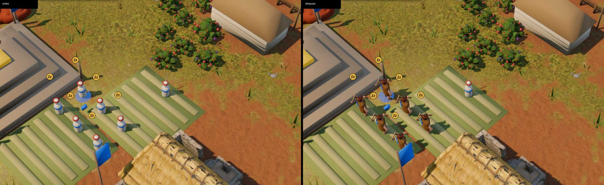
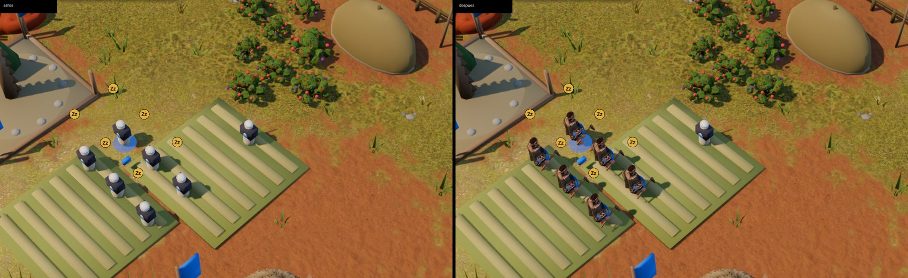
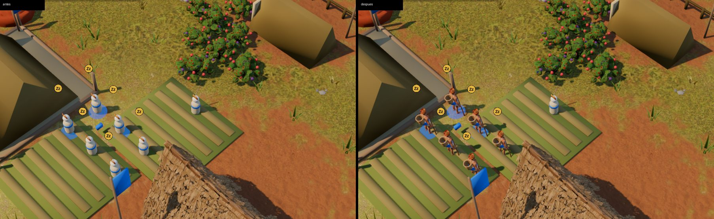
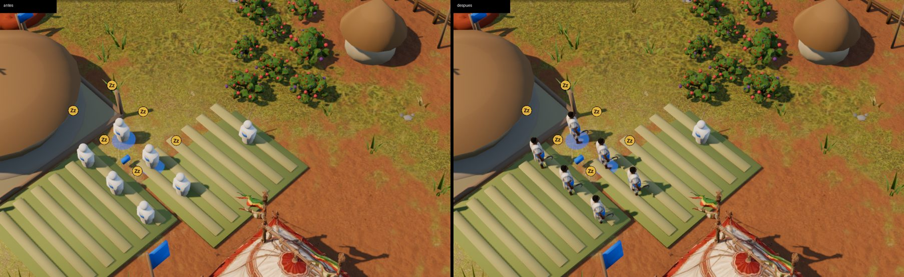
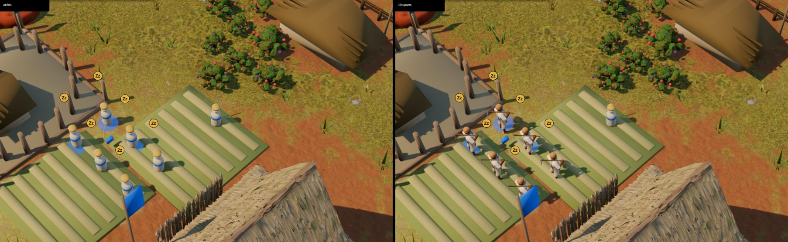
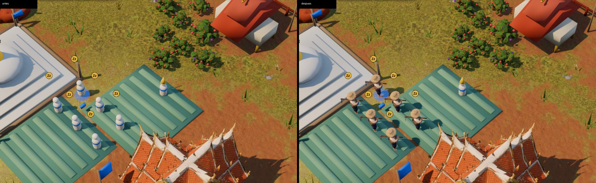
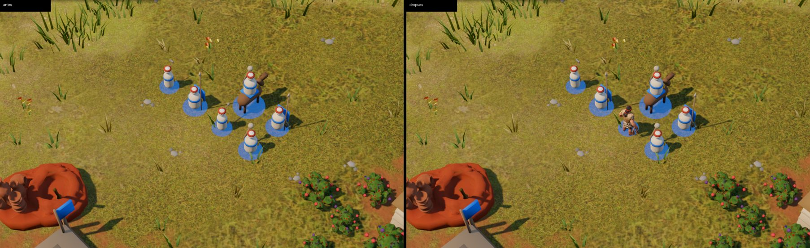
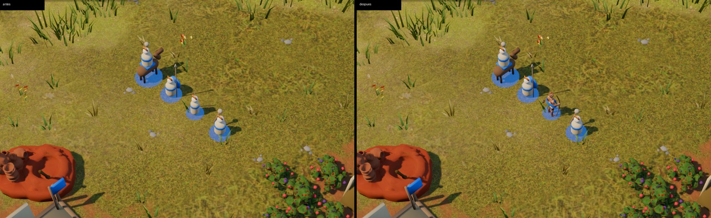
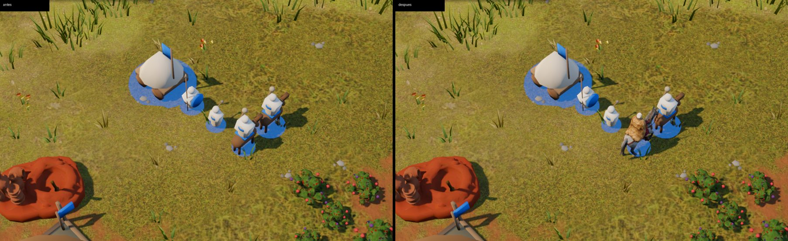

Doscientos aldeanos (`--demo=multitud`); a la izquierda la maqueta, a la derecha los modelos:

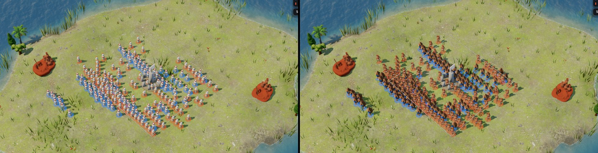

### Tropiezos
- **El remesh aparte no hacía falta.** En la etapa 16 se pagaba `remesh` (5 créditos) después del 3D. Pasar `should_remesh: true` en la misma tarea `multi-image-to-3d` da la malla baja directamente y la textura horneada sobre ella.
- **La escala por el lado horizontal no sirve para personas.** El arquero guaraní mide 0,99 de ancho por el arco y el Runa 1,14 de fondo por la chakitaqlla: ajustados a 0,9 m de ancho, habrían medido casi dos metros. Se escalan por la altura.
- **Al principio las figuras quedaban chicas** al lado de la maqueta, que es más ancha. Se subió `FIGURE_H` de 1,0 a 1,25.
- **El color del equipo**: el disco queda tapado por los campos de cultivo y entre muchas unidades. Por eso se agregó la faja. En el equipo rojo con los guaraníes (pintura de urucum) la faja se distingue menos; el disco sigue ayudando.
- **Capturas desde la copia de trabajo**: hace falta `godot --headless --path . --import` antes de la primera corrida, porque sin `.godot/` no se registran las clases.
- **Las capturas de antes** se sacaron con los `data/civs/*.json` del último commit y el código nuevo: la maqueta no depende de los cambios en `_model_for`.

### Pruebas
- `godot --path . -- --autotest --civ=guaranies --terreno=llano --mute`: AUTOTEST: OK.
- `tests/civ_smoke.gd`: las tres partidas llegan a la edad II o III sin errores.
- No se tocó `src/sim/`.

## (b) Música para Etiopía
(en curso)

## (c) Animación
No se hizo. Los modelos son mallas estáticas sin esqueleto, así que caminar con piernas exige riggearlos: con Meshy (tarea `rigging`, con créditos) o a mano en Blender. Queda pendiente.
