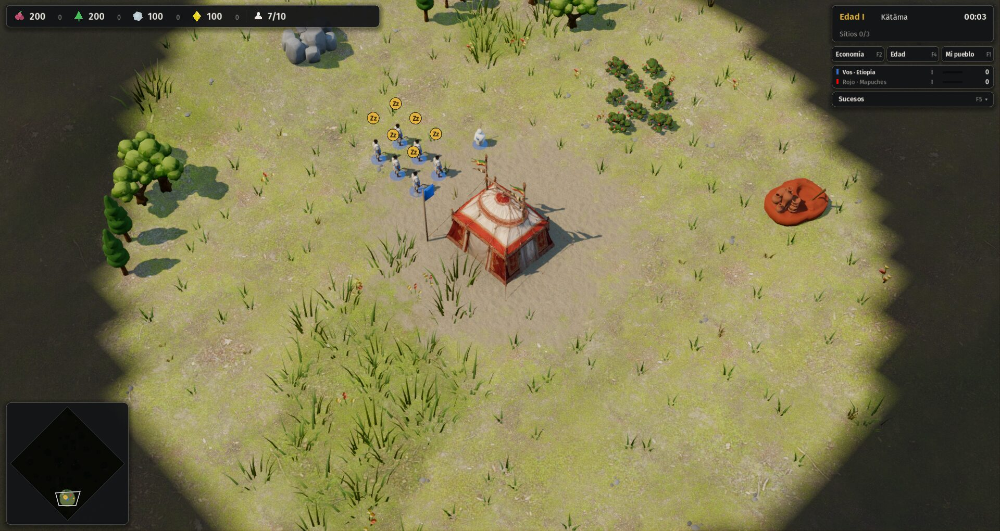

# 19 · Arte y sonido: unidades, edificios y música (desde 2026-11-14)

## Pedido del autor
> "Start 5 if you think you can."

El punto 5 incluye:
- modelos generados para los edificios y las unidades que todavía son la maqueta procedural;
- animación;
- música para Etiopía, que no tiene ninguna.

## Paso a paso
1. **(09:05) Agente de arte y sonido**, en su copia del repositorio. Tiene tres tareas:
   - modelos con Meshy, con un tope de 350 créditos sobre 403: primero el aldeano de cada pueblo y después la unidad militar más característica;
   - música para Etiopía con licencia libre (CC0 o dominio público);
   - animación, si alcanza el tiempo.

   Escribe [01-modelos-y-musica.md](01-modelos-y-musica.md).

- [01 · Modelos de unidades y música](01-modelos-y-musica.md): se generaron con Meshy los aldeanos de los seis pueblos, el hondero inca, el arquero guaraní y el jinete noble etíope, con unos 2500 triángulos y texturas de 512 px. Se escalan por la altura y llevan una faja del color del equipo. Se gastaron 324 créditos. Con 200 unidades en pantalla, el rendimiento no baja respecto de la maqueta. Para Etiopía no se encontró música CC0 ni de dominio público y no se forzó nada (consulta C-24). La animación con esqueleto quedó pendiente.

## Commits
- «Unidades: aldeanos de los seis pueblos y tres unidades características generados con Meshy».
- «Etiopía: búsqueda de música sin resultado limpio; consulta C-24 y estado al día».

## Integración
2. **(15:20) Fusión de la rama de arte** (commits `ac7dac2` y `bcb23bd`).
   - **Conflictos:** solo en documentos. La consulta de la música etíope también vino numerada C-22, igual que las dos de interfaz, y pasó a **C-24** (cambiada también en `01-modelos-y-musica.md` y `assets/audio/musica/README.md`).
   - **Pruebas sobre lo fusionado, ya con las partes A y B de interfaz:** autotest OK en las seis civs y `tests/civ_smoke.gd` sin errores.
   - **Captura** (Etiopía, segundo 3): los aldeanos ya son los modelos de Meshy, con faja del color del equipo. Quedan en escala junto a la capital, que era la observación del autor sobre aldeanos gigantes.

     
   - **Créditos de Meshy:** quedan 79 hasta la renovación mensual.
   - **Pendiente:** música etíope (C-24), el flecheiro de Palmares (36 créditos) y animación con esqueleto.
