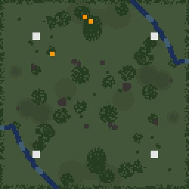
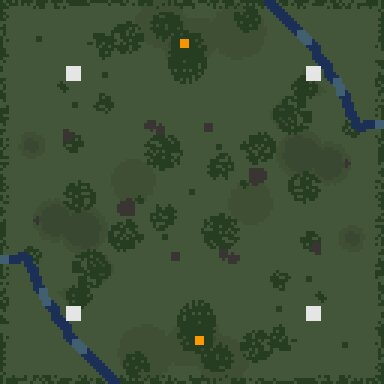

# 20 · Telemetría (desde 2026-11-14 22:00)

## Pedido del autor
> "Si aún no hay, necesitamos un sistema de telemetría que nos pueda indicar problemas en el mapa, bugs, lugares que trancan a la IA o a las unidades, edificios que no se pueden construir, etc., para que podamos analizar seguido qué está pasando."

## Punto de partida
No hay telemetría. Lo más parecido son los libros de la simulación (`Sim.ledger`, `stats`) y las pruebas de humo, que solo dicen "trabado" o "no trabado" al final de la partida.

## Plan
1. Un registro de sucesos problemáticos que corre dentro de la simulación sin ser parte del estado (no entra en el hash). Registra:
   - unidades trabadas;
   - caminos que no llegan;
   - órdenes rechazadas, con su motivo;
   - edificios sin lugar;
   - aldeanos ociosos;
   - lugares donde la IA se repite sin avanzar;
   - picos de tiempo por tick.
2. Que se guarde en cada partida (jugada, IA contra IA y pruebas) en un archivo por partida.
3. Una herramienta que lo resuma: tabla por tipo y mapa de calor sobre el mapa, para encontrar los lugares problemáticos.
4. Que las pruebas largas (torneo, mapas) lo usen y dejen su informe en `proceso/`.

## Paso a paso
1. **(22:20) El registro, dentro de la simulación pero sin ser estado** (`src/sim/sim_telemetry.gd`, `Sim.tele`).
   - **Solo mira:** no entra en el hash ni cambia nada; el determinismo da OK con él prendido. Cada suceso guarda tick, tipo, jugador, casilla y detalle. Cada tipo tiene un mínimo de ticks entre dos registros iguales, así no se llena con el mismo problema repetido, y hay un tope de 30 000 sucesos.
   - **Tipos y dónde se anotan:**

     | Tipo | Dónde | Qué guarda |
     |---|---|---|
     | `trabada` | Las rendiciones de `_follow` y de los `stuck > 25` (refugio, ataque, recolección, entrega, obra) | unidad, orden, destino |
     | `sin_camino` | `_set_goal`: el camino no llega a la casilla pedida y esa casilla no es sólida | desde dónde, unidad |
     | `rechazo` | `_notify` | mensaje, orden que lo causó, si fue la IA |
     | `ia_sin_lugar` | `_site_near` de la IA | edificio |
     | `ia_sin_ruta` | Caminos incas sin paso | edificio |
     | `ocioso` | Revisión cada 15 s: el aldeano también estaba ocioso en la revisión anterior | lugar |
     | `tick_lento` | Lo mide quien corre la simulación (la simulación no puede usar `Time`): el juego, según la velocidad, y las pruebas, a más de 25 ms | ms |
   - **Dónde queda:**
     - **en el juego:** cada partida de más de un minuto se guarda en `user://telemetria/<fecha>-<semilla>.jsonl` al terminar, al ir al menú o al salir;
     - **en las pruebas:** `tests/torneo.gd` y `tests/mapas_smoke.gd` aceptan `--telemetria=carpeta`.
   - **Informe:** `godot --headless --path . -s tools/telemetria.gd -- --entrada=carpeta --salida=carpeta`, o sin argumentos para leer las partidas jugadas. Escribe `informe.md` con:
     - totales por tipo y por civ;
     - las órdenes rechazadas más frecuentes;
     - los edificios que la IA no ubica;
     - las unidades que se rinden;
     - los ticks lentos;
     - por partida, las tres celdas de 8 casillas con más problemas.

     Además dibuja un PNG por partida con el mapa regenerado desde la semilla y los sucesos encima: rojo trabadas, naranja caminos imposibles, amarillo ociosos, violeta la IA sin lugar.
2. **(22:50) Primera corrida: los 13 mapas en 1 contra 1, 20 minutos cada uno.** La telemetría encontró enseguida dos problemas reales:
   - **Punto de reunión dentro de un bosque:** en montaña, 91 caminos imposibles en un mismo lugar, (36, 36). En el mapa de calor se ve que el punto de reunión de la IA mapuche cae en un claro cerrado por árboles, y el ejército nunca llega. Arreglo en `sim_ai.gd`: el punto se prueba con un camino desde la capital y, si no llega, se acerca a la base de a cuartos. Resultado en la segunda corrida: 103 → 13 en montaña.
   - **La IA pide lo que no puede pagar,** unas 80 órdenes rechazadas por partida. Para saber cuáles, el rechazo ahora guarda la orden que lo causó (`_cur_cmd`) y si vino de la IA. Son todas de entrenamiento: la IA revisaba el costo contra el mismo saldo para cada edificio, y las órdenes recién se aplican al tick siguiente. Ahora gasta de un presupuesto (`_spend`) a medida que da órdenes.
   - **Otro lugar marcado,** en bosque templado (44, 76): la IA persigue en una incursión a un aldeano que recolecta dentro de un bosquecito; las unidades llegan lo más cerca que pueden. Es menor y queda anotado.
3. **(00:10) Tercera corrida, con los dos arreglos** ([informe](pruebas/03-mapas-1v1-arreglos/informe.md); primera corrida: [informe](pruebas/01-mapas-1v1/informe.md)).

   | Tipo | Primera corrida | Con arreglos |
   |---|---|---|
   | Órdenes rechazadas | 829 (sin el detalle de la orden) | 154 |
   | Caminos imposibles | 250 | 215 |
   | IA sin ruta para caminos incas | 3 | 27 |
   | Trabadas | 8 | 8 |
   | Ociosos | 19 | 4 |

   - **Rechazos:** bajaron a menos de una quinta parte con el presupuesto de la IA.
   - **Caminos imposibles:** en montaña ya no está el punto de reunión encerrado (de 103 a menos de 15). El total casi no baja porque aparecen otros lugares, que son el próximo trabajo: incursiones a bosquecitos y vados.
   - **Caminos incas sin ruta:** subieron. Hay que revisar `_road_tiles`, que busca solo dentro del rectángulo entre los dos edificios más un margen de 8.

     | Montaña, primera corrida | Montaña, con arreglos |
     |---|---|
     |  |  |
4. **(00:20) Un error del juego encontrado por el registro del juego abierto,** no por la telemetría: el juego del menú se cayó con "Invalid access to property 'slot'" repetido.
   - **Causa:** la ayuda de la barra de recursos (los nombres de la riqueza de cada pueblo) usa la misma ventana que la grilla de órdenes, y esa ventana pedía la casilla de la grilla. Pasar el mouse por los recursos repetía el error hasta tirar el juego.
   - **Arreglo:** `hud.gd` solo dibuja la casilla si la hay. El autotest ahora pasa el mouse por la barra de recursos (control 0) y da OK sin errores.
   - **Pendiente:** que el juego guarde los SCRIPT ERROR en la telemetría, así se ven en el informe aunque no se mire la consola.
