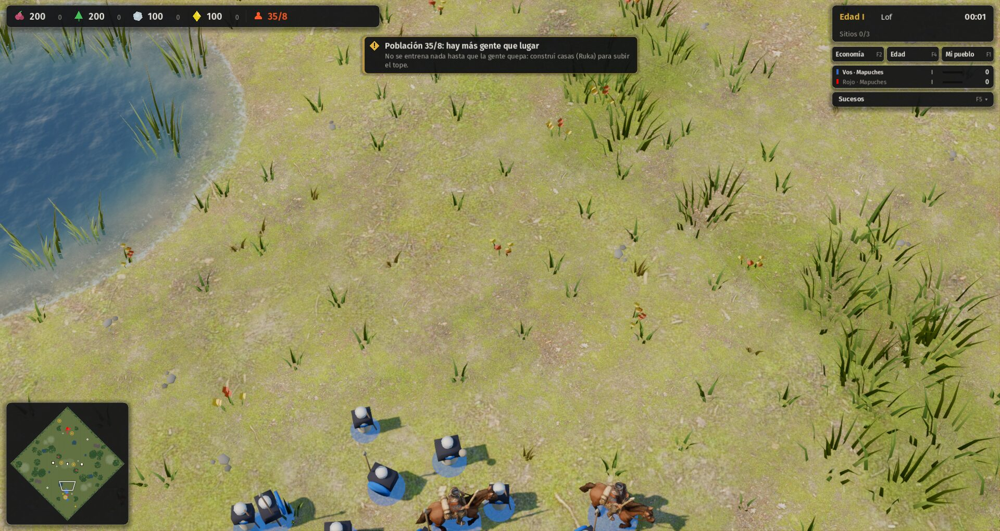
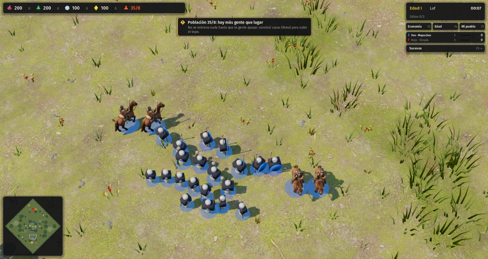
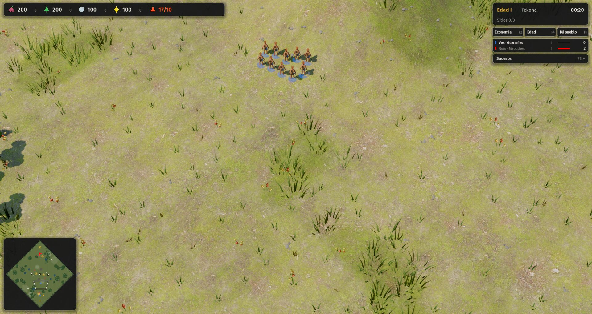
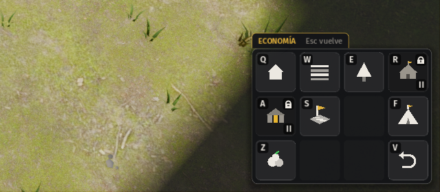
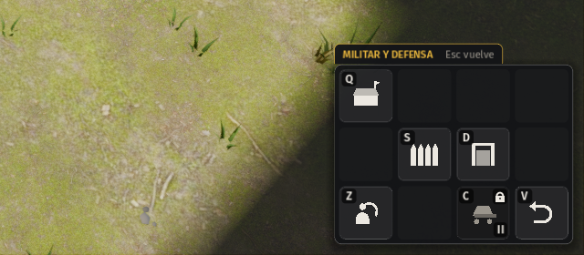

# 21 · Jugabilidad al estilo AoE4: estudio e implementación (desde 2026-11-14 22:00)

## Pedido del autor
> "Por ahora me está costando, pero puede ser un tema de skill. Necesitamos varias cosas para acercarnos a un gameplay como el de Age of Empires 4. Ahora parece más al 1 por algunas cosas puntuales."
>
> "Necesitamos mejorar mucho y crear features que hacen de la jugabilidad una experiencia agradable, como pueden ser la agrupación de diferentes tropas. Que las unidades que son enviadas a algo en grupo, si son aldeanos y se los manda a caminar, lo hagan ordenados en bloque y se esperen para llegar juntos; si se los manda a un trabajo puntual cerca, está bien que vayan todos corriendo para llegar antes; si se los manda muy lejos, que se agrupen. Los oficiales militares siempre agrupados, formaciones militares, etc."
>
> "Por ejemplo, mandar a construir un almacén de arcilla al lado de la arcilla y que los aldeanos rápidamente comiencen a recolectar eso cuando terminan de hacerlo; que haya diferentes almacenes para diferentes cosas, ajustar precios obvio. Si alguna civ no tiene todos y tiene unificado está bien, pero si no nos quedamos cortos. Lo mismo para los militares: si arqueros, caballos, infantería, asedio, todo sale del mismo lugar, no tiene mucho sentido, la madera pasa a ser un poco innecesaria de colectar, etc."
>
> "Creo que necesitamos hacer ahora un estudio más serio de Age of Empires en todos estos sentidos, revisar en qué nos quedamos cortos, qué podemos adoptar y llevarlo adelante."

## Punto de partida (verificado en `data/edificios.json`)
- **Un solo almacén para todo:** `deposito` recibe alimento, madera, piedra y riqueza, igual que el centro.
- **Un solo cuartel para todo el ejército:** `cuartel` produce guerrero, hondero, lancero y ariete.
- **Movimiento:** los grupos se mueven cada unidad por su cuenta, sin formación ni velocidad común.

## Plan
1. **Estudio, con un equipo de agentes de perfiles distintos:**
   - (a) investigación de AoE4 (y AoE2 donde sirva) sobre movimiento de grupos y formaciones, almacenes, edificios de producción, y comodidades de economía y de órdenes;
   - (b) auditoría de nuestro juego contra esa lista;
   - (c) crítica de diseño: qué conviene adoptar, adaptado a nuestros pueblos y no como copia.
2. Plan priorizado en `docs/diseno/jugabilidad/`, con lo que cambia en datos y en la simulación.
3. Implementación por pasos, cada uno con su prueba, determinismo, banco y captura.

## Paso a paso
1. **(22:10) Estudio, primera vuelta: dos agentes en paralelo.**
   - **Referencia de AoE4** ([01-referencia-aoe4.md](../../docs/diseno/jugabilidad/01-referencia-aoe4.md), 70 fuentes: archivos del juego publicados por aoe4world, wiki, notas de parche, respuestas de desarrolladores en el foro):
     - **formación militar:** se arma sola, en un rectángulo de doble ancho que fondo, con choque adelante, distancia atrás y asedio al final, y todo el grupo a la velocidad del más lento; los rezagados corren +40 %;
     - **los aldeanos no forman en AoE4,** a propósito según un desarrollador: que esperen al grupo en viajes largos, como pide el autor, sería algo propio de Raíces;
     - **almacenes:** molino, maderero y minero a 50 de madera; quien construye uno empieza solo a recolectar lo más cercano;
     - **producción:** cuartel en la edad I; arquería y establo en la II (150 de madera cada uno); taller de asedio en la III (250). Ninguna civ unifica estos edificios;
     - **comodidades** que llegaron después del lanzamiento: patrullar, cola global de producción, seleccionar todos los edificios de un tipo, volver al trabajo;
     - **puntos débiles del estudio:** el ritmo de partida es la sección con menos datos.
   - **Auditoría de nuestro juego** ([02-auditoria.md](../../docs/diseno/jugabilidad/02-auditoria.md)), con mediciones propias:
     - **sin noción de grupo:** 24 unidades mandadas a 40 casillas llegan con 21 s de diferencia y se estiran hasta 14 casillas; los jinetes llegan 20 s antes que los lanceros, y las unidades se cruzan porque los lugares se reparten por número;
     - **al terminar un almacén,** el aldeano vuelve a lo que juntaba antes, no a lo que tiene al lado;
     - **la simulación ya admite almacenes de un solo recurso** (la qollqa inca funciona así): separarlos es sobre todo datos, interfaz e IA;
     - **un cuartel de 150 de madera** produce todo en cinco de seis civs;
     - **la madera** pesa 26–33 % de lo recolectado y no sobra, pero no decide nada porque un edificio alcanza para todo el ejército;
     - **fallas encontradas de paso:**
       - lo encolado con Mayús detrás de recolectar nunca sale;
       - Ayutthaya no puede investigar `hachas`, `canteria` ni `orfebreria` (no tiene depósito);
       - los mapuches no pueden investigar `cestas`, `riego` ni `mamposteria` (no tienen centro);
       - las proporciones de aldeanos de la IA están escritas en el código.
   - **Sigue:** un tercer agente, crítico de diseño, propone qué adoptar y cómo adaptarlo a cada pueblo, con historia y números (`03-propuesta.md`). Después, el plan por pasos.
2. **(22:40) Estudio, segunda vuelta: propuesta de diseño criticada** ([03-propuesta.md](../../docs/diseno/jugabilidad/03-propuesta.md)), hecha por un tercer agente con los dos estudios.
   - **Grupos con ancla:** un punto virtual sigue un solo camino (un A* por grupo, no uno por unidad) a la velocidad del más lento, y cada unidad sigue su lugar en la formación.
     - Todo en enteros, con una tabla de 16 rumbos en lugar de trigonometría.
     - Los rezagados corren +40 % (+25 % los aldeanos), pero no si pelearon hace menos de 3 s.
     - El grupo espera hasta 8 s a quien quedó a más de 5 casillas.
   - **Orden de la formación:** sigue nuestro triángulo de contadores, no el de AoE4: adelante la línea, después el choque, la distancia, el asedio y el apoyo, con los montados en las alas. Cuatro formaciones (bloque, línea, abierta, columna), más "suelto" con Alt para retirarse.
   - **Aldeanos:** hasta 16 casillas cada uno va por su cuenta; más lejos, en bloque, y se sueltan a 6 casillas del trabajo.
   - **Almacenes:** granero, leñera y barrero comunes, con nombre propio en cada pueblo. Las excepciones tienen fundamento:
     - los mapuches llevan todo al lof;
     - Ayutthaya cobra con el elefante y suma solo un almacén de arcilla;
     - Palmares usa el mocambo como leñera;
     - Etiopía lleva lo excavado a la corte.
   - **Producción militar por función:** cuartel (choque y línea), campo de tiro (distancia), corral de guerra (montados, edad II) y taller (asedio, edad II). Cinco de seis pueblos se apartan del molde con fundamento.
   - **Plan de 11 pasos,** de lo barato y reversible a lo que mueve el balance (almacenes y cuarteles al final), con un solo cambio de balance por torneo. Lo adopto como plan de esta etapa.
   - **Preguntas al autor:** C-25 a C-30 en `CONSULTAS.md`. Mientras no contestes, sigo con la opción por defecto.
3. **(23:00) Primeros arreglos, adelantados del plan (pasos 2 y 3) porque son chicos y claros:**
   - **Al terminar un almacén, quien lo levantó recolecta** lo más cercano que ese almacén recibe (`_do_build`), como en AoE4. Antes volvía a lo que juntaba antes o se quedaba ocioso. Prueba nueva `tests/jugabilidad.gd`: tres aldeanos levantan un depósito junto al bosque y al terminar los tres cortan madera.
   - **Tecnologías por capacidad, no por tipo de edificio:**
     - el campo `en` de `tecnologias.json` dice dónde se investiga: `{"deposito": "madera"}` vale en cualquier edificio que reciba madera, y `{"tipo": "centro"}` en el centro o la capital;
     - una sola función, `Sim.tech_here`, la usan la simulación, la grilla y la IA;
     - arregla las fallas de la auditoría: Ayutthaya investiga tala, cantería y orfebrería en su centro, y los mapuches cestas, riego y mampostería en el lof;
     - la prueba revisa que, en cada civ, toda tecnología tenga dónde investigarse.
   - Determinismo, autotest con Ayutthaya, mapuches y guaraníes, `tests/grilla.gd` y `civ_smoke` sin errores.
4. **(23:20) Paso 1 del plan: línea de base y números al dato.**
   - **Números al dato:** la separación entre lugares de un grupo (750), el radio en que un constructor ayuda en otra obra (10 000), las proporciones de aldeanos de la IA y la distancia a la que la IA considera lejos un almacén (4500) pasaron de `sim.gd` y `sim_ai.gd` a `reglas.json` (`grupo`, `ia_economia`), sin cambiar los valores. Determinismo OK.
   - **Prueba nueva `tests/grupos.gd`:** reproduce la medición de la auditoría y es la base que los pasos de formación tienen que mejorar.

     | Caso | Diferencia de llegada | Dispersión al llegar | Estiramiento en la marcha |
     |---|---|---|---|
     | 24 militares mixtos a 40 casillas | 23,4 s | 2,4 casillas | 12,9 casillas |
     | 12 aldeanos a 40 casillas | 4,7 s | 1,4 | 2,8 |
     | 12 aldeanos a 6 casillas | 3,8 s | 1,4 | 2,7 |

     Los militares llegan desparramados en el tiempo y se estiran casi 13 casillas en el camino, porque cada uno va a su velocidad. Los aldeanos, todos iguales, casi no se estiran. Objetivo de la propuesta: llegada ≤ 3 s y dispersión ≤ 4 casillas (`--objetivo=1` lo exige).
5. **(00:00) Pasos 4 y 5 del plan: formación y grupo en marcha** (`src/sim/sim_groups.gd`).
   - **Cómo funciona:**
     - un ancla virtual sigue un solo camino A* para todo el grupo, a la velocidad del más lento;
     - cada miembro camina hacia su lugar en la formación, relativo al ancla y al rumbo (tabla de 16 rumbos en enteros);
     - los rezagados a más de 0,8 casillas corren +40 % (+25 % los aldeanos);
     - si alguien queda a más de 5 casillas, el ancla espera hasta 8 s y después lo suelta;
     - mientras alguien pelea, el ancla se planta, y al terminar cada uno vuelve a su lugar, no a un punto suelto;
     - si el lugar cae sobre algo sólido o la unidad se traba, sigue al ancla: pasa en fila por los vados;
     - el grupo se disuelve al llegar.
   - **Formación por bandas**, de adelante hacia atrás: línea, choque, distancia, asedio y apoyo; los montados en las alas. Dentro de cada banda los lugares se asignan sin cruces (adelante primero, después de izquierda a derecha).
   - **Cuándo se forma:** con 2 o más unidades a 12 casillas o menos del centro de la selección; las de afuera van solas. Solo aldeanos: en bloque únicamente si el destino está a más de 16 casillas, y si no, cada uno corre a su trabajo, como pidió el autor. La orden `move` con `"suelto": true` no forma (para la retirada; falta el botón y Alt en la interfaz).
   - **Números:** todos en `reglas.json → grupo`. El estado del grupo entra en el hash. Determinismo OK.
   - **Resultado** (`tests/grupos.gd`, [resultado](pruebas/05-grupos.txt)):

     | Caso | Llegada (antes → ahora) | Estiramiento en la marcha |
     |---|---|---|
     | 24 militares mixtos a 40 casillas | 23,4 s → **1,1 s** | 12,9 → **4,0 casillas** |
     | 12 aldeanos a 40 casillas (en bloque) | 4,7 s → **0,3 s** | 2,8 → 2,5 |
     | 12 aldeanos a 6 casillas (cada uno) | 3,8 s → 3,8 s | sin cambio, como se quería |

     Cumple los objetivos de la propuesta (llegada ≤ 3 s, dispersión ≤ 4). El banco de 200 unidades mejoró: el peor tick bajó de 78 a 46 ms, porque un grupo pide un camino y no 200.
   - **Captura** (`--demo=formacion --civ=mapuches`, nueva): 24 unidades mixtas desparramadas junto a la base, mandadas al centro. Segundo 1 y segundo 7: el bloque marcha junto, con los jinetes en las alas.

     | Salida | En marcha |
     |---|---|
     |  |  |
   - `civ_smoke` sin errores, autotest OK y 2v2 de 10 minutos sin fuego amigo.
   - **Falta, por orden del plan:**
     - ataque a un blanco lejano en formación (paso 6);
     - aldeanos en bloque al mandarlos a recolectar o construir lejos, con escolta (paso 7);
     - formaciones elegibles, Alt para ir suelto y el rumbo con el arrastre (paso 8);
     - un torneo para ver si el balance se movió.
6. **(00:50) Paso 7 del plan: aldeanos en bloque cuando el trabajo está lejos.**
   - **Grupo con tarea:** el grupo puede llevar una tarea pendiente (`then`). Al clic derecho sobre un recurso, un cimiento, un almacén o un edificio propio a más de 16 casillas, la selección marcha en bloque. A 6 casillas del destino (`aldeanos_suelta_dist`) se disuelve y cada uno hace lo pedido: recolectar, construir, entregar o refugiarse.
   - **Cimientos lejanos:** al poner un cimiento lejos, los constructores también van en bloque.
   - **Cerca, nada cambia:** cada uno corre a su trabajo, como pidió el autor.
   - **La IA** da las mismas órdenes, así que sus aldeanos también marchan juntos a lo lejano.
   - **Pruebas** (`tests/jugabilidad.gd`, [resultado](pruebas/07-jugabilidad.txt)):
     - 6 aldeanos mandados a una arcilla a 54 casillas marchan en grupo y, al llegar, los seis recolectan. Reciben la orden de recolectar todos en el mismo tick, cuando el grupo se disuelve; la prueba no mide cuándo pisa cada uno la arcilla;
     - 3 aldeanos mandados a algo cercano van directo, sin grupo.
   - **Captura** (`--demo=bloque`, nueva, con la cámara puesta por la demo): 10 aldeanos guaraníes cruzan el campo en dos filas de cinco hacia la arcilla del centro, segundo 20.

     
   - **Tropiezo:** la primera captura mostraba a los aldeanos quietos junto a una arcilla, y parecía una falla del grupo. Era la demo: buscaba la arcilla entre las entidades activas, donde los recursos no están, y nunca dio la orden. Con la búsqueda corregida, el grupo avanza parejo; 47 casillas a paso de aldeano son unos 40 s.
   - Determinismo OK, banco de 200 unidades en 7,8 ms de promedio y 45 de peor tick, `tests/grupos.gd` OK y autotest OK.
7. **(01:05) Parte del paso 8: ir suelto.**
   - **Alt + clic derecho** manda sin formación: cada uno a su velocidad, para retirarse. Es lo más pedido en el foro de AoE4 (referencia, §6). El marcador sale en rojo para que se note que va suelto.
   - **La IA** se retira suelta cuando saca unidades de la base rival (`_leash`).
   - La ayuda (F1) lo explica.
   - **Falta del paso 8:** elegir la formación (bloque, línea, abierta, columna) y el rumbo con el arrastre.
   - Autotest OK y determinismo OK.
8. **(01:40) Paso 9 del plan: almacenes por recurso.**
   - **Capa común** (`data/edificios.json`): granero (alimento), leñera (madera) y barrero (piedra y arcilla, lo que se cava), a 50 de madera, 2×2 y 20 s. El depósito unificado (75) queda solo para los invasores y las campañas.
   - **Por pueblo**, como en la propuesta (§2.2), con los nombres marcados `[verificar]` mientras no haya fuente (C-30):

     | Pueblo | Almacenes | Qué recibe todo |
     |---|---|---|
     | Tawantinsuyu | Llant'a wasi (madera), Kamayuq wasi (piedra y arcilla); la qollqa sigue siendo su granero | centro |
     | Mapuches | ninguno (C-26) | el lof |
     | Guaraníes | Tapyi (alimento y madera, 60), Ñai'ũ renda (piedra y arcilla) | centro |
     | Etiopía | Gotära (granero), Inchet bet (leñera); lo que se cava va a la corte | kätäma y la corte |
     | Palmares | Paiol (granero), Olaria (barrero); el mocambo hace de leñera | centro y mocambos |
     | Ayutthaya | Khlang din, solo arcilla (C-25) | palacio y elefante del rey |
   - **Modelos de maqueta** propios (`meshes.gd`), para reconocerlos de lejos: la leñera con troncos apilados, el granero redondo con techo cónico y el barrero con bloques de piedra y vasijas.
   - **Grilla:** leñera en E (donde estaba el depósito), granero en Z y barrero en X dentro del submenú de economía, con el ícono del recurso.
   - **IA:** `_dropsite_for(recurso)` elige el almacén más barato de su civ que recibe ese recurso. Sin almacén para ese recurso no construye ninguno, porque lo cubren sus edificios propios. Antes construía siempre `deposito`.
   - **Campañas:** los objetivos que piden depósitos cuentan los almacenes nuevos (`alias_campana`).
   - **Edición de los datos sin reformatear:** el primer intento reescribió los seis JSON enteros (590 líneas de cambio solo de formato). Se volvió atrás y se editaron solo las claves tocadas; se comprobó que el resto de cada civ quedó igual.
   - **Pruebas:**
     - determinismo OK; `tests/jugabilidad.gd` OK, con el tapyi guaraní junto al bosque y los tres constructores talando al terminar;
     - `tests/grilla.gd` OK y autotest OK en las seis civs;
     - `civ_smoke` ([resultado](pruebas/09-civ-smoke.txt)) y las 25 misiones ([resultado](pruebas/09-campanas.txt)) sin errores.

     
9. **(02:20) Paso 10 del plan: producción militar por función.**
   - **Capa común:** cuartel (choque y línea), campo de tiro (distancia, edad I, 150 de madera), corral de guerra (montados, II, 175) y taller de asedio (II, 200). Los invasores, que son solo IA y de campaña, siguen con un cuartel para todo.
   - **Por pueblo:**

     | Pueblo | Choque y línea | Distancia | Montados | Asedio |
     |---|---|---|---|---|
     | Tawantinsuyu | Kallanka | **Warak'a kancha**: hondero, boleador y el hondero de piedra caliente (su asedio) | solo por Vilcabamba | sin taller |
     | Mapuches | **Lof** (weichafe) y Ruka de guerra (lanza larga y arquero) | Ruka de guerra | **Corral** (kona) | — |
     | Guaraníes | Aty de guerra | **Guyrapa róga** (2×2, 100 de madera) | — | Taller de tacuara (150) |
     | Etiopía | Campamento de chewa (chewa y jabalinero) | Campamento de chewa | **Färäs bet**, el jinete noble desde la edad I | Taller |
     | Palmares | Casa de guerra (también el espingardeiro) | **Mocambo** (flecheiro) | — | — |
     | Ayutthaya | Cuartel de la guardia | Sanam ying thanu | Kraal (elefantes) | Taller |
   - **Tecnologías militares por capacidad:** `armas_*`, `escudos_*`, `marcha` y `adiestramiento` se investigan en cualquier edificio que entrene tropa (`"en": {"militar": true}`).
   - **IA:** `_producer_types()` encuentra los edificios de producción de su civ y levanta uno de cada uno después del primer cuartel, y otro si sobra. `_makes_military` ahora cuenta el asedio; antes un taller nunca habría entrenado.
   - **Modelos de maqueta:** campo de tiro (galpón con dos blancos de paja), corral de guerra (cobertizo con pesebres y cerca) y taller (techo a un agua con un ariete a medio hacer). En la grilla militar van en Z, X y C, con el ícono de la unidad.

     
   - **Dónde me aparto de la propuesta, por ahora:**
     - el Guyrapa róga no exige árboles cerca: hace falta una regla de lugar nueva;
     - Palmares sigue sacando el espingardeiro de la casa de guerra, porque su "tenda de ferreiro" de la propuesta no existe y la *ferraria* es un hito de la edad III: sacarlo de ahí le quitaba la pólvora de la edad II.
   - **Medición, 15 minutos de IA contra IA:** cuándo sale la primera unidad de cada función.

     | Civ | Edificios de producción a los 15 min | Choque | Distancia | Línea | Asedio |
     |---|---|---|---|---|---|
     | Tawantinsuyu | 3 kallanka, 2 warak'a kancha, kallanka real | 2:10 | 7:30 | 7:50 | 12:30 |
     | Mapuches | 1 ruka, 3 corrales, lof | 5:40 | 6:00 | 7:30 | — |
     | Guaraníes | 2 aty, 1 guyrapa róga, 1 taller | 9:20 | 9:20 | 11:50 | 13:50 |
     | Etiopía | 2 campamentos, 1 färäs bet | 9:00 | 5:40 | 8:20 | — |
     | Palmares | 2 casas de guerra, mocambo | 7:10 | 1:40 | 12:10 | — |
     | Ayutthaya | 2 cuarteles, 1 sanam | 3:10 | 4:40 | — | — |

     Cuatro de seis tienen las tres funciones antes del minuto 12. Palmares llega a las 12:10. Ayutthaya no entrena lanceros en 15 minutos: su lancero pide la edad II, y la IA prioriza el elefante y la compañía japonesa. Va al torneo.
   - Determinismo, `tests/grilla.gd`, `tests/jugabilidad.gd` y autotest en las seis civs: OK.
10. **(03:00) Torneo con solo las formaciones** (antes de almacenes y producción por función), 2 semillas, 10 partidas por civ ([resultado](pruebas/06-torneo-grupos.txt)):

    | Civ | 5 semillas, sin formaciones (etapa 18) | Con formaciones |
    |---|---|---|
    | Palmares | 40 % | 70 % |
    | Tawantinsuyu | 36 % | 70 % |
    | Guaraníes | 68 % | 60 % |
    | Mapuches | 48 % | 40 % |
    | Ayutthaya | 56 % | 30 % |
    | Etiopía | 52 % | 30 % |

    - **Las partidas se definen más:** 24 de 30 terminan con los hitos destruidos (antes, 61 %). Los ejércitos que llegan juntos rompen bases.
    - **El reparto se mueve,** a favor de las civs de infantería con mucha distancia (Palmares, Tawantinsuyu) y en contra de las de caballería y elefantes (Etiopía, Ayutthaya). Tiene sentido: los montados iban adelante solos y ahora marchan al paso de la infantería.
    - **No ajusto con este torneo:** ya hay almacenes y producción por función encima, y el torneo con el código final está corriendo. Con 10 partidas por civ el ruido es de unos ±15 puntos.
11. **(03:20) Torneo con el código final (almacenes y producción por función): desbalanceado** ([torneo](pruebas/10-torneo.txt), [economía en paz](pruebas/10-economia-paz.txt)).

    | Civ | Victorias | Edad III en paz (antes → ahora) |
    |---|---|---|
    | Guaraníes | 100 % | 11:35 → 14:25 |
    | Ayutthaya | 70 % | 17:35 → 15:07 |
    | Tawantinsuyu | 70 % | 12:52 → 16:57 |
    | Palmares | 40 % | 19:57 → 18:07 |
    | Etiopía | 10 % | 13:37 → 19:27 |
    | Mapuches | 10 % | 12:15 → 19:42 |

    - **Edad II** sigue en su rango (5:37 a 8:12). La III se atrasa en casi todas: hay más edificios que pagar.
    - **Dos causas encontradas en la IA, no en los datos:**
      1. **Mapuches sin almacén.** La IA nunca levantaba un lof junto a un recurso lejano, porque `_dropsite_for` descartaba los edificios que dan población. Sus aldeanos caminaban hasta la base. Ahora, si una civ no tiene almacén para un recurso, usa su edificio barato que lo recibe (el lof a 110, el mocambo para la madera de Palmares), hasta `ia_economia.almacen_alternativo_max` = 150.
      2. **Etiopía sin su jinete noble a tiempo.** Su unidad preferida salía del cuartel; ahora sale del färäs bet, y la IA lo levantaba después del cuartel: el primer jinete a las 9:00. Ahora el edificio de la unidad preferida de cada civ (`ia_unidades`) va tan temprano como el primer cuartel.
    - Determinismo OK. Torneo y economía de nuevo, con estos dos arreglos, antes de tocar precios.
12. **(05:00) Torneo con los dos arreglos de IA** ([torneo](pruebas/11-torneo.txt), [economía en paz](pruebas/11-economia-paz.txt)).

    | Civ | Torneo anterior | Con los arreglos | Edad III en paz |
    |---|---|---|---|
    | Mapuches | 10 % | **80 %** | 17:57 |
    | Palmares | 40 % | 80 % | 16:42 |
    | Guaraníes | 100 % | 60 % | 14:15 |
    | Tawantinsuyu | 70 % | 50 % | 15:50 |
    | Ayutthaya | 70 % | 20 % | 15:20 |
    | Etiopía | 10 % | **10 %** | **20:57** |

    - **El lof como almacén** levantó a los mapuches de 10 a 80 %: era eso, y se pasó. Queda para el próximo ajuste.
    - **Etiopía sigue abajo,** con la peor economía (3557 de riqueza a los 30 min; los guaraníes, 5518) y la edad III a las 20:57, cuando antes era 13:37. Es la primera en la edad II (5:32) y la última en la III. La causa: la propuesta la dejaba sin barrero, porque "lo que se cava va a la corte", pero en la práctica sus aldeanos caminaban la piedra y la arcilla hasta la capital.
    - **Cambio, el único de esta vuelta:** Etiopía recibe un barrero, el *Dängay bet* (amhárico: casa de la piedra `[verificar]`). Me aparto de la propuesta en esto; la corte sigue extrayendo su arcilla igual.
    - Ayutthaya (20 %) y el exceso mapuche (80 %) esperan al torneo siguiente: un cambio por vez.
13. **(06:30) Etiopía con barrero: mejora la economía, no el torneo** ([torneo](pruebas/12-torneo.txt), [economía en paz](pruebas/12-economia-paz.txt)).
    - **Torneo:** Palmares 90 %, mapuches 80 %, guaraníes 60 %, Tawantinsuyu 50 %, Ayutthaya 20 %, Etiopía 0 %.
    - **Economía etíope:** la riqueza a los 30 minutos subió de 3557 a 4782, pero la edad III sigue tarde (19:47).
    - **Herramienta nueva `tools/ia_por_dentro.gd`:** cada 3 minutos de una partida Etiopía contra mapuches, muestra ejército, productores, aldeanos por recurso y edificios, y al final los rechazos que anotó la telemetría.
      - El ejército etíope es comparable al mapuche y tiene tantos aldeanos como el resto (39 al minuto 12).
      - Pero vive sin alimento (entre 21 y 71) con riqueza de sobra (742).
      - **No levanta mercado nunca**, y antes sí: el 15 % de su riqueza pasaba por el mercado. El mercado cuesta 175 de madera, y la madera se va antes en granjas (18), gults y almacenes; además el mercado estaba último en el orden de la IA.
    - **Arreglos de IA, por el mismo motivo: con edificios separados la madera pesa más, que es lo que pidió el autor, y la IA tiene que acompañar:**
      1. el mercado va antes que los demás edificios desde la edad II;
      2. el reparto de aldeanos de la edad II en adelante pasa de 42 % alimento y 25 % madera a 37 % y 30 % (`reglas.json → ia_economia.proporcion_tardia`).
    - **Resultado en la misma partida:** a los 12 minutos Etiopía tiene mercado y 15 aldeanos en madera (antes 12). Determinismo OK. Torneo y economía de nuevo.
14. **(08:00) Mercado primero y más madera: las economías se acercan, el torneo no** ([torneo](pruebas/13-torneo.txt), [economía en paz](pruebas/13-economia-paz.txt)).
    - **Economía en paz:** riqueza a los 30 minutos entre 4863 (Etiopía) y 7037 (Palmares); edad II entre 5:35 y 8:10; edad III entre 15:30 y 20:05.
    - **Torneo:** mapuches 90 %, Palmares 80 %, guaraníes 60 %, Tawantinsuyu 40 %, Ayutthaya 20 %, Etiopía 10 %.
    - **Con `tools/ia_por_dentro.gd`, minuto 15:**
      - Palmares tiene 2 mocambos: su ventaja viene de la economía, la más alta.
      - Los mapuches tienen **8 edificios que entrenan tropa**: 4 lof (cada uno saca weichafe), 3 corrales (kona) y 2 ruka. La IA levantaba lofs también como almacén.
    - **Cambio, el único de esta vuelta:** el edificio que la IA usa como almacén cuando no tiene otro (lof, mocambo) entrena tropa, así que tiene un tope más bajo: 3 en lugar de 4 (`ia_economia.almacen_alternativo_cantidad`). Determinismo OK.
15. **(10:30) ¿Las formaciones hunden a Etiopía y Ayutthaya? No.**
    - **Torneo con el tope de lofs** ([resultado](pruebas/14-torneo.txt)): mapuches 80 %, guaraníes 70 %, Palmares 70 %, Tawantinsuyu 50 %, Ayutthaya 20 %, Etiopía 10 %.
    - **Sospecha:** las dos civs de caballería y elefantes ya habían caído a 30 % en el torneo con solo las formaciones, y marchar al paso de la infantería les quita su ventaja.
    - **Prueba nueva `tools/duelo.gd`:** 6 partidas de 25 minutos entre dos civs, con el movimiento en grupo prendido y apagado.

      | Duelo | Con grupos | Sin grupos |
      |---|---|---|
      | Etiopía contra mapuches | 1–5 | 0–6 |
      | Etiopía contra Tawantinsuyu | 1–5 | 0–6 |
      | Ayutthaya contra Tawantinsuyu | 2–4 | 1–5 |

      Sin grupos les va igual o peor: **las formaciones no son la causa.**
    - **Causa encontrada:** la producción separada. Antes la IA etíope sacaba su jinete noble de hasta 5 cuarteles. Ahora sale de un solo färäs bet, y los cuarteles que suma cuando le sobra solo hacen chewa y jabalineros.
    - **Arreglo en la IA:** el "edificio principal" que se multiplica cuando sobra es el de la unidad preferida de la civ (`ia_unidades`): el färäs bet etíope y la warak'a kancha inca. En las demás sigue siendo el cuartel.
    - **Duelo después del arreglo:** Etiopía contra Tawantinsuyu, 2–4 (antes 1–5). Determinismo OK. Torneo completo a continuación.
16. **(13:00) Etiopía dejaba de entrenar mientras ahorraba para el hito.**
    - **Torneo con el edificio de la unidad preferida** ([resultado](pruebas/15-torneo.txt)): mapuches 100 %, Palmares 70 %, guaraníes 50 %, Ayutthaya 40 %, Tawantinsuyu 40 %, Etiopía 0 %.
    - **Una partida entera de Etiopía contra Tawantinsuyu, minuto a minuto:**
      - a los 12:00 los ejércitos están parejos (16 contra 20);
      - a los 15:00 Etiopía tiene 5 unidades contra 48, con 942 de alimento sin gastar.
    - **Causa:** mientras ahorra para el hito, la IA solo entrena si atacan su capital. La capital etíope es una corte que se muda, así que no veía los ataques a su base.
    - **Arreglo:** la amenaza cuenta también a los enemigos cerca de cualquier edificio propio (`ia_economia.amenaza_capital` 22 000 y `amenaza_edificio` 12 000).
      - La primera versión comparaba cada enemigo con cada edificio y subió el promedio de 6 IA de 18 a 25 ms por tick.
      - La segunda marca primero las celdas cercanas a los edificios propios y mira una vez a cada enemigo: 21 ms.
    - **Duelo Etiopía contra Tawantinsuyu:** 5–1 (antes 1–5). Determinismo OK.
17. **(14:20) Métodos para que un cambio de estructura no rompa tanto el balance** (pregunta del autor: "¿Cada cambio va a tener este impacto en el balance? ¿Hay métodos para que no nos pase tanto?").
    - **Diagnóstico:** de los ocho arreglos de esta tanda, siete fueron de la IA, que tenía supuestos escritos a mano ("hay un cuartel", "el mercado va al final", "la amenaza es la de la capital"). El octavo fue el barrero etíope. El torneo lo mostraba tarde, en 80 minutos, como si fuera desbalance.
    - **Herramientas nuevas:**
      1. **Prueba de salud de la IA** (`tests/salud_ia.gd`, unos 5 minutos): por civ, edad II antes de las 9:30, al menos dos funciones y 10 militares al minuto 12, dos edificios de producción, mercado al minuto 15 y pocos recursos parados. Se corre antes de cada torneo.
      2. **Sucesos de IA trabada** en la telemetría (etapa 20, paso 6).
      3. **Torneo en paralelo** (`tools/torneo_paralelo.sh`): reparte los cruces en N procesos con `--parte=i/n`. Con 8 procesos, 5 semillas (75 partidas, 25 por civ) pasan de unas 3 horas a unos 30 minutos.
    - **Lo que encontró la salud de la IA, y los arreglos:**
      - Ayutthaya llegaba a la edad II a las 10:52: levantaba campo de tiro y taller antes. Ahora los edificios de producción que no son el principal esperan a la edad II.
      - Etiopía y Palmares no tenían mercado al minuto 15: la madera se iba antes en granjas y almacenes. Ahora, si no alcanza para el mercado, se guarda: lo que viene después (caminos, torre) espera.
      - El primer orden de esa reserva dejó a los guaraníes con 3 militares. Orden final: hito, producción, almacenes, edificios propios de la civ, mercado, caminos.
      - Los guaraníes levantaban dos casas del arco y ningún cuartel. El segundo edificio principal ahora espera a que haya uno de cada uno de los otros.
    - **Salud de la IA ahora** ([resultado](pruebas/17-salud-ia.txt)): Tawantinsuyu, mapuches y Etiopía OK. Quedan los guaraníes y Palmares sin mercado al minuto 15, Palmares con 2 militares (pierde las peleas contra Ayutthaya en esa semilla) y Ayutthaya con la edad II a las 10:06.
    - Torneo de 5 semillas en paralelo, corriendo.
