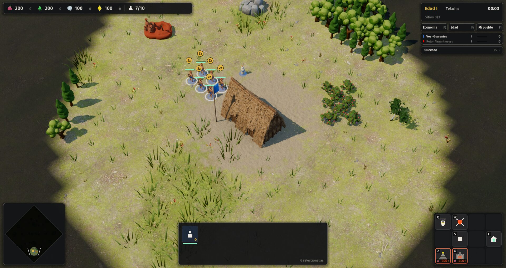
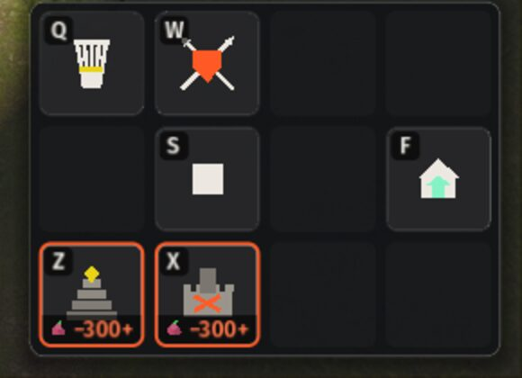
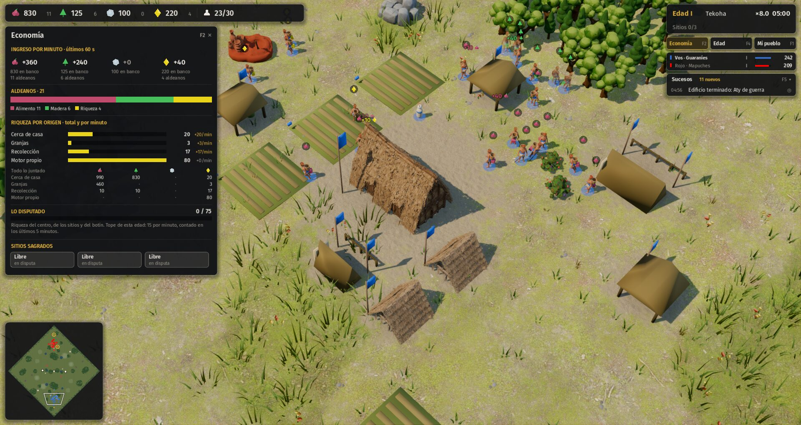
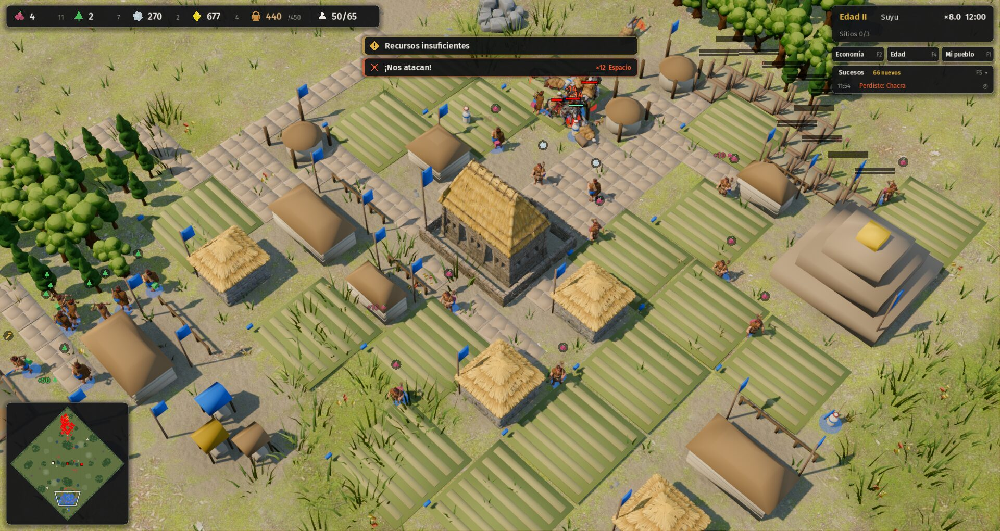
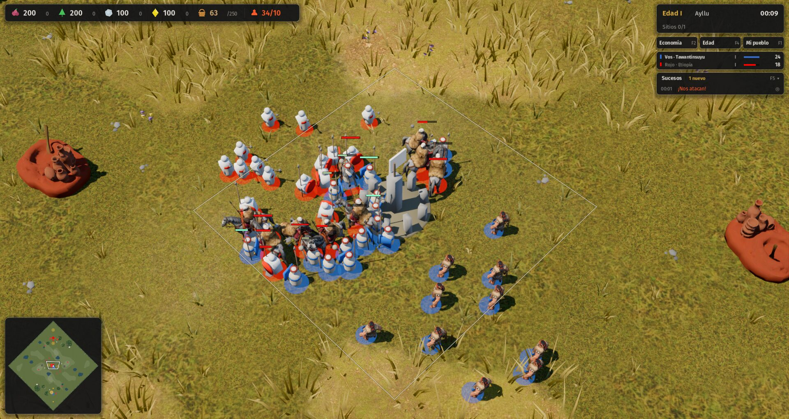
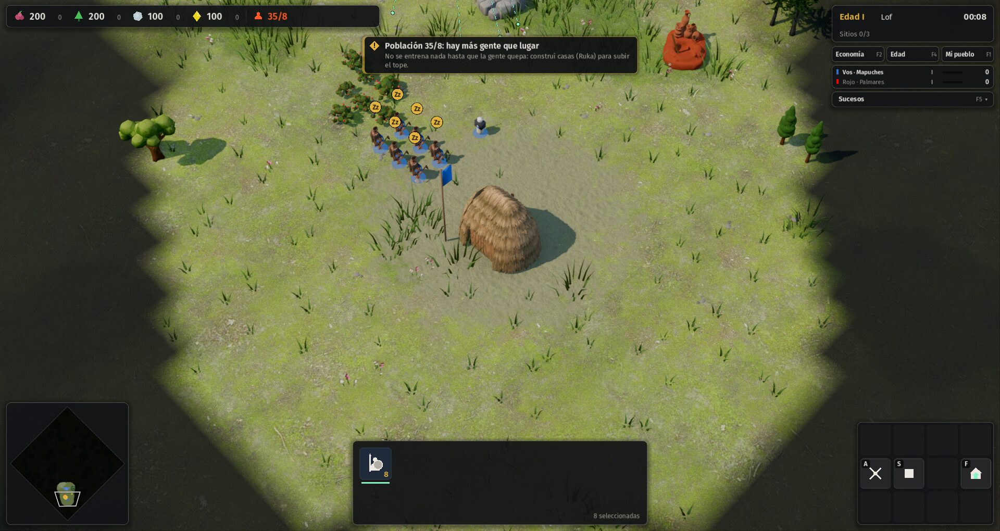

# Jugador de prueba 1 · Veterano competitivo de AoE4

Informe del 2026-11-15. Responde a la pregunta del autor: "¿Qué les gustaría del juego y qué les parece que le falta para ser tan divertido como Age of Empires 4?".

## 1. Quién soy y qué probé

**Perfil.** Juego AoE4 en rankeada, entre Diamante y Conqueror. Abro siempre con la misma orden de construcción y la ajusto según el mapa. Miro el ritmo (cuándo llega la edad II, cuántos aldeanos tengo al minuto 5 y al 10), la macro (centro sin parar, almacenes pegados al recurso, producción constante) y la micro (formaciones, ataque en movimiento, retirada, foco). Juego con la grilla de atajos y casi sin mouse en la economía.

**Límite de esta prueba.** No puedo usar mouse ni ver la pantalla en vivo. Jugué con un **script que da órdenes como un jugador** (una "IA mía" muy simple: aldeanos sin parar, casas antes de trabarse, almacenes cuando el recurso queda lejos, hito apenas alcanza, dos edificios militares y ataque en movimiento). No hace micro ni reacciona bien en la edad II, así que **mis derrotas no dicen nada del balance**: sirven para medir el ritmo de la edad I y la presión de la IA. Los scripts quedaron fuera del repositorio, en la carpeta de trabajo de esta sesión (`scratchpad/testers/veterano/`).

**Comandos exactos** (desde la raíz del repo):

| Qué | Comando |
|---|---|
| Qué hay alrededor de la base | `godot --headless --path . -s scratchpad/testers/veterano/mapa.gd -- --civ=guaranies` |
| Apertura rápida (boom) contra la IA normal | `godot --headless --path . -s scratchpad/testers/veterano/apertura.gd -- --civ=guaranies --rival=mapuches --min=25 --plan=boom --ataque=14` |
| Lo mismo con Etiopía contra Tawantinsuyu | `… apertura.gd -- --civ=etiopia --rival=tawantinsuyu --min=25 --plan=boom --ataque=14` |
| Lo mismo contra la IA difícil | `… apertura.gd -- --civ=guaranies --rival=mapuches --min=25 --plan=boom --ataque=14 --dif=dificil` |
| Ataque temprano (cuartel en la edad I) | `… apertura.gd -- --civ=guaranies --rival=mapuches --min=20 --plan=rush --ataque=6` |
| Peleas aisladas de 10 contra 10 | `godot --headless --path . -s scratchpad/testers/veterano/micro.gd` |
| Captura del arranque | `godot --path . -- --civ=guaranies --terreno=llano --seed=7 --shot=x.png --shot-at=3 --select=aldeano` |
| Grilla de economía | `godot --path . -- --civ=guaranies --rival=mapuches --terreno=llano --seed=7 --shot=x.png --shot-at=3 --select=aldeano --grilla=economia` |
| IA contra IA, minuto 5, panel de economía | `godot --path . -- --aivai --civ=guaranies --rival=mapuches --terreno=llano --seed=7 --speed=8 --shot=x.png --shot-at=300 --panel=economia` |
| IA contra IA, minuto 12 | `godot --path . -- --aivai --civ=tawantinsuyu --rival=etiopia --terreno=llano --seed=7 --speed=8 --shot=x.png --shot-at=720 --panel=puntaje` |
| Batalla | `godot --path . -- --demo=batalla --civ=tawantinsuyu --rival=etiopia --shot=x.png --shot-at=9 --cam=64,64,22` |
| Formación | `godot --path . -- --demo=formacion --civ=mapuches --shot=x.png --shot-at=8 --select=lancero` |

También leí `data/` (edificios, unidades, reglas, edades, tecnologías, recursos), los atajos en `src/game/controller.gd` y la ayuda F1.

## 2. Lo que me gustó

- **El ritmo de la edad I se parece a AoE4.** Con una apertura limpia de guaraníes coloqué el hito a las 3:55 y llegué a la edad II a las **4:48**, con 22 aldeanos al minuto 5. En AoE4 la referencia es una edad II a las 4:30 con unos 20 aldeanos. Las partidas terminaron entre los 13:35 y los 18:50, cerca de los 19 minutos de mediana en Conqueror.
- **Dos hitos por edad,** como los landmarks: la elección existe desde la primera edad.
- **Almacenes por recurso a 50 de madera,** y quien los levanta se pone a recolectar al terminar. Mi script puso la leñera a 1:17–1:31 y la economía se sintió de AoE4: mandar y olvidarse.
- **El punto de reunión sobre un recurso** manda al aldeano a recolectar (`_spawn_from`). Es el punto de reunión económico de AoE4.
- **Ir suelto con Alt** es mejor que lo que tiene AoE4, que no lo ofrece. Lo medí: una retirada mixta de jinetes y lanceros cruza 26 casillas en **9,7 s suelta y en 21,3 s en formación**. Es justo lo que pide el foro de AoE4 desde 2022.
- **Formaciones que llegan juntas** (la demo lo muestra) y con los montados en las alas.
- **Atajos que ya conozco:** grilla QWER/ASDF/ZXCV, `H` para el centro, `.` para el aldeano ocioso, Ctrl y Mayús + número para los grupos, doble toque para centrar, Espacio para ir al último ataque, Mayús para encolar órdenes y para encolar de a 5, y Z en el centro para la campana.
- **Información económica mejor que la de AoE4 en partida:** la barra de arriba muestra aldeanos por recurso, y F2 muestra el ingreso por minuto y el reparto de la gente ([captura 3](capturas/veterano/03-min5-economia.jpg)). En AoE4 eso lo ves recién en el resumen final.
- **La IA normal castiga la codicia:** sube a la edad II hacia las 6:30, tiene 14–29 militares al minuto 10 y ataca. Mi script, sin defensa, perdió la base al minuto 13. Para practicar defensa sirve.
- **Seis economías distintas** (rozas, mit'a, corte que se muda, fama, tributo, ganado). En AoE4 eso es lo que hace rejugable cada civ.

## 3. Lo que le falta para ser tan divertido como AoE4

### 3.1 La edad I no tiene decisiones
- **Comida inicial.** Alrededor de la base hay 8 arbustos de 150 (1200 de comida) y nada más: ni ovejas, ni ciervos, ni un jabalí ([captura 1](capturas/veterano/01-inicio.jpg)). Con 8 aldeanos en comida, los arbustos se acaban entre el minuto 3:50 y el 4:30 y hay que pasar a granjas. En AoE4 esa transición llega entre el minuto 7 y el 10.
- **Qué se pierde:** en AoE4 los primeros minutos son una carrera de decisiones chicas:
  - el explorador busca ovejas y las trae;
  - se decide si pelear el jabalí con 8 aldeanos;
  - se empujan ciervos hasta el molino;
  - se elige cuándo construir el molino en los arbustos.
  
  Acá el explorador solo mira, y la edad I es poner gente en los arbustos y esperar.
- **El hito se construye demasiado rápido:** 60 s de base (41–53 s con tres constructores), contra 190 s del landmark de AoE4. En AoE4, mientras sube el landmark, tu economía está expuesta y el rival lo sabe: ahí nace la presión de la edad I. Acá esa ventana casi no existe, y dónde se pone el hito no importa (en AoE4 hay landmarks adelantados o defensivos).

### 3.2 La micro no paga
Peleas de 10 contra 10 en terreno llano, las dos con ataque en movimiento (`micro.gd`):

| Pelea | Resultado | Duración |
|---|---|---|
| 10 honderos contra 10 guerreros | gana el guerrero; **pierde 1 unidad** | 12,6 s |
| Lo mismo, con los honderos retrocediendo (kiteo) | gana el guerrero; **no pierde ninguna** | 23,7 s |
| Lo mismo, con fuego concentrado en el más herido | gana el guerrero; pierde 1 | 15,0 s |
| 10 honderos contra 10 lanceros | gana el hondero; pierde 2 | 29,3 s |
| 10 guerreros contra 10 lanceros | gana el lancero; **no pierde ninguna** | 22,0 s |
| 8 jinetes contra 10 honderos | gana el jinete; **no pierde ninguno** | 12,9 s |

- **Los contadores son de piedra, papel o tijera puro:** el daño contra la función débil se multiplica por 2 o por 2,25 (`reglas.json → contadores`: 200 y 225). Quien elige mal pierde todo y quien elige bien no pierde nada.
- **Kitear empeora el resultado:** el hondero camina a 1,25 casillas por segundo y el guerrero a 1,6.
- **El foco no cambia nada.**
- En AoE4, con la composición equivocada igual podés salvar la pelea con micro: separar a los arqueros, sacar a los heridos, flanquear con caballería, tirar a los arietes. Acá la pelea se decide en la pantalla de producción. Para alguien competitivo eso es lo que más baja la diversión.

### 3.3 Faltan órdenes y atajos que en AoE4 uso cada minuto
- **No hay:**
  - seleccionar todos los militares;
  - seleccionar los militares ociosos;
  - seleccionar todos los edificios de un tipo (para encolar en paralelo o poner un punto de reunión común);
  - marcadores de cámara (Ctrl + F1–F4);
  - patrullar;
  - mantener posición;
  - elegir la formación (línea, abierta, columna);
  - atacar el suelo.
- **El panel militar tiene tres botones:** atacar, detener y refugiarse ([captura 6](capturas/veterano/06-panel-militar.jpg)).
- **No hay botón siempre visible de aldeanos ociosos** con su contador. Solo está la tecla `.` y la cuenta dentro de F2. En AoE4 el ícono está abajo a la izquierda y es lo que más miro.
- **No hay cola global de producción** en pantalla.

### 3.4 La información de combate no alcanza
- **El panel de una unidad muestra los valores de base de `unidades.json`,** no los reales (ver 4.1). No sé contra qué pega fuerte ni cuánta armadura tiene de verdad.
- **No hay armadura contra cuerpo a cuerpo y contra distancia** por separado, ni mejoras por unidad (veterano, élite). Las mejoras militares (armas, escudos, marcha, adiestramiento) valen para todos los militares a la vez, y además hay un bono automático de ataque por edad (+10/20/35 %). En AoE4, mejorar a los arqueros o a los hombres de armas es una decisión de composición; acá no hay que decidir nada.
- **En la batalla las unidades se amontonan** y cuesta distinguir funciones. Los etíopes se ven blancos sobre discos rojos y no se sabe cuál es lancero y cuál guerrero ([captura 5](capturas/veterano/05-batalla.jpg)).

### 3.5 La IA no sirve para practicar macro
- **Tope de aldeanos:** la normal se planta en 42 y la difícil en 60 (`reglas.json → dificultades`). En partidas de 16 a 19 minutos, la IA normal dejó su centro sin producir hasta 560 s.
- **Tampoco expande:** en AoE4 el jugador fuerte va a 100 aldeanos y a un segundo centro.
- **Sí presiona temprano,** y eso está bien. Pero a partir del minuto 15 la partida contra la IA se vuelve de ejército contra ejército sin economía detrás.

## 4. Errores y rarezas

1. **El panel de la unidad muestra estadísticas falsas.** `src/game/hud.gd`, en `_single()` (línea 913), lee `e.def["ataque"]`, `e.def["armadura"]` y `e.def["velocidad"]`. Así ignora:
   - el bono de ataque por edad (`edades.json → bono_ataque`, aplicado en `sim.gd:1330`);
   - las tecnologías `armas_*`, `escudos_*` y `marcha`;
   - la reducción global de `velocidad_pct` (90 %).

   **Para reproducirlo:** llegar a la edad II, investigar `armas_1` y seleccionar un guerrero. Sigue diciendo "Ataque 11".
2. **Las partidas que cierran con `--shot` no dejan telemetría.** `_maybe_shot()` termina con `get_tree().quit()` y nunca llama a `save_replay()` ni a `save_telemetry()`. Mi partida de IA contra IA hasta el minuto 12 no aparece en `user://telemetria/`. Afecta a todas las pruebas por captura.
3. **En `--aivai` aparecen avisos del jugador 0 controlado por la IA,** como "Recursos insuficientes" ([captura 4](capturas/veterano/04-min12-ia.jpg)). Es ruido para quien mira.
4. **Las demos arrancan por encima del tope de población.** Con `--demo=batalla` se ve 34/10 en rojo, y con `--demo=formacion` 35/8, con el aviso "hay más gente que lugar". También sale "¡Nos atacan!" a los 0:01. Solo pasa en las demos, pero confunde al revisar capturas.
5. **El costo faltante del hito en la grilla dice "−300+"** ([captura 2](capturas/veterano/02-grilla-hitos.jpg)). Entendí que faltan 300 de comida "y algo más", pero no qué. En AoE4 el costo sale en rojo, recurso por recurso.
6. **Sin `--rival`, el rival cambia de una captura a otra** (me tocaron Tawantinsuyu y Palmares). No es un error, pero para comparar capturas conviene que la ayuda de `main.gd` lo diga.

## 5. Mis 10 deseos, del que más cambia la diversión al que menos

1. **Contadores más blandos y micro que pague.** Bajar los multiplicadores de ×2 y ×2,25 a algo como ×1,5–×1,75, para que un 10 contra 10 con la composición mala termine con la mitad de bajas del lado ganador. Darle al hondero algo para kitear (que el guerrero no lo alcance siempre, o un hostigador montado). `micro.gd` sirve de prueba fija.
2. **Comida temprana con decisiones:** animales que el explorador arrea, caza mayor que pelea (guanaco, tapir, búfalo, según el mapa) y ciervos para empujar. Llevar las granjas al minuto 7–9. Le da trabajo al explorador y abre el robo de comida.
3. **Mantener posición, patrullar y elegir la formación** (línea contra el daño en área, abierta contra flechas). Ya está en el plan de `proceso/21`, paso 8.
4. **Atajos de selección:** todos los militares, militares ociosos, todos los edificios de un tipo, recorrer edificios, y marcadores de cámara.
5. **Botón visible de aldeanos ociosos con contador** (y otro de militares ociosos), más una cola global de producción arriba.
6. **Hito con ventana de riesgo:** obra de 120–150 s de base y que el lugar importe, por ejemplo con un aura o una ventaja si queda adelantado o junto a recursos.
7. **Panel de unidad con los valores reales:** ataque con bonos, armadura, contra qué funciones pega fuerte y qué mejoras tiene.
8. **Mejoras por unidad o por función** (veterano, élite, o una mejora del hondero en su campo de tiro) y armadura separada contra cuerpo a cuerpo y contra distancia. Así la composición se decide también con la investigación.
9. **Una IA "experta"** que llegue a 80–100 aldeanos, no deje el centro ocioso y levante un segundo centro, para practicar macro en serio.
10. **Leer la batalla de un vistazo:** siluetas y colores de base más marcados por función, ícono del tipo sobre la unidad con Alt apretado, y barras de vida al pelear. La opción `--barras=1` ya existe; podría ser la opción por defecto en combate.

## 6. Números medidos

**Arranque** (todas las civs que probé): 6 aldeanos y un explorador; 200 de comida, 200 de madera, 100 de piedra y 100 de riqueza; población 7/10. El aldeano cuesta 50 de comida y tarda 18 s (AoE4: 20 s). Cerca de la base hay 8 arbustos de 150 a unas 5 casillas, una veta de piedra y dos arcillas a unas 10, y el bosque desde las 10 casillas.

**Ritmo de la edad I** (semilla 7, terreno llano):

| Partida | Hito colocado | Edad II | Aldeanos al minuto 5 | Aldeanos al minuto 10 |
|---|---|---|---|---|
| Yo, guaraníes (boom) | 3:55 | **4:48** | 22 | 27–37 |
| Yo, Etiopía (boom) | 4:58 | 5:39 | 22 | 32 |
| Yo, Tawantinsuyu (boom) | 6:15 | 6:53 | 25 | 28 |
| IA normal, mapuches | 5:57 | 6:28 | 21 | 34 |
| IA normal, Tawantinsuyu | 6:15 | 6:46 | 25 | 42 |
| IA difícil, mapuches | 6:13 | 6:47 | 21 | 35 |
| Referencia AoE4 (foro) | — | ~4:30 | ~20 | — |

- **Obra del hito:** 60 s de base; con tres constructores, 41–53 s. AoE4: 190 s.
- **Comida silvestre agotada:** entre el minuto 3:50 y el 4:30, y la primera granja va ahí mismo. En AoE4, entre el minuto 7 y el 10.
- **Ejército de la IA normal:** 14–29 unidades al minuto 10 y un pico de 37–74 unidades antes del final.
- **Tope de aldeanos de la IA:** 42 en normal, alcanzado hacia el minuto 13; 60 en difícil.
- **Duración de las 6 partidas por script:** de 13:35 a 18:50, todas perdidas por mi script, que no defiende ni hace micro.
- **Retirada de 12 unidades por 26 casillas:** 21,3 s en formación y 9,7 s suelta (Alt).
- **Peleas de 10 contra 10:** tabla de la sección 3.2.

## Capturas

| | |
|---|---|
|  |  |
| 1. Arranque guaraní: arbustos y nada para cazar | 2. Hitos en la grilla: "−300+" no dice qué falta |
|  |  |
| 3. Minuto 5 con F2: la información económica es muy buena | 4. Minuto 12: la IA con 4 de comida y 677 de riqueza flotando, y un aviso de "Recursos insuficientes" de la IA |
|  |  |
| 5. Batalla: un montón, y cuesta leer las funciones | 6. Panel militar: atacar, detener y refugiarse; población 35/8 de la demo |
