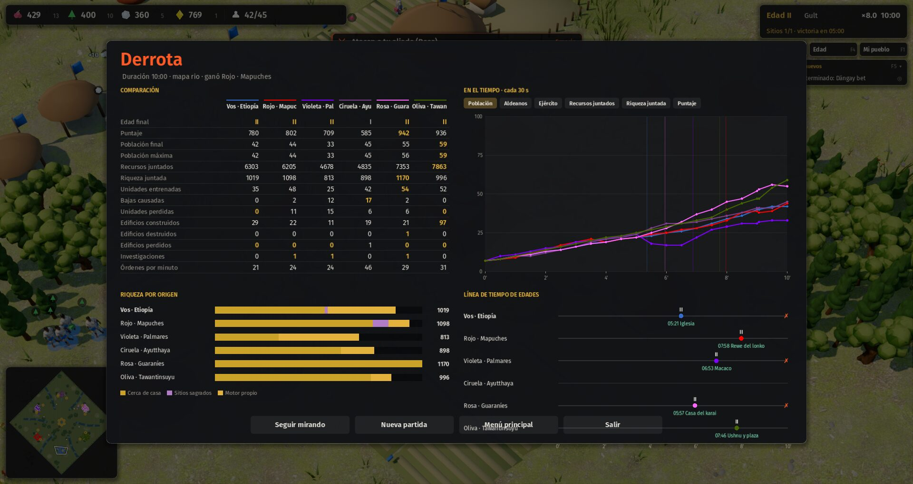
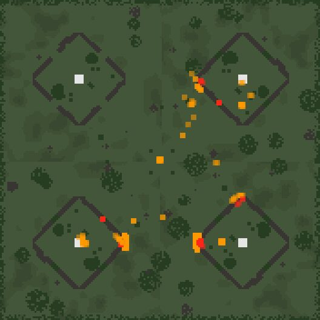
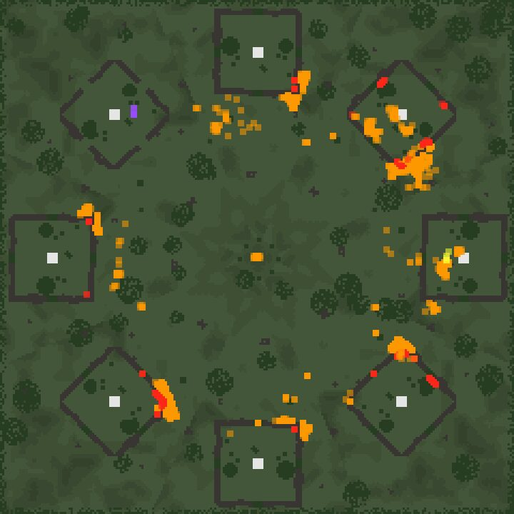
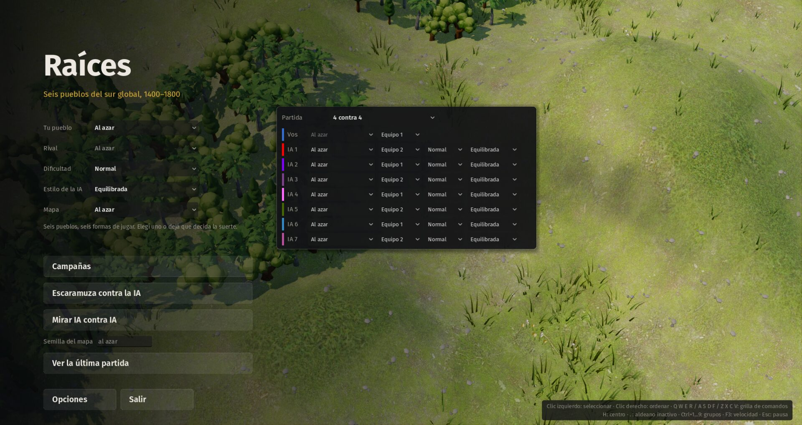
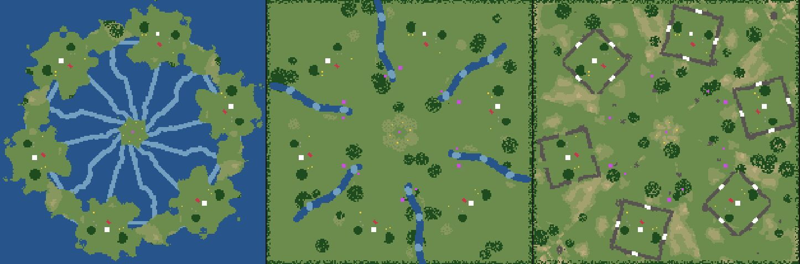
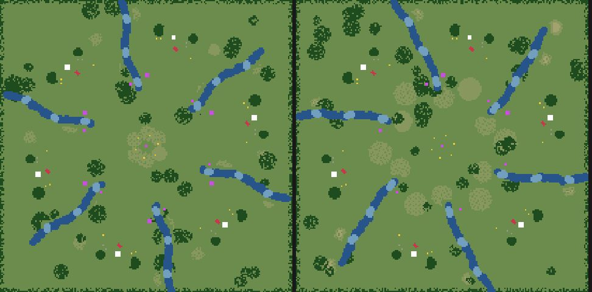
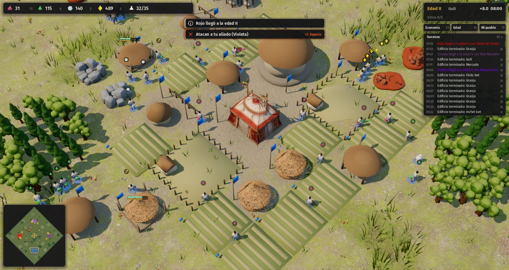

# 04 · Equipos y todos contra todos

Informe de jugador de prueba. Perfil: juego 2v2, 3v3 y 4v4 con amigos en AoE4 y partidas largas contra la IA. Me importan los mapas, la IA como aliada y como rival, el tributo, la coordinación, el rendimiento con muchos jugadores y la rejugabilidad.

## 1. Qué probé y cómo

No puedo usar el mouse ni mirar la pantalla en vivo. Jugué con capturas, vistas de mapas, partidas de IA por script y la telemetría.

| Qué | Comando |
|---|---|
| Menú de lugares (4v4 y todos contra todos con 6) | `godot --path . -- --menu --partida=3 --shot=menu_4v4.png --shot-at=2` (y `--partida=5`) |
| 2v2 de IA mirado como jugador 0, minuto 8 | `godot --path . -- --civs=etiopia,mapuches,palmares,ayutthaya --equipos=0,1,0,1 --terreno=llano --seed=11 --speed=8 --aivai --panel=puntaje,sucesos --shot=2v2_hud.png --shot-at=480` |
| 3v3 de IA, minuto 10 | `godot --path . -- --civs=etiopia,mapuches,palmares,ayutthaya,guaranies,tawantinsuyu --equipos=0,1,0,1,0,1 --terreno=rio --seed=5 --speed=8 --aivai --panel=puntaje --shot=3v3.png --shot-at=600` |
| Mapas de 6 jugadores | `godot --headless --path . -s tools/vista_mapas.gd -- --terrenos=islas,fortines,rio,llano,selva,mesetas --semillas=2 --jugadores=6 --salida=<carpeta>` |
| Sitios sagrados por terreno | Script que solo genera el mapa (sin IA) y cuenta `sitio_sagrado`: 13 terrenos × 2, 4, 6 y 8 jugadores × 3 semillas |
| Diez partidas de IA | Script propio (`partidas.gd`, en mi carpeta de trabajo, fuera del repo): `Sim.new(semilla, n, null, {civs, equipos, terreno})`, una `SimAI` por jugador y estilos por lugar. Mide duración, cómo termina, bajas, fuego amigo, tributos, ms por tick y, cada 10 s, si hay 4 o más soldados enemigos a menos de 22 casillas de una capital y si hay 3 o más soldados aliados cerca. Guarda la telemetría con `s.tele.save` |
| Jugador humano quieto | La misma partida sin IA en el lugar 0: ¿el aliado le da tributo? ¿lo defiende? |
| Telemetría | `godot --headless --path . -s tools/telemetria.gd -- --entrada=<carpeta> --salida=<carpeta>` |

Las diez partidas: 2v2 en llano con aliados alternados (como arma el menú) y con aliados vecinos; 2v2 en islas; 2v2 en fortines con un estilo distinto por lugar; dos 2v2 con el humano quieto; todos contra todos con 4 agresivas en río; 3v3 en río; todos contra todos con 6 en llano; 4v4 en fortines. Respeté el tope de 4 partidas de 6 o más jugadores (3v3 dos veces, todos contra todos con 6 y 4v4).

**Aviso sobre los tiempos:** corrí varias partidas a la vez, con la máquina cargada (carga 11,6 en 12 núcleos, más los otros testers). Los ms por tick de este informe salen inflados; sirven para comparar entre sí, no como medición limpia (para eso está `proceso/18`, paso 8).

## 2. Lo que me gustó

- **El menú de lugares es lo que pido en un juego de equipos:** de 1v1 a 4v4 y todos contra todos con 4, 6 u 8, y por lugar elegís civ, equipo, dificultad y estilo. Mezclar una IA pacífica con una agresiva en el mismo equipo es algo que en AoE4 no puedo hacer.
- **Cero fuego amigo** en 6.400 bajas de diez partidas. Las puertas aliadas dejan pasar a los aliados.
- **Los avisos de equipo funcionan:** "Atacan a tu aliado (Violeta) ×3" con salto por Espacio, "Rojo llegó a la edad II" y el registro de sucesos con colores por jugador.
- **La pantalla de fin es muy buena:** comparación por jugador, curvas cada 30 s, riqueza por origen y línea de tiempo de edades con el hito elegido. En AoE4 es lo que más miro con amigos después de la partida.
- **Los mapas son parejos de verdad.** Islas y fortines con 6 se ven calcados entre bases, y la prueba de equidad con 50 semillas lo respalda.
- **Los cuatro estilos de IA** le dan personalidad a cada rival. Una mesa de todos contra todos con estilos mezclados promete.
- **El todos contra todos de 4 agresivas** fue la mejor partida que medí: 41 minutos, 979 bajas, cuatro pueblos llegando a la edad III y un ganador por conquista.

## 3. Lo que le falta para ser tan divertido como los equipos de AoE4

### La IA como aliada
- **No viene a defenderme.** En 54 a 63 momentos con mi capital atacada, ningún soldado aliado se acercó (ni 3). La regla existe (`ia_ayuda_radio` = 70 casillas), pero en los mapas generados el aliado nunca está tan cerca: con aliados alternados (lo que arma el menú) quedan a 127 casillas en 2v2, 137 en 3v3 y 134 a 192 en 4v4; aun como vecinos, a 90 en 2v2. Ver la sección 4.
- **No me da tributo cuando lo necesito.** Solo da cuando al aliado le quedan menos de 150 de algo. Con el humano quieto (200 de alimento, 200 de madera, 100 de piedra) no llegó **ni un tributo en 21 minutos**. Entre IA hubo de 0 a 2 tributos por partida en 2v2, y 19 en el 4v4.
- **No puedo pedirle nada.** En AoE4 una bengala en el minimapa ya es un pedido. Acá no hay forma de decir "atacá ahí", "vení a defender", "mandame madera" o "voy a la edad III".
- **La IA no habla.** No avisa "voy a atacar a Rojo", "necesito ayuda" o "te mando 200 de alimento". El aliado no se siente un compañero; es otro programa que juega al lado.

### Señales y coordinación
- **Sin bengalas ni pings propios.** El minimapa solo marca los ataques. Con amigos, la bengala es lo que más se usa.
- **Sin chat ni frases rápidas.** Aunque el multijugador en red no exista todavía, frases como "¡Ataquemos!", "Ayuda", "Retirada" o "Necesito recursos" sirven igual con la IA.
- **Sin marcar a un rival.** En todos contra todos quiero decirle a mi aliado de turno a quién atacamos.

### Puntaje y objetivos
- **El fin de la partida no agrupa por equipo:** son seis u ocho columnas sueltas. En la pantalla de fin falta el total de cada equipo (en el puntaje F6 ya está).
- **No hay objetivos de mapa que inviten a pelear en el medio**, salvo los sitios sagrados, y hoy los sitios deciden demasiado (sección 4).

### Modos de juego
- **No se pueden elegir las condiciones de victoria:** no hay "solo conquista", "sin sitios", "regicida", "rey de la colina", ni tiempo límite con puntaje. En AoE4, con amigos, lo primero que hacemos es sacar los sitios sagrados o ajustarlos.
- **No hay opción para ubicar a los equipos:** "juntos" (aliados vecinos, como el "Team positions" de AoE4) o "mezclados". El menú siempre alterna a los aliados (0,1,0,1), así que en 2v2 mi aliado queda en la esquina opuesta y tengo un rival a cada lado.
- **Faltan opciones de partida:** recursos iniciales, edad inicial, tamaño del mapa, límite de población, "equipos fijos" y "revelar mapa". Son las que cambian la partida con amigos.
- **No hay agua jugable.** Islas y delta tienen agua, pero no hay barcos. En 2v2 islas la partida se resolvió como en tierra.

### Rejugabilidad
- **Los mapas de N jugadores se parecen mucho entre semillas.** Las bases caen siempre en el mismo círculo, con los mismos ángulos, y el río con 6 sale "costados" en las dos semillas (captura). La equidad está muy bien, pero se pierde la sorpresa de AoE4, donde cada partida de equipos es otro mapa.
- **Un solo tamaño de mapa por cantidad de jugadores.**

## 4. Errores y rarezas

### A. Un 3v3 se define en 9 minutos por un solo sitio sagrado (grave)
- **Qué pasa:** en río con 6 jugadores, la semilla 53 genera **un solo sitio sagrado** (debería haber 7). El equipo 1 lo toma al minuto 4 y gana por sitios a los **9:04**, con **32 bajas** en toda la partida.
- **Con la semilla 5 pasa lo mismo:** sitio tomado a los 4:05 y victoria a los 9:04. La captura muestra "Derrota · Duración 10:00" y arriba a la derecha "Sitios 1/1 · victoria en 05:00".
- **Causa probable:** los sitios "entre bases vecinas" caen donde están los ríos de la forma "costados" (`Sim._generate_map_n`, `nearest_free(…, 8)`). Si no hay lugar libre de 2×2, el sitio no se crea, y no hay aviso.
- **Conteo** (3 semillas: 5, 100, 107):

  | Jugadores | Islas | Río | Fortines | Bosque | Montaña | Mesetas / sierra |
  |---|---|---|---|---|---|---|
  | 2 | 1/1/1 | 3/3/2 | 3/3/3 | 2/3/3 | 3/3/3 | 3/3/3 |
  | 4 | **1/1/1** | 5/5/**1** | 5/5/5 | 5/5/5 | 5/5/**2** | 5/**3**/5 |
  | 6 | **1/1/1** | **1**/7/7 | 7/7/**1** | **3**/7/7 | 7/7/7 | 7/7/7 |
  | 8 | **1/1/1** | 8/8/**3** | 9/9/9 | 9/8/8 | 9/9/9 | 9/9/9 |

  **Islas tiene siempre un solo sitio**, con cualquier cantidad de jugadores. Además, la cantidad cambia entre semillas del mismo terreno, así que la justicia del mapa depende de la suerte.
- **Cómo reproducirlo:** `Sim.new(53, 6, null, {"civs": […6…], "equipos": [0,1,0,1,0,1], "terreno": "rio"})`, IA en los 6 lugares, hasta el minuto 10.

  

### B. En fortines las IA no pueden atacar: se gana por sitios sin pelear (grave)
- **2v2 en fortines** (semilla 31; pacífica y agresiva contra acosadora y equilibrada): **0 bajas en 17:30**, con ejércitos de 61 a 94 soldados. Ganó el equipo de la pacífica, que tomó los 5 sitios.
- **4v4 en fortines** (semilla 71): seis de los ocho jugadores llegaron a 200 de población, con 135 a 156 soldados, y terminaron con **0 bajas y 0 muertes**. La partida terminó por sitios a los 31:29. La telemetría registró **4089 caminos imposibles y 1180 unidades trabadas**.
- **Qué muestra la telemetría:**
  - **Las tropas se traban en las puertas de su propio fortín:** jugador 2, `trabada` en (133,109) yendo a (132,107), y en (109,133) yendo a (107,132), con orden mover.
  - **El camino a una base rival es imposible:** `sin_camino` desde (135,134) hasta (45,132), porque las puertas del rival no dejan pasar y la IA no las rompe.
  - **Además:** la mayoría de los 594 rechazos del 4v4 son "Población llena · en_marcha": IA que siguen pidiendo tropa con la población llena.

  | 2v2 fortines | 4v4 fortines |
  |---|---|
  |  |  |

  Rojo es trabada y naranja, camino imposible. Se juntan en las salidas de cada recinto.
- **Cómo reproducirlo:** 4 jugadores en `fortines` con la semilla 31, o 8 con la 71, todas IA y 30 minutos. Después, `tools/telemetria.gd`.

### C. El aliado nunca está dentro del radio de ayuda
- **Distancia entre capitales aliadas** (casillas):

  | Partida | Alternados (menú) | Vecinos |
  |---|---|---|
  | 2v2 | 127 | 90 |
  | 3v3 | 137 | — |
  | 4v4 | 134 a 192 | — |

  `ia_ayuda_radio` es 70, así que `_ally_threat` no se dispara nunca.
- **Medido:** en 8 partidas con equipos hubo 316 muestras con una capital atacada y solo 3 con soldados aliados cerca, en el 2v2 con aliados vecinos, y probablemente de paso.
- **Con el humano quieto:** cayó mi capital (minuto 12 con aliados vecinos, minuto 21 con alternados), con 54 a 63 muestras de amenaza y **0** con ayuda.

### D. El tributo de la IA casi no aparece
- La regla pide que el aliado tenga **menos de 150** de un recurso y que al que da le sobren más de 800. Un humano que junta pero no gasta nunca la cumple.
- **Tributos medidos:**

  | Partida | Tributos |
  |---|---|
  | 2v2 con humano quieto | 0 |
  | 2v2 en llano (alternados / vecinos) | 1 / 2 |
  | 2v2 en islas | 1 |
  | 3v3 | 0 |
  | 4v4 | 19 (casi todo alimento y madera a la Tawantinsuyu) |

### E. La partida de 6 no termina
- **Todos contra todos con 6 en llano** (semilla 61): sigue abierta a los **60:00**, con 2877 bajas.
- **Quedan tres en pie:** Palmares con 7 de población y 0 soldados (sigue vivo por un hito), Tawantinsuyu con 74 soldados y Guaraníes con 30.
- **Lo que pide la partida:** un tiempo límite con puntaje, o una regla de rendición o de eliminación por no tener población.

### F. Cierres con error de memoria y una caída
- **Al salir:** dos de tres capturas con ventana terminaron con `double free or corruption (!prev)` y `corrupted size vs. prev_size while consolidating`, con volcado de memoria. La captura se guarda igual.
- **Una caída durante la partida:** la primera corrida del todos contra todos de 4 agresivas se cayó con **signal 11**, en `Sim._cleanup` (`sim.gd:1404`, `by_id.erase`), llamado desde `step` (`sim.gd:855`).
- **No se repite:** la misma semilla, corrida otra vez, terminó bien a los 40:57. Parece corrupción de memoria del motor, no de la lógica, pero en una partida larga de amigos sería una caída.
- **Cómo reproducirlo:** muchas partidas headless en paralelo con la máquina cargada; no tengo un caso exacto.

### G. Interfaz con muchos jugadores
- **Pantalla de fin con 6 jugadores:** en la línea de tiempo de edades, la fila "Oliva · Tawantinsuyu" queda encima del botón "Menú principal" (captura del punto A, abajo).
- **Colores de 8 jugadores que se confunden en el menú:** Vos (azul) con IA 6 (celeste), IA 2 (violeta) con IA 3 (morado), e IA 4 (magenta) con IA 7 (rosa).
- **Menú en 4v4:** siguen a la vista "Rival" y "Estilo de la IA" de la columna izquierda, que en ese modo no se usan. Confunde.

  

### H. Ritmo de las IA en equipo
- **Una civ suele quedar fuera muy temprano:**
  - en el todos contra todos de 4, Etiopía terminó a los 20 minutos sin pasar de la edad I y con 2.321 recolectados;
  - en el 2v2 en llano, Palmares cayó a los 24 con 12.298 recolectados, contra 30.000 de los demás.
- En equipos, quien cae primero deja a su compañero 1 contra 2 durante 8 a 10 minutos. Sin defensa ni tributo del aliado (C y D), no hay remontada.

### I. Telemetría de las 10 partidas, resumida

| Partida | Sin camino | Trabadas | Ociosos | IA sin ruta | Ticks lentos (> 25 ms) |
|---|---|---|---|---|---|
| 2v2 fortines (estilos) | 407 | 170 | 0 | 0 | 175 |
| 4v4 fortines | 4089 | 1180 | 12 | 11 | 378 |
| Todos contra todos con 6, llano | 303 | 62 | 512 | 209 (Tawantinsuyu) | 698 |
| 2v2 llano (alternados) | 180 | 56 | 28 | 0 | 348 |
| Todos contra todos con 4, río | 174 | 73 | 12 | 0 | 360 |
| 2v2 islas | 0 | 0 | 0 | 0 | 164 |

- **Unidades que se rinden** (las tres partidas grandes): aldeano recolectando 516, guerrero moviendo 247, lancero 139, hondero 121.
- **Rechazo más común** (las tres partidas grandes): "Población llena · en_marcha" (Palmares 251, Mapuches 204, Guaraníes 173).

## 5. Mis 10 deseos, en orden

1. **Que cada mapa tenga siempre sus sitios sagrados, y que se puedan apagar.** Si un sitio no entra, buscarle otro lugar o avisar. Islas con un solo sitio y río o fortines con uno según la semilla deciden partidas de equipo en 9 minutos.
2. **Que la IA sepa entrar a un fortín:** romper la puerta o la empalizada con asedio, o elegir otra salida. Y que sus tropas no se traben en sus propias puertas. Hoy, en fortines, las partidas grandes no tienen peleas.
3. **IA aliada que defiende de verdad:** que el radio de ayuda dependa del mapa (por ejemplo, la distancia al aliado más un margen), o que ayude siempre que pueda llegar a tiempo.
4. **Bengalas y pedidos al aliado:** alt+clic en el mapa o el minimapa para "atacá acá" o "defendé acá", y botones de "mandame alimento / madera / piedra / riqueza". La IA responde y lo dice en el chat.
5. **Frases de la IA aliada y rival:** "Voy contra Rojo", "Me atacan, ayuda", "Te mando 200 de madera", y una provocación del rival agresivo. Es lo que más personalidad da.
6. **Condiciones de victoria y opciones de partida en el menú:** conquista, sitios sí o no, tiempo límite con puntaje, regicida, recursos y edad iniciales, población máxima, revelar mapa.
7. **Ubicación de los equipos:** "juntos" (vecinos, por defecto como en AoE4) o "mezclados".
8. **Tributo de la IA cuando el aliado lo necesita para algo concreto** (la próxima edad, una tropa), no solo cuando le quedan menos de 150. Y un aviso: "Rojo te pide 300 de madera para la edad III".
9. **Más variedad entre semillas en los mapas de N:** girar el círculo, variar el radio y las formas de agua (el río con 6 siempre sale "costados"), y un tamaño de mapa a elección. Y, a futuro, barcos para islas y delta.
10. **Pantalla de fin por equipos y partidas largas que terminen:** totales por equipo, la fila de la línea de tiempo que no pise los botones, y un final para el todos contra todos que se estira (tiempo límite o rendición).

## 6. Números medidos

| Partida | Terreno | Duración | Cómo terminó | Bajas | Tributos | Capital atacada / con ayuda | ms por tick, promedio / peor* |
|---|---|---|---|---|---|---|---|
| 2v2 alternados (semilla 11) | llano | 32:10 | conquista, equipo 1 | 621 | 1 | 63 / 0 | 20,8 / 232 |
| 2v2 vecinos (semilla 11) | llano | 32:15 | conquista, equipo 1 | 730 | 2 | 56 / 3 | 22,1 / 286 |
| 2v2 (semilla 23) | islas | 17:59 | sitios (había 1) | 280 | 1 | 54 / 0 | 18,1 / 275 |
| 2v2 con estilos (semilla 31) | fortines | 17:30 | sitios, **0 bajas** | 0 | 0 | 0 / 0 | 22,0 / 450 |
| 2v2, humano quieto, alternados | llano | 21:37 | conquista | 198 | 0 | 54 / 0 | 13,2 / 225 |
| 2v2, humano quieto, vecinos | llano | 21:17 | conquista (yo caigo al minuto 12) | 253 | 0 | 63 / 0 | 15,3 / 201 |
| Todos contra todos con 4 agresivas (semilla 41) | río | 40:57 | conquista, Mapuches | 979 | — | 178 / — | 20,9 / 433 |
| 3v3 (semilla 53) | río | **9:04** | sitios (había 1) | 32 | 0 | 5 / 0 | 19,9 / 136 |
| 3v3 (semilla 5, para repetir lo anterior) | río | **9:04** | sitios (había 1) | — | — | — | — |
| Todos contra todos con 6 (semilla 61) | llano | 60:00 | **abierta** | 2877 | — | 264 / — | 43,6 / 919 |
| 4v4 (semilla 71) | fortines | 31:29 | sitios; 6 de 8 sin pelear | 439 | 19 | 21 / 0 | 81,9 / 1265 |

\* Con la máquina cargada; ver el aviso del punto 1. A ×4 de velocidad entran 25 ms por tick.

- **Fuego amigo:** 0 en todas.
- **Cómo terminaron las 11:**
  - 5 por sitios sagrados: tres con un solo sitio en el mapa y dos en fortines sin peleas;
  - 5 por conquista;
  - 1 abierta a los 60 minutos.
- **Duración por conquista:** 21 a 41 minutos, como un 2v2 de AoE4. Por sitios: 9 a 31.

### Mapas de 6 jugadores

| Islas, río y fortines (semilla 100) | Río con dos semillas: la misma forma |
|---|---|
|  |  |

### En partida

El aviso "Atacan a tu aliado (Violeta) ×3" se ve bien, pero mientras tanto mi IA aliada no hace nada por él.
