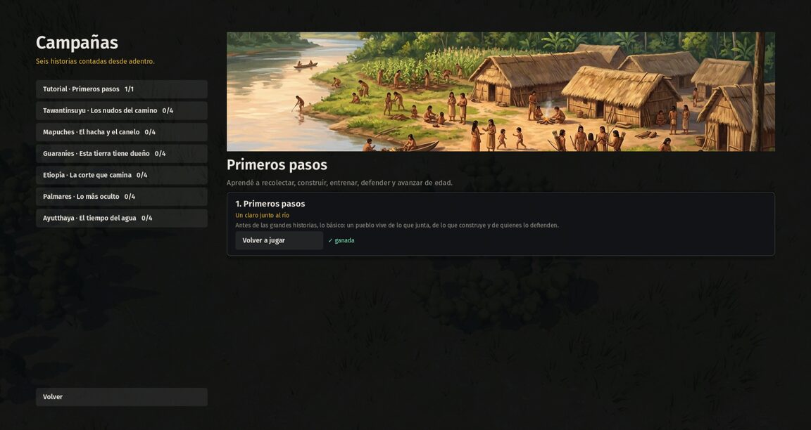

# 22 · Jugadores de prueba (desde 2026-11-15 13:10)

## Pedido del autor
> "Generá un grupo de agentes que sean los jugadores testers del juego, y que nos hagan un feedback de qué les gustaría del juego y qué les parece que le falta para ser tan divertido como Age of Empires 4, y dejame todo eso en proceso. Continuá documentando y solucionando problemas que veamos con la telemetría."

## Cómo se hace
Cuatro agentes, cada uno con un perfil de jugador distinto. Un agente no puede jugar con mouse y pantalla como una persona; juega con lo que sí puede manejar:
- partidas con capturas a distintos minutos (`--shot`, `--cam`, `--select`, `--grilla`, `--panel`);
- IA contra IA para mirar ritmo y peleas;
- partidas guiadas por script con la API de la simulación (dar órdenes como un jugador y ver qué pasa);
- las campañas;
- la ayuda, los nombres y las descripciones del juego;
- la telemetría de sus propias partidas.

Ninguno toca código ni datos: solo escriben su informe y guardan sus capturas en `capturas/<perfil>/`.

| Perfil | Qué mira | Informe |
|---|---|---|
| Veterano de AoE4, competitivo | Ritmo, órdenes de construcción, macro, micro, atajos, información en pantalla | [01-veterano-aoe4.md](01-veterano-aoe4.md) |
| Nuevo en los RTS | Claridad, tutorial, primeras partidas, qué se entiende y qué frustra | [02-nuevo-en-rts.md](02-nuevo-en-rts.md) |
| Historia y estética | Pueblos, nombres, campañas, arte, sonido, si se siente cada cultura | [03-historia-y-estetica.md](03-historia-y-estetica.md) |
| Equipos y todos contra todos | 2v2, 3v3, 6 jugadores, mapas, estilos de IA, rejugabilidad | [04-equipos-y-ffa.md](04-equipos-y-ffa.md) |

Al final, una síntesis con lo que repiten varios y un plan priorizado: [00-sintesis.md](00-sintesis.md).

## Paso a paso
1. **(13:10) Etapa abierta;** los cuatro agentes trabajan en paralelo.
2. **(14:30) Llegaron dos informes.**
   - **Veterano de AoE4** ([informe](01-veterano-aoe4.md)):
     - **el ritmo de la edad I se parece a AoE4:** edad II a las 4:48 con una apertura limpia;
     - **la micro no paga:** los contadores multiplican el daño por 2 o más y kitear no sirve;
     - **la edad I no tiene decisiones:** no hay caza ni ganado, y el explorador no tiene trabajo;
     - **los hitos se levantan en menos de 1 minuto,** contra unos 3 en AoE4;
     - **faltan órdenes:** seleccionar todos los militares o los ociosos, patrullar, mantener posición, cola global;
     - **la IA se planta en 42 aldeanos en dificultad normal.**
   - **Historia y estética** ([informe](03-historia-y-estetica.md)):
     - **lo mejor son las campañas,** por sus narradores y sus fuentes;
     - **lo más grave:** los rivales históricos (Adal, Birmania, chankas, tupíes) juegan como "Invasores" europeos o con la cultura del jugador;
     - **no hay cambio por edad,** el ejército son maquetas blancas, no hay voces, y Etiopía no tiene música;
     - **nombres dudosos:** "Espingardeiro de resgate", "Inkarri" como edad, el Qorikancha en la edad IV;
     - **textos de prototipo** que rompen la inmersión.
   - **Errores concretos que encontraron**, que arreglo enseguida (paso 3):
     - el panel de la unidad muestra los valores de base, sin las mejoras;
     - `--shot` termina sin guardar la telemetría y con un volcado de memoria;
     - en IA contra IA salen los avisos de la IA del jugador 0;
     - "✓ ganada" se dibuja en vertical en la pantalla de campañas;
     - quedan textos "(… en el prototipo)" en los objetivos;
     - las demos y algunas misiones arrancan por encima del tope de población.
3. **(16:00) Llegó el informe del nuevo en los RTS** ([informe](02-nuevo-en-rts.md)):
   - **pierde siempre contra la IA fácil:** 8 de 8, entre los minutos 10 y 28; la IA fácil está en su base a los 8–9 minutos, ya en la edad II;
   - **dos derrotas fueron por sitios sagrados** con 25 soldados intactos en casa: ningún aviso grande los explica;
   - **el tutorial, seguido al pie de la letra, deja la misión trabada:** "todos al bosque" no deja alimento para el ejército;
   - **faltan avisos que enseñen** (ocioso, frutos agotados, riqueza sin gastar) y un botón de aldeanos ociosos con número;
   - **lo que más le gustó:** el panel de edad con "qué falta", las fichas con nombre propio y común, y el arte de las campañas.
4. **(16:10) Arreglos de los errores que encontraron los jugadores de prueba:**
   - **Panel de la unidad con los valores reales:** ataque con mejoras y bono de edad, armadura con mejoras y velocidad real. Lo calcula la simulación (`Sim.effective_attack` y `effective_armor`, que también usa el daño), así no pueden volver a diferir.
   - **IA contra IA:** ya no aparecen los rechazos de la IA del jugador 0 como si fueran tuyos.
   - **Campañas:** "✓ ganada" se escribe en horizontal (la etiqueta cortaba por palabra sin ancho).

     
   - **Textos de prototipo** fuera de los objetivos de Guaraníes 1, 3 y 4 y de Palmares 1.
   - **La ficha del cuartel** decía "choque, distancia y línea" para todos: era un texto fijo en `controller.gd`, de antes de la producción por función. Ahora la descripción está en `edificios.json` y la ficha lista lo que entrena cada pueblo.
   - **`--shot` guarda la telemetría** antes de cerrar.
   - **El volcado de memoria al cerrar** (`double free or corruption`, código 134) no está arreglado:
     - pasa dentro del motor, después de guardar la captura, y no siempre: el mismo commit dio 0 una vez y 134 otra;
     - la versión de ayer cierra bien; con la de hoy falla casi siempre;
     - descarté el registro de errores (sin él también falla), el sonido (`--audio-driver Dummy` también falla) y liberar la escena antes de salir;
     - no afecta partidas ni pruebas, porque la captura ya se guardó; queda anotado en `docs/09`.
   - Determinismo y autotest con guaraníes y Etiopía: OK.
5. **(17:00) Llegó el informe de equipos y todos contra todos** ([informe](04-equipos-y-ffa.md)): faltan sitios sagrados en mapas de varios, en fortines nadie pelea, la IA aliada no defiende y casi no da tributo, y el todos contra todos con 6 no termina.
6. **(17:10) Síntesis de los cuatro** ([00-sintesis.md](00-sintesis.md)): lo que gustó, lo que repiten ordenado por cuánto le quita a la diversión, y el plan. Tres preguntas que cambian el balance van a `CONSULTAS.md`: contadores más blandos (C-31), comida temprana con animales (C-32) y tiempo de obra de los hitos (C-33). La C-34 pregunta el orden de prioridades. Empiezo por los errores de la sección 1, que no cambian el balance.
7. **(17:40) Arreglos de los errores que arruinaban partidas de varios** (síntesis, sección 1):
   - **Sitios sagrados que faltaban.** Cuando un sitio caía en el agua o en un lugar ocupado, el generador de mapas de varios lo descartaba sin avisar: islas quedaba con 1. Ahora se acerca al centro hasta que entra. El del centro no se corre, para no quedar más cerca de nadie: si el centro es un lago, ese sitio no va. Prueba nueva `tests/sitios.gd`: en islas, río, fortines, bosque, delta y llano, con 3, 4, 6 y 8 jugadores y 6 semillas, siempre hay al menos un sitio por jugador. OK.
   - **En fortines nadie peleaba porque cada uno estaba encerrado en su cerco.** Era una falla mía de la etapa 18:
     - para que el giro no dejara huecos en diagonal, la empalizada llenaba todo el grosor del cerco (3 casillas), pero la puerta era una sola casilla en el medio;
     - el dueño pasaba la puerta, pero no las empalizadas de adelante y de atrás;
     - ahora la puerta es una columna de 3 de ancho que atraviesa el cerco.
     - **Prueba nueva en `tests/equipos.gd`:** cada jugador llega desde su base hasta el centro del mapa. Con el código anterior quedaban encerrados los 4 de 4 y 5 de 6; ahora, ninguno.
   - **La IA aliada no defendía:** el radio de ayuda era de 70 casillas y los aliados quedan a 90–192. Ahora es de 200; igual solo va si su propia base no está amenazada.
   - **Tributo:** la IA da cuando al aliado le quedan menos de 400 (antes 150) y a ella le sobran más de 600 (antes 800).
   - Determinismo OK. Partidas 2v2 de 20 minutos para medir ayuda y tributo, corriendo.
8. **(19:00) Más arreglos de la sección 1:**
   - **El todos contra todos que no terminaba:** la derrota llega al perder todos los hitos, la capital y lo que cuenta para la victoria (el mocambo de Palmares, el lof mapuche), pero la IA solo atacaba hitos y capitales. Un pueblo sin ejército seguía vivo para siempre por un mocambo. Ahora la IA también va contra lo que cuenta para la victoria.
   - **IA fácil de verdad:** cuatro parámetros nuevos solo para la fácil (`reglas.json → dificultades.facil`):
     - no ataca la base antes del minuto 15;
     - no hace incursiones;
     - no va por los sitios sagrados;
     - no pasa de la edad II;
     - además, tope de 15 militares si no la atacan.
   - **Medido con el mismo script del jugador nuevo** (`novato.gd`, guaraníes contra Tawantinsuyu fácil, semillas 7 y 21):

     | | Antes | Con los cambios |
     |---|---|---|
     | Primer enemigo en la base | 8:14 | 15:45 y 16:10 |
     | Resultado | derrota a los 13:52, por sitios | partidas abiertas a los 30:00 |
     | Aldeanos perdidos | — | 1 y 0 |
   - **IA aliada, 2v2 de 20 minutos** ([resultado](pruebas-equipos-2v2.txt)): entre 2 y 3 tributos por partida (antes 0 a 2), cero fuego amigo.
   - Determinismo OK.
9. **(2026-11-15 13:00) Segunda ronda, a pedido del autor:** "Antes de terminar de balancear, ¿podemos volver a consultar con los players y ver qué nos dicen ahora?"
   - Los mismos cuatro jugadores, con la memoria de la primera ronda. Así comparan con su propio informe.
   - Juegan la versión con todo lo de la etapa 23: combate con bonos y dos armaduras, animales y caza, órdenes y comodidades, aprender a jugar y rivales con civ propia.
   - El balance todavía no está cerrado (Palmares 88 % en el último torneo).
   - Informes en [ronda-2/](ronda-2/) y una síntesis comparada al final.
10. **(16:00) Segunda ronda completa** ([síntesis comparada](ronda-2/00-sintesis.md)). Mejoraron casi todos los puntos de la primera ronda:
    - ritmo y comida como AoE4;
    - micro que paga;
    - comodidades casi completas;
    - el jugador nuevo con ganas de seguir;
    - rivales con civ propia;
    - mapas de varios que ya se juegan.

    Aparecieron errores nuevos chicos, como la IA fácil en el centro, aldeanos que no carnean y misiones por encima del tope de población, que se arreglan ya. Lo más pedido ahora: hitos lentos, sitios a 10 minutos, opciones de partida e identidad visual y sonora.
