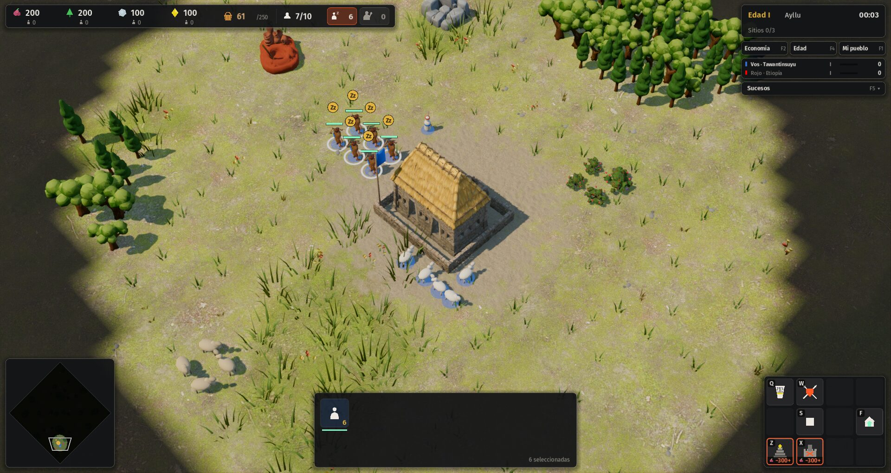
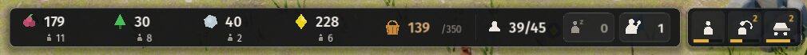
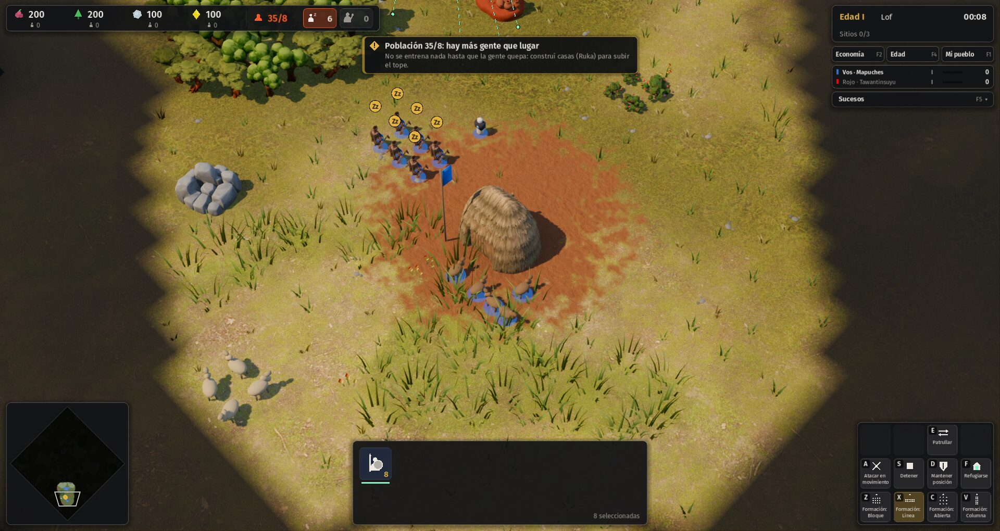
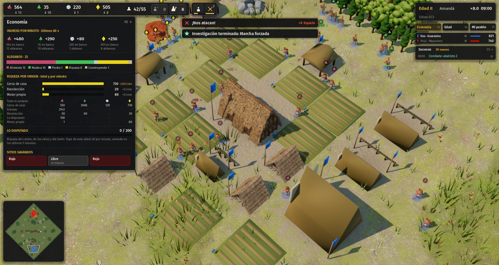
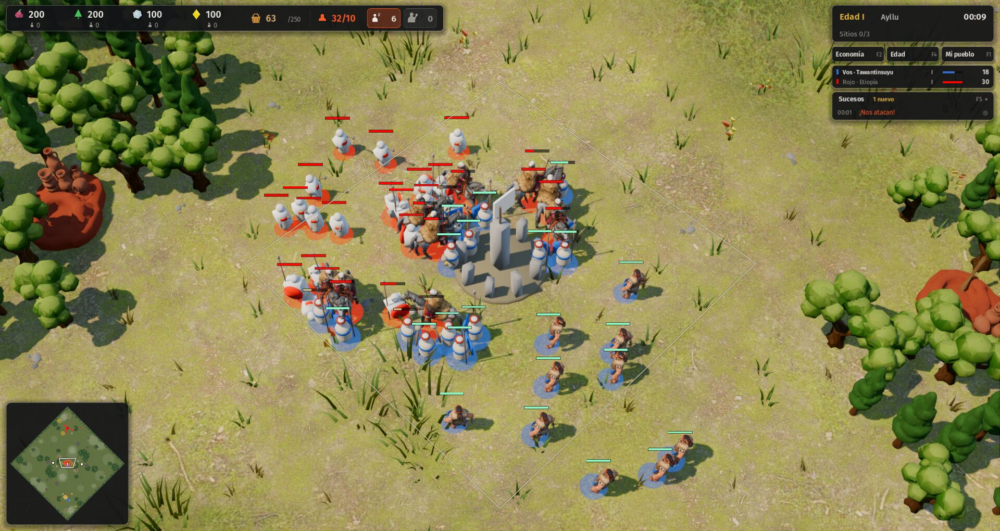

# Jugador de prueba 1, segunda ronda · Veterano competitivo de AoE4

Informe del 2026-11-15, después de la etapa 23 ([README](../../23-como-aoe4/README.md)). El de la primera ronda está en [../01-veterano-aoe4.md](../01-veterano-aoe4.md). Probé el árbol de trabajo tal como estaba, con el cambio de IA todavía sin commitear (`data/reglas.json` y `src/sim/sim_ai.gd`).

## 1. Qué probé

Con el mismo método que la primera vez: mi script juega una apertura contra la IA, otros scripts arman peleas aisladas y saco capturas con `--shot`. Le agregué al script de apertura lo que haría un veterano con lo nuevo:
- el explorador sale a reclamar animales sueltos;
- el rebaño que queda lejos se arrea a la base;
- los aldeanos de comida carnean primero los animales propios;
- se levantan graneros y barreros junto a la comida y la piedra.

Mi script sigue sin hacer micro y defiende mal: **las derrotas no miden el balance**.

| Qué | Comando |
|---|---|
| Animales: carnear en cadena, aldeano a un animal suelto, explorador que reclama, comida por civ | `godot --headless --path . -s scratchpad/testers/veterano/animales.gd` |
| Apertura con animales, contra la IA normal | `godot --headless --path . -s scratchpad/testers/veterano/apertura2.gd -- --civ=guaranies --rival=mapuches --min=25 --plan=boom --ataque=14` |
| Ídem | `… apertura2.gd -- --civ=etiopia --rival=tawantinsuyu --min=25 --plan=boom --ataque=14` |
| Ídem | `… apertura2.gd -- --civ=tawantinsuyu --rival=mapuches --min=25 --plan=boom --ataque=14` |
| Contra la IA difícil | `… apertura2.gd -- --civ=tawantinsuyu --rival=etiopia --min=25 --plan=boom --ataque=14 --dif=dificil` |
| Prueba fija de micro | `godot --headless --path . -s tests/micro.gd` |
| Micro con las órdenes nuevas | `godot --headless --path . -s scratchpad/testers/veterano/micro2.gd` |
| Arranque inca | `godot --path . -- --civ=tawantinsuyu --rival=etiopia --terreno=llano --seed=7 --shot=x.png --shot-at=3 --select=aldeano` |
| Barra y cola global, minuto 6 | `godot --path . -- --aivai --civ=tawantinsuyu --rival=etiopia --terreno=llano --seed=7 --speed=8 --shot=x.png --shot-at=360` |
| Grilla militar nueva | `godot --path . -- --demo=formacion --civ=mapuches --shot=x.png --shot-at=8 --select=lancero --formacion=linea --nombres=1` |
| Minuto 9 con F2 | `godot --path . -- --aivai --civ=guaranies --rival=mapuches --terreno=llano --seed=7 --speed=8 --shot=x.png --shot-at=540 --panel=economia` |
| Batalla con barras | `godot --path . -- --demo=batalla --civ=tawantinsuyu --rival=etiopia --shot=x.png --shot-at=9 --cam=64,64,22 --barras=1` |
| Telemetría de esas capturas | `godot --headless --path . -s tools/telemetria.gd -- --entrada=<carpeta> --mapas=0` |

Los scripts están en la carpeta de trabajo de la sesión (`scratchpad/testers/veterano/`), fuera del repositorio.

## 2. Mis 10 deseos de la primera ronda, uno por uno

| # | Deseo | Estado | Qué medí |
|---|---|---|---|
| 1 | Contadores más blandos y micro que pague | **Mejoró mucho** | El contador gana pero paga, y concentrar el fuego ahora cambia la pelea: de 1 baja a 4. Kitear a la línea sale perfecto (ver §5) |
| 2 | Comida temprana con decisiones | **Hecho** | 4800 de comida silvestre a 30 casillas, contra 1200 antes. El explorador de los guaraníes reclamó 10 animales en 2 minutos. Mi primera granja llegó a las 11:32, contra las 4:00 de antes |
| 3 | Mantener posición, patrullar, elegir la formación | **Hecho** | La grilla militar tiene todo, con nombres ([captura 3](capturas/veterano/03-grilla-militar.jpg)). En un espejo de honderos, la formación abierta le gana al bloque y le quedan 5 de 10 |
| 4 | Atajos de selección y marcadores de cámara | **Hecho** | `M`, `,`, `T`, `Tab`. Los marcadores son solo tres (F7–F9); AoE4 tiene ocho |
| 5 | Botón de ociosos y cola global | **Hecho** | Es lo que más me cambió la partida ([captura 2](capturas/veterano/02-barra-y-cola.jpg)). Los aldeanos por recurso debajo de cada recurso se leen de un vistazo |
| 6 | Hito con ventana de riesgo | **Falta** | Siguen 60, 90 y 120 s. Con tres constructores, el hito de la edad II tardó 31–56 s |
| 7 | Panel de unidad con los valores reales | **Hecho** | `hud.gd` usa `effective_attack` y `effective_armor` y muestra las dos armaduras ("3 / 0") |
| 8 | Mejoras por unidad y dos armaduras | **A medias** | Las dos armaduras están. Las mejoras siguen siendo para todos los militares, más el bono automático por edad |
| 9 | IA experta | **Falta** | Siguen los topes de 42 y 60 aldeanos. La IA normal dejó el centro sin producir entre 72 y 372 s por partida |
| 10 | Leer la batalla de un vistazo | **Poco** | Con `--barras=1` se distinguen los bandos ([captura 5](capturas/veterano/05-batalla-barras.jpg)), pero sigue siendo un montón y los etíopes se ven blancos |

**Las rarezas de la primera ronda:**
- **Ya arregladas:**
  - el panel de la unidad (4.1);
  - la telemetría con `--shot`: mis dos capturas de IA contra IA dejaron su archivo (4.2);
  - los avisos de la IA en `--aivai` (4.3).
- **Siguen igual:**
  - las demos arrancan por encima del tope, con 32/10 y 35/8 (4.4);
  - el costo del hito sigue diciendo "−300+" ([captura 1](capturas/veterano/01-inicio-llamas.jpg)) (4.5).

## 3. Qué mejoró, en la sensación de juego
- **Los primeros cinco minutos ahora tienen cosas que hacer.** Arrear las llamas, mandar el explorador a robar animales sueltos, decidir cuándo ir a los venados y poner un granero al lado. Es la sensación de las ovejas de AoE4.
- **El ritmo quedó más cerca de AoE4:**
  - la IA inca y la etíope difícil llegan a la edad II a las 4:41 y a las 4:39;
  - mi apertura etíope llegó a las 4:30, la referencia exacta de AoE4.
- **La barra de arriba es de AoE4 o mejor:** aldeanos por recurso, ociosos con número, militares ociosos y cola global con avance. Con `Tab` y `M` ya no tengo que buscar edificios con la cámara.
- **La micro existe:**
  - el fuego concentrado triplica las bajas del ganador;
  - kitear a la línea la deja en cero sin perder a nadie;
  - la formación abierta gana el duelo de distancia.

## 4. Qué sigue faltando para ser tan divertido como AoE4
1. **El hito sigue sin ventana de riesgo.** Es lo que más le falta ahora a la edad I. Con la comida nueva, la edad II llega a las 4:30–4:50, pero subir sigue siendo poner tres aldeanos y esperar menos de un minuto.
2. **La composición mixta no paga.** 5 lanceros y 5 honderos pierden contra 10 guerreros: al ganador le quedan 4 en ataque en movimiento y 3 con mantener posición. En AoE4, la línea delante y la distancia detrás es la base del juego. Acá los guerreros pasan de largo a los lanceros y se comen a los honderos. Falta algo que haga de muro: que el lancero frene o "trabe" al que pasa al lado, o que la línea le gane más al choque cuando lo tiene enfrente.
3. **Kitear al choque sigue sin servir.** Los honderos que kitean contra guerreros mueren todos sin matar a ninguno. Está bien que el arquero no escape de la infantería rápida, pero entonces falta la unidad que sí puede kitear: un hostigador montado o una jabalina con más velocidad.
4. **Los sitios sagrados ganan en 5 minutos** (`reglas.json → sitios.victoria_ms` = 300 000); en AoE4 son 10. En la partida contra la IA difícil perdí a las 20:15 con 72 militares vivos y la capital en pie, porque la IA tenía los tres sitios. Para un competitivo, 5 minutos es poco tiempo para responder si uno está atacando del otro lado.
5. **La IA no sirve para practicar macro.** Sigue topeando en 42 y 60 aldeanos. La normal sí aprieta temprano y bien.
6. **Faltan mejoras por unidad** (veterano o élite del hondero en su campo de tiro). La composición sigue sin decidirse también con la investigación.
7. **Tres marcadores de cámara son pocos.** Uso cinco: base, dos frentes, el sitio y la expansión.

## 5. Errores nuevos y cómo reproducirlos

1. **Un aldeano mandado a un animal suelto queda ocioso.** Al acercarse, el animal pasa a ser suyo (se reclama), el blanco desaparece y el aldeano se queda parado al lado, sin carnearlo. En AoE4, mandar un aldeano a una oveja la mata y la junta.
   - **Cómo reproducirlo:** `animales.gd`, caso 2. Un aldeano inca mandado (`target`) al animal suelto más cercano, a 8 casillas: el rebaño sube de 5 a 9 y el aldeano sigue ocioso 60 s después.
2. **Al terminar la carne, los aldeanos no carnean el animal siguiente.** Van a los arbustos y las llamas restantes quedan sin tocar. En AoE4 el aldeano pasa solo a la oveja siguiente; acá hay que volver a mandarlo cada 200 de comida.
   - **Cómo reproducirlo:** `animales.gd`, caso 1. Cuatro aldeanos carnean una llama; a los 60 s están en los arbustos y quedan 8 animales propios sin carnear (las 4 llamas y los 4 sueltos que reclamaron al pasar).
3. **Los animales sueltos cercanos los reclaman solos los aldeanos.** Los 4 sueltos "cerca" están a unas 5 casillas de la capital, donde los aldeanos los reclaman en segundos con solo pasar. No es un error, pero el explorador solo tiene trabajo con los de entre bases y con los del rival. Convendría ponerlos a 10–15 casillas.
4. **Siguen de la primera ronda:** las demos por encima del tope de población y el "−300+" del costo del hito.

No encontré errores en la telemetría de mis partidas: cero trabadas, cero caminos imposibles y 7 rechazos de la IA por recursos. Lo que sí aparece son 74 ticks lentos, con una mediana de 14 ms y un peor de 27, a ×8.

## 6. Mis 10 deseos, actualizados

1. **Hitos de 190/220/250 s y con lugar que importe.** Ya está en el plan (G), y es lo que más falta para que la edad I tenga tensión.
2. **Que la composición mixta pague:** la línea delante tiene que proteger a la distancia. Por ejemplo, que el lancero frene al choque que tiene al lado, o un bono de la línea que solo valga contra lo que la ataca de frente. La prueba es el caso I de `micro2.gd`: hoy pierde la mezcla.
3. **Aldeanos que siguen solos con el animal siguiente,** y que mandarlos a un animal suelto lo carnee.
4. **Una unidad que pueda kitear al choque:** hostigador montado o jabalinero rápido, uno por pueblo donde tenga sentido.
5. **IA experta** que llegue a 80–100 aldeanos, con un segundo centro y el centro siempre produciendo.
6. **Victoria por sitios en 10 minutos**, o con una opción de partida (está en el plan, I).
7. **Mejoras por unidad** en su edificio, como el veterano y la élite de AoE4.
8. **Ocho marcadores de cámara.**
9. **Batalla más legible por defecto:** barras de vida al pelear sin tener que prender `--barras`, y siluetas por función.
10. **Animales sueltos cercanos un poco más lejos** (10–15 casillas), para que reclamarlos sea trabajo del explorador.

## 7. Números medidos

**Comida silvestre al alcance** (30 casillas): 4800 en cinco civs (5 animales propios, 4 sueltos a unas 5 casillas, 4 arbustos y 8 venados a 15–25). Los guaraníes tienen 5400, sin rebaño y con 16 venados. En la primera ronda eran 1200.

**Ritmo** (semilla 7, terreno llano):

| Partida | Hito | Edad II (ronda 1 → 2) | Aldeanos al minuto 5 | Al minuto 10 |
|---|---|---|---|---|
| Yo, Etiopía | 3:54 | 5:39 → **4:30** | 22 | atacado, partida perdida a las 13:40 |
| Yo, Tawantinsuyu, contra la IA normal | 4:13 | 6:53 → **4:49** | 25 | atacado |
| Yo, Tawantinsuyu, contra la IA difícil | 4:15 | 4:51 | 25 | 39 |
| Yo, guaraníes | 4:43 | 4:48 → **5:39** | 22 | 29 al minuto 9 |
| IA normal, mapuches | 5:32 | 6:28 → 6:05 | 22 | 37 |
| IA normal, Tawantinsuyu | 4:10 | 6:46 → **4:41** | 25 | 34 al minuto 8 |
| IA difícil, Etiopía | 4:04 | **4:39** | 22 | 33 |

- **Los guaraníes son los únicos que subieron más tarde:** no tienen rebaño y sus venados están lejos.
- **La IA llegó a la edad III** a las 13:52 (mapuches) y a las 13:53 (Etiopía difícil).
- **Las partidas duraron** 13:40, 16:41, 19:46 y 20:15. La última se perdió por los sitios sagrados.

**Animales:**
- 4 aldeanos con una llama: la carne (200) se acaba antes de los 60 s;
- el explorador guaraní reclamó 0 animales en 30 s, 3 en 60 s, 6 en 90 s y 10 en 120 s.

**Micro, `tests/micro.gd` (10 contra 10):**

| Pelea | Ronda 1 | Ronda 2 |
|---|---|---|
| Honderos contra guerreros | ganan los guerreros con 9 de 10 vivos | 8 de 10 |
| Lo mismo, kiteando | 10 de 10 | 10 de 10 (kitear no sirve) |
| Lo mismo, con fuego concentrado | 9 de 10 | **6 de 10** |
| Honderos contra lanceros | ganan los honderos con 8 de 10 | 6 de 10 |
| Guerreros contra lanceros | ganan los lanceros con 10 de 10 | 7 de 10 |
| 8 jinetes contra 10 honderos | ganan los jinetes con 8 de 8 | 7 de 8 |
| Retirada en formación y suelta | 21,3 s y 9,7 s | 21,2 s y 9,7 s |

**Micro con las órdenes nuevas, `micro2.gd`:**

| Pelea | Resultado |
|---|---|
| 5 lanceros + 5 honderos contra 10 guerreros | ganan los guerreros con 4 de 10 |
| Lo mismo, esperando con mantener posición | ganan los guerreros con 3 de 10 |
| 10 honderos en línea contra 10 lanceros | 6 de 10 vivos, igual que en bloque: con 10 unidades las dos formas dan 5 × 2 |
| 10 honderos que kitean a 10 lanceros | **10 de 10 vivos** |
| Honderos en formación abierta contra honderos en bloque | gana la abierta con 5 de 10 |
| Control: 10 guerreros contra 10 guerreros | 0 contra 1: parejo |

## Capturas

| | |
|---|---|
|  |  |
| 1. Arranque inca: las 5 llamas junto a la capital y los sueltos abajo a la izquierda. El hito todavía dice "−300+" | 2. La barra nueva: aldeanos por recurso, 0 aldeanos ociosos, 1 militar ocioso y la cola global con tres edificios |
|  |  |
| 3. Grilla militar: E patrullar, D mantener, Z X C V formaciones, con nombres. La demo sigue en 35/8 | 4. Minuto 9, guaraníes de la IA: 13 aldeanos en comida y dos sitios en manos del rival |
|  | |
| 5. Batalla con `--barras=1`: los bandos se leen; las funciones, no tanto | |
