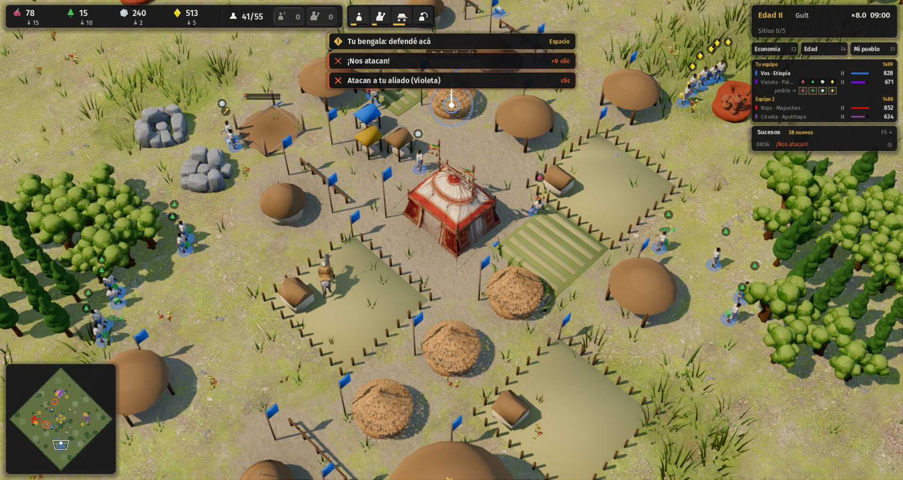
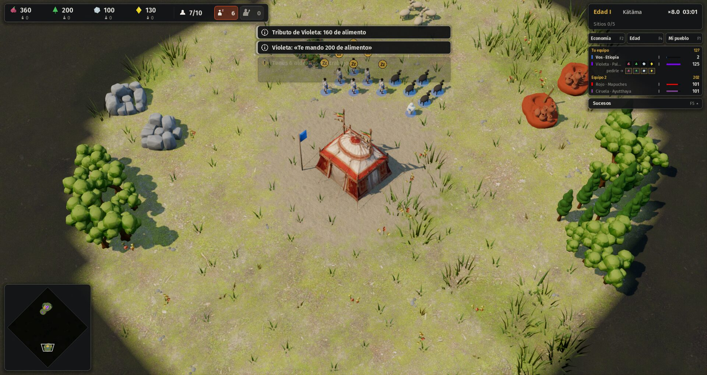
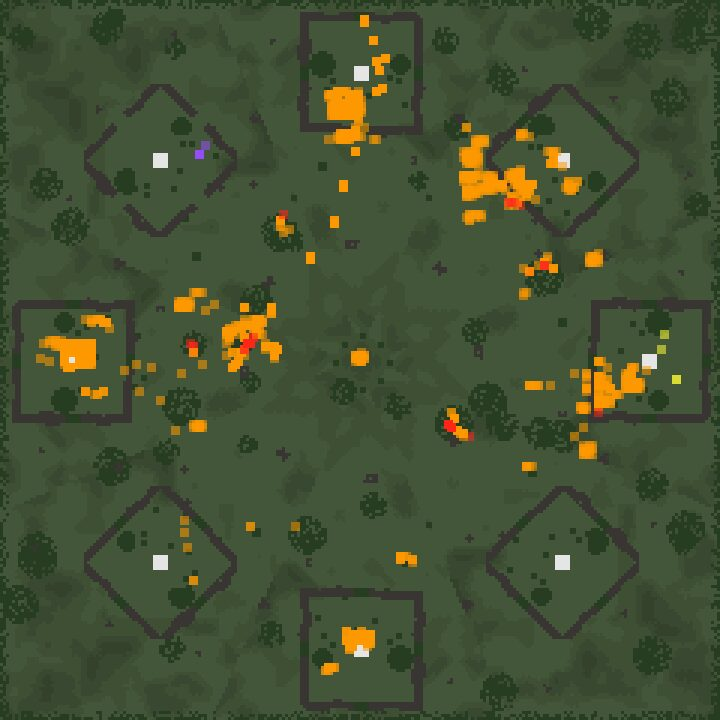

# 04 · Equipos y todos contra todos, segunda ronda

Soy el mismo jugador de la primera ronda ([informe](../04-equipos-y-ffa.md)): 2v2, 3v3 y 4v4 con amigos en AoE4, y partidas largas contra la IA. Repetí las mismas partidas, con las mismas semillas, y probé las bengalas, los pedidos y las frases de la IA.

## 1. Qué probé y cómo

| Qué | Comando |
|---|---|
| Sitios sagrados por terreno | El mismo script de la primera ronda (solo genera el mapa): 13 terrenos × 2, 4, 6 y 8 jugadores × semillas 5, 100 y 107. Ahora cuenta por `def.sagrado` |
| Las 10 partidas de la primera ronda, con las mismas semillas | `partidas2.gd` (en mi carpeta de trabajo, fuera del repo): el script de la primera ronda más frases de la IA (`ia_dice`), pedidos, sitios del mapa, primera baja y un "jugador por script" |
| Bengalas y pedidos | En los casos con bengalas, el jugador 0 tira estas órdenes por la simulación: `{"t": "bengala"}` de ataque sobre la capital rival más cercana a los 12 y 18 minutos; de defensa si hay 4 o más enemigos junto a su capital; `{"t": "pedir"}` de madera y alimento al aliado a los 8, 14 y 20 minutos. A los 45, 90, 150 y 240 s de cada bengala mido cuántos soldados aliados hay a 15 casillas, y cuántos de los enviados (`SimAI._flare_units`) siguen vivos y a qué distancia |
| Menú en 4v4 | `godot --path . -- --menu --partida=3 --shot=menu_4v4.png --shot-at=2` |
| Bengala y fila de pedir en partida | `godot --path . -- --civs=etiopia,mapuches,palmares,ayutthaya --equipos=0,1,0,1 --terreno=llano --seed=11 --speed=8 --aivai --bengala=1 --shot=2v2_bengala.png --shot-at=540` |
| Frase de la IA aliada (con humano, sin `--aivai`) | `godot --path . -- --civs=etiopia,mapuches,palmares,ayutthaya --equipos=0,1,0,1 --terreno=llano --seed=11 --speed=8 --panel=sucesos --shot=2v2_humano_frase.png --shot-at=181` |
| Telemetría | `godot --headless --path . -s tools/telemetria.gd -- --entrada=<carpeta> --salida=<carpeta>` |

- **Partidas de 6 o más:** 3 (3v3 en río, todos contra todos con 6 y 4v4), dentro del tope de 4.
- **Tiempos:** igual que la primera vez, corrí varias partidas a la vez con la máquina cargada. Los ms por tick sirven para comparar, no como medición limpia.
- **Determinismo:** el 2v2 con bengalas, corrido dos veces, dio exactamente la misma partida.

## 2. Qué mejoró respecto de mi primer informe

### Mis errores, punto por punto

| # (ronda 1) | Qué era | Ahora |
|---|---|---|
| A | Mapas con un solo sitio sagrado; 3v3 decidido en 9 minutos | **Arreglado.** Con 4, 6 y 8 jugadores, todos los terrenos tienen al menos un sitio por jugador en las tres semillas, también islas (5, 7 y 9). El 3v3 en río con la semilla 53 ahora tiene 7 sitios y dura **24:45, con 654 bajas** (antes 9:04, con 32) |
| B | En fortines nadie peleaba | **Arreglado en lo grueso.** El 4v4 en fortines pasó de 439 a **1558 bajas** y terminó por conquista, con los rivales cayendo de a uno (minutos 16, 21, 27 y 31). El 2v2 en fortines pasó de 0 a 46 bajas, con la primera a los 7:39. Pero sigue terminando por sitios a los 14:51 (ver 4.C) |
| C | El aliado nunca estaba dentro del radio de ayuda | **El radio sí, el efecto no.** El radio ahora es de 200 casillas, pero mi medida casi no cambió: soldados aliados junto a una capital atacada en 0 a 7 de cada 28 a 89 muestras (ver 4.B) |
| D | La IA casi no daba tributo | **Mejoró mucho.** De 0–2 por partida a 3–11 en 2v2, 14 en 3v3 y 45 en 4v4. Al humano quieto le llegaron 3 o 4 tributos, contra ninguno antes |
| E | El todos contra todos con 6 no terminaba | **Sigue abierto a los 60:00,** pero por otra razón: ahora quedan 4 en pie con ejército (antes, uno vivo solo por un hito). Y el todos contra todos de 4 agresivas, que antes terminaba a los 40:57, ahora queda abierto a los 45:00 con tres en pie |
| F | Caída en la simulación y errores de memoria al salir | **Sin caídas en la partida:** 14 corridas headless sin un solo signal 11. **Al salir, peor:** las 4 capturas con ventana terminaron con `double free or corruption` y volcado de memoria (antes, 2 de 3) |
| G | Pantalla de fin, colores y menú con muchos jugadores | **Sin cambios.** El menú en 4v4 es el mismo, con los mismos colores parecidos: celeste con azul, violeta con morado, rosa con magenta |
| H | Un pueblo cae muy temprano y deja a su compañero solo | **Sigue.** En el 3v3, Etiopía cae a los 16 y Mapuches a los 19. En el 4v4, Ayutthaya cae a los 16. En el todos contra todos con 6, Mapuches cae a los 20 con 10.128 recolectados |

### Mis 10 deseos

| # | Deseo (ronda 1) | Estado |
|---|---|---|
| 1 | Sitios siempre presentes y que se puedan apagar | Presentes, sí. Apagarlos, no |
| 2 | IA que entra a un fortín | Sí. En el 4v4 hay guerra de verdad |
| 3 | IA aliada que defiende | El radio está, pero no lo veo en la partida (4.B) |
| 4 | Bengalas y pedidos | **Están, y se ven bien** (captura). La respuesta es despareja (4.A) y los pedidos casi nunca se cumplen (4.D) |
| 5 | Frases de la IA | **Están.** "Violeta: «Te mando 200 de alimento»" y "Voy contra Rojo" le dan cara al aliado |
| 6 | Condiciones de victoria y opciones de partida | No (pendiente, anotado en el plan) |
| 7 | Equipos juntos o mezclados | No (pendiente) |
| 8 | Tributo cuando el aliado lo necesita | Mejoró (más seguido); el pedido explícito casi nunca se atiende |
| 9 | Más variedad entre semillas | No (pendiente) |
| 10 | Fin por equipos y partidas largas que terminen | No. Las dos partidas sin equipos de esta ronda quedaron abiertas |

| Bengala propia, cola global y fila "pedirle →" en el puntaje | Frase y tributo del aliado |
|---|---|
|  |  |

## 3. Qué sigue faltando

- **Opciones de partida:** condiciones de victoria (sin sitios, solo conquista, tiempo límite con puntaje), recursos y edad iniciales, población máxima. Las partidas de esta ronda lo muestran:
  - **sitios:** el 2v2 en fortines se decidió a los 14:51 por los cinco sitios, con 46 bajas;
  - **todos contra todos:** los dos quedaron abiertos (45 y 60 min) sin un final a la vista.
- **Equipos juntos o mezclados.** El menú sigue alternando a los aliados: en 2v2 mi compañero queda en la esquina opuesta.
- **Un registro del chat:** las frases de la IA son avisos de 2,6 s y no quedan en el registro de sucesos (F5). Si la frase llega en plena pelea, se pierde.
- **Pantalla de fin por equipos** y colores de 8 jugadores que se distingan.
- **Variedad entre semillas** en los mapas de varios.
- **Balance en todos contra todos:** Palmares juntó **128.731** en la partida de 6, más del doble que el segundo (62.517). Me suena con el 88 % del último torneo.

## 4. Errores nuevos

### A. La tropa que responde a una bengala a veces no llega
- **2v2 en llano, aliados alternados (semilla 11):**
  - **bengala de ataque a los 12:00:** el aliado contesta "Voy a tu bengala con 14" y manda 12. A los 45, 90, 150 y 240 s hay **0** aliados junto a la bengala. Los enviados se quedan a 72–90 casillas: llegan a la mitad del camino y no avanzan más;
  - **bengala a los 18:00:** "Voy a tu bengala con 33". Llegan, pero tarde: a los 45 s hay 9 aliados a 15 casillas y a los 240 s, 29.
- **2v2 con aliados vecinos:** a los 12:00 manda 3, y a los 90 s los 3 están muertos. A los 18:00 contesta "Ahora no tengo tropa para mandar".
- **Lo que necesito como jugador:**
  - que el grupo enviado llegue, o que avise "no puedo llegar";
  - un mínimo razonable: con 3 soldados, mejor no ir;
  - ver en el minimapa adónde va mi aliado.
- **Cómo reproducirlo:** `Sim.new(11, 4, null, {"civs": ["etiopia","mapuches","palmares","ayutthaya"], "equipos": [0,1,0,1], "terreno": "llano"})`, IA en los 4 lugares, y a los 12:00 `push_command({"t": "bengala", "player": 0, "x": <capital rival>.x, "y": <capital rival>.y})`. Después se sigue `ai._flare_units` del jugador 2.

### B. La ayuda al aliado sigue sin verse
- **Con el radio nuevo de 200:** de 28 a 89 muestras con una capital atacada por partida, y soldados aliados cerca (3 o más a 22 casillas) en 0 a 7.
  - Lo mejor fue en islas, con 7 de 68.
  - En el 4v4, 1 de 89.
- **La IA no dice "Voy a defenderte" cuando ayuda sola:** esa frase solo sale como respuesta a una bengala. Si fuera, no me enteraría.
- **Posible causa:** `_ally_threat` solo actúa si su propia base no está amenazada (paso 7 de `22-testers/README.md`). En equipos casi siempre hay alguien atacando a cada uno, así que la condición rara vez se da. No lo verifiqué en el código.
- **Con el humano quieto:** esta vez nadie atacó mi capital en 20 minutos (la telemetría muestra 0 enemigos cerca de mi base en cada minuto). Caí junto con mi aliado, a los 18 y a los 20, cuando el otro equipo ganó.

### C. El 2v2 en fortines todavía lo deciden los sitios
- **Semilla 31; pacífica y agresiva contra acosadora y equilibrada:** el equipo de la pacífica toma los 5 sitios y gana a los 14:51, con 46 bajas.
- La pacífica tiene `controla_mapa` y en fortines los demás salen tarde a buscar los sitios.
- **El fallo de antes ya no está:** el recinto propio ya no encierra (83 caminos imposibles contra 407 antes, 1 trabada contra 170).

### D. Los pedidos de recursos casi nunca se cumplen
- **Resultado:** de 22 pedidos de madera y alimento a los minutos 8, 14 y 20, la IA aliada cumplió **1**. Los otros 21 los contestó con "No me sobra madera" o "No me sobra alimento".
- **Por qué:** pide tener lote más sobra (200 + 300 = 500) del recurso pedido, y en esos minutos la IA gasta todo en tropa y edificios.
- **Mientras tanto,** la misma IA manda tributos sin que se los pida (3 a 45 por partida).
- **Lo que esperaría:** que un pedido pese más que el tributo espontáneo; si no tiene, que lo mande apenas junte, o que ofrezca otro recurso ("No tengo madera; te mando riqueza").
- **Cómo reproducirlo:** el mismo 2v2, con `push_command({"t": "pedir", "player": 0, "a": 2, "recurso": "madera"})` a los 8:00.

### E. Detalles de las frases y la bengala
- **"Te mando 200", pero llegan 160:** la frase dice 200 y el aviso de al lado, "Tributo de Violeta: 160 de alimento" (por la comisión del 20 %). Se lee como un error. Mejor: "Te mando 200 (te llegan 160)".
- **El cartel de la bengala queda tapado:** en la captura, el cartel "Defendé acá" sobre el mundo queda debajo de la pila de avisos.
- **Tributo demasiado temprano:** a los 3:00, la IA ya le da tributo a un humano que todavía no gastó nada, porque cualquiera tiene menos de 400 al principio.

### F. Rendimiento con 8
- **4v4 en fortines:** 51,5 ms por tick de promedio (antes 81,9) y un **peor tick de 2270 ms** (antes 1265). Con la máquina cargada, pero es un tirón de más de 2 segundos.
- **La telemetría todavía marca 3889 caminos imposibles en el 4v4.** Ya no están en las puertas propias: están **adentro de los recintos rivales**. Los honderos de los jugadores 2 y 7 no llegan a lo que atacan, que probablemente está rodeado de otros edificios.

  

  Naranja es camino imposible y rojo, trabada. Comparado con la primera ronda, las manchas pasaron de las puertas al interior de las bases.
- **Cómo reproducirlo:** `Sim.new(71, 8, …, "terreno": "fortines")` con 8 IA, 32 minutos y `tools/telemetria.gd`.

### G. Fuera de mi perfil, pero lo vi
- **El 1 contra 1 en islas sigue con un solo sitio** (2 jugadores, semillas 5, 100 y 107). El arreglo cubrió los mapas de varios.
- **Algunos 1 contra 1 quedan con 2 sitios:** río (semilla 107), bosque (semilla 5), valle, selva y delta.

## 5. Mis 10 deseos, actualizados

1. **Opciones de partida:** sitios sí o no, conquista, tiempo límite con puntaje y población máxima. Hoy es lo que más cambia la experiencia en equipo.
2. **Que la tropa que va a una bengala llegue** o avise que no puede, y que se vea en el minimapa adónde va.
3. **Que la IA aliada defienda aunque a ella también la ataquen** (por ejemplo, con la mitad del ejército), y que lo diga: "Voy a defenderte con 12".
4. **Que los pedidos pesen:** prioridad sobre el tributo espontáneo, entrega diferida cuando junte, u otro recurso a cambio.
5. **Equipos juntos o mezclados** en el menú, con "juntos" por defecto.
6. **Registro de chat** en F5, con las frases de los aliados y mis bengalas.
7. **Un final para el todos contra todos:** tiempo límite con puntaje o la opción de rendirse; y que el líder con ventaja se vuelva el blanco de los demás, como pasa con personas.
8. **Pantalla de fin por equipos** y ocho colores bien distintos.
9. **Variedad en los mapas de varios:** giro y radio del círculo, formas de agua, tamaño a elección.
10. **Que caer temprano no sea el final:** que el aliado mande tropa o recursos al que está cayendo, o que se pueda pasar las aldeas al compañero.

## 6. Números medidos

| Partida | Terreno | Duración (antes → ahora) | Cómo terminó | Bajas (antes → ahora) | Tributos (antes → ahora) | Capital atacada / con ayuda | ms por tick, promedio / peor* |
|---|---|---|---|---|---|---|---|
| 2v2 alternados (semilla 11) | llano | 32:10 → 31:50 | conquista, equipo 1 | 621 → 759 | 1 → 11 | 77 / 0 | 23,2 / 220 |
| 2v2 vecinos (semilla 11) | llano | 32:15 → 21:51 | conquista, equipo 1 | 730 → 277 | 2 → 5 | 62 / 0 | 22,5 / 319 |
| 2v2 (semilla 23) | islas | 17:59 → 22:51 | conquista, equipo 1 (antes por 1 sitio) | 280 → 459 | 1 → 7 | 68 / 7 | 21,2 / 289 |
| 2v2 con estilos (semilla 31) | fortines | 17:30 → 14:51 | sitios, equipo 0 | 0 → 46 | 0 → 10 | 2 / 0 | 27,7 / 336 |
| 2v2, humano quieto, alternados | llano | 21:37 → 20:15 | cae con el aliado | 198 → 239 | 0 → 4 (al humano, 4) | 15 / 0 | 18,7 / 191 |
| 2v2, humano quieto, vecinos | llano | 21:17 → 18:31 | cae con el aliado | 253 → 161 | 0 → 3 (al humano, 2) | 28 / 0 | 17,1 / 432 |
| 2v2 con bengalas y pedidos, alternados | llano | — → 27:05 | conquista, equipo 0 | 569 | 8 | 37 / 3 | 13,5 / 174 |
| 2v2 con bengalas y pedidos, vecinos | llano | — → 22:02 | conquista, equipo 1 | 272 | 5 | 63 / 0 | 11,5 / 98 |
| Todos contra todos con 4 agresivas (semilla 41) | río | 40:57 → **45:00 abierta** | 3 en pie | 979 → 1037 | — | 154 / — | 21,3 / 291 |
| 3v3 (semilla 53) | río | **9:04 → 24:45** | conquista, equipo 0 (antes por 1 sitio) | 32 → 654 | 0 → 14 | 79 / 0 | 23,7 / 197 |
| Todos contra todos con 6 (semilla 61) | llano | 60:00 → 60:00 **abierta** | 4 en pie | 2877 → 2337 | — | 205 / — | 27,5 / 200 |
| 4v4 (semilla 71) | fortines | 31:29 → 31:58 | **conquista** (antes por sitios, sin pelear) | 439 → **1558** | 19 → 45 | 89 / 1 | 51,5 / **2270** |

\* Con la máquina cargada. A ×4 de velocidad entran 25 ms por tick.

- **Fuego amigo:** 0 en todas.
- **Cómo terminaron las 12:**

  | | Ronda 1 | Ronda 2 |
  |---|---|---|
  | Por conquista | 5 | 7 |
  | Por sitios | 5 | 1 |
  | Abiertas | 1 | 2 |
  | Junto con el aliado (humano quieto) | — | 2 |
- **Primera baja:** entre 3:27 y 7:39 (antes no la medía).
- **Frases de la IA por partida:** entre 32 y 232. Las más comunes:

  | Frase | Veces |
  |---|---|
  | "Voy contra…" | 5 a 116 |
  | "¡Me atacan!" | 13 a 71 |
  | "Te mando…" | 3 a 45 |
  | "No me sobra…" | 4 a 6 |
  | "Voy a tu bengala" | 1 a 2 |
  | "Voy a defenderte" | **0** |

  En todos contra todos no hay frases, como corresponde.
- **Pedidos cumplidos:** 1 de 22.
- **Bengalas de ataque que llegaron:** 1 de 4 (29 soldados a los 4 minutos). Las de defensa no se probaron, porque nadie atacó la base del jugador por script.
- **Sitios en mapas de varios:**

  | Jugadores | Islas | Río | Fortines | Bosque |
  |---|---|---|---|---|
  | 4 | 5/5/5 (antes 1/1/1) | 5/5/5 (antes 5/5/1) | 5/5/5 | 5/5/5 |
  | 6 | 7/7/7 (antes 1/1/1) | 7/7/7 (antes 1/7/7) | 7/7/7 (antes 7/7/1) | 6/7/7 (antes 3/7/7) |
  | 8 | 9/9/9 (antes 1/1/1) | 8/8/8 (antes 8/8/3) | 9/9/9 | 9/8/8 |
