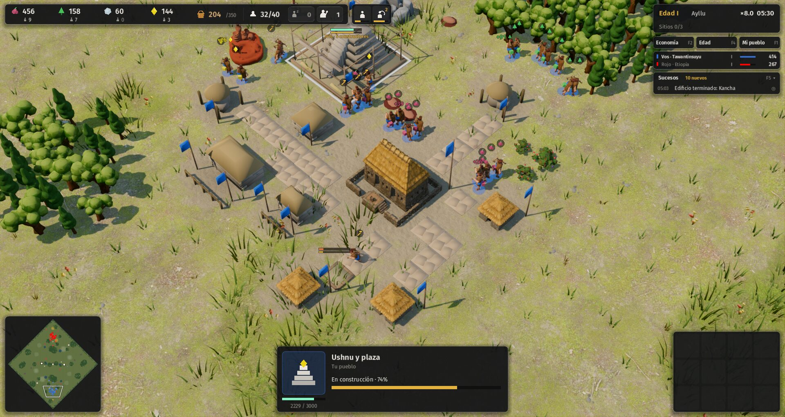
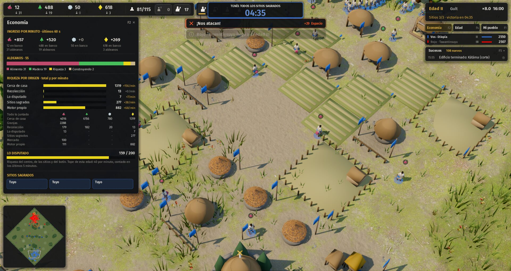
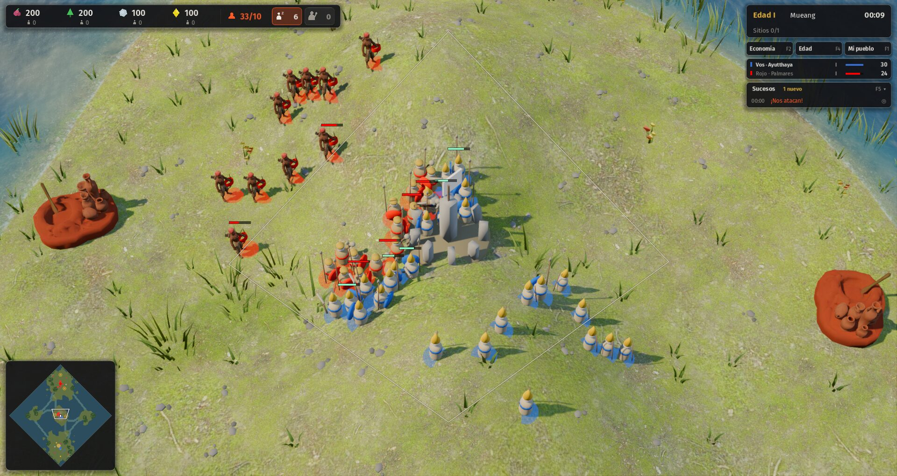
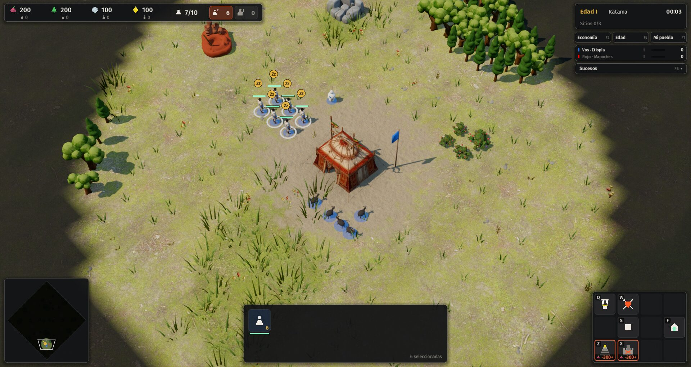

# Jugador de prueba 1, tercera ronda · Veterano competitivo de AoE4

Informe del 2026-11-16, después de la etapa 24 ([README](../../24-tras-la-segunda-ronda/README.md)). Rondas anteriores: [primera](../01-veterano-aoe4.md) y [segunda](../ronda-2/01-veterano-aoe4.md). Jugué sobre `main` en 6f1c3be. La experta contra la difícil (frente G) todavía está en ajuste, y así la juzgo.

## 1. Qué probé

El método es el de siempre, con a lo sumo dos Godot a la vez:
- **apertura por script contra la IA**, ahora con la cantidad de constructores del hito, las opciones de partida y una medida nueva: cuántos segundos pasa un enemigo a 12 casillas o menos de un hito en obra;
- **peleas aisladas;**
- **capturas con `--shot`.**

Mi script hace una apertura limpia, pero no disputa sitios ni hace micro, y defiende tocando la campana. **Sus derrotas no miden el balance;** sirven para medir el ritmo, la presión de la IA y cómo terminan las partidas.

| Qué | Comando |
|---|---|
| Prueba fija de micro | `godot --headless --path . -s tests/micro.gd` |
| Micro con las órdenes nuevas | `godot --headless --path . -s scratchpad/testers/veterano/micro2.gd` |
| Caza y arreo: carnear en cadena, aldeano a un animal suelto, explorador, comida por civ | `godot --headless --path . -s scratchpad/testers/veterano/animales.gd` |
| Apertura contra la normal, hito con 4 constructores | `godot --headless --path . -s scratchpad/testers/veterano/apertura3.gd -- --civ=etiopia --rival=tawantinsuyu --min=30 --plan=boom --ataque=14 --const=4` |
| Contra la experta | `… apertura3.gd -- --civ=tawantinsuyu --rival=etiopia --min=30 --plan=boom --ataque=14 --const=4 --dif=experta` (y con `--rival=mapuches`) |
| Recursos altos, 30 minutos, sin sitios | `… apertura3.gd -- --civ=etiopia --rival=mapuches --min=31 --plan=boom --ataque=16 --const=4 --recursos=altos --tiempo=30 --sitios=no` |
| Sin sitios ni hitos | `… apertura3.gd -- --civ=etiopia --rival=mapuches --min=31 --plan=boom --ataque=16 --const=4 --tiempo=30 --sitios=no --hitos=no` |
| Hito en obra | `godot --path . -- --aivai --civ=tawantinsuyu --rival=etiopia --terreno=llano --seed=7 --speed=8 --shot=x.png --shot-at=330 --select=ushnu` |
| Experta contra experta, minuto 16 | `godot --path . -- --aivai --civ=etiopia --rival=tawantinsuyu --terreno=llano --seed=7 --speed=8 --dificultad=experta --shot=x.png --shot-at=960 --panel=economia` |
| Batalla | `godot --path . -- --demo=batalla --civ=ayutthaya --rival=palmares --shot=x.png --shot-at=9 --cam=64,64,22` |
| Arranque etíope | `godot --path . -- --civ=etiopia --rival=mapuches --terreno=llano --seed=7 --shot=x.png --shot-at=3 --select=aldeano` |

Los scripts están en la carpeta de trabajo de la sesión (`scratchpad/testers/veterano/`), fuera del repositorio.

## 2. Qué mejoró desde la segunda ronda

| Pedido de la ronda 2 | Estado | Qué medí |
|---|---|---|
| Hitos de 190/220/250 s | **Hecho** | Con 4 constructores, mi hito de la edad II tardó 96–100 s (antes, 31–56) y el de la IA normal, 79 s. La edad II cae a las 4:34–5:10, cerca de AoE4 y con una ventana real |
| Carnear en cadena | **Hecho** | Cuatro aldeanos se comen las 5 llamas sin que les diga nada y recién después van a los arbustos: 1010 de comida en 4 minutos |
| Aldeano mandado a un animal suelto | **Hecho** | Lo reclama, lo carnea y se pone a juntar en la misma orden |
| Sueltos más lejos | **Hecho** | Ahora están a 10–14 casillas: los aldeanos no los reclaman al pasar y el explorador tiene trabajo |
| Sitios a 10 minutos | **Hecho** | Cuenta grande "TENÉS TODOS LOS SITIOS SAGRADOS · 04:35" ([captura 2](capturas/veterano/02-experta-sitios.jpg)) y fin con motivo ("motivo sitios") |
| IA experta | **Hecha, en ajuste** | Llega a 81–84 aldeanos hacia el minuto 18–20 y levanta más centros. Me ganó las dos partidas por sitios. Ver §4 |
| Opciones de partida | **Hecho** | Las cuatro andan: recursos altos (hito a los 0:01, edad II a las 2:35), tiempo límite, sin sitios y sin hitos (gana quien arrasa todo, en este caso a las 20:08) |
| Mezcla de línea y distancia que pague | **Sin cambio** | Mismos números que en la ronda 2 (§6) |
| Unidad que kitee al choque | **Sin cambio** | |
| Mejoras por unidad | **Sin cambio** | |
| Ocho marcadores de cámara | **Sin cambio** | Siguen F7–F9 |
| Barras de vida por defecto | **Sin cambio** | Pero las tropas propias por pueblo ya se distinguen mejor: la batalla Ayutthaya–Palmares se lee bien sin barras ([captura 3](capturas/veterano/03-batalla.jpg)) |

**Además:**
- **Se camina entre edificios pegados y se deposita por cualquier lado.** No lo pude ver jugando a mano, pero mis aldeanos no se trabaron: 66–125 aldeano-segundos ociosos por partida, como en la ronda 2.
- **La IA hace almacenes junto al bosque:** la inca y la etíope levantaron 8 leñeras en 20 minutos.

## 3. Qué sigue mal, en orden de importancia

1. **La IA no usa la ventana del hito.** Ahora la ventana existe, pero en ninguna de mis cinco partidas pasó un enemigo a 12 casillas o menos de un hito en obra, ni del mío ni del suyo (contador vacío). En AoE4 el landmark en obra es el blanco más rico del juego, y saber que te lo van a pegar es lo que tensa la edad I. Si la IA no lo hace, contra la IA la ventana no se siente.
2. **La mezcla de línea y distancia sigue perdiendo.** 5 lanceros y 5 honderos contra 10 guerreros: ganan los guerreros con 4 de 10 en ataque en movimiento y con 3 de 10 si la mezcla espera con mantener posición. Es igual que en la ronda 2. La base de AoE4 (muro adelante, tiradores atrás) acá no funciona.
3. **La experta crece, pero sube lenta y gasta mal.**
   - **Sube tarde de edad.** La experta etíope llegó a la edad II a las 6:33 y no tocó la III en 20 minutos; la mapuche, a la II a las 9:18 y a la III a las 18:34. En experta contra experta, a los 16 minutos Etiopía tenía 55 aldeanos y seguía en la edad II, mientras Tawantinsuyu ya estaba en la III. Un jugador de nivel alto hace el segundo centro *y* llega a la II a las 5.
   - **Graneros en serie** (ver §5).
   - **Gana por sitios, no por pelea.** Toma los tres sitios hacia el minuto 10 y gana a las 20:11 aunque yo tenga 94 militares vivos. Así me ganó las dos partidas. Es legítimo y muy de AoE4, pero hoy es la forma más fácil de ganarme, no la mejor.
4. **La ficha del hito en obra no dice lo que importa.** Muestra "En construcción · 74 %" y la vida ([captura 1](capturas/veterano/01-hito-en-obra.jpg)), pero no el tiempo que falta ni dónde rinde el aura. Las auras (+15 % de recolección o curación a 9 casillas) son la decisión nueva de dónde levantar el hito, y al colocarlo no se ve el radio. La IA normal inca levantó el suyo pegado a la capital, sin campos ni bosque al lado.
5. **El costo del hito sigue diciendo "−300+"** en la grilla ([captura 4](capturas/veterano/04-inicio-etiopia.jpg)). Es la tercera ronda.
6. **Kitear al choque sigue sin servir:** 10 honderos que kitean contra 10 guerreros mueren todos sin matar a ninguno.

## 4. La experta, con números

| Partida | Edad II | Edad III | Aldeanos (minutos 5 / 10 / 15 / 20) | Final |
|---|---|---|---|---|
| Experta etiópica contra mi Tawantinsuyu | 6:33 (hito a las 4:26) | — | 22 / 34 / 62 / 58 (84 al minuto 18) | gana por sitios a las 20:11 |
| Experta mapuche contra mi Tawantinsuyu | 9:18 | 18:34 | 28 / 59 / 65 / 81 | gana por sitios a las 23:14 |
| Experta etíope contra experta inca (IA contra IA) | — | Etiopía todavía en la II a los 16:00 | 55 al minuto 16 | sitios etíopes al minuto 16, cuenta en 4:35 |

- **Comparación:** la normal sigue topeando en 42 aldeanos. La experta llega a 80 y pico, que es lo que pedí.
- **Dónde falla:** pierde aldeanos ante mis ataques (de 84 a 58 entre los minutos 18 y 20) y sube tarde de edad.

## 5. Errores nuevos y cómo reproducirlos

1. **La experta reconstruye graneros sin fin donde se los rompen.** En la partida contra mi Tawantinsuyu levantó **55 graneros** en 20 minutos (2750 de madera), y mi ejército rompió 49 edificios, casi todos graneros. Los vuelve a poner junto a los venados del medio, por donde pasa mi ejército. Además, frenan mi ataque en movimiento: el ejército se detiene a romper cada granero que encuentra y tarda 5 minutos en avanzar 35 casillas, sin llegar nunca a la capital.
   - **Cómo reproducirlo:** `apertura3.gd -- --civ=tawantinsuyu --rival=etiopia --min=21 --plan=boom --ataque=14 --const=4 --dif=experta`. Mirá `build:almacen_alimento` en "stats P1" y las líneas "ejército:" con los blancos (`almacen_alimento/1`).
   - **Qué propongo:** un tope de graneros perdidos por lugar, o que no reconstruya donde perdió uno hace poco.
2. **Siguen de la primera ronda:**
   - el "−300+" del costo del hito;
   - las demos por encima del tope de población (33/10 en `--demo=batalla`). Las misiones sí quedaron arregladas con `pob_extra`.
3. **Con recursos altos, el hito se puede colocar en el segundo 1.** Llegué a la edad II a las 2:35. Si es a propósito (en AoE4, con recursos altos también se sube enseguida), está bien. Pero conviene que la opción lo diga, porque cambia todo el juego temprano.

## 6. Números medidos

**Ritmo** (semilla 7, llano):

| Partida | Hito colocado | Edad II | Obra | Aldeanos al minuto 5 / 10 |
|---|---|---|---|---|
| Yo, Etiopía, 4 constructores | 3:23 | 4:59 | 96 s | 22 / 37 |
| Yo, Tawantinsuyu, 4 constructores | 2:54 | 4:34 | 100 s | 25 / 43 |
| IA normal, Tawantinsuyu | 3:51 | 5:10 | 79 s | 25 / 40 |
| IA normal, mapuches | — | 7:19 | — | 22 / 35 |
| Ronda 2 (hitos de 60 s), referencia | — | 4:30–4:51 | 31–56 s | 22–25 |

- **Duración y final de las partidas:** 19:57 (conquista), 20:08 (conquista sin hitos), 20:11 (sitios), 23:14 (sitios) y 23:15 (conquista).
- **Caza y arreo:**
  - 4 aldeanos se comen las 5 llamas en cadena: 1010 de comida en 4 minutos;
  - el explorador guaraní reclama 3, 6 y 10 animales a los 60, 90 y 120 s;
  - hay 4800 de comida silvestre a 30 casillas (5400 los guaraníes).

**Micro** (sin cambios en el combate desde la ronda 2; los números son idénticos):

| Pelea | Ronda 1 | Ronda 2 y 3 |
|---|---|---|
| Honderos contra guerreros | ganan los guerreros, 9 de 10 vivos | 8 de 10 |
| Lo mismo, con fuego concentrado | 9 de 10 | 6 de 10 |
| Lo mismo, kiteando | 10 de 10 | 10 de 10 |
| Guerreros contra lanceros | ganan los lanceros, 10 de 10 | 7 de 10 |
| 5 lanceros + 5 honderos contra 10 guerreros | — | ganan los guerreros, 4 de 10 |
| Honderos que kitean a lanceros | — | 10 de 10 honderos vivos |
| Honderos en formación abierta contra honderos en bloque | — | gana la abierta, 5 de 10 |

## 7. Qué falta para ser tan divertido como AoE4, en orden

1. **Que la IA ataque el hito en obra** y lo defienda cuando es el suyo. La ventana ya está; falta quien la use.
2. **Que la mezcla de línea y distancia gane** (caso I de `micro2.gd`). Algo que haga de muro: que el lancero frene al choque que pasa a su lado, o un bono de frente.
3. **Experta que suba de edad a tiempo** sin dejar de expandirse, y que no gaste madera en graneros que pierde.
4. **Mostrar el aura al colocar el hito** (el radio en el suelo) y el tiempo que falta en la ficha. Así dónde ponerlo se vuelve una decisión visible, como los landmarks de AoE4.
5. **Que la IA dispute los sitios con el ejército** y los vaya a buscar si yo los tengo. Hoy los toma temprano y yo no tengo nada que hacer para recuperarlos más que ir con todo.
6. **Una unidad que kitee al choque:** hostigador montado o jabalinero rápido.
7. **Mejoras por unidad** en su edificio.
8. **Ocho marcadores de cámara.**
9. **El costo del hito en recursos reales** en lugar de "−300+".
10. **Barras de vida al pelear por defecto.**

## Capturas

| | |
|---|---|
|  |  |
| 1. Ushnu de la IA normal en obra al 74 %, pegado a la capital. La ficha no dice cuánto falta ni dónde rinde el aura | 2. Experta contra experta, minuto 16: Etiopía con 55 aldeanos, los tres sitios y la cuenta de 10 minutos en 04:35, todavía en la edad II |
|  |  |
| 3. Batalla Ayutthaya–Palmares: con tropas propias por pueblo, los bandos se leen sin barras | 4. Arranque etíope: las cabras junto a la kätäma y los hitos todavía con "−300+" |
