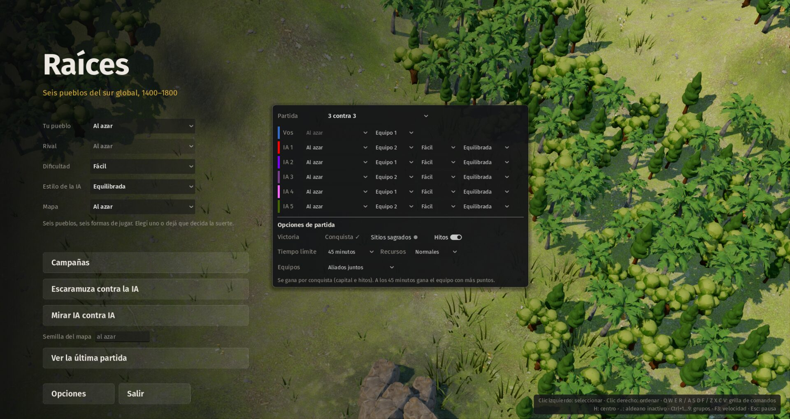
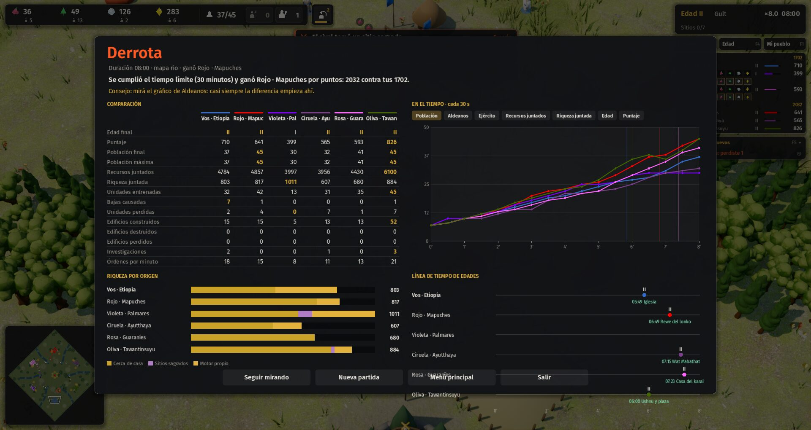
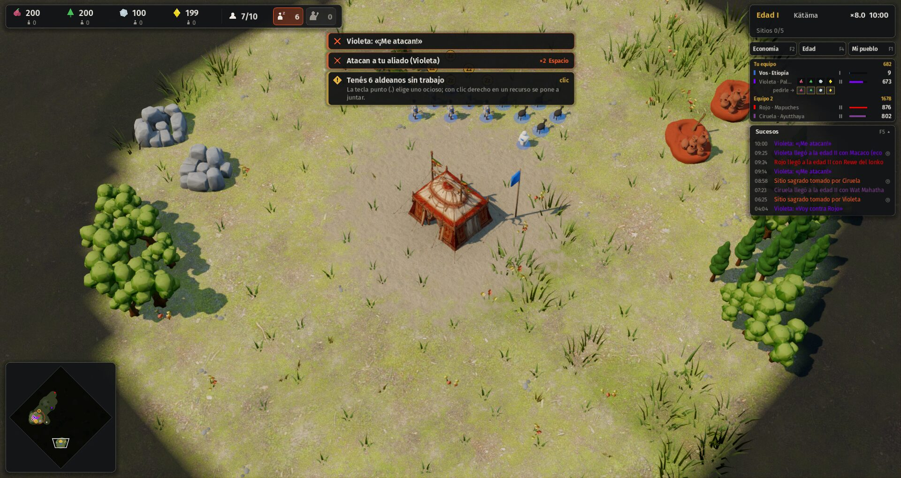
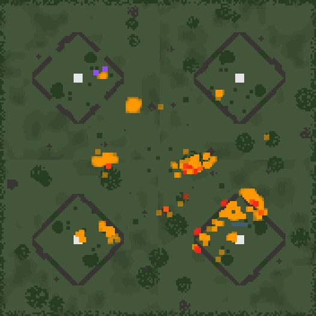

# 04 · Equipos y todos contra todos, tercera ronda

Soy el mismo jugador de las rondas 1 y 2 ([ronda 1](../04-equipos-y-ffa.md), [ronda 2](../ronda-2/04-equipos-y-ffa.md)): 2v2, 3v3 y 4v4 con amigos en AoE4, y partidas largas contra la IA. Esta vez puse a prueba lo que trajo la etapa 24: opciones de partida (aliados juntos o mezclados, tiempo límite, sitios sí o no), defensa del aliado, bengalas, pedidos y frases.

## 1. Qué probé y cómo

| Qué | Comando |
|---|---|
| Diez partidas de IA | `partidas3.gd`, en mi carpeta de trabajo y fuera del repo. Es el script de la ronda 2 más las opciones de `Sim.new` (`ubicacion_equipos`, `tiempo_limite_min`, `sitios_sin_victoria`). Anota `end_reason`, `Sim.score` y `Sim.team_score`, y la distancia real entre aliados. Lo corrí con `godot --headless --path . -s partidas3.gd -- --caso=<caso>`, **de a dos procesos**, como pidió el orquestador |
| Bengalas y pedidos | Igual que en la ronda 2: el jugador 0 tira bengalas de ataque a los 12 y 18 minutos y de defensa cuando atacan su capital, y pide madera y alimento a los 8, 14 y 20 minutos |
| Menú con opciones de partida | `godot --path . -- --menu --partida=2 --ubicacion=juntos --tiempo=45 --sitios=no --shot=menu.png --shot-at=2` |
| Pantalla de fin por tiempo, 3v3 | `godot --path . -- --civs=etiopia,mapuches,palmares,ayutthaya,guaranies,tawantinsuyu --equipos=0,1,0,1,0,1 --ubicacion=juntos --tiempo=30 --sitios=no --terreno=rio --seed=53 --speed=8 --aivai --panel=fin-tiempo --shot=fin.png --shot-at=480` |
| Frases en el registro (F5), con humano | `godot --path . -- --civs=etiopia,mapuches,palmares,ayutthaya --equipos=0,1,0,1 --ubicacion=juntos --terreno=llano --seed=11 --speed=8 --panel=sucesos --shot=f5.png --shot-at=600` |
| Telemetría | `godot --headless --path . -s tools/telemetria.gd -- --entrada=<carpeta> --salida=<carpeta>` |

- **Partidas de 6 jugadores:** 4. Son el 3v3 con aliados juntos y con aliados mezclados, el todos contra todos con 6 sin opciones y con tiempo límite de 45 sin victoria por sitios.
- **No repetí el 4v4 en fortines.** Con dos procesos a la vez y el tope de partidas grandes no entraba. Lo reemplacé por el 2v2 en fortines y el 3v3.
- **Tiempos:** con dos procesos a la vez, la máquina estuvo menos cargada que en las rondas 1 y 2. Por eso los ms por tick bajan en parte por la carga, no solo por el código.

## 2. Qué mejoró respecto de mis informes anteriores

### Mis errores de la ronda 2, punto por punto

| # (ronda 2) | Qué era | Ahora |
|---|---|---|
| A | La tropa que iba a una bengala de ataque no llegaba | **Sigue igual en las de ataque, y las de defensa andan muy bien.** De 4 bengalas de ataque a la capital rival llegó 1, con 2 soldados (ver 4.A). Las 8 bengalas de defensa del 2v2 con aliados juntos tuvieron respuesta: "Voy a defenderte con N" (de 4 a 49) y entre 10 y 51 aliados junto a la bengala a los 45–150 s |
| B | El aliado no defendía si a él también lo atacaban | **Arreglado y se nota.** En el 2v2 con aliados juntos hubo tropa aliada junto a una capital atacada en 40 de 128 muestras (antes, 0 de 62). La frase "Voy a defenderte" aparece entre 2 y 48 veces por partida (antes, nunca). Con aliados mezclados, menos: 2 de 116 en 2v2 y 6 de 92 en 3v3 |
| C | El 2v2 en fortines lo decidían los sitios a los 15 minutos | **Ya no.** Con los sitios a 10 minutos, la misma partida tiene 1223 bajas y sigue abierta a los 45:00. Pero sin tiempo límite no termina (ver 4.C) |
| D | Los pedidos de recursos casi nunca se cumplían (1 de 22) | **Un poco mejor: 3 de 18.** Las tres veces fue alimento a los 8 minutos o el de los 20; la madera, nunca |
| E | "Te mando 200" llegaba como 160; frases fuera del registro; tributo a los 3 minutos | **Arreglado.** Las frases quedan en F5 con el color del aliado (captura). El primer tributo llega a los 8 minutos en las 7 partidas con equipos |
| F | Peor tick de 2,3 s en el 4v4 | No repetí el 4v4. **El peor tick de esta ronda fue de 662 ms**, en el todos contra todos con 6 a los 75 minutos |
| G | Un solo sitio en el 1 contra 1 en islas | No lo volví a mirar: no es mi perfil |

### Mis 10 deseos de la ronda 2

| # | Deseo | Estado |
|---|---|---|
| 1 | Opciones de partida: sitios sí o no, tiempo límite, conquista | **Hecho, y bien.** El bloque del menú se entiende y una línea dice en palabras cómo se gana (captura). El tiempo límite corta justo en el minuto pedido y gana el equipo con más puntos |
| 2 | Que la tropa que va a una bengala llegue | En defensa, sí. En ataque, no (4.A) |
| 3 | Que el aliado defienda aunque lo ataquen, y lo diga | **Hecho.** Se ve sobre todo con aliados juntos |
| 4 | Que los pedidos pesen | A medias: 3 de 18 |
| 5 | Equipos juntos o mezclados | **Hecho.** "Juntos" pone a los aliados a 78–90 casillas; "mezclados", a 127–137 |
| 6 | Registro de chat en F5 | **Hecho** |
| 7 | Un final para el todos contra todos | **Solo con tiempo límite.** Sin él, los dos todos contra todos siguen abiertos (60 y 75 minutos) |
| 8 | Pantalla de fin por equipos y 8 colores distintos | **A medias.** La frase del fin suma por equipo ("2032 contra tus 1702"), pero la tabla sigue por jugador, la línea de tiempo con 6 tapa los botones y los colores son los mismos |
| 9 | Variedad en los mapas de varios | No |
| 10 | Que caer temprano no sea el final | No. Siguen cayendo civs a los 12–23 minutos |

| Menú: opciones de partida | Fin por tiempo en un 3v3 |
|---|---|
|  |  |

## 3. Lo que más me interesaba

### ¿El todos contra todos con 6 termina?

**Sin opciones, no.** Con el tiempo límite, sí.

| Partida | Fin | Cómo | En pie |
|---|---|---|---|
| Todos contra todos con 6, llano (semilla 61), sin opciones | **abierta a los 75:00** | — | 5 de 6. Ayutthaya cae a los 71. Etiopía sigue en pie con 0 de población y 40 edificios |
| La misma, con tiempo límite de 45 y sin victoria por sitios | 45:00 | **por tiempo**, gana Palmares con 10.598 puntos contra 8.669 | los 6, nadie cae en 45 minutos |
| Todos contra todos con 4 agresivas, río (semilla 41) | **abierta a los 60:00** | — | 3 de 4 (Etiopía cae a los 30) |

- **La "cacería sin hitos" de la etapa 24 no alcanza a cerrar un todos contra todos con la victoria normal.** Cada IA ataca a su vecino, nadie remata, y un pueblo sin gente (Etiopía) sigue vivo por sus hitos y su capital.
- **Con el tiempo límite, la partida tiene un final claro.** Pero en 45 minutos no cayó ninguno de los 6, y el ganador es quien más juntó: Palmares, con 57.984 recolectados contra 46.433 del segundo. En los 75 minutos sin límite, Palmares juntó 138.289, el doble que cualquiera.
- **Para mí, el todos contra todos se juega con tiempo límite.** Sugiero que el menú lo elija solo cuando la partida es todos contra todos.

### Aliados juntos o mezclados

| Partida | Juntos | Mezclados |
|---|---|---|
| 2v2 llano (semilla 11): distancia entre aliados | 90 casillas | 127 |
| Fin | 38:45, conquista | 38:01, conquista |
| Bajas | 1004 | 878 |
| Capital atacada con ayuda aliada cerca | **40 de 128** | 2 de 116 |
| "Voy a defenderte" | 29 | 27 |
| 3v3 río (semilla 53): distancia entre aliados | 78–80 a los vecinos, 137 al de la otra punta | 137 |
| Fin | **46:16, sitios** | 22:30, conquista |
| Bajas | 1935 | 607 |
| Capital atacada con ayuda aliada cerca | 7 de 98 | 6 de 92 |
| Tributos | 29 | 8 |

- **Con aliados juntos, el 2v2 se siente de equipo:** el aliado llega a tiempo, hay tributo y la partida es larga y pareja.
- **Con aliados mezclados,** el aliado dice "Voy a defenderte" casi tantas veces, pero casi nunca llega.
- **En el 3v3 con aliados juntos,** el del medio queda bien acompañado y los de las puntas, a 137 casillas.
- **Las dos partidas son muy distintas con la misma semilla:**
  - **juntos:** 46 minutos de frente parejo, con 1935 bajas, que termina por sitios;
  - **mezclados:** a los 12 minutos cae Etiopía y el equipo de enfrente se la come de a uno.

### Tiempo límite

| Partida | Corte | Ganó | Puntos por equipo |
|---|---|---|---|
| 2v2 en islas, aliados juntos, 30 minutos sin sitios (semilla 23) | 30:00 exacto | equipo 0 | 16.990 contra 8.004 |
| Todos contra todos con 6, 45 minutos sin sitios | 45:00 exacto | Palmares | 10.598 contra 8.669 (el segundo) |
| 3v3 en río, 30 minutos (captura con `--panel=fin-tiempo`) | — | Rojo · Mapuches | "2032 contra tus 1702" |

- **Funciona como en AoE4:** corta en el minuto exacto, suma los puntos de todo el equipo (también los de los caídos) y la pantalla de fin explica por qué.
- **Falta el aviso antes del final.** Según el documento, la cuenta grande aparece en los últimos 5 minutos, pero no la capturé.

## 4. Qué sigue faltando y errores nuevos

### A. La bengala de ataque sigue sin llegar
- **2v2 con aliados juntos** (semilla 11):
  - **12:00:** "Voy a tu bengala con 6". A los 45, 90, 150 y 240 s no hay ningún aliado junto a la bengala. Los enviados se quedan a 95–109 casillas y van muriendo (de 6 a 2).
  - **18:00:** "Voy a tu bengala con 7". Durante 4 minutos, 6 vivos quietos a 96 casillas.
- **2v2 con aliados mezclados:**
  - **12:00:** manda 5, y a los 45 s están todos muertos.
  - **18:00:** manda 3 y llegan 2, a los 150 s.
- **Las de defensa sí llegan:** en el 2v2 con aliados juntos, 8 de 8, con 10 a 51 aliados en el lugar.
- **Mi lectura:** el grupo que va a una bengala de ataque es chico (3 a 7, el 50 % del ejército "libre"), cruza el mapa solo y se frena o muere a mitad de camino, casi siempre a la misma distancia (~96 casillas).
- **Lo que pediría:**
  - que una bengala de ataque sume al aliado a su próxima oleada en lugar de mandar un piquete;
  - que el grupo enviado espere a juntarse;
  - si no puede, que avise "Voy con la próxima oleada".
- **Cómo reproducirlo:**
  - `Sim.new(11, 4, null, {civs: [etiopia, mapuches, palmares, ayutthaya], equipos: [0,1,0,1], terreno: llano, ubicacion_equipos: juntos})`, con IA en los 4;
  - a los 12:00, `{"t": "bengala", "player": 0}` sobre la capital rival más cercana;
  - después, seguir `ai._flare_units` del jugador 2.

### B. Los pedidos se cumplen 3 de 18 veces
- La madera nunca se cumplió: la IA siempre la está gastando, y la regla pide que le queden 300 después de dar 200.
- El alimento se cumplió 3 veces.
- **Mientras tanto,** la misma IA da entre 3 y 30 tributos por partida sin que se los pidan. El pedido sigue pesando menos que el tributo espontáneo.

### C. Partidas largas sin final
- **Sin tiempo límite quedaron abiertas tres de las diez:** el 2v2 en fortines a los 45:00, el todos contra todos de 4 agresivas a los 60:00 y el de 6 a los 75:00.
- **El 2v2 en fortines** (semilla 31, estilos mezclados) tiene 1223 bajas, pero los cuatro siguen en pie a los 45 minutos, con 76 a 159 soldados cada uno.
- **La telemetría marca 1504 caminos imposibles y 206 trabadas en esa partida:**
  - casi todos de la Tawantinsuyu (jugador 0), alrededor del centro del mapa ((104,88)) y junto al recinto de su aliado (abajo a la derecha);
  - de 37 a 23 veces por casilla, sus guerreros y honderos no encuentran camino a su propia base ((56,40)) ni hacia el este ((136,104)).
  - La Tawantinsuyu tiene 291 edificios a los 45 minutos (talleres y caminos incluidos). Puede que su propia obra le cierre el paso, pero no lo verifiqué.

  

  Naranja es camino imposible y rojo, trabada.
- **Cómo reproducirlo:** `Sim.new(31, 4, …, terreno: fortines)` con los estilos pacífica, acosadora, agresiva y equilibrada; 45 minutos; después `tools/telemetria.gd`.

### D. Lo que sigue pendiente (ya anotado por el autor)
- **Pantalla de fin por equipos:** la tabla sigue por jugador.
- **Línea de tiempo con 6 jugadores:** las filas "Rosa · Guaraníes" y "Oliva · Tawantinsuyu" quedan encima del botón "Menú principal" y hasta fuera del panel (captura del fin por tiempo). Ya lo marqué en la ronda 1.
- **Ganador con tiempo límite en equipos:** dice "ganó Rojo · Mapuches" aunque gana el equipo. Mejor "ganó el equipo de Rojo".
- **Colores de 8 jugadores:** son los mismos, y en el menú siguen "Rival" y "Estilo de la IA" a la izquierda aunque no se usen.
- **Interruptores del menú distintos:** "Sitios sagrados ●" apagado es un punto suelto, y "Hitos" es un interruptor. No se lee igual (captura del menú).
- **Mapas:** la misma variedad que antes.
- **Error de memoria al salir:** sigue en las 3 capturas con ventana. En las 10 partidas headless no hubo ninguna caída.

### E. Balance en partidas de varios
- **Palmares es la que más junta en todas las partidas largas:**

  | Partida | Palmares | El siguiente |
  |---|---|---|
  | Todos contra todos con 6, 75 minutos | 138.289 | 77.702 |
  | Todos contra todos con 4 | 72.045 | 55.242 |
  | 2v2 en fortines | 63.888 | 45.648 |

- **Gana por puntos los todos contra todos con tiempo límite.** En el torneo de 1 contra 1 quedó en 40 %, pero en partidas largas de varios su economía se dispara.
- **Algunos pueblos caen primero varias veces:**
  - Etiopía: minuto 12 en el 3v3 mezclado y minuto 30 en el todos contra todos de 4;
  - Mapuches: minuto 23 en los dos 2v2 de llano;
  - Palmares: minuto 18 en el 3v3 con aliados juntos.

## 5. Mis 10 deseos, actualizados

1. **Que la bengala de ataque sume al aliado a su próxima oleada**, en lugar de mandar un piquete que se queda a mitad de camino.
2. **Tiempo límite por defecto en todos contra todos** (o una sugerencia en el menú). Sin él, las partidas de 4 y 6 no terminan.
3. **Pantalla de fin por equipos:** total del equipo, "ganó el equipo de…" y una línea de tiempo que no tape los botones.
4. **Que los pedidos pesen más que el tributo espontáneo**, o que la IA ofrezca otro recurso ("No me sobra madera; te mando alimento").
5. **Aliados juntos por defecto en 2v2:** la diferencia es enorme (40 contra 2 defensas). En 3v3, que los de las puntas también puedan ayudarse, quizás con una forma de "media luna".
6. **Un aviso fuerte a 5 minutos del tiempo límite y del final por sitios,** para el que juega en equipo: "Quedan 5 minutos; van ganando por 300 puntos".
7. **Balance de Palmares en partidas largas de varios:** su economía se dispara después del minuto 30.
8. **Que la IA remate en todos contra todos** a quien ya no tiene población, como haría una persona.
9. **Variedad en los mapas de varios** y ocho colores bien distintos.
10. **Que caer temprano no sea el final:** pasarle las aldeas o la tropa al compañero, o que el aliado mande ayuda antes de que caiga.

## 6. Números medidos

| Partida | Terreno | Ronda 2 | Ronda 3 | Cómo terminó | Bajas (r2 → r3) | Tributos (r2 → r3) | Capital atacada / con ayuda | ms por tick, promedio / peor* |
|---|---|---|---|---|---|---|---|---|
| 2v2 alternados, ahora "mezclados" (semilla 11) | llano | 31:50 | 38:01 | conquista, equipo 0 | 759 → 878 | 11 → 17 | 116 / 2 | 14,8 / 161 |
| 2v2 vecinos, ahora "juntos" (semilla 11) | llano | 21:51 | 38:45 | conquista, equipo 0 | 277 → 1004 | 5 → 11 | 128 / **40** | 14,6 / 239 |
| 2v2 con estilos (semilla 31) | fortines | 14:51, sitios | **45:00 abierta** | — | 46 → 1223 | 10 → 30 | 12 / 3 | 25,5 / 523 |
| 2v2, humano quieto, juntos | llano | 20:15 | 23:49 | sitios, equipo 1 | 239 → 290 | 4 → 3 (al humano, 2) | 48 / 0 | 6,6 / 41 |
| 2v2, 30 min sin sitios, juntos (semilla 23) | islas | (22:51, conquista) | 30:00 | **tiempo**, equipo 0 | 459 → 771 | 7 → 12 | 101 / 0 | 14,8 / 115 |
| 3v3 juntos (semilla 53) | río | 24:45 | 46:16 | sitios, equipo 1 | 654 → 1935 | 14 → 29 | 98 / 7 | 29,9 / 434 |
| 3v3 mezclados (semilla 53) | río | 24:45 | 22:30 | conquista, equipo 0 | 654 → 607 | 14 → 8 | 92 / 6 | 17,6 / 126 |
| Todos contra todos con 4 agresivas (semilla 41) | río | 45:00 abierta | **60:00 abierta** | — | 1037 → 1425 | — | 195 / — | 13,5 / 54 |
| Todos contra todos con 6 (semilla 61) | llano | 60:00 abierta | **75:00 abierta** | — | 2337 → 3519 | — | 545 / — | 39,4 / 662 |
| Todos contra todos con 6, 45 min sin sitios | llano | — | 45:00 | **tiempo**, Palmares | 1985 | — | 286 / — | 29,2 / 199 |

\* Dos procesos a la vez; a ×4 de velocidad entran 25 ms por tick.

- **Fuego amigo:** 0 en todas.
- **Cómo terminaron las 10:**

  | | Cuántas |
  |---|---|
  | Por conquista | 3 |
  | Por sitios | 2 (después de 23 y 46 minutos) |
  | Por tiempo | 2 |
  | Abiertas sin tiempo límite | 3 |
- **Primer tributo:** a los 8 minutos en todas (a los 10 en una). En la ronda 2 era a los 3.
- **Frases por partida:**

  | Frase | Veces |
  |---|---|
  | "Voy contra…" | 31 a 89 |
  | "¡Me atacan!" | 19 a 69 |
  | "Voy a defenderte" | **2 a 48** (antes, 0) |
  | "Te mando…" | 3 a 30 |
  | "No me sobra…" | 5 |

  En todos contra todos no hay frases.
- **Bengalas:**

  | Tipo | Llegaron |
  |---|---|
  | De ataque | 1 de 4, con 2 soldados |
  | De defensa | 8 de 8, con 10 a 51 aliados en el lugar |
- **Pedidos cumplidos:** 3 de 18 (antes, 1 de 22).
- **Viajes al depósito** (telemetría nueva), media por civ:
  - madera, de 2 a 11 casillas (Palmares 11, con un máximo de 68);
  - alimento, de 2 a 4.
- **Rechazo más común:** "Población llena · en_marcha", 907 veces de Palmares.
- **Telemetría total de las 10 partidas:**

  | Suceso | Cantidad |
  |---|---|
  | Caminos imposibles | 3480 (1504 en el 2v2 de fortines) |
  | Trabadas | 875 |
  | Ticks lentos | 3936 |
