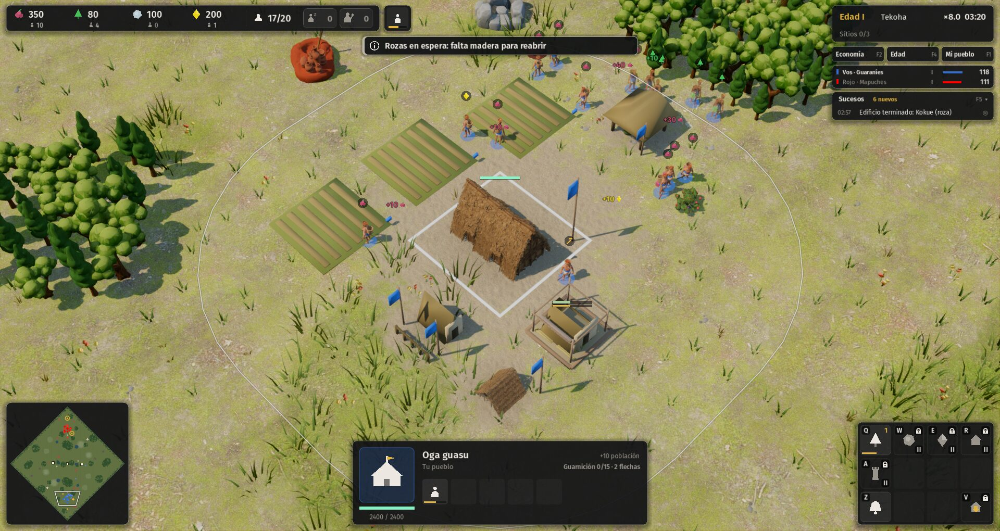
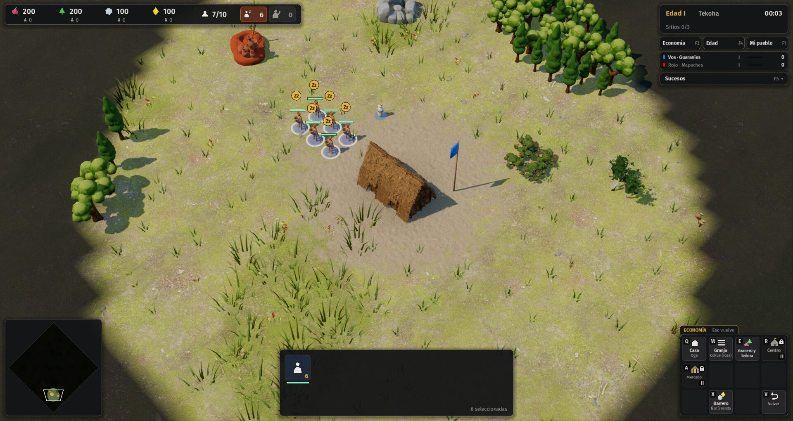
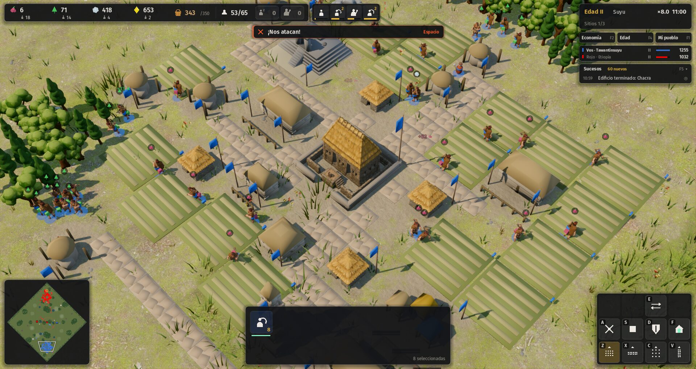
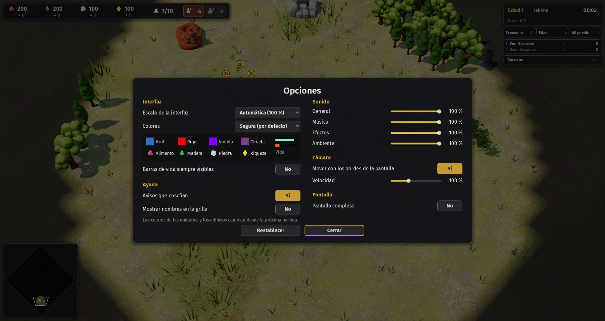
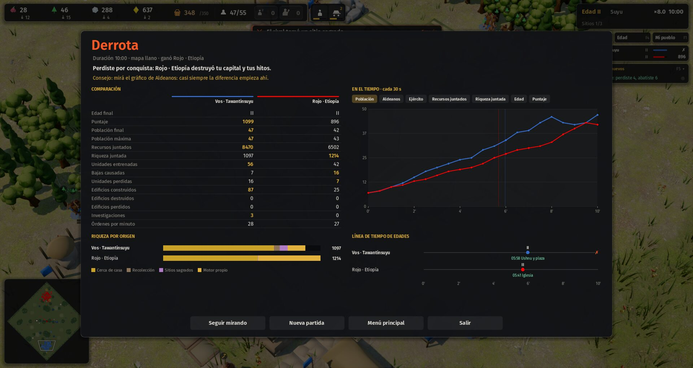
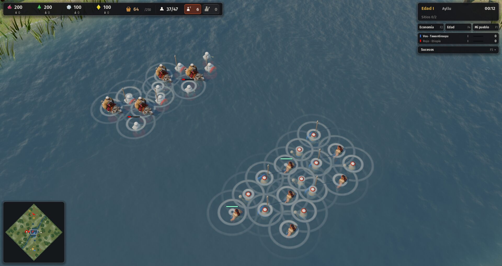

# Jugador de prueba 1, cuarta ronda · Veterano competitivo de AoE4

Informe del 2026-11-16, sobre `main` en 352136e. Rondas anteriores: [1](../01-veterano-aoe4.md), [2](../ronda-2/01-veterano-aoe4.md) y [3](../ronda-3/01-veterano-aoe4.md). Esta ronda la dediqué sobre todo a la **calidad de vida y la usabilidad**: lo que un jugador que juega AoE4 todos los días nota en el primer minuto. Además miré lo de siempre: micro, ventana del hito, sitios, experta y caza.

## 1. Qué probé

| Qué | Comando |
|---|---|
| Controles de punta a punta con mouse y teclado de verdad (78 chequeos) | `godot --path . -- --autotest --civ=guaranies --terreno=llano` |
| Matriz de micro, capa común (5 variantes por pelea) | `godot --headless --path . -s tools/micro_matriz.gd -- --variantes=5` |
| Ídem, guaraníes contra mapuches | `… tools/micro_matriz.gd -- --variantes=5 --civs=guaranies,mapuches` |
| Mis pruebas fijas | `godot --headless --path . -s tests/micro.gd` y `scratchpad/testers/veterano/micro2.gd` |
| Hito en obra, IA contra IA | `godot --headless --path . -s tools/hito_en_obra_ia.gd -- --seeds=7` |
| Apertura contra la normal | `godot --headless --path . -s scratchpad/testers/veterano/apertura3.gd -- --civ=etiopia --rival=tawantinsuyu --min=30 --plan=boom --ataque=14 --const=4` |
| Apertura contra la experta | `… apertura3.gd -- --civ=tawantinsuyu --rival=etiopia --min=30 --plan=boom --ataque=14 --const=4 --dif=experta` |
| Centro seleccionado, IA contra IA | `godot --path . -- --aivai --civ=guaranies --rival=mapuches --terreno=llano --seed=7 --speed=8 --shot=x.png --shot-at=200 --select=centro` |
| Grilla de economía con nombres | `godot --path . -- --civ=guaranies --rival=mapuches --terreno=llano --seed=7 --shot=x.png --shot-at=3 --select=aldeano --grilla=economia --nombres=1` |
| Ejército seleccionado | `godot --path . -- --aivai --civ=tawantinsuyu --rival=etiopia --terreno=llano --seed=7 --speed=8 --shot=x.png --shot-at=660 --select=hondero` |
| Opciones | `godot --path . -- --civ=guaranies --rival=mapuches --terreno=llano --seed=7 --shot=x.png --shot-at=2 --abrir=opciones` |
| Pantalla de fin | `godot --path . -- --aivai --civ=tawantinsuyu --rival=etiopia --terreno=llano --seed=7 --speed=8 --shot=x.png --shot-at=600 --panel=fin-derrota` |
| Batalla de la demo (sin `--terreno`) | `godot --path . -- --demo=batalla --civ=tawantinsuyu --rival=etiopia --shot=x.png --shot-at=12 --cam=64,64,22` |

Además leí los atajos en `src/game/controller.gd` y `src/game/ui/atajos.gd`, el panel de selección (`hud.gd`, `SelectionPanel`) y las opciones. Mi script sigue sin hacer micro ni disputar sitios: sus derrotas no miden el balance.

## 2. Calidad de vida y usabilidad, por gravedad

Gravedad: **alta**, molesta en todas las partidas; **media**, molesta seguido o confunde; **baja**, detalle.

### Alta

**1. No se pueden cambiar las teclas.**
- **Hoy:** las Opciones tienen interfaz, colores, ayuda, sonido, cámara y pantalla, pero ni una sección de teclas ([captura 4](capturas/veterano/04-opciones.jpg)). Las teclas viven en `controller.gd`, `atajos.gd` y `interfaz.json`.
- **Qué esperaría:** como AoE4, poder reasignar cada atajo y elegir entre "grilla" y "clásico". Yo tengo años de memoria muscular: en AoE4 los marcadores van en F1–F4, y acá F1–F6 son los paneles.
- **Cómo verlo:** Esc → Opciones.

**2. Con varios edificios seleccionados, cada tecla entrena una unidad en cada uno.**
- **Hoy:** con 5 cuarteles seleccionados, una pulsación de Q encola 5 unidades y las paga todas juntas; con Mayús, 25 (`controller.gd`, `run_command`, caso `train`).
- **Qué esperaría:** como AoE4, una unidad por pulsación en el edificio con la cola más corta. Así controlo cuánto gasto y reparto la producción apretando la misma tecla.
- **Por qué es grave:** con `T` (todos los del tipo) o el doble clic, la forma natural de producir en serie, se vacía el banco de un golpe.
- **Cómo reproducirlo:** dos cuarteles, doble clic en uno y Q.

### Media

**3. `H` no recorre los centros.**
- **Hoy:** selecciona siempre el primer centro o la capital. Con dos o tres centros (la experta los levanta, y yo también), no hay forma de saltar de uno a otro con el teclado.
- **Qué esperaría:** cada `H` lleva al centro siguiente, como en AoE4.
- **Dónde:** `controller.gd`, `_key`, `KEY_H`.

**4. El panel de varias unidades no informa.**
- **Hoy:** con 8 honderos seleccionados se ve un ícono, el número y "8 seleccionadas" ([captura 3](capturas/veterano/03-ejercito-fuera-de-pantalla.jpg)). No hay vida por unidad ni la suma del grupo. Clic en el ícono deja solo ese tipo (eso sí está), pero Mayús + clic no lo saca.
- **Qué esperaría:**
  - un retrato por unidad con su barra de vida, para retirar a los heridos;
  - Mayús + clic para sacar a uno o a un tipo;
  - Ctrl + clic para quedarse solo con ese tipo.

  En AoE4 es la herramienta de micro más usada.

**5. Seleccionar no lleva la cámara.**
- **Hoy:** "8 seleccionadas" con el ejército fuera de la pantalla ([captura 3](capturas/veterano/03-ejercito-fuera-de-pantalla.jpg)). El doble toque del número del grupo sí centra.
- **Qué esperaría:** que el doble toque de `M` y de `,` también centre, como el del grupo.

**6. Al cerrar, el juego se cae.**
- **Hoy:** el autotest termina con "AUTOTEST: OK" y después "corrupted size vs. prev_size", con código 134 y un volcado. Lo vienen anotando las rondas anteriores.
- **Riesgo:** si le pasa a un jugador al salir, parece un juego roto, aunque la telemetría y la repetición ya estén guardadas.

**7. En IA contra IA siguen apareciendo avisos de la IA.**
- **Hoy:** "Rozas en espera: falta madera para reabrir" aparece en `--aivai` ([captura 1](capturas/veterano/01-centro-seleccionado.jpg)). Lo de "Recursos insuficientes" se arregló en la ronda 2, pero los sucesos `notice` no miran si el jugador local es la IA (`hud.gd`, caso `"notice"`).
- **Gravedad:** solo molesta a quien mira o graba IA contra IA.

### Baja

**8. Los grupos de control no son exclusivos.** Una unidad puede quedar en el 1 y en el 2; en AoE4 es una opción.

**9. No hay grupo 0.** Solo hay 1 a 9.

**10. Hay un círculo grande sin explicar al seleccionar el centro** ([captura 1](capturas/veterano/01-centro-seleccionado.jpg)). Supongo que es el alcance de las flechas o de la campana, pero no dice cuál.

**11. `--demo=batalla` sin `--terreno` puede caer en un lago.** Las 60 unidades pelean sobre agua azul profunda, con ondas ([captura 6](capturas/veterano/06-demo-en-el-agua.jpg)). Solo afecta las capturas, pero esa captura engaña: parece que se camina sobre el agua.

### Lo que ya está a la altura de AoE4 o mejor
El autotest pasó los 78 chequeos con mouse y teclado de verdad. Lo que más uso:
- **Barra de recursos:** aldeanos por recurso, ociosos con número (Mayús para todos), militares ociosos con `,` y Ctrl, `M`, `T`, `Tab` y la cola global con clic al edificio.
- **Ocho marcadores de cámara** con Alt + 1…8.
- **Costo del hito recurso por recurso** ("−500 / −300"; adiós al "−300+" después de tres rondas).
- **El hito:**
  - el aura en el suelo al colocarlo, con "En el aura: 4 fuentes de alimento";
  - "Faltan 1:54 con 4 constructores" y "Parada: sin constructores".
- **Barras de vida de quien pelea,** sin prender ninguna opción.
- **Grilla con nombre común y propio** ([captura 2](capturas/veterano/02-grilla-con-nombres.jpg)):
  - Casa / Oga, Granja / Kokue (roza), "Granero y leñera" y Barrero / Ñai'ũ renda;
  - las casillas son las mismas en todas las civs (granero, leñera y barrero en Z, E y X), que es lo que pide la memoria muscular.
- **Avisos que enseñan:**
  - viaje largo con el nombre del almacén;
  - "atacá o subí de edad";
  - "perdés en M:SS".

  Se pueden apagar en Opciones.
- **Pantalla de fin** ([captura 5](capturas/veterano/05-fin-de-partida.jpg)): motivo ("Perdiste por conquista: … destruyó tu capital y tus hitos"), consejo, tabla comparada y gráficos en el tiempo (población, aldeanos, ejército, recursos, riqueza, edad y puntaje), con la línea de las edades. Es mejor que el resumen de AoE4 en la misma pantalla.
- **Caza:**
  - clic derecho en un animal propio lo carnea (con el cursor de juntar alimento);
  - del arbusto se pasa al arbusto, no a la llama.

## 3. Lo mío de siempre

**Micro (matriz de la capa común, 5 variantes).** La propuesta C2 (guerrero común a 1350 y línea +6 contra el choque) funcionó:

| Pelea | Ronda 3 (mi prueba) | Ronda 4, capa común |
|---|---|---|
| 5 lanceros + 5 honderos contra 10 guerreros, sin micro | pierde la mezcla (quedan 4 guerreros) | **gana 4 de 5** (quedan 5,6 de la mezcla) |
| Lo mismo, con mantener posición y escalonar | — | **gana 5 de 5** (6,2 vivos) |
| 10 honderos que escalonan contra 10 guerreros | — | **gana 4 de 5** (5,8 vivos) |
| 10 honderos que kitean "a mi manera" | 0 de 5 | 0 de 5 |

- **Me equivoqué en dos cosas:**
  - mi "kitear" (alejarse 3 casillas apenas te tocan) no deja tirar nunca; la micro que paga es la de AoE4, tirar y retroceder mientras se recarga;
  - mis pruebas fijas eran guaraníes contra mapuches, y el "guerrero" era el weichafe (1750 de velocidad y más barato).
- **Contra el weichafe la mezcla sigue perdiendo,** con 2 de 5. Está bien: es el choque que no se kitea, la identidad mapuche.
- Por eso `tests/micro.gd` casi no se movió (los guerreros terminan con 9 de 10 vivos y 7 de 10 con fuego concentrado).

**Ventana del hito** (`tools/hito_en_obra_ia.gd`, normal contra normal, semilla 7):
- en 2 de 3 pares hubo enemigos cerca del hito en obra (38 s y 24–27 s), pero no cayó ninguno;
- en mis dos partidas, nadie se acercó al mío: mi hito de la edad II termina a las 4:59, antes de que la IA normal tenga más de 6 soldados.
- Ya no está vacío, pero todavía no da miedo.

**Experta:**
- **Graneros:** levantó 7 en casi 20 minutos (en la ronda 3, 55).
- **Aldeanos:** 22, 33 y 58 a los 5, 10 y 15 minutos.
- **Final:** me ganó por sitios a las 19:35. Esta vez mandé 67 militares a su base a los 15:00, pero no le alcanzó a mi script, que no disputa los sitios.

**Contra la normal:**
- **Edades:** yo, edad II a las 4:59; la IA inca, edad II a las 5:10 y III a las 13:59.
- **Final:** perdí por conquista a las 25:09.
- **Puntaje:** 2373 contra 5354.

## 4. Errores nuevos y cómo reproducirlos
1. **Entrenar con varios edificios encola uno por edificio** (§2, punto 2). Es más una diferencia con AoE4 que un error, pero en la práctica gasta sin querer.
2. **Avisos `notice` de la IA en `--aivai`** (§2, punto 7).
3. **La demo de batalla en un lago** (§2, punto 11).
4. **Caída al cerrar** (§2, punto 6). No es nueva, pero sigue.

## 5. Qué falta para ser tan divertido como AoE4, en orden
1. **Teclas configurables,** con un perfil "como AoE4" (marcadores en F1–F4, paneles en otro lado).
2. **Producción en varios edificios a la manera de AoE4:** una por pulsación, al de cola más corta.
3. **Panel de selección con retratos y vida por unidad,** y sacar o quedarse con un tipo con Mayús o Ctrl + clic.
4. **`H` que recorra los centros** y doble toque de `M` y `,` que centre.
5. **IA que dispute los sitios con el ejército.** Me sigue ganando por sitios sin que haya una pelea que los decida.
6. **Que la IA pegue de verdad al hito en obra** con lo que tenga, aunque sean 4 soldados en la edad I, como hacen los jugadores en AoE4.
7. **Mejoras por unidad** en su edificio.
8. **Que el juego no se caiga al cerrar.**
9. **Explicar el círculo del centro seleccionado.**
10. **Grupos exclusivos opcionales y grupo 0.**

## Capturas

| | |
|---|---|
|  |  |
| 1. Centro guaraní seleccionado en IA contra IA: cola con un aldeano, grilla con tecnologías por edad, un círculo sin explicar y el aviso de la IA "Rozas en espera" | 2. Grilla de economía con nombres: el común arriba y el propio abajo; el tapyi dice "Granero y leñera" |
|  |  |
| 3. 8 honderos seleccionados fuera de la pantalla: ícono y número, sin vida por unidad | 4. Opciones: sin sección de teclas |
|  |  |
| 5. Pantalla de fin: motivo, consejo, comparación y gráficos. A la altura de AoE4 | 6. `--demo=batalla` sin `--terreno`: los dos ejércitos sobre un lago |
