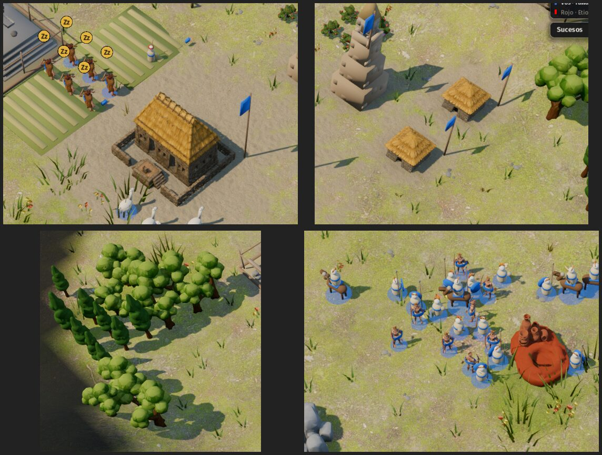
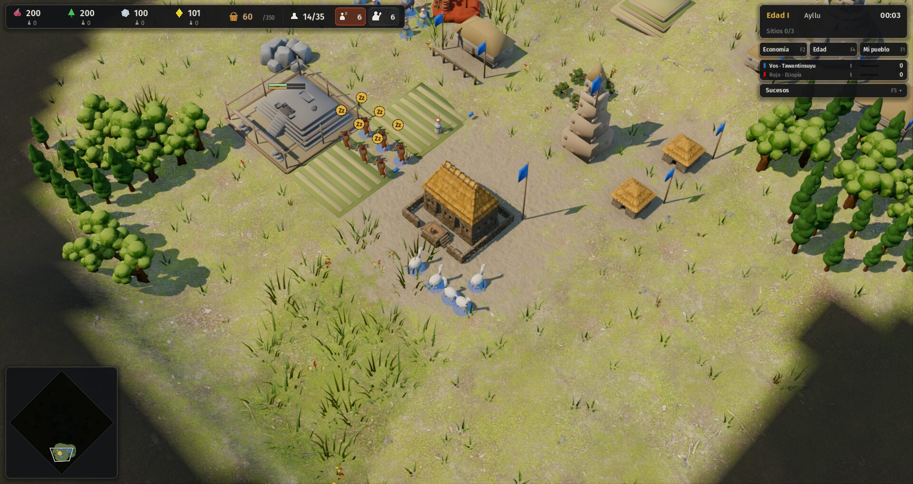
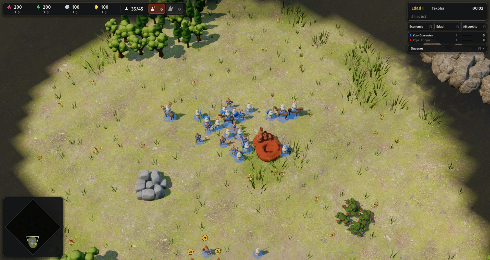
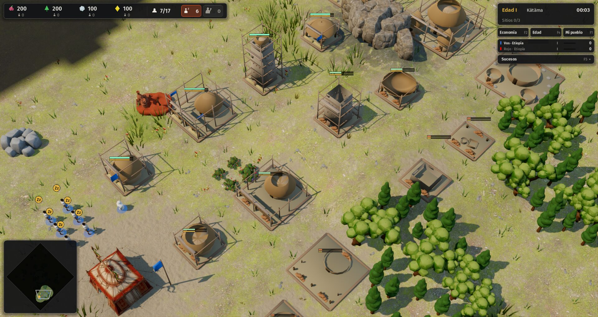
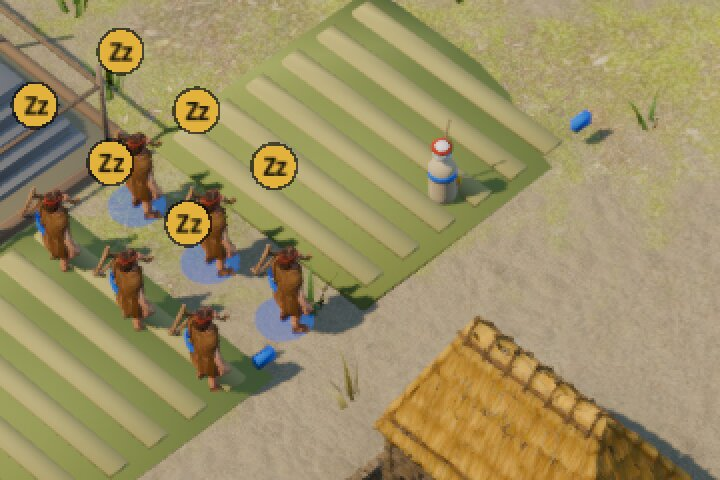

# Escala: tamaños de personas, edificios y árboles comparados con AoE4

Pedido del autor al veterano de AoE4 (2026-11-16): "Que el experto analice cómo ve los tamaños de las cosas, edificios y unidades, comparado con AoE4, que tiene una sensación de realidad muy buena basada en el tamaño de las cosas; creo que estamos muy lejos."

Medido sobre `main` en 45887f8. Para lo nuestro usé lo que el juego dibuja de verdad, no lo que dicen los datos: un script crea la vista (`WorldView`) con un edificio de cada tipo en la edad I y una unidad de cada clase, y mide la caja de cada modelo.

**Sobre los números de AoE4:** salen de lo que veo jugándolo (miles de horas, pero de memoria) y no de una medición. No tengo los archivos de modelos y no pude hacer búsquedas en esta sesión. Todos llevan **[verificar]**. Al final propongo cómo verificarlos con dos capturas de AoE4.

## 1. Cómo se midió

- **Medición de lo dibujado:** `godot --headless --path . -s scratchpad/testers/veterano/escala.gd` (fuera del repositorio). Mide en unidades de mundo, y una unidad de mundo es una casilla (`WorldView.to_world`: milésimas de casilla / 1000).
- **Datos leídos:**
  - `src/game/world_view.gd`: `FIGURE_H` 1,25; `_stretch_k`; `_make_mm` para los árboles;
  - `src/game/rts_camera.gd`: inclinación 54°, campo de visión 30°, distancia 32 (de 16 a 70);
  - `data/reglas.json`: `escala_visual` con `unidad_pct` 82, `altura_min_cm` y `estirar_max_pct` 170; `velocidad_pct` 90; `mapa_tam` 128;
  - `data/edificios.json` y `data/civs/*.json`: `tam`.
- **Capturas** al zoom por defecto, 1920×1020:
  - `godot --path . -- --demo=base --civ=tawantinsuyu --terreno=llano --seed=21 --shot=x.png --shot-at=3`
  - `godot --path . -- --demo=formacion --civ=guaranies --terreno=llano --seed=21 --shot=x.png --shot-at=2 --cam=b12,b10,32`
  - `godot --path . -- --demo=obras --civ=etiopia --terreno=llano --seed=21 --shot=x.png --shot-at=3`

## 2. Lo nuestro, en números

**La persona mide 1,03 casillas** (1,25 × 0,82, medida igual en las seis civs). Si una persona mide 1,70 m, **una casilla son 1,65 m**. Todo lo que sigue va en casillas y en "personas" (cuántas veces la altura de un aldeano).

| Qué | Alto | En personas | Planta / huella | Notas |
|---|---|---|---|---|
| Aldeano | 1,03 | 1,0 | ancho 0,4–0,6 | Modelo generado |
| Guerrero (maqueta) | 0,75 | **0,74** | 0,52 | Más bajo que el aldeano |
| Lancero (con la lanza) | 1,50 | 1,46 | 0,45 | |
| Arquero o hondero | 0,82–1,02 | 0,8–1,0 | | |
| Jinete | 1,27 | 1,24 | 1,0 | |
| Llama, chilihueque | 1,0 | 1,0 | 0,7 | La llama mide lo mismo que la persona |
| Cerdo, cabra, búfalo | 0,49 / 0,60 / 0,66 | 0,5–0,65 | 0,6–1,1 | El búfalo, bajo para un animal de arado |
| Venado | 0,45–1,1 | 0,4–1,1 | | Según el pueblo |
| Árbol | 1,8–2,3 de malla, ×0,82–1,27 por instancia: **1,5–2,9; media ≈ 2,1** | **≈ 2,0** | copa 1,6–1,7 | |
| Arbusto | 0,70 | 0,7 | 1,0 | |
| Mata de pasto decorativo | 0,2–0,55 | 0,2–0,5 | | Algunas matas llegan a la cintura |
| Roca / arcilla | 1,0 / 1,5 | 1,0 / 1,4 | 2,3–2,7 | |
| **Casa** | 2,08 | **2,0** | planta 1,5 en 2×2 | Estirada a `altura_min` 220 cm |
| Almacén | 1,60 | 1,6 | 2,0–2,3 en 2×2 | |
| **Cuartel**, campo de tiro, establo | 2,00 | **2,0** | 2,5–3,0 en 3×3 | |
| Mercado | 1,80 | 1,8 | 2,5 en 3×3 | |
| **Granja** | 0,38 | 0,4 | 2,95 en 3×3 | De lado, 2,9 personas |
| **Centro / capital** | 3,16 | **3,1** | 3,2–3,4 en 4×4 | Lof mapuche: 3×3 |
| Torre | 4,20 | 4,1 | 1,4 en 2×2 | |
| **Hitos** (36) | 1,5–3,9 | **1,5–3,8**, mediana ≈ 2,6 | ≈ 4,0 en 4×4 (mapuches, 3,1 en 3×3) | El ushnu, 1,6; el centro etíope de la iglesia, 4,1 |

**Cámara:**
- inclinación 54°, campo de visión vertical 30°, distancia 32 por defecto (16 a 70);
- en 16:9 se ven unas **30 × 21 casillas**, o sea unas 29 × 20 personas;
- **el aldeano mide unos 40 px de alto en una pantalla de 1020 px** ([captura 5](capturas/escala/05-aldeanos-40px.jpg), medido a ojo con la imagen al doble).

**Velocidad:**
- aldeano: 1,25 × 0,90 = **1,125 casillas/s = 1,09 personas por segundo**. Con una casilla de 1,65 m son 1,86 m/s, un paso rápido (caminar es 1,3–1,5 m/s);
- guerrero común: 1,22 casillas/s; jinete: 1,98; explorador: 1,9–2,25.

**Calles:**
- la casa ocupa 1,5 de sus 2 casillas, y quedan 0,25 casillas de margen por lado;
- entre dos edificios pegados queda un pasillo de 1 casilla dentro de la huella (`pasillo_entre_edificios`).

**El bosque:** un árbol por casilla con copa de 1,6–1,7: las copas se tocan y se lee como bosque. El problema es el alto, no la densidad.

## 3. Comparación con AoE4 [verificar]

Las proporciones que importan, en alturas de una persona:

| Proporción | Raíces | AoE4 (de memoria) [verificar] | Cuánto nos falta |
|---|---|---|---|
| Casa / persona | 2,0 | 2,5–3 | ×1,3–1,5 |
| Cuartel / persona | 2,0 | 3–4 | ×1,5–2 |
| Centro / persona | 3,1 | 5–7 | ×1,6–2,2 |
| Hito / persona | 1,5–3,8 (mediana 2,6) | 6–12 | **×2,5–4** |
| Torre / persona | 4,1 | 5–7 | ×1,3–1,7 |
| Árbol / persona | 2,0 | 4–6 | **×2–3** |
| Centro / casa | 1,5 | 2–2,5 | ×1,4–1,6 |
| Lado de la granja / persona | 2,9 | 4–5 | ×1,4–1,7 |
| Ancho del centro / persona | 3,2 | 7–9 | ×2–2,5 |
| Velocidad del aldeano en personas por segundo | 1,09 | ≈ 0,8 (1,125 casillas/s, con una casilla de AoE4 menor que la persona) | nos movemos ≈ 35 % más rápido |
| Aldeano en pantalla a 1080p, zoom por defecto | ≈ 40 px | ≈ 30–35 px | un poco más grande |
| Soldado / aldeano | 0,74–1,46 | ≈ 1,0–1,1 (el hombre de armas es apenas más alto por el casco) | el guerrero es más bajo que el aldeano |

**Huellas en casillas de AoE4** [verificar, no las tengo seguras]: casa ≈ 2×2 o 3×3, almacenes 2×2, cuartel ≈ 4×4, centro ≈ 6×6 a 8×8, landmarks ≈ 6×6 a 10×10, granja ≈ 4×4. Lo que sí sé es la sensación: un centro de AoE4 ocupa en pantalla lo que 6 a 8 aldeanos en fila, y un landmark de la edad II se ve desde la otra punta de la base. El nuestro ocupa 3 aldeanos.

## 4. Diagnóstico, de lo que más pesa a lo que menos

1. **Las personas son grandes para todo lo demás (o todo es chico para las personas).** El aldeano mide una casilla entera. Casas, cuarteles, centro y árboles quedan entre la mitad y dos tercios de lo que serían en AoE4. Es la sensación de "maqueta" que nota el autor: el pueblo parece hecho de casitas de juguete con gente adentro ([captura 1](capturas/escala/01-lado-a-lado.jpg)).
2. **Los árboles son bajos:** 2 personas contra 4–6. Es lo que más rompe la ilusión en la pantalla, porque son lo que más se ve. El bosque parece un vivero ([captura 1](capturas/escala/01-lado-a-lado.jpg), abajo a la izquierda).
3. **Los hitos no dominan:** la mediana es 2,6 personas, casi como un cuartel. En AoE4 el landmark es la pieza más grande de la base. Acá el ushnu (1,6) y el aty guasu (1,8) son más bajos que una casa estirada.
4. **El centro es angosto:** 4×4 casillas con una planta de 3,2 son 3 personas de ancho. Con aldeanos de una casilla, 6 a su alrededor ya tapan el frente.
5. **La velocidad no va con el tamaño:** 1,09 personas por segundo, un paso de trote. Ya lo había notado el autor (`docs/10`, sección 4). Si se achica a la persona sin tocar la velocidad, va a parecer todavía más rápida.
6. **Las maquetas militares son más bajas que el aldeano:** el guerrero mide 0,74 personas, y una tropa de 24 se ve como un grupo de chicos con lanzas de adultos ([captura 3](capturas/escala/03-tropa-24.jpg)).
7. **El pasto decorativo** llega a la cintura del aldeano en algunas matas, y eso achica todavía más a la persona en la lectura.
8. **La cámara está bien:** 40 px por aldeano está en el orden de AoE4. El problema son las proporciones entre objetos, no el zoom.
9. **Las granjas no son enormes:** 3×3 con aldeanos de 1 casilla es lo correcto en proporción. Si se achica a la persona, la granja crece sola en la lectura.

## 5. Propuesta en números, por impacto

Separo lo que es **solo vista** (no cambia hashes, ni caminos, ni balance) de lo que **toca la simulación**.

### Paso 1, solo vista: achicar a la persona y levantar lo demás

| Valor | Hoy | Propuesta | Efecto |
|---|---|---|---|
| `escala_visual.unidad_pct` | 82 | **60** | Persona de 1,03 a 0,75 casillas (1 casilla ≈ 2,3 m). Todo lo demás crece ×1,37 en proporción |
| `escala_visual.altura_min_cm.casa` | 220 | **270** | Casa 3,6 personas |
| `…produccion` | 270 | **330** | Cuartel 4,4 personas |
| `…capital` | 360 | **480** | Centro 6,4 personas |
| `…hito` | 380 | **560** | Hito 7,5 personas (los bajos, como el ushnu, se estiran) |
| `…torre` | 420 | **520** | Torre 6,9 personas |
| `estirar_max_pct` | 170 | **230** | Para que los hitos chatos lleguen |
| Árboles (`_make_mm`, factor de la instancia) | 0,82–1,27 | **×1,5** (1,23–1,9) | Árbol medio de 2,1 a 3,2 casillas: 4,2 personas |
| Pasto decorativo (`_build_clutter`, `sc`) | 1,15–1,65 | **×0,6** | Que no llegue a la rodilla |
| Maquetas militares (`unit_mesh_for`) | guerrero 0,75 de alto | **al alto del aldeano** (`FIGURE_H`) | Soldados de la misma altura que la gente |
| Distancia de la cámara por defecto (`rts_camera.zoom`) | 32 | **28** | El aldeano de 0,75 casillas vuelve a ≈ 33 px |

- **Riesgos:**
  - estirar en alto sobre la misma planta afina los edificios (torres con forma de chimenea). En los procedurales conviene subir la altura de las paredes y del techo, no estirar todo; en los modelos generados, estirar está bien hasta ×1,5;
  - con personas más chicas cuesta más hacer clic: el área de selección tiene que seguir siendo el disco del radio de la simulación, que no cambia.
- **Prueba:** capturas antes y después de las tres demos, y el autor a ×1.

### Paso 2, simulación: velocidad
Con la persona a 0,75 casillas, el aldeano pasa a 1,5 personas por segundo y se va a ver corriendo.
- **Opción A (recomendada):** `velocidad_pct` de 90 a **72**: 0,9 casillas/s, 1,2 personas por segundo, todavía un poco más que AoE4.
- **Qué toca:** el tiempo de cada viaje y la economía (el alimento y la madera rinden menos por la caminata), el tiempo de llegada de los ataques, la micro (`tests/micro.gd`, `micro_matriz`) y los torneos. Es el cambio de balance más grande de este informe: va solo y con un torneo de 10 semillas.
- **Opción B:** no tocar la velocidad, dejar que el autor la mire a ×1 y decidir con él.

### Paso 3, simulación: huellas más grandes para lo que domina

| `tam` | Hoy | Propuesta |
|---|---|---|
| Centro y capitales | 4×4 | **5×5** |
| Hitos | 4×4 (mapuches 3×3) | **5×5** (mapuches 4×4) |
| Cuartel y producción | 3×3 | 3×3, igual |
| Casa, almacenes, granja, torre | — | igual |

- **Qué toca:**
  - `can_place` y la colocación de la IA (`_site`, `_site_near`, márgenes);
  - el generador de mapas: la separación de bases y la simetría, que hay que medir con `tests/equidad` y `mapas_smoke`; quizás `mapa_tam` de 128 a 136;
  - los caminos alrededor de la capital, los fortines y los cercos;
  - las 25 misiones (huellas sobre relieve real), el aura del hito (medida desde el borde: crece sola) y la guarnición.
- **Prueba:** determinismo, `campaign_smoke`, equidad de mapas y torneo.

### Lo que no tocaría
- **Las granjas en 3×3:** con la persona más chica ya se leen grandes.
- **La casa en 2×2:** con más alto alcanza.
- **El tamaño del mapa,** salvo que el paso 3 lo pida.

## 6. Cómo verificar los números de AoE4

1. Dos capturas de AoE4 al zoom por defecto, a 1080p:
   - un centro con aldeanos al lado;
   - un landmark de la edad II junto a una casa y un bosque.
2. Medir en píxeles el alto del aldeano, de la casa, del centro, del landmark y de un árbol, y el ancho del centro.
3. Dividir por el alto del aldeano y reemplazar la columna "AoE4 [verificar]" de la sección 3.

Con eso se ajustan los números del paso 1 sin tocar la simulación.

## Capturas

| | |
|---|---|
|  |  |
| 1. Lado a lado, al zoom por defecto. Arriba a la izquierda, la capital inca con aldeanos y una chacra: la capital mide 3 personas. Arriba a la derecha, dos casas (2 personas) y la torre (4). Abajo a la izquierda, el bosque, de 2 personas. Abajo a la derecha, 24 soldados junto a una arcilla: los guerreros son más bajos que los aldeanos | 2. La base inca entera al zoom por defecto, 30 × 21 casillas a la vista |
|  |  |
| 3. 24 soldados guaraníes: el grupo ocupa lo mismo que la arcilla de 2×2 | 4. Obras etíopes en tres etapas, con aldeanos abajo a la izquierda: los edificios de 3×3 miden 2 personas |
|  | |
| 5. Aldeanos al doble: unos 40 px de alto en la pantalla de 1020 px | |
