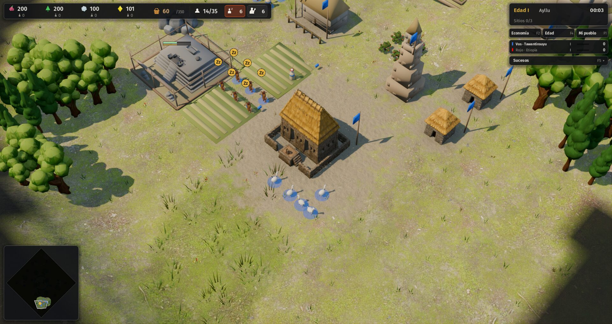
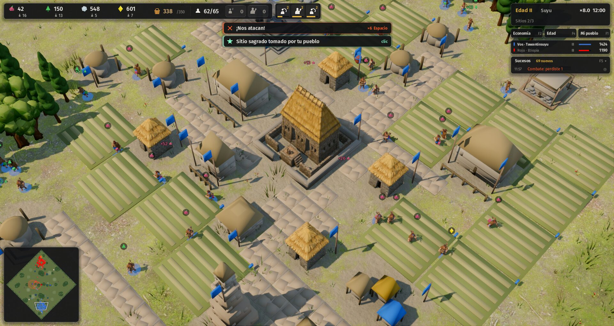
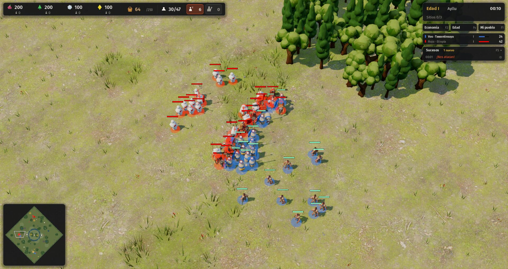
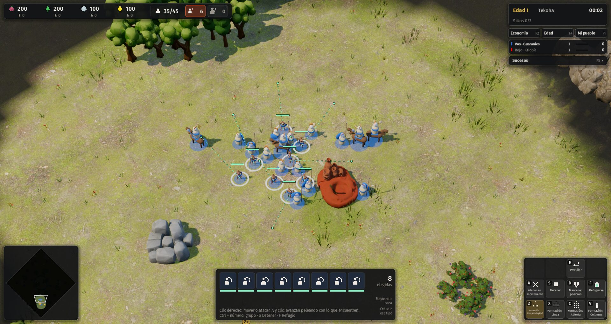
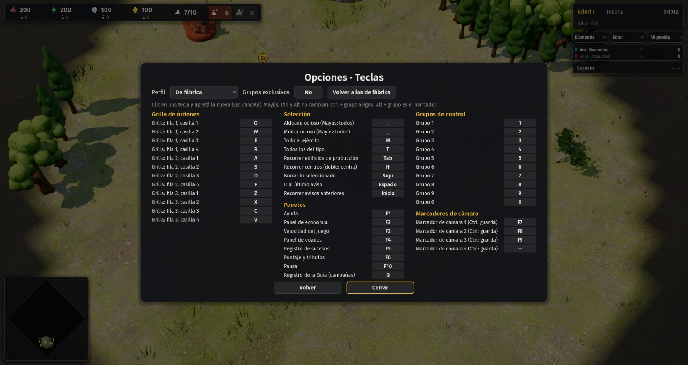
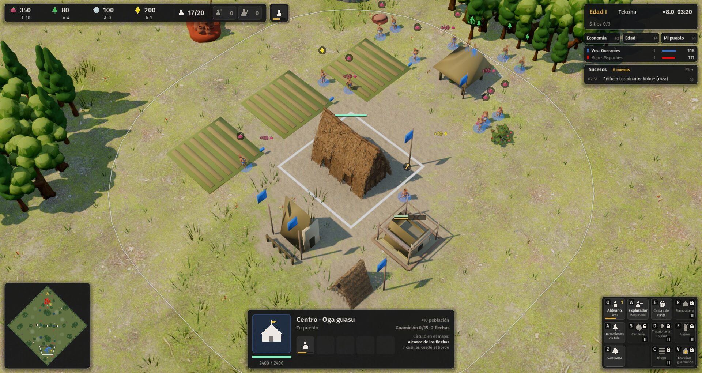

# Jugador de prueba 1, quinta ronda · Veterano competitivo de AoE4

Informe del 2026-11-16, sobre `main` en f6234d5. En el árbol de trabajo había un cambio sin commitear en `data/civs/guaranies.json`, el balance en curso. Rondas anteriores: [1](../01-veterano-aoe4.md), [2](../ronda-2/01-veterano-aoe4.md), [3](../ronda-3/01-veterano-aoe4.md), [4](../ronda-4/01-veterano-aoe4.md) y el [análisis de escala](../ronda-4/03-escala-veterano.md).

## 1. Qué probé

| Qué | Comando |
|---|---|
| Controles reales (101 chequeos) | `godot --path . -- --autotest --civ=guaranies --terreno=llano` |
| Escala medida | `godot --headless --path . -s tools/escala.gd` |
| Apertura contra la normal | `godot --headless --path . -s scratchpad/testers/veterano/apertura3.gd -- --civ=etiopia --rival=tawantinsuyu --min=30 --plan=boom --ataque=14 --const=4` |
| Apertura contra la experta | `… apertura3.gd -- --civ=tawantinsuyu --rival=etiopia --min=30 --plan=boom --ataque=14 --const=4 --dif=experta` |
| Base al zoom por defecto | `godot --path . -- --demo=base --civ=tawantinsuyu --terreno=llano --seed=21 --shot=x.png --shot-at=3` |
| Ciudad de la IA, minuto 12 | `godot --path . -- --aivai --civ=tawantinsuyu --rival=etiopia --terreno=llano --seed=7 --speed=8 --shot=x.png --shot-at=720` |
| Batalla | `godot --path . -- --demo=batalla --civ=tawantinsuyu --rival=etiopia --shot=x.png --shot-at=10` |
| Panel de varias unidades | `godot --path . -- --demo=formacion --civ=guaranies --terreno=llano --seed=21 --shot=x.png --shot-at=2 --cam=b12,b10,28 --select=hondero` |
| Teclas | `godot --path . -- --civ=guaranies --rival=mapuches --terreno=llano --seed=7 --shot=x.png --shot-at=2 --abrir=teclas` |
| Centro en IA contra IA | `godot --path . -- --aivai --civ=guaranies --rival=mapuches --terreno=llano --seed=7 --speed=8 --shot=x.png --shot-at=200 --select=centro` |

Mi script sigue sin micro y sin disputar sitios: sus derrotas no miden el balance.

## 2. Los arreglos de mi ronda 4, uno por uno

| # | Pedido | Quedó | Cómo lo comprobé |
|---|---|---|---|
| 1 | Teclas configurables | **Bien** | 43 acciones, perfiles "De fábrica" y "AoE4", intercambio si choca ([captura 5](capturas/veterano/05-teclas.jpg)). El autotest reasigna H a J y la grilla muestra la tecla nueva |
| 2 | Producción como AoE4 | **Bien** | Con dos cuarteles, una pulsación entrena una unidad ([1, 0]) y Mayús reparte 5 al de cola más corta (quedan 3 y 3, con la de antes) |
| 3 | `H` recorre los centros | **Bien** | Un toque elige, el doble centra y Mayús + H vuelve a la capital. Es mejor que en AoE4, que siempre centra |
| 4 | Panel de varias con vida | **Bien** | Retratos con su barra, Mayús + clic saca y Ctrl + clic deja el tipo, con la ayuda escrita al lado ([captura 4](capturas/veterano/04-panel-de-varias.jpg)) |
| 5 | `M` y `,` centran | **Bien** | `M` centra en el grueso del ejército, no en el promedio |
| 6 | Grupos exclusivos y grupo 0 | **Bien** | El perfil AoE4 los prende |
| 7 | Sin avisos de la IA en `--aivai` | **Bien** | El "Rozas en espera" ya no aparece ([captura 6](capturas/veterano/06-centro-circulo.jpg)) |
| 8 | El círculo del centro | **Bien** | "Círculo en el mapa: alcance de las flechas · 7 casillas desde el borde" |
| 9 | Demo de batalla fuera del lago | **Bien** | Ahora es en campo abierto ([captura 3](capturas/veterano/03-batalla.jpg)) |
| 10 | IA que dispute los sitios | **Bien, pero me sigue ganando por sitios** | Contra la normal perdí por sitios a las 20:18. Mi script no los disputa: es justo que pierda. Ya no es "la IA gana sin pelear": los recupera con ejército |
| — | Caída al cerrar | **Sigue** | El autotest termina con "AUTOTEST: OK" y código 134 |

El autotest pasó los **101 chequeos**. En la ronda 4 eran 78.

## 3. La escala nueva

**Medida** (`tools/escala.gd`; alto del cuerpo, sin estandartes, en alturas de una persona):

| | Ronda 4 (medida corregida por 4p) | Ahora | AoE4 (de memoria) [verificar] | ¿Alcanza? |
|---|---|---|---|---|
| Persona | 1,02 casillas | **0,75** | — | sí |
| Aldeano en pantalla, zoom por defecto | ≈ 40 px | **≈ 33 px** (zoom 28) | ≈ 30–35 px | sí |
| Casa | 0,8 | **1,3–2,2** (ruka 1,3) | 2,5–3 | casi; la ruka no |
| Cuartel | 1,2 | **2,5–3,1** | 3–4 | sí |
| Centro, alto | 2,1 | **2,3–4,3** (lof 2,3) | 5–7 | **no** |
| Centro, ancho | 3,1 | **3,0–4,6** | 7–9 | **no** |
| Hitos, mediana | 2,4 | **3,3–6,2** | 6–12 | casi (Ayutthaya, 3,3) |
| Torre | 3,9 | **3,6–6,0** | 5–7 | sí |
| Árbol | 2,0 | **4,0** | 4–6 | sí |
| Mercado | — | **1,5** | ≈ 3 | no: no se estira |
| Almacenes | — | 1,4–1,8 | ≈ 1,5–2 | sí |
| Soldado de maqueta / aldeano | 0,74 | 1,3 (lancero 2,0 con la lanza) | 1,0–1,1 | un poco altos |
| Venado de Palmares | — | **0,35** | ≈ 1 | no: parece un perro |

**Cómo se ve** ([captura 1](capturas/veterano/01-escala-base.jpg) contra la [de la ronda 4](../ronda-4/capturas/escala/02-base-zoom-defecto.jpg); [captura 2](capturas/veterano/02-escala-ciudad-min12.jpg)):
- **El cambio es grande y en la dirección correcta.** El bosque ya es un bosque, los cuarteles se leen como edificios y la ciudad de la IA al minuto 12 parece un pueblo y no una maqueta. Es el cambio que más acercó la sensación a AoE4 en las cinco rondas.
- **El centro sigue siendo una casa grande.** Con 4×4 casillas no da el ancho: 4,2 personas de ancho contra 7–9 en AoE4. Al lado de cuatro chacras de 3×3 se pierde.
- **El ícono "Zz" de ocioso** es más grande que la cabeza del aldeano. Con la gente más chica, conviene achicarlo a la mitad.

**¿Alcanza el paso 1? No del todo:**
1. **La velocidad (C-65): hace falta ahora.** El aldeano anda 1,125 casillas por segundo y la persona mide 0,75 casillas: son **1,5 personas por segundo**. En la ronda 4 eran 1,09, y en AoE4 calculo unas 0,8 [verificar]. Con la gente más chica se ve trotar. Propongo `velocidad_pct` de 90 a 72 como en el informe de escala (1,2 personas por segundo), con su torneo. Es lo que más falta para que "se sienta real".
2. **Las huellas de 5×5 (C-66): para el centro sí; para los hitos ya no tanto.** Los hitos llegan a 5,6 personas de mediana y se leen. El centro necesita la huella: con 4×4 el cuerpo no pasa de 3,4 casillas.
3. **Solo vista, sin consulta:**
   - estirar el mercado y la ruka mapuche;
   - el venado de Palmares a 0,8 personas;
   - el "Zz" al 60 %.

## 4. Calidad de vida y usabilidad, por gravedad

**Media:**
1. **Al cerrar, el juego se cae** (código 134). Es lo último que queda de mi lista de la ronda 4.
2. **No se pueden asignar teclas a acciones fuera de la grilla.** Faltan:
   - seleccionar todos los aldeanos;
   - la campana;
   - "volver al trabajo";
   - "todos los edificios militares".

   Hoy la campana está en la casilla Z del centro y hay que elegir el centro primero. AoE4 tiene atajos globales para la campana y para todos los edificios de producción.
3. **El perfil AoE4 deja 4 marcadores en la lista de teclas** (el 4 sin tecla de fábrica), mientras que Alt + 1…8 da 8. Conviene que la lista muestre los 8.

**Baja:**
4. **Barras rojas en todos los enemigos que pelean:** en la batalla de 30 contra 30 ([captura 3](capturas/veterano/03-batalla.jpg)) el rojo tapa a las figuras, que ahora son chicas. AoE4 dibuja las barras más finas y solo con daño, o al mantener una tecla. Propongo barras de la mitad del alto o solo en las unidades dañadas.
5. **El "Zz" es más grande que la cabeza** (ver la escala).

**Bien** (sumado a lo de la ronda 4): las teclas configurables con intercambio, la producción repartida, `H` con un toque y doble, los retratos con vida, y los grupos exclusivos y el 0. Hoy los controles de selección y producción están a la altura de AoE4.

## 5. Lo mío de siempre

**La experta ya es experta:**
- **Aldeanos:** 22, 35, 65, 99 y 100 a los 5, 10, 15, 20 y 25 minutos. Población 185 de 200 al minuto 25.
- **Edades:** edad II a las 6:07 y no llegó a la III en 26 minutos (colocó el hito a las 24:29).
- **Final:** me ganó por conquista a las 26:34, con 47 000 de recursos juntados contra mis 14 000.
- **Es lo primero que me da miedo de verdad.** Lo único que le pediría es que suba de edad antes, como un jugador de nivel alto que hace boom y pasa a la III cerca del minuto 12.

**La normal:** edad II a las 5:11 y III a las 20:17. Me ganó por sitios a las 20:18, con los tres en su poder.

**Ventana del hito:** en mis dos partidas nadie se acercó a un hito en obra, ni al mío ni a los de la IA. Mi script ataca recién al minuto 14 o 15, cuando ya no hay hitos de edad II en obra. Lo midió la herramienta del orquestador en la ronda 4. No volví a medirlo.

**Micro y caza:** sin cambios desde la ronda 4 (salvo la emboscada guaraní en balance). No los volví a medir.

## 6. Qué falta para ser tan divertido como AoE4, en orden
1. **La velocidad (C-65):** con la gente más chica es lo que más rompe la sensación de realidad.
2. **El centro de 5×5 (C-66),** o al menos más ancho dentro de su huella.
3. **Que la experta suba de edad a tiempo** sin dejar de expandirse.
4. **Que el juego no se caiga al cerrar.**
5. **Atajos globales:** campana, todos los aldeanos y todos los edificios de producción.
6. **Barras más finas o solo con daño,** y el "Zz" más chico.
7. **Mercado y ruka estirados,** y el venado de Palmares en proporción.
8. **Mejoras por unidad** (pendiente desde la ronda 3).
9. **Los 8 marcadores en la lista de teclas.**
10. **Una IA difícil que use la ventana del hito** con lo que tenga, aunque sea poco.

## Capturas

| | |
|---|---|
|  |  |
| 1. La misma base de la ronda 4 con la escala nueva: el bosque y la torre crecen y la gente se achica. El centro sigue chico para su papel | 2. Ciudad de la IA inca al minuto 12: ya se lee como pueblo. Las chacras de 3×3 dominan |
|  |  |
| 3. Batalla en campo abierto: las barras rojas tapan a las figuras chicas | 4. 8 honderos con retrato y vida; los modificadores explicados a la derecha |
|  |  |
| 5. Opciones → Teclas: 43 acciones y perfil AoE4 | 6. Centro con Aldeano y Explorador en la grilla y el círculo explicado; sin avisos de la IA |
