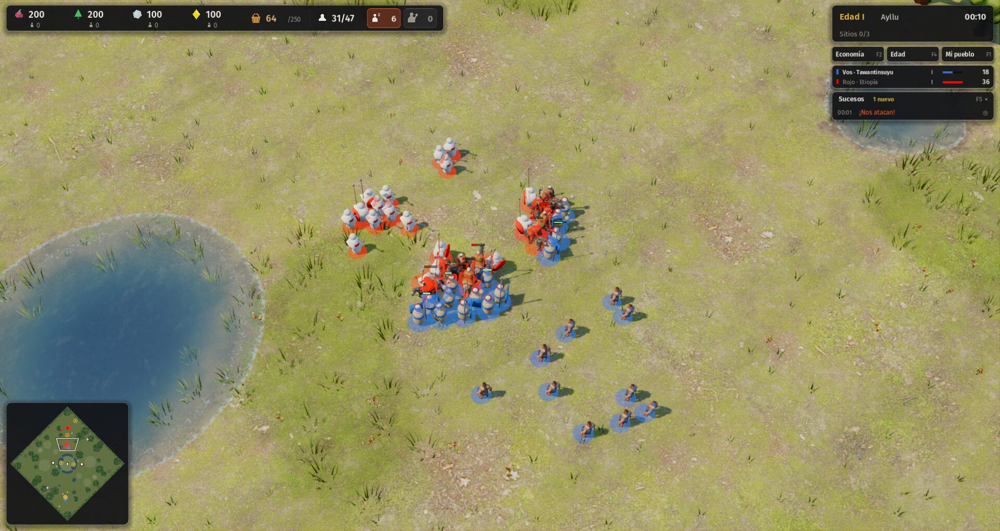
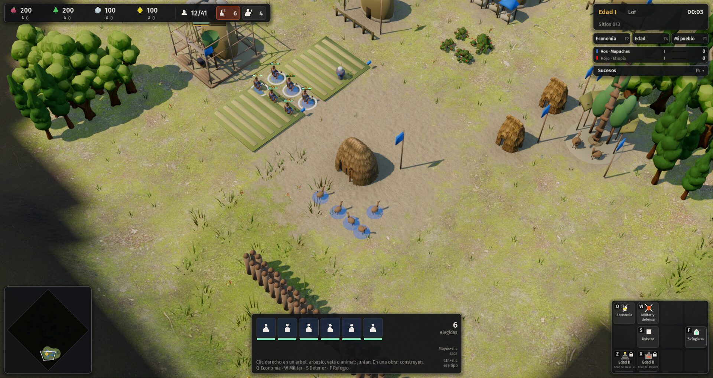

# Jugador de prueba 1, sexta ronda · Veterano competitivo de AoE4

Informe del 2026-11-16, sobre `main` en d54e949. Mientras jugaba corría el torneo 29 en 10 procesos: usé a lo sumo dos Godot y las corridas fueron más lentas. Rondas anteriores: [1](../01-veterano-aoe4.md), [2](../ronda-2/01-veterano-aoe4.md), [3](../ronda-3/01-veterano-aoe4.md), [4](../ronda-4/01-veterano-aoe4.md), [5](../ronda-5/01-veterano-aoe4.md) y la [escala](../ronda-4/03-escala-veterano.md).

## 1. Qué probé

| Qué | Comando |
|---|---|
| Controles reales, dos veces | `godot --path . -- --autotest --civ=guaranies --terreno=llano` |
| Partida contra la experta, 30 minutos, con mi ataque al minuto 12 y a qué le pega cada soldado | `godot --headless --path . -s scratchpad/testers/veterano/apertura3.gd -- --civ=tawantinsuyu --rival=etiopia --min=30 --plan=boom --ataque=12 --const=4 --dif=experta` |
| Micro C2, capa común (3 variantes) | `godot --headless --path . -s tools/micro_matriz.gd -- --variantes=3` |
| Hito en obra, experta contra experta | `godot --headless --path . -s tools/hito_en_obra_ia.gd -- --dificultad=experta --seeds=7 --minutes=20` |
| Batalla | `godot --path . -- --demo=batalla --civ=tawantinsuyu --rival=etiopia --shot=x.png --shot-at=10` |
| Base mapuche con los aldeanos elegidos | `godot --path . -- --demo=base --civ=mapuches --terreno=llano --seed=21 --shot=x.png --shot-at=3 --select=aldeano` |

Mi script sigue sin micro y sin disputar sitios.

## 2. Mis pedidos de la ronda 5

| Pedido | Quedó | Cómo lo comprobé |
|---|---|---|
| Mercado y ruka levantados | **Bien** | Mercado de 2,6–3,2 personas y ruka de 2,0 (medido por el orquestador con `tools/escala.gd`; en la [captura 2](capturas/veterano/02-base-mapuche.jpg) la ruka ya no es un montículo) |
| Venado de Palmares | **Bien** | Era el pecarí; ahora hay más venados |
| "Zz" chico | **Bien** | Del tamaño de la cabeza, encima del aldeano ([captura 2](capturas/veterano/02-base-mapuche.jpg)) |
| Barras de vida finas | **Bien** | 25 × 3 px, solo en lo dañado, elegido o bajo el mouse. En la batalla de 30 contra 30 ya no tapan a nadie ([captura 1](capturas/veterano/01-batalla-barras.jpg)). Como en AoE4 |
| Campana, todos los aldeanos y producción | **Bien** | B, N y P: el autotest los prueba |
| 8 marcadores en la lista | **Bien** | Están en Opciones → Teclas |
| Caída al cerrar | **Sigue** | El autotest termina con código 134 las dos veces |
| Velocidad (C-65) | No se hace por ahora | Respondida: vuelve con las animaciones. Lo acepto: con buenas animaciones de paso, 1,5 personas por segundo se nota menos |
| Huellas de 5×5 (C-66) | En consulta | |

El autotest pasó **112 de 112** la segunda vez. La primera falló un chequeo; lo cuento en §5.

## 3. Las peleas con la elección de blancos nueva

Lo medí en mi partida contra la experta: cada minuto anoté a qué le pegaba cada soldado de mi ejército en ataque en movimiento.

- **Ahora pega primero a lo que pelea.** Al avanzar, mi ejército le pegó a guerreros, arietes y honderos. Cuando no había militares, a aldeanos (20 a 25 de mis soldados a la vez). Después, a los centros nuevos que tiran flechas, y recién al final a los almacenes. En la ronda 3, el mismo ataque se detenía en cada granero (55 graneros de la experta, 49 rotos por mí) y nunca llegaba.
- **Es AoE4:** el ataque en movimiento limpia el ejército, después la economía y después la base.
- **Le hizo daño de verdad a la experta:**
  - sus aldeanos bajaron de 36 al minuto 15 a 20 al minuto 20;
  - su ejército quedó en 4 al minuto 15;
  - mataron 165 de los suyos (sumando mis aldeanos y torres).

  En la ronda 5 la experta me había ganado con 100 aldeanos.
- **No llega a la capital:** después de cada pelea el ejército vuelve a casa (mi script lo llama a defender). Eso es mi script, no el juego.

**Micro C2** (`tools/micro_matriz.gd`, capa común, 3 variantes):
- la mezcla de 5 lanceros y 5 honderos le gana a 10 guerreros 3 de 3, con 5 vivos sin micro y 7 con fuego concentrado o manteniendo y escalonando;
- escalonar contra guerreros gana 2 de 3 y kitear a la línea, 3 de 3 sin bajas;
- es igual que en la ronda 4: la elección de blancos no rompió la micro.

## 4. La experta

| Pregunta | Respuesta | Medida |
|---|---|---|
| ¿Sube de edad? | **Sigue lenta** | Experta contra experta: edad II a las 6:17–9:29 y una sola edad III (Palmares, 17:33) en 6 jugadores y 20 minutos. Contra mí, edad II a las 6:07 y nunca la III en 30 minutos |
| ¿Ataca el hito en obra? | **Poco** | Experta contra experta: enemigos cerca del hito en obra 0, 3 y 16–53 s según el par, sin hitos perdidos. Contra mí, nunca: mi hito de la edad II termina a las 5:07, cuando la experta tiene 0 militares |
| ¿Disputa sitios? | Sí, según el paso 5b. En mi partida de 30 minutos nadie ganó por sitios | |
| ¿Da pelea? | **Sí, en la economía** (100 aldeanos en la ronda 5). **Contra un ataque temprano se cae:** con 11 militares al minuto 10 y 4 al 15, mi ataque del minuto 12 la dejó en 20 aldeanos | |

- **El problema de la experta** es que no se defiende cuando expande. Junta para el segundo centro y el ejército mínimo de la edad II (20) no alcanza contra un ataque de 40.
- **Un jugador de AoE4 que hace boom** levanta una torre o dos junto al segundo centro y tiene la campana a mano. Pediría que la experta:
  - suba el ejército mínimo cuando ve un ejército rival más grande;
  - levante una torre junto a cada centro nuevo.

## 5. Calidad de vida y usabilidad, por gravedad

**Media:**
1. **El consejo de la pelea perdida está desactualizado.** El resumen dice "con A y clic atacan lo primero que ven; mandalos con clic derecho contra los soldados" (`src/game/ui/consejos.gd`, línea 529). La hoja de atajos (F12) dice "atacar en movimiento: atacan lo primero que ven" (`hoja_atajos.gd`, línea 82). Desde la elección de blancos (5d), el ataque en movimiento pega primero a los militares. Hay que cambiar el texto, por ejemplo: "atacan primero a los soldados, después a los aldeanos y a lo que tira flechas". Si no, el juego enseña a no usar la orden que ahora funciona bien.
2. **Al cerrar, el juego se cae** (código 134), en las dos corridas.
3. **Un chequeo del autotest falla de a ratos con la máquina cargada:** "cuenta grande de sitios del rival (jugador −1)" falló la primera vez y pasó la segunda, mientras corría el torneo. Parece la misma clase de tropiezo de tiempo que se arregló en otras partes del autotest (esperar a que la orden entre). No es del juego, pero ensucia la prueba.

**Baja:**
4. **En la batalla siguen siendo dos manchas** ([captura 1](capturas/veterano/01-batalla-barras.jpg)). Las barras ya no molestan, pero los etíopes son blancos con disco rojo, y en el montón no se ve quién es lancero y quién guerrero. Con Alt se ve la función sobre los techos de los edificios. Lo mismo sobre las unidades, al mantener Alt, sería el detalle que falta.
5. **Las teclas de las formaciones** (Z X C V en la grilla militar) son las mismas que los hitos en la grilla del aldeano. Con aldeanos y soldados elegidos a la vez, ¿cuál gana? No lo pude probar sin mouse; lo anoto para revisar.

**Bien:**
- las barras;
- el "Zz";
- los atajos globales B, N y P;
- la lista de 8 marcadores;
- el panel de los aldeanos elegidos explica qué hace el clic derecho ([captura 2](capturas/veterano/02-base-mapuche.jpg)).

## 6. Qué falta para ser tan divertido como AoE4, en orden
1. **Experta que se defienda cuando expande** (ejército según el del rival, torre en cada centro nuevo) y que suba de edad a tiempo.
2. **Actualizar el consejo y la hoja de atajos** sobre el ataque en movimiento.
3. **Que el juego no se caiga al cerrar.**
4. **La IA que pegue al hito en obra con lo que tenga.**
5. **El centro de 5×5 (C-66).**
6. **Velocidad y animaciones** (C-65, ya en plan).
7. **Alt muestra la función sobre las unidades,** no solo sobre los techos.
8. **Mejoras por unidad.**
9. **Revisar el choque de Z X C V** con selección mixta.
10. **Sacar el chequeo de sitios del autotest de lo que falla con carga.**

## Capturas

| | |
|---|---|
|  |  |
| 1. Batalla de 30 contra 30: barras chicas solo en los heridos; se lee mejor, pero sigue siendo una mancha roja y otra azul | 2. Base mapuche con 6 aldeanos elegidos: "Zz" chico, ruka levantada y la ayuda del clic derecho en el panel |
