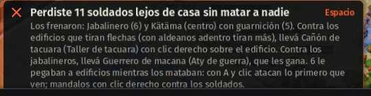
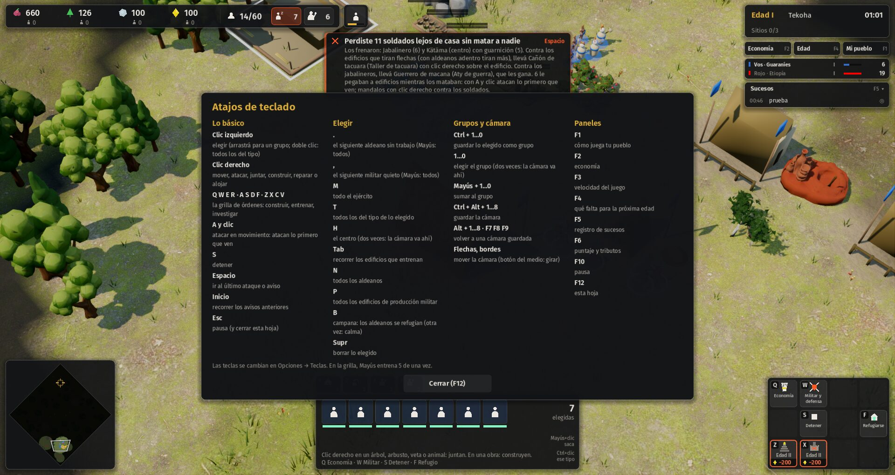

# Ronda 6 · Jugador nuevo en los RTS

Rondas anteriores: [1](../02-nuevo-en-rts.md), [2](../ronda-2/02-nuevo-en-rts.md), [3](../ronda-3/02-nuevo-en-rts.md), [4](../ronda-4/02-nuevo-en-rts.md) y [5](../ronda-5/02-nuevo-en-rts.md). Lo que se hizo desde la ronda 5: [4q, la primera victoria](../../24-tras-la-segunda-ronda/4q-primera-victoria.md) y la elección de blancos (filas U y W de la etapa 24).

## Qué probé

Rama `main` (d54e949). Había un torneo de 10 procesos corriendo; nunca tuve más de dos procesos de Godot míos a la vez.

| Qué | Comando |
|---|---|
| ¿Le gano a la fácil? | `novato6.gd` (el de la ronda 5, sin el error que encontró 4q: ya no vuelve a pedir el hito en la edad II). Guaraníes contra Tawantinsuyu fácil, llano, sin sitios, 30 minutos. Tres maneras de jugar (abajo) |
| Controles reales, aviso de la pelea y hoja de atajos | `godot --path . -- --autotest --civ=guaranies --terreno=llano` (la captura de la hoja sale de `screenshots/autotest_atajos.png`, que guarda el autotest) |

Las tres maneras de jugar:
- **Plan:** `--ahorra=1 --asedio=1 --ataca=1`. Hasta la edad II, 8 soldados como mucho. Hito a los ~8 minutos. En la edad II, taller y arietes. Ataca con 15 soldados o más y 2 arietes o más.
- **Medio:** `--asedio=1 --ataca=1`. Arietes, pero sin ahorrar para el hito.
- **Simple:** `--ataca=1`. Ataca con 15, sin asedio.

## ¿Le gano a la fácil?

**¡Sí!** Por primera vez en seis rondas.

| Manera | Semilla | Resultado | Ataques | Soldados perdidos |
|---|---|---|---|---|
| Plan | 21 | **Gano a las 19:56** (Rojo se rinde) | 3 | 10 |
| Plan | 11 | **Gano a las 17:38** | 2 | 4 |
| Plan | 3 | **Gano a las 29:05** | 6 | 32 |
| Plan | 7 | Sin terminar a los 30:00 | 3 | 37 |
| Medio (arietes, sin ahorrar) | 21 | **Gano a las 26:59** | 5 | 24 |
| Simple (sin asedio) | 7 | Sin terminar a los 30:00 | 7 | 35 |
| Simple (sin asedio) | 21 | Sin terminar a los 30:00 | 6 | 44 |

**Lo que se lee:**
- **Con arietes se gana:** 4 de 5 partidas con asedio (3 de 4 con el plan, 1 de 1 sin ahorrar). La rendición llega entre los minutos 17 y 29.
  - La semilla 7 sigue rebelde, igual que en la medida de 4q: los primeros ataques se deshacen y el plan no se recupera.
  - Lindo detalle: la fácil se rinde. No tuve que tirar la capital entera.
- **Sin asedio no se gana:** 13 ataques en dos semillas y ningún final. Tiene sentido, y ahora el juego lo dice tres veces: el aviso «atacá», el aviso de la pelea y la ficha.
- **El plan no es complicado:** ahorrar un poco en la edad I, hito a los 8 minutos, taller a los 11 y atacar a los 14. Es lo que cualquiera aprende con el tutorial más el aviso «atacá». La semilla 3 se gana tarde (29:05), con 6 ataques: hay que insistir.
- **La elección de blancos se nota en los números.** Con el plan, las bajas bajaron de 36–50 (ronda 5) a 4–37. Y los «edificios» de la fácil ya no son 120 tramos de camino, sino 20–30 edificios de verdad.

**En la semilla 7 (simple) mi script se trabó con el hito**: lo pidió una vez a las 8:40, no lo pudo levantar y nunca reintentó. Una persona vería el aviso y probaría de nuevo; no cuento esto contra el juego.

## El resumen de la pelea

> **Perdiste 11 soldados lejos de casa sin matar a nadie**
> Los frenaron: Jabalinero (6) y Kätäma (centro) con guarnición (5). Contra los edificios que tiran flechas (con aldeanos adentro tiran más), llevá Cañón de tacuara (Taller de tacuara) con clic derecho sobre el edificio. Contra los jabalineros, llevá Guerrero de macana (Aty de guerra), que les gana. 6 le pegaban a edificios mientras los mataban: con A y clic atacan lo primero que ven; mandalos con clic derecho contra los soldados.

(Es la pelea armada del autotest, contra Etiopía.)

**¿Me enseña algo útil?** Sí, muchísimo. Es exactamente lo que pedí en la ronda 5:
- **qué me frenó**, con nombre y número: 6 jabalineros, 5 por el centro con aldeanos adentro;
- **qué llevar**, con nombre y edificio: cañón de tacuara del Taller; guerrero de macana del Aty de guerra;
- **el error de manejo:** «con A y clic atacan lo primero que ven». Esto nunca lo hubiera adivinado solo.

**Lo que mejoraría:**
- **Es largo:** seis renglones de letra chica en un aviso que se va solo. En el medio de la pelea no lo leo entero.
- Que el título quede arriba y lo demás vaya en tres puntos cortos:
  - «Te frenaron: 6 jabalineros, el centro con 5 adentro».
  - «Llevá: Cañón de tacuara, Guerrero de macana».
  - «Usá clic derecho sobre los soldados, no A y clic».
- Que quede en el registro F5 para releerlo. Inicio recorre los avisos anteriores, pero eso no lo sabría si no estuviera en la hoja de atajos.

## La hoja de atajos (F12) y Alt

- **La hoja de atajos me sirve.** Es una pantalla, en cuatro columnas («Lo básico», «Elegir», «Grupos y cámara», «Paneles»), en castellano claro y con lo que hace cada tecla. Está en la pausa y en Mi pueblo.
- **La campana pasó a B.** Se acabó el doble sentido de la Z (hito o campana) que venía marcando desde la ronda 2.
- **Alt no figura en la hoja.** La hoja nombra «Ctrl + Alt + 1…8» (cámara), pero no «mantener Alt: ver alcances, barras y qué es cada edificio». Es justo lo que alguien nuevo necesita para la escala nueva, y no lo encontraría. No pude probar Alt en una captura (el modo de capturas no mantiene teclas), así que no opino cómo se ve.
- **F1 sigue siendo «cómo juega tu pueblo».** Ahora está bien: la hoja de atajos es la ayuda de las teclas, y F1 la del pueblo.

## Calidad de vida y usabilidad, por gravedad

### Media

1. **El aviso de la pelea es largo** para leerlo en el momento (ver arriba). Lo pondría en tres renglones cortos.
2. **Alt no está en la hoja de atajos.** Los íconos sobre los techos solo los encuentra quien ya sabe.
3. **Sin asedio, el ataque no termina nunca.** El juego ya lo dice, pero quien no lo lee puede jugar 30 minutos atacando sin final. Con la fácil, ¿conviene que se rinda también si pierde mucha tropa en su base? Por ejemplo, tres oleadas seguidas sin poder echar al atacante.

### Leve

4. **En la grilla, los hitos ahora dicen «Edad II» completo** ([captura 3](capturas/nuevo/03-grilla-edad-ii.jpg)), pero se pierde la palabra «hito». Para alguien nuevo, «Edad II» en un botón de construir no dice que es un edificio. «Hito → Edad II» se entendería mejor si entra.
5. **El crash al salir** sigue (`corrupted size` / `double free`), en el autotest y en las capturas.

### Lo que anda muy bien

- Autotest **OK, 112 chequeos**, con los tres del aviso de la pelea y los de la hoja.
- La rendición de la fácil: termina la partida cuando ya está claro quién gana.
- La elección de blancos: mis tropas ya no se pierden pegándole a caminos.
- El panel de los aldeanos con ayuda, el centro con Aldeano en Q y la granja del tutorial, de la ronda 5.

## Mis 10 deseos, actualizados

1. **El aviso de la pelea en tres renglones cortos** (qué te frenó / qué llevar / cómo mandarlos).
2. **Alt en la hoja de atajos** («mantené Alt: qué es cada edificio, alcances»).
3. **Que la pantalla de victoria por rendición lo festeje:** era mi primera victoria. Un «¡Ganaste tu primera partida!» con un consejo para la próxima (probá Normal) me daría ganas de seguir.
4. **Un «arte de la guerra»** que enseñe el plan que acabo de descubrir: ahorrar, hito, taller, atacar con arietes.
5. **Objetivos sugeridos en la escaramuza**, siguiendo el mismo plan («hito antes del minuto 10», «taller», «2 arietes», «atacá»).
6. **«Hito → Edad II»** en la grilla.
7. **Que la fácil se rinda también** si no logra echar a mi ejército durante un rato largo, para el que ataca sin asedio.
8. **Campaña recomendada** después del tutorial.
9. **Íconos de función a la vista sin Alt**, como opción para principiantes.
10. **El crash al salir.**

## ¿A los 10 minutos tengo ganas de seguir?

Sí, y esta vez sin peros grandes. Los primeros 10 minutos ya estaban bien desde la ronda 4. Lo que faltaba era ganar, y ahora gano: hito a los 8 minutos, taller a los 11, arietes y a la carga. Rojo se rinde entre los minutos 17 y 29. Cuando pierdo una pelea, el juego me dice qué me frenó y qué llevar la próxima vez. Para alguien que nunca jugó un RTS, ganarle a la fácil en su segunda o tercera partida y entender por qué es lo que hace que vuelva a jugar. Lo próximo que pediría es que el juego festeje esa primera victoria y me invite a Normal.
