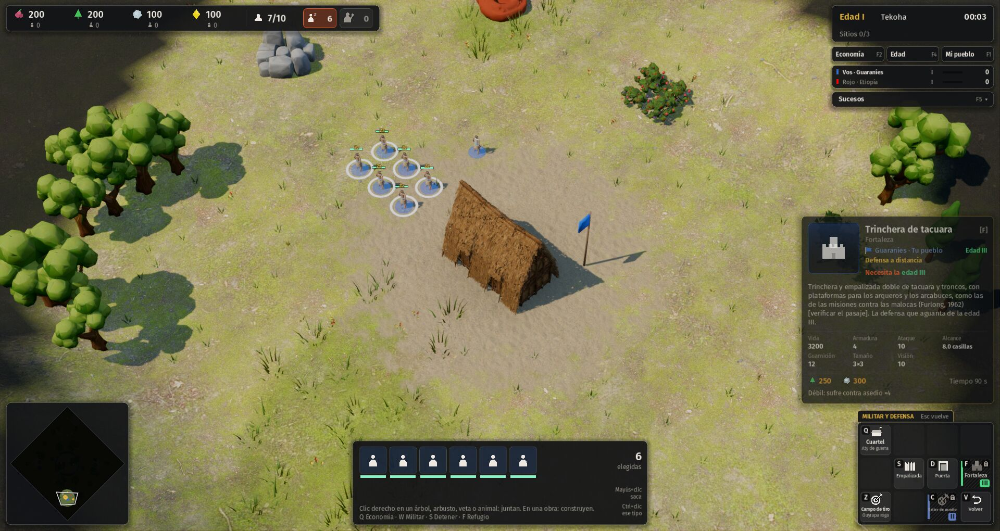
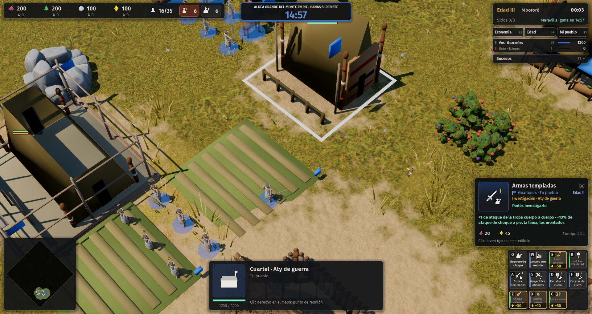

# Ronda 7 · Jugador nuevo en los RTS

> Main en `da4d074`. Ronda corta: el autor está al límite de uso, así que medí poco y miré solo 4 capturas.

## Qué probé

| Qué | Comando |
|---|---|
| ¿Le sigo ganando a la fácil? | `godot --headless --path . -s tools/primera_victoria.gd -- --seeds=21,7 --min=30 --dif=facil` (mi plan: ahorrar en la I, hito a los ~8 min, taller y arietes, atacar con 15 + 2) |
| Grilla del aldeano con ayuda de algo bloqueado | `--civ=guaranies --terreno=llano --select=aldeano --grilla=militar --ayuda=7 --cam=b2,b2 --shot=… --shot-at=3` |
| Grilla del cuartel en la edad III | `--civ=guaranies --demo=base --edad=3 --select=cuartel --ayuda=4 --cam=b6,b6,16 --shot=…` |
| Grilla del centro en la edad III | lo mismo con `--select=centro --ayuda=0` |
| El cierre | las 4 corridas con ventana, mirando el código de salida y si aparece `corrupted size` / `double free` |

## ¿Le gano a la fácil? **No: 0 de 2**

| Semilla | Ronda 6 | Ronda 7 | Ataques | Tropa perdida | Arietes perdidos |
|---|---|---|---|---|---|
| 21 | **Gano a las 19:56** | Sin terminar a los 30:00 | 2 (13:00 y 22:00) | 42 | 10, los 10 por **honderos** |
| 7 | Sin terminar | Sin terminar a los 30:00 | 1 (13:00) | 42 | 10 (4 por honderos) |

- **La capital de la fácil no recibió un solo golpe** (vida mínima 2400, entera). Mis arietes llegan a 10–11 casillas y mueren antes.
- **Lo que me mata son los honderos:** 48 y 44 de mis bajas, y casi 4000 de daño en cada partida. Con los arietes pasa lo mismo: en la semilla 21, los 10 los bajaron honderos. Un ariete tiene 6 de armadura a distancia; que una honda lo tire me sorprende. ¿Hay un bono contra asedio, o es la herrería nueva de la fácil? No lo investigué (no toco código), pero es la primera pregunta.
- **Ataco menos que antes:** 1 o 2 oleadas en 30 minutos, contra 2 a 6 en la ronda 6. Después del primer ataque tardo 9 minutos en volver a juntar 15 + 2.
- **Para alguien nuevo, esto es lo más grave de la ronda.** En la ronda 6 había descubierto un plan que ganaba 3 de 4; ahora el mismo plan no gana ninguna y el aviso de la pelea me va a decir «Llevá: …», pero los arietes no llegan igual. La fácil quedó difícil para el que aprende.

## Íconos, color por edad, estados y ayuda

- **Se entiende sin leer.** La franja de color a la izquierda de cada casilla y el chip con la edad (verde III, azul II) me dicen «esto es para más adelante» antes de pasar el mouse. El candadito chico en la esquina ayuda.
- **El rojo está bien usado.** En la fortaleza (edad III, estando en la I) dice «Necesita la **edad III**» en rojo, con «edad III» en verde, el color de la edad. En el cuartel, con recursos, dice «Podés investigarlo» en verde. Donde falta riqueza, el borde es ámbar y la casilla muestra «−50» con el ícono: eso es claro y no asusta.
- **Se filtran notas de los historiadores.** La ayuda de la fortaleza guaraní dice «(Furlong, 1962) **[verificar el pasaje]**». Hay ~110 `[verificar…]` en `data/` (37 en hitos, 6 a 13 por pueblo). Al que juega le parece un error, o que el juego no está terminado.
- **Nombres cortados:** «aller de asedio» (Taller de asedio, en la grilla del aldeano) y «Pohã ñana (remedios del» en la del cuartel.
- **En ámbar, el texto de la casilla queda muy apagado** («Adiestramiento», «Choque veterano»): cuesta leer qué es justo en lo que me falta plata.

## ¿Abruman las mejoras nuevas?

- **El cuartel en la III tiene 11 casillas:** 2 tropas y 9 mejoras. Entre ellas, «Línea veterana» y «Choque veterano», que para mí dicen lo mismo, y 4 de herrería (armas templadas, proyectiles afinados, escudos y corazas de cuero) que en la ronda 6 estaban en otro lado.
- **No sé qué comprar primero.** La ayuda de «Armas templadas» es buena («+1 de ataque cuerpo a cuerpo · +10 % de choque…»), pero no me dice si me conviene más que «Línea veterana». El color por edad me ordena en el tiempo, pero no por importancia.
- **El centro en la III ([captura 3](capturas/nuevo/03-centro-edad-iii.jpg))** se banca mejor: aldeano, explorador y 9 mejoras de economía con nombres que se entienden (cestas de carga, herramientas de tala, riego). La ficha del aldeano, con «AHORA · Tenés 6 en el mapa» y «Débil: pega poco a edificios», es lo mejor de la interfaz para un nuevo.
- **Lo que pediría:** una marca de «recomendado» (una estrellita) en 1 o 2 casillas por edificio, o que la ayuda diga «Primero: …». Y juntar «Línea veterana» y «Choque veterano» en un nombre que diga la diferencia («Veteranos: tropa de línea» / «Veteranos: choque»).

## Aldeanos y soldados animados

- No pude juzgarlo bien: en la captura sin IA, a los 50 s los 6 aldeanos estaban parados fuera de cámara (eso sí: el aviso «Tenés 6 aldeanos sin trabajo · Espacio» salió claro arriba). No gasté más capturas. Queda para la ronda que viene, con video.

## El cierre del juego

- **Parece arreglado.** Las 4 corridas con ventana cerraron con código 0 y sin `corrupted size` ni `double free`. En la corrida sin ventana quedan los avisos de Godot de objetos sin liberar, que al jugador no le llegan.

## Mis pedidos de la ronda 6

| # | Pedido | ¿Quedó? |
|---|---|---|
| 1 | Aviso de la pelea en tres renglones | **Sí** («Te frenaron…» / «Llevá: …» / cómo) |
| 2 | Alt en la hoja de atajos | **Sí** («Grupos, cámara y Alt») |
| 3 | Festejar la primera victoria | **Sí**, en el panel del final. No lo vi en pantalla porque no gané |
| 4 | «Arte de la guerra» con el plan | No |
| 5 | Objetivos sugeridos en la escaramuza | No |
| 6 | «Hito → Edad II» en la grilla | No lo encontré |
| 7 | Que la fácil se rinda si no me puede echar | No: la rendición sigue pidiendo edificios perdidos o la capital baja |
| 8 | Campaña recomendada tras el tutorial | No |
| 9 | Íconos de función sin Alt, como opción | No |
| 10 | El crash al salir | **Parece que sí** (ver arriba) |

## Pedidos por gravedad

### Alta

1. **La fácil ya no se deja ganar con el plan del principiante** (0 de 2; antes 3 de 4). Los honderos tiran arietes y la capital queda intacta. Revisar con `tools/primera_victoria.gd` qué cambió para la fácil (¿herrería, honderos contra asedio?) y devolverle la ventana al que aprende.

### Media

2. **Sacar los `[verificar…]` del texto que ve el jugador** (o esconderlos fuera del modo desarrollo).
3. **Una guía de qué comprar primero** en grillas de 9 mejoras: estrellita de «recomendado» o una línea «Primero: …» en la ayuda.
4. **Nombres que digan la diferencia:** «Línea veterana» y «Choque veterano».
5. **Que la fácil se rinda también** si no me puede echar de su base (sigue de la ronda 6, y ahora pesa más).

### Leve

6. **Nombres cortados** en la grilla («aller de asedio», «Pohã ñana (remedios del»).
7. **El texto de las casillas en ámbar**, más legible.
8. **De la ronda 6, siguen:** «Hito → Edad II», objetivos sugeridos, arte de la guerra, campaña recomendada, íconos sin Alt.

### Lo que anda muy bien

- Color por edad y franja: sé en qué edad se habilita algo sin leer.
- El rojo solo donde de verdad no se puede; el ámbar con «−50» para lo que falta.
- La ficha del aldeano en el centro («AHORA», «Débil: …», «Mayús + clic: cinco»).
- El aviso de la pelea corto, Alt en la hoja y, al parecer, el fin del crash al salir.

## ¿A los 10 minutos tengo ganas de seguir?

Sí, porque la interfaz nueva se lee mucho mejor. Pero a los 30 minutos, sin poder voltear a la fácil con el plan que me había funcionado, me frustraría. Volver a que la primera victoria sea alcanzable es lo primero.
