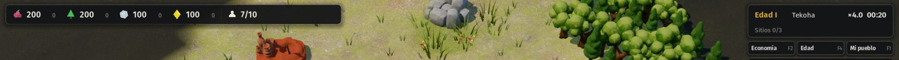
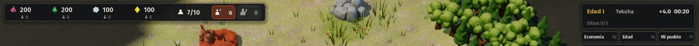
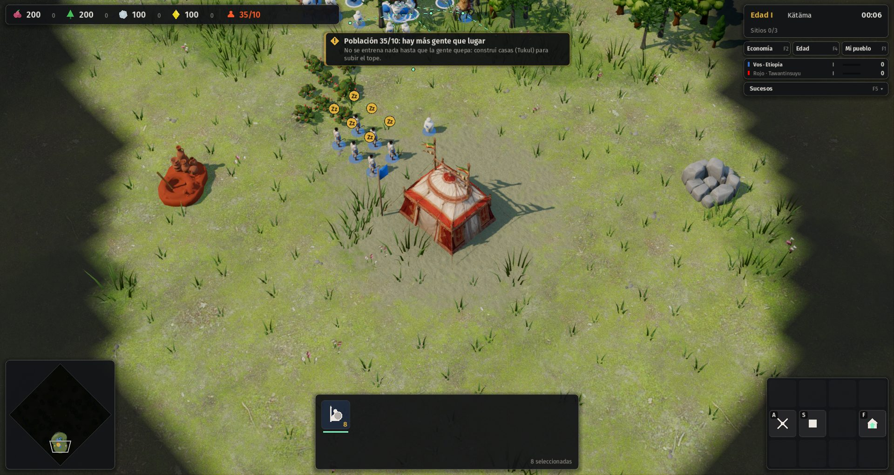
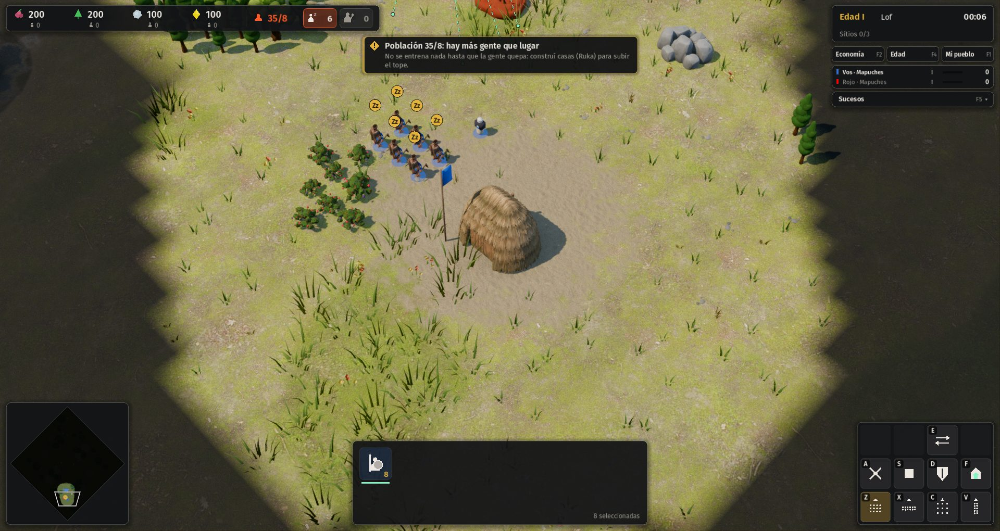
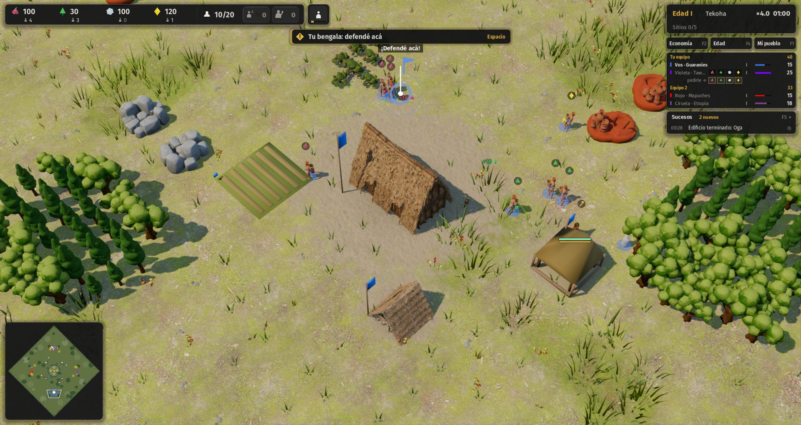
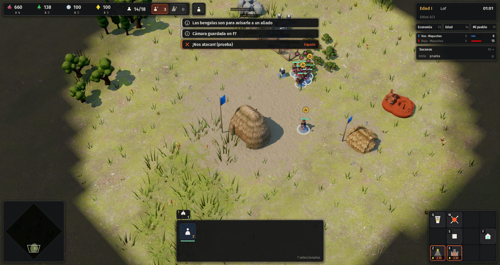

# 23 · B · Órdenes y comodidades como AoE4 (2026-11-15)

Parte B del plan de la etapa ([README](README.md)). No mueve el balance: son órdenes nuevas, atajos y avisos. Lo que hace AoE4 está en `docs/diseno/jugabilidad/01-referencia-aoe4.md` (§1.3, §4) y las formaciones en `03-propuesta.md` (§1.9).

## Qué quedó

### 1. Barra de recursos con aldeanos y ociosos
- Debajo de cada recurso, cuántos aldeanos lo recolectan. Antes estaba al costado, chico y sin explicar. Clic en ese número: se seleccionan esos aldeanos.
- Dos botones nuevos con número:
  - **aldeanos ociosos**: en rojo si hay alguno;
  - **militares ociosos**.
- En los dos: clic selecciona el siguiente y lleva la cámara; Mayús + clic selecciona todos.
- La barra se ensancha sola: con recurso propio (mit'a, fama, kulliñ) no se pisa.

### 2. Atajos (`src/game/ui/atajos.gd`)
| Tecla | Qué hace |
|---|---|
| `.` | Siguiente aldeano ocioso. Con Mayús o Ctrl, todos |
| `,` | Siguiente militar ocioso. Con Mayús o Ctrl, todos |
| `M` | Todos los militares |
| `T` o doble clic en un edificio | Todos los del tipo de lo seleccionado, en todo el mapa (el doble clic en una unidad sigue siendo "los de la pantalla") |
| `Tab` | Recorre los edificios de producción y lleva la cámara |
| `Ctrl + F7…F9` / `F7…F9` | Guardar la cámara / volver a ella |

**Marcadores en F7–F9 y no en F1–F4.** F1–F6 abren los paneles (pueblo, economía, velocidad, edad, sucesos, puntaje) y F10 es la pausa. Quedan tres marcadores; AoE4 da ocho. Las teclas están en `data/interfaz.json → ordenes.marcadores`. Consulta C-35.

### 3. Cola global de producción (`src/game/ui/cola_global.gd`)
A la derecha de la barra de recursos hay un ícono por cada edificio propio que produce algo. Cada ícono muestra:
- lo que está saliendo;
- la barra de avance;
- cuántos hay en cola.

Clic: selecciona el edificio y lleva la cámara. Mayús + clic: todos los edificios de ese tipo. Como en AoE4, no muestra los edificios en obra.

### 4. Mantener posición y patrullar (simulación)
- **Mantener posición** (`D` en la grilla militar).
  - Es una orden nueva de la unidad (`Order.HOLD`).
  - No se mueve, ni siquiera si le pegan. Cada `ordenes.mantener_busca_cada_ticks` busca un blanco a su alcance (no a su visión) y le pega; si el blanco se aleja, lo suelta.
  - Se corta con cualquier otra orden. No es una postura permanente: así lo hace AoE4.
  - No cuenta como ocioso.
- **Patrullar** (`E` y clic).
  - Cada unidad va del lugar donde está hasta su punto del destino, repartido como al mover, y vuelve.
  - Es un ataque en movimiento que da la vuelta al llegar. Pelea con lo que ve y retoma la ronda.
  - Cualquier orden nueva la corta: `_own_units` borra la marca.
  - Los aldeanos no patrullan.
- Las dos entran en `state_hash`: la orden y, si la hay, la marca de patrulla con sus dos puntas.

### 5. Formaciones y rumbo (simulación y grilla)
- En la grilla militar, `Z X C V` eligen **bloque, línea, abierta y columna**:
  - la elegida queda marcada;
  - la formación se rearma en el lugar (orden nueva `formar`);
  - todas las órdenes de mover siguientes la usan.
- Las cuatro formas salen de `03-propuesta.md` §1.9. Los números están en `reglas.json → grupo`.

| Forma | Cómo se arma | Número en `reglas.json → grupo` |
|---|---|---|
| Línea | 2 filas por banda, hasta 40 de ancho | `linea_filas`, `ancho_max_linea` |
| Abierta | El bloque con el doble de hueco | `abierta_hueco_pct` |
| Columna | 2 de ancho, sin alas: los montados van en la fila | `columna_ancho` |

- **El rumbo se elige arrastrando el clic derecho.**
  - La orden sale al soltar. Mientras se arrastra, se ve una flecha y el nombre de la formación.
  - El cliente calcula el rumbo con la misma tabla de enteros que la simulación (`SimGroups.heading`), así la orden llega cerrada: `move` lleva `form` y `rumbo`.
  - Un clic corto (menos de `arrastre_rumbo_px`) es una orden como antes.
- Cada unidad guarda el último rumbo de su formación (`SimEntity.rumbo`). Así "formar" en el lugar sigue mirando hacia el mismo lado.

### 6. Bengalas, pedidos y frases de la IA aliada
- **Bengala**: Alt + clic izquierdo en el mapa o en el minimapa.
  - Es la orden de la simulación `bengala`, así que es determinista.
  - Si cae a `defender_radio` de un edificio propio o aliado, dice "defendé acá"; si no, "atacá acá".
  - Se ve en el mundo (aros que laten, banderita y cartel) y en el minimapa, unos segundos (`interfaz.json → ordenes.bengala_s`). También llega como aviso, que se puede saltar con Espacio.
  - Solo la ven los del equipo.
  - Sin aliados, no se tira y se avisa por qué.
- **La IA aliada responde a la bengala** (`SimAI._flares`).
  - Lo hace si la bengala está a `ia_radio` o menos.
  - Manda `ia_parte_pct` de su ejército libre, los más cercanos primero, con un mínimo de `ia_min`.
  - Esas unidades se quedan en el lugar un rato en vez de volver a su punto de reunión.
  - Si no tiene tropa, lo dice.
- **Pedir recursos**: en el puntaje (F6), debajo de los botones de tributo de cada aliado, hay una fila "pedirle →" con los cuatro recursos.
  - El pedido queda anotado en la simulación (`requests`).
  - La IA aliada da `pedido.lote` si después le quedan `pedido.sobra`; si no, contesta "No me sobra…".
  - Si el aliado es una persona, le aparece el aviso "Verde te pide 200 de madera".
- **Frases de la IA**: la simulación emite el suceso `ia_dice` con una clave. El HUD arma el texto con `data/interfaz.json → frases_ia`.
  - Frases para todo el equipo: "Voy contra Rojo", "¡Me atacan!".
  - Frases solo para el aliado nombrado: "Te mando 200 de madera", "No me sobra piedra", "Voy a tu bengala con 6", "Voy a defenderte con 4".
  - Ninguna se repite antes de `ia_frases_calma_ticks`, salvo las respuestas.

## Por qué así
- **Mantener posición como orden y no como postura**: AoE4 la tiene así, y una postura persistente agregaba estado a cada unidad. Si se pide una postura que no se borre (referencia, §4, "lo que falta"), se agrega después.
- **Patrulla sin formación**: cada unidad hace su ida y vuelta. Es lo que hace AoE4 y evita mezclar el ancla del grupo con dos destinos.
- **La formación elegida se recuerda en el cliente**, no en la simulación: va en cada orden. Así una repetición la reproduce igual.
- **Bengala y pedido son órdenes de la simulación** y la IA los lee como estado. Las frases son sucesos, no estado: no entran en el hash, pero salen de la simulación y son iguales en todas las máquinas.

## Pruebas
- `tests/ordenes.gd` (nueva):
  - mantener posición: no persigue, pega al que entra y se corta;
  - patrulla de ida y vuelta, que se corta con detener;
  - las cuatro formas con sus medidas: bloque 1,97 × 4,02 casillas, línea 1,36 × 5,62, abierta 2,36 × 5,25, columna 5,24 × 1,81;
  - el rumbo gira la línea y `formar` pasa a columna mirando igual;
  - la IA aliada responde la bengala y el pedido, y lo dice;
  - las bengalas vencen.
  - **ORDENES: OK.**
- `tests/test_determinism.gd`: OK, hash 1068952643, el mismo que antes. En 3000 ticks de 1 contra 1 la IA no arma ningún grupo y no usa las órdenes nuevas.
- `tests/bench.gd`: 7,93 ms por tick en promedio, contra 8,05 ms antes (misma máquina, corrido a solas). Peor tick: 53,6 ms; antes, 46,1 ms.
- `tests/grilla.gd`: OK. `tests/grupos.gd`: OK, las mismas medidas que antes.
- `tests/equipos.gd -- --minutes=5 --solo=2v2`: EQUIPOS OK, cero fuego amigo en los cuatro 2v2. `tests/civ_smoke.gd`: sin errores.
- Autotest (`--autotest --civ=guaranies --terreno=llano` y con mapuches): OK. Tiene 22 controles nuevos:
  - el botón de ociosos (clic y Mayús + «.»);
  - aldeanos por recurso;
  - `M`, `,` y Ctrl + `,`;
  - la grilla militar, la línea con X, mantener con D y patrullar con E + clic;
  - la flecha y el rumbo del arrastre;
  - que la orden nueva corta la patrulla;
  - Ctrl + F7 / F7, Tab y T;
  - la cola global (que muestre la producción y que el clic lleve al edificio);
  - que Alt + clic sin aliados no tira bengala.

## Tropiezos
- Los primeros controles del autotest fallaban de a ratos. Revisaban la simulación pocos cuadros después de la orden, antes del tick que la aplica. Ahora esperan 0,3 s.
- El arrastre del clic derecho caía a veces sobre un árbol: la orden era "recolectar" y no llevaba rumbo. El autotest ahora busca un lugar vacío.
- Las capturas "antes" se hicieron con `git archive HEAD` en una carpeta aparte. La copia aislada no deja usar `git worktree`.

## Posibles choques al integrar
- `hud.gd` (barra de recursos reescrita, cola global, frases), `main.gd` (autotest con `_autotest_ordenes` y los argumentos `--bengala` y `--formacion`), `controller.gd`, `panel_pueblo.gd` (una línea de atajos) y `data/interfaz.json` (claves `ordenes` y `frases_ia`, y casillas fijas de la grilla militar). Todo va marcado con `# --- órdenes ---`.
- La barra superior ahora mide 54 de alto, antes 46.
