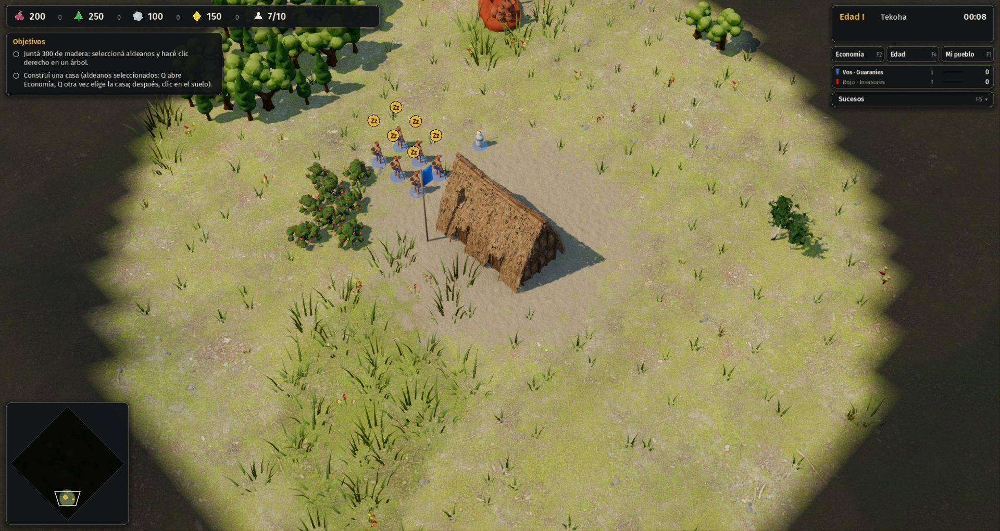
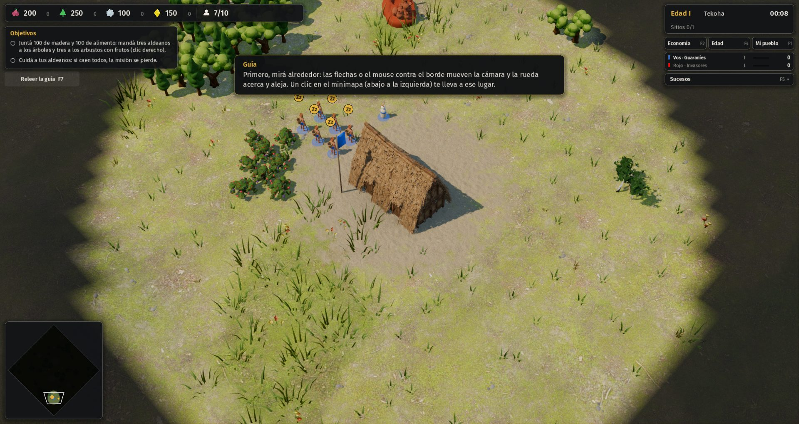
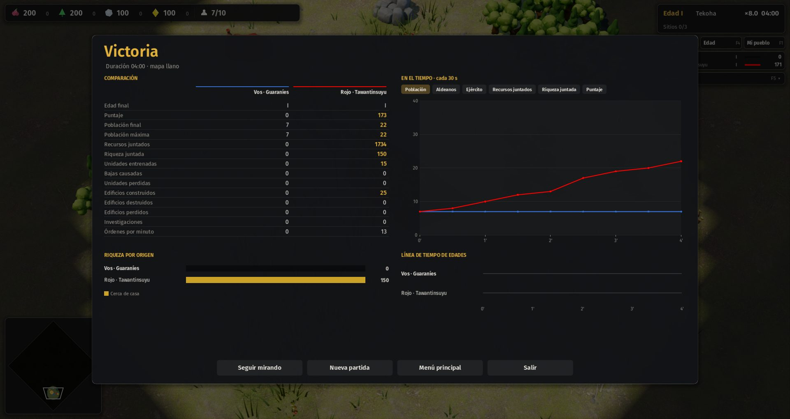
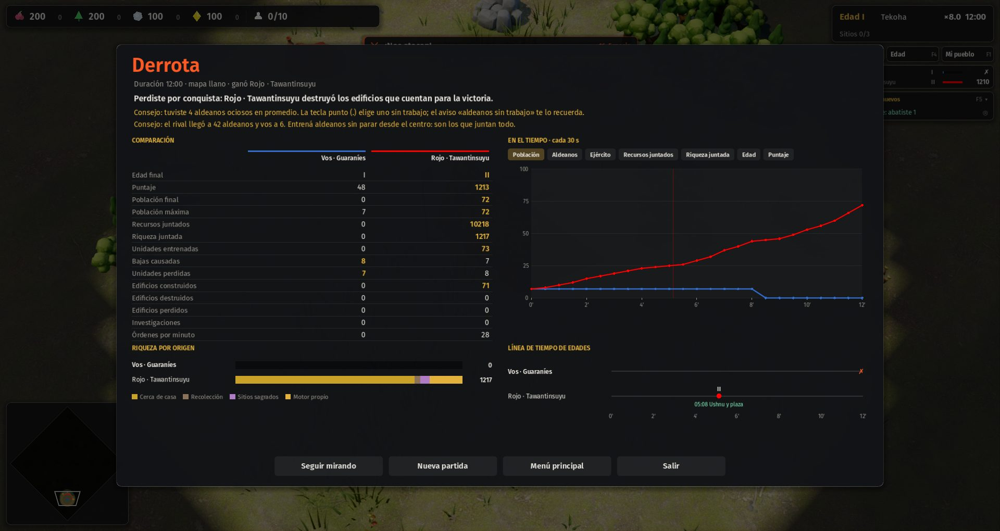
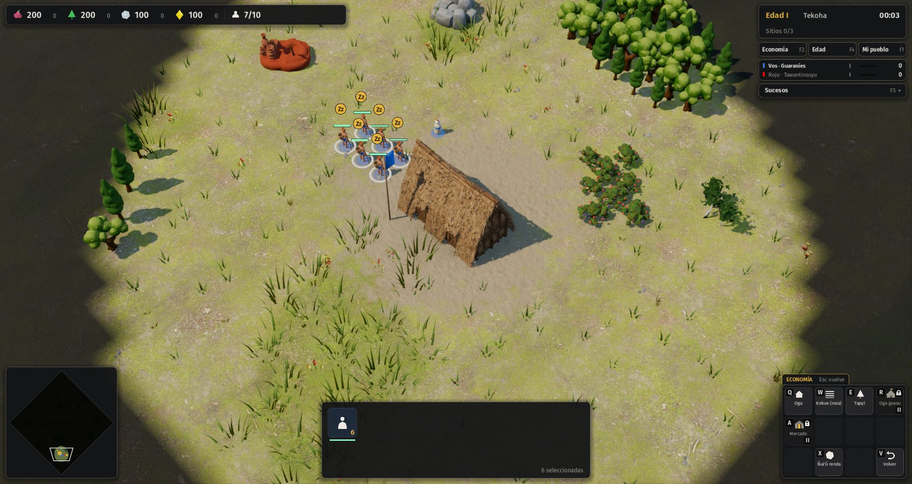
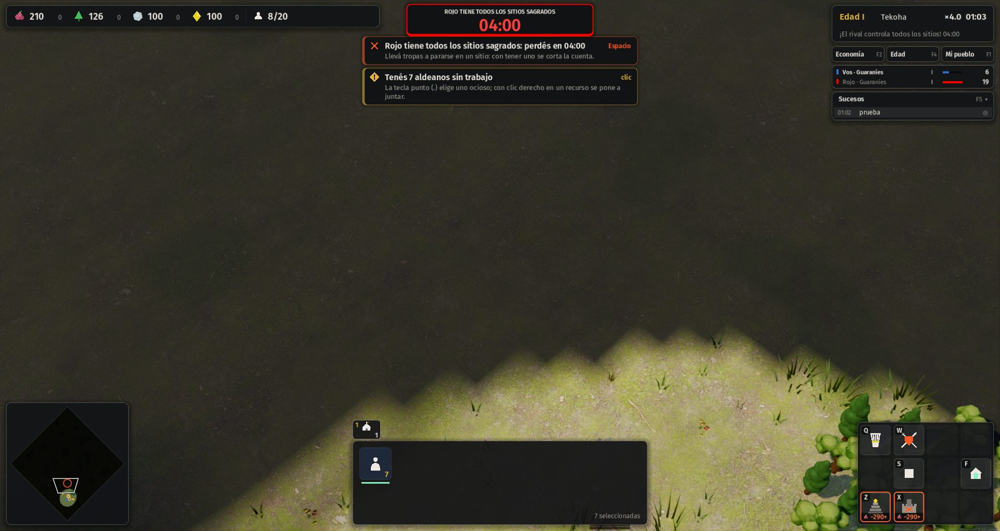
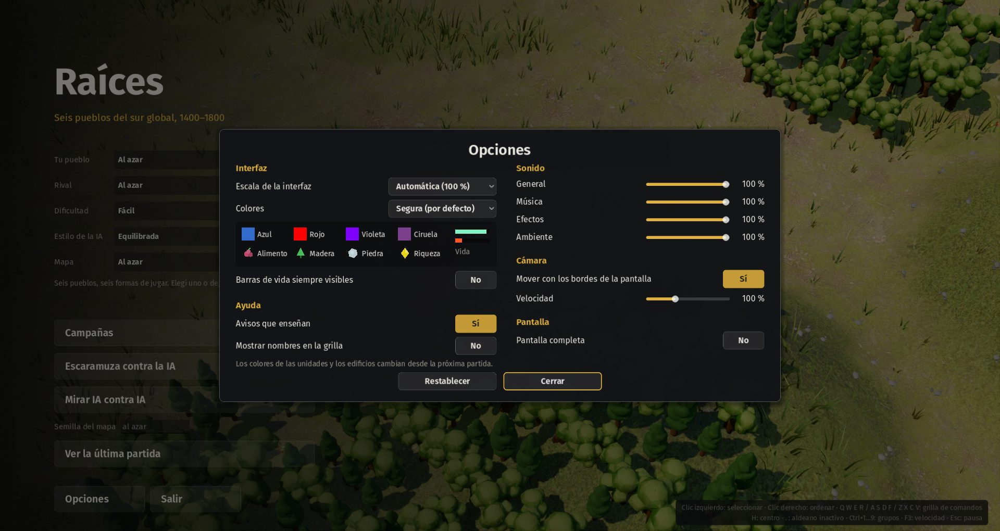

# 23 · C · Aprender a jugar como en AoE4

Parte C del plan de la etapa 23 (`README.md`). Sale del informe del jugador nuevo (`../22-testers/02-nuevo-en-rts.md`) y de la síntesis (`../22-testers/00-sintesis.md`, sección 3). La idea: que el juego enseñe lo que hace perder y que nadie quede trabado sin saber por qué.

## Qué se hizo y por qué

### 1. Tutorial que se puede ganar haciéndole caso
**El problema:** el jugador nuevo siguió el tutorial al pie de la letra (los seis aldeanos a la madera) y quedó trabado para siempre. A los 5:00 no le quedaban aldeanos, sin aldeanos no hay hito y la misión no terminaba ni avisaba nada. Además:
- nunca le pidió alimento ni riqueza;
- el ataque llegaba al terminar el cuartel, con cero soldados;
- los objetivos aparecían desordenados;
- no enseñaba cámara, exploración ni sitios sagrados.

**Lo que cambió en `data/campanas/tutorial.json`:** once objetivos, de a uno.
1. Juntar 100 de madera y 100 de alimento (tres aldeanos a cada lado).
2. Casa.
3. Tres aldeanos.
4. 100 de riqueza (los aldeanos nuevos, a la veta).
5. Explorar con el explorador hasta encontrar el sitio sagrado.
6. Tomar el sitio.
7. Cuartel.
8. Cinco guerreros.
9. Abatir a los saqueadores.
10. Edad II, con el panel F4 como guía.
11. Una regla siempre visible: «Cuidá a tus aldeanos: si caen todos, la misión se pierde».

La Guía empieza enseñando la cámara (flechas, bordes, rueda y minimapa) y explica cada recurso cuando hace falta. Treinta segundos después del cuartel dice «¡Llegan en 60 segundos!» y arranca una cuenta regresiva grande arriba al centro. A los 30 segundos recuerda la campana. Los saqueadores aparecen a una distancia calculada para que lleguen cuando la cuenta termina. El sitio sagrado del tutorial no gana la partida: solo enseña cómo se toma y para qué sirve.

**Lo que cambió en el motor de escenarios (`src/sim/sim_scenario.gd`):**
- objetivos `juntar` (lo juntado desde que aparece el objetivo, no lo que hay en el banco), `explorar` y `sitio`;
- eventos con `espera`, la acción `cuenta` y la `distancia` del ataque;
- sitios sagrados propios de la misión (con `victoria: false`) y dificultad de la IA rival;
- toda derrota lleva un motivo (`texto_fallo` del objetivo, o uno general), que la pantalla de la misión muestra antes de «Volvé a intentarlo».

Está documentado en `docs/campanas/README.md`. En `src/sim/sim_mods.gd`, la opción de partida `sitios_sin_victoria` deja los sitios sin cuenta. Las misiones existentes no usan nada de esto y se comportan igual.

**La prueba:** `tests/tutorial_letra.gd` juega el tutorial haciendo exactamente lo que dicen los objetivos y la Guía. Parte de los scripts del jugador nuevo, adaptados.
- **`--modo=letra`:** sigue el texto. Toca la campana cuando la Guía dice «si no te alcanzan los guerreros» y hace granjas cuando el aviso dice que se acabaron los frutos. Debe ganar.
- **`--modo=indefenso`:** hace todo menos defenderse. No puede quedar trabado: gana, o pierde con un motivo.

### 2. Avisos que enseñan
`src/game/ui/consejos.gd` mira la partida cada 5 segundos de juego y avisa con la pila de avisos que ya existía (`avisos.gd`):
- **«Tenés N aldeanos sin trabajo»**, si llevan 20 s ociosos, con la tecla punto. Al clic, la cámara va al primero.
- **«Se acabaron los frutos cerca del centro»**, una vez, con el nombre de la granja del pueblo (en los guaraníes, «Kokue (roza)»).
- **«Estás juntando riqueza que no gastás (N)»**, con qué hacer, y lo mismo para los otros tres recursos con su umbral.
- **«Rojo tiene todos los sitios sagrados: perdés en M:SS»**, con «llevá tropas a pararse en un sitio». Se repite cada minuto mientras dure. Al revés: «Tenés todos los sitios: ganás en M:SS».

Se apagan en Opciones, sección «Ayuda» → «Avisos que enseñan». Se guarda en `user://opciones.cfg`. Los umbrales están en `data/interfaz.json` → `consejos`.

### 3. Cuenta regresiva de los sitios, grande y para todos
`src/game/ui/cuenta_grande.gd`: cuando alguien tiene todos los sitios, aparece arriba al centro una caja con «ROJO TIENE TODOS LOS SITIOS SAGRADOS» y el tiempo en grande. El borde y el número llevan el color de quien los tiene, y en el último minuto el número late. La ven todos, tengan o no los sitios. En las misiones, la misma caja muestra la cuenta del escenario («LLEGAN LOS SAQUEADORES»). Además, el reloj de la derecha ya no dice «victoria en 05:00» cuando el sitio no gana (tutorial).

### 4. Pantalla de fin que explica
`src/game/ui/panel_fin.gd`:
- **Por qué terminó**, en una línea: conquista o sitios sagrados, quién ganó y, si fue por sitios, durante cuánto tiempo los tuvo.
- **Hasta dos consejos concretos si perdiste**, sacados de las muestras cada 30 s (`panel_datos.gd`, que ahora guarda también ociosos y sitios; no es estado de la simulación):
  - «el rival tuvo todos los sitios unos 5 minutos»;
  - «tuviste 6 aldeanos ociosos en promedio»;
  - «el rival llegó a 31 aldeanos y vos a 6»;
  - «el rival llegó a la edad II a los 7:40; vos, nunca»;
  - recursos sin gastar en promedio;
  - ejército mucho más chico.
- **Un gráfico nuevo, Edad**, junto a Población, Aldeanos, Ejército, Recursos y Riqueza juntados y Puntaje.

Los umbrales del consejo están en `data/interfaz.json` → `fin`.

### 5. Nombres en la grilla y registro de la Guía
- **Opción «Mostrar nombres en la grilla».** El glifo se achica y el nombre va debajo, en dos renglones, o en uno si abajo está la franja de «no alcanza» o la edad (`estado_casilla.gd`).
- **Registro de la Guía** (`src/game/ui/registro_guia.gd`). En las campañas aparece el botón «Releer la guía G» debajo de los objetivos. G abre todos los mensajes, el más nuevo arriba y con la hora. Al integrar, la tecla pasó de F7 a G: F7 a F9 son los marcadores de cámara de la parte B.
- **Los mensajes duran más:** 11 letras por segundo, entre 7 y 22 s (antes, entre 5 y 14). Los valores están en `data/interfaz.json` → `guia`.
- **Panel de objetivos más corto:** los cumplidos se muestran en un renglón, y solo los últimos tres, porque el tutorial tiene once.

### 6. El menú arranca en Fácil
Sin `user://opciones.cfg`, la dificultad viene en Fácil. Al cambiarla se guarda (`[partida] dificultad`) y la próxima vez arranca en la última elegida. Las capturas y las pruebas no leen el archivo, así que siempre muestran Fácil.

## Capturas

| Antes | Después |
|---|---|
|  Tutorial a los 8 s: un objetivo de madera, el mensaje se va a los 5 s |  Objetivo de madera y alimento, la regla de los aldeanos y «Releer la guía F7» |
|  Fin: números y gráficos, sin decir por qué |  Derrota real contra la IA normal sin jugar: por qué terminó, dos consejos y la pestaña Edad |
|  Grilla del aldeano: solo íconos |  Con «Mostrar nombres en la grilla» |
| |  Cuenta grande de los sitios, con el color del rival, y los avisos «perdés en 04:00» y «aldeanos sin trabajo» (autotest) |
| |  Opciones: sección Ayuda y, detrás, el menú en Fácil |

## Pruebas

| Prueba | Resultado |
|---|---|
| `tests/tutorial_letra.gd` (`--modo=letra`) | **Gana a las 8:26.** Saqueadores avisados a las 6:06; llegan a las 7:06 (la cuenta decía 60 s); campana con 3 guerreros; hito a las 7:30 |
| `tests/tutorial_letra.gd -- --modo=indefenso` | **Pierde a las 8:29 con motivo** («Perdiste a todos tus aldeanos… tocá la campana (Z)»). Antes: abierta hasta el minuto 25 sin decir nada |
| Script original del jugador nuevo (seis a la madera) con el tutorial viejo | Reproducido: 0 aldeanos a los 5:00 y misión abierta a los 25:00 |
| `--autotest --civ=guaranies --terreno=llano` | **OK, 39 controles, dos corridas seguidas** (9 nuevos: aviso de ociosos, apagado en Opciones, cuenta grande del rival, «perdés en», nombres en la grilla, F7 abre y cierra el registro, fin con motivo, gráfico de edad) |
| `tests/test_determinism.gd` | OK, hash `1068952643`, igual que antes del cambio (la escaramuza no cambió) |
| `tests/bench.gd` | 9,39 ms promedio, peor 64,30 ms (presupuesto 100 ms) |
| `tests/campaign_smoke.gd` | Las 25 misiones se arman y corren 3 minutos sin errores; el tutorial arranca con o1 y la regla de los aldeanos activos y el resto oculto |

## Tropiezos

- **El sitio quedaba fuera de la vista del explorador.** El primer lugar quedaba a 15 casillas del camino recto al centro y el explorador ve 11. Se corrió a (26, 14) desde la capital.
- **«Llegan en 60 s» llegaban en 105.** Los saqueadores aparecían en el borde del mapa. Por eso el ataque ahora tiene `distancia`: con 84 casillas, llegan a los 60 s.
- **El hito con todos refugiados.** En la prueba, el hito se encargaba en el mismo instante del toque de calma, con todos los aldeanos todavía adentro, y quedaba sin constructores. Lo mismo le pasaría a una persona que toca Z y enseguida X: el cimiento queda puesto y hay que mandar aldeanos a mano. Queda anotado para la parte B (órdenes).
- **Los frutos se acaban a los 9–10 minutos** y el aldeano queda ocioso. El aviso «Se acabaron los frutos cerca» es justamente para eso, y la prueba al pie de la letra lo sigue (hace rozas).
- **El aviso de ociosos en el autotest fallaba a veces**: el aviso real ya había salido antes (los aldeanos estuvieron quietos con la campana) y no se repite en 90 s. La prueba limpia ese registro antes de revisar.
- **Las consultas de otras partes** pueden sumar números en `CONSULTAS.md` en paralelo: las de esta parte quedaron como C-37 y C-38 al integrar (la parte B ya usaba C-35 y C-36).

## Posibles choques al integrar
- `src/game/hud.gd`: bloques `# --- aprender ---` (variables, setup, duración del diálogo, evento `dialogo`, `_process`, `ObjectivesPanel`, reloj de sitios).
- `src/game/main.gd`: el motivo de derrota en `mission_over` y el bloque nuevo del autotest.
- `src/game/ui/estado_casilla.gd`: el bloque que dibuja el nombre (la parte B toca la grilla).
- `src/game/ui/opciones.gd` y `src/game/menu.gd`: la sección Ayuda y la dificultad. La parte H suma dificultades: el menú usa la lista fija `facil, normal, dificil`, que habrá que ampliar.
- `data/interfaz.json`: tres bloques nuevos al final (`consejos`, `guia`, `fin`).
