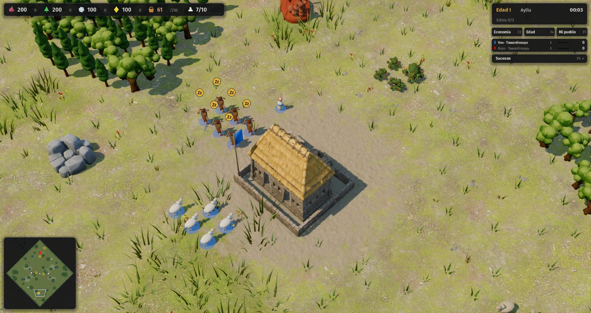
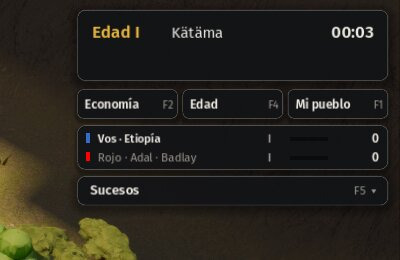

# 23 · Hacia AoE4, con identidad propia (desde 2026-11-15 20:00)

## Pedido del autor
> "Siguiendo el feedback que nos pidieron, si los encaramos de la misma forma que lo ha resuelto AoE4, ¿cómo lo haríamos?"
>
> "Me gustó todo lo sugerido para hacerlo más como AoE4, vayamos por ahí, siempre manteniendo identidad del sur global y las peculiaridades de cada civ, pero llevemos el trabajo en esa dirección."

Respuestas a C-31 a C-34: sí a todo, en ese orden.

## Qué se toma de AoE4 y qué no
- **Se toma:**
  - bonos planos por clase y dos armaduras;
  - ovejas, ciervos y jabalíes; granjas tardías y trabajo para el explorador;
  - hitos de 190/220/250 s que se usan;
  - las comodidades de órdenes y selección, la cola global y las bengalas;
  - el "arte de la guerra" y cinco dificultades;
  - la cuenta regresiva visible de los sitios;
  - rivales con civ propia, aspecto por edad, voces y una maravilla por pueblo;
  - las opciones de partida.
- **No se toma, a propósito:**
  - sitios por presencia y no por monjes;
  - aldeanos en bloque cuando van lejos (pedido del autor);
  - la economía asimétrica de cada pueblo (fama, mit'a, corte, roza), que es la identidad de Raíces.
- **Cada cosa se adapta a la región:** los animales son llamas, guanacos, pecaríes, tapires, cabras y búfalos; las formaciones incluyen la columna para el Qhapaq Ñan; las auras son las de los hitos propios (ushnu, wat).

## Plan
| # | Qué | Quién | Mueve el balance | Prueba |
|---|---|---|---|---|
| A | Cerrar el balance actual: mapuches 84 %, Tawantinsuyu 24 %, edad II de Ayutthaya | Líder | sí | Salud de la IA, torneo de 5 semillas en paralelo |
| B | Órdenes y comodidades como AoE4 (ver abajo) | Agente 1 | no | Autotest, `tests/grilla.gd`, capturas |
| C | Aprender a jugar (ver abajo) | Agente 2 | no | Autotest, `campaign_smoke`, capturas |
| D | Rivales con civ propia en las campañas: Adal, Toungoo y Konbaung, chankas, cayambes y cañaris, tupíes; y revisión de nombres | Agente 3 | no (solo campañas) | `campaign_smoke`, `civ_smoke` |
| E | Combate como AoE4: bonos planos por clase, armadura contra cuerpo a cuerpo y contra distancia, kiteo y fuego concentrado | Líder | **sí** | Prueba de micro fija, salud de la IA, torneo |
| F | Comida temprana como AoE4: animales por región para arrear, caza que pelea, menos arbustos, granjas más tarde, explorador con trabajo | Líder | **sí** | Economía en paz (granjas hacia el minuto 7–9), salud, torneo |
| G | Hitos como AoE4: obra de 190/220/250 s y auras según el lugar | Líder | **sí** | Edades en paz, salud, torneo |
| H | IA intermedia, difícil+ y experta (80–100 aldeanos, segundo centro) | Líder | no (la normal no cambia) | Salud de la IA por dificultad |
| I | Opciones de partida: victoria (conquista, sitios sí o no, tiempo límite), recursos y edad iniciales, equipos juntos o mezclados | Más adelante | no | Autotest |
| J | Arte y sonido con los créditos del mes: tropas propias, centro y casa por edad, hitos con su arquitectura, voces | Más adelante | no | Capturas |

**B, órdenes y comodidades:**
- botón de aldeanos ociosos con número y otro de militares ociosos;
- cantidad de aldeanos por recurso en la barra de recursos;
- seleccionar todos los militares, los militares ociosos y todos los edificios de un tipo;
- marcadores de cámara;
- cola global de producción arriba, con clic para ir al edificio;
- mantener posición y patrullar;
- elegir formación (bloque, línea, abierta, columna) y el rumbo arrastrando;
- bengalas con Alt + clic en el mapa o el minimapa, a las que responde la IA aliada;
- pedirle recursos al aliado, y frases de la IA en el chat.

**C, aprender a jugar:**
- tutorial que pide alimento y riqueza, avisa el ataque, falla si se pierden todos los aldeanos y enseña cámara y sitios;
- avisos que enseñan, que se pueden apagar en Opciones;
- cuenta regresiva grande de los sitios sagrados;
- pantalla de fin con gráficos de la partida a lo largo del tiempo;
- nombres en la grilla (opción);
- registro para releer los mensajes de la guía;
- el menú en Fácil la primera vez.

Orden de los cambios de balance: A, después E, F y G, de a uno, con un torneo de 5 semillas entre cada uno. B, C y D corren en paralelo y se integran cuando terminan.

## Paso a paso
1. **(20:00) Etapa abierta.** Respuestas anotadas en `CONSULTAS.md`. Se lanzan los agentes 1, 2 y 3, cada uno en su copia del repositorio.
2. **(21:00) Cambio de orden: el combate (E) antes de cerrar el balance actual (A).** El combate nuevo vuelve a mezclar todo el balance; cerrarlo antes sería trabajo perdido. Se balancea una sola vez, con el sistema nuevo.
3. **(21:30) Combate como AoE4 (E): bonos planos y dos armaduras.**
   - **Antes:** un multiplicador por función, de ×2 a ×2,25 a favor y de ×0,6 a ×0,8 en contra. Quien elegía mal perdía todo y quien elegía bien no perdía nada (informe del veterano).
   - **Ahora:**
     - el daño es ataque + bono contra la función del blanco − armadura;
     - el bono por función está en `reglas.json → bonos`: línea +5 contra choque, distancia +4 contra línea, choque +6 contra distancia; cada unidad puede sumar los suyos en `bono`, incluso contra montados;
     - la armadura es doble: `armadura` contra cuerpo a cuerpo y `armadura_distancia` contra lo que pega de más de 1,5 casillas (`alcance_distancia`). El lancero tiene 3 contra cuerpo a cuerpo y 0 contra distancia; el jinete, 1 y 2; el ariete, 2 y 6; el elefante de guerra y la compañía japonesa, lo mismo en las dos;
     - los multiplicadores quedan solo contra edificios y en el asedio, como el bono de asedio de AoE4.
   - **Se ve:** el panel de la unidad muestra las dos armaduras ("3 / 0"), y la ficha dice "+5 contra choque" y "choque le pega +6".
   - **Prueba fija nueva `tests/micro.gd`:** la escribió el veterano en la etapa 22 ([resultado](pruebas/01-micro-bonos.txt)).

     | Pelea | Antes | Ahora |
     |---|---|---|
     | 10 honderos contra 10 guerreros | gana el guerrero; pierde 1 | gana el guerrero; pierde 2 |
     | Lo mismo con fuego concentrado | pierde 1 | **pierde 4** |
     | 10 honderos contra 10 lanceros | gana el hondero; pierde 2 | pierde 4 |
     | 10 guerreros contra 10 lanceros | gana el lancero; pierde 0 | pierde 3 |
     | 8 jinetes contra 10 honderos | gana el jinete; pierde 0 | pierde 1 |

     El contador sigue ganando, pero paga, y el fuego concentrado cambia la pelea. Kitear al guerrero sigue sin servir, como en AoE4 (el arquero no escapa de la infantería rápida ni de la caballería); contra la línea, que es lenta, sí sirve. El veterano pedía que el ganador pierda la mitad: estamos en 20–40 %, y el torneo dirá si hay que ablandar más.
   - Determinismo OK, banco 8,2 ms por tick y autotest OK.
   - **Salud de la IA:** marca ejércitos de 5 y 6, pero son peleas perdidas, no una IA trabada. Hay que ajustar la prueba para que distinga una cosa de la otra.
   - Torneo de 5 semillas corriendo.
4. **(23:00) Comida temprana como AoE4 (F): animales por región, caza y menos arbustos.**
   - **Animales propios:** 5 junto a la capital, que no ocupan población. Se arrean como cualquier unidad y un aldeano los carnea: el animal pasa a ser carne (200 de alimento), que se junta más rápido que los arbustos (`tasa.carne` 1200 contra 1000).
   - **Animales sueltos:** cerca de cada base y entre las bases (3). Pasan a ser del jugador cuya unidad llega primero a 3 casillas, como las ovejas de AoE4; el explorador vuelve a tener trabajo. Un animal muerto por el rival también deja su carne, así que se puede robar matándolo.
   - **Venados:** 2 manadas de 4 por base, con 300 cada uno, lejos de la casa: conviene un granero al lado.
   - **Arbustos:** de 8 a 4 por base.
   - **Por pueblo** (`unidades.rebano` y `civ.animales`):

     | Pueblo | Animal | Nota |
     |---|---|---|
     | Tawantinsuyu | llama | |
     | Mapuches | chilihueque, el camélido que criaban antes de la oveja | `[verificar]` |
     | Etiopía | cabra | |
     | Ayutthaya | búfalo de agua | |
     | Palmares | cerdo | `[verificar]` |
     | Guaraníes | sin rebaño | pueblo cazador: 4 manadas de venados en lugar de 2 |
   - **Mapas:** en los de 2 jugadores, el kit de la base 0 y su espejo; en los de varios, el mismo kit girado. `reglas.json → animales` tiene todos los números.
   - **IA:**
     - sus aldeanos carnean primero los animales propios;
     - su explorador va a los sueltos más cercanos;
     - lo que quede lejos de la capital se arrea a casa.
   - **Vista:**
     - cuadrúpedo de maqueta con el color de cada animal;
     - venados más altos y con cuernos;
     - carne en el suelo;
     - los recursos que aparecen durante la partida (la carne) ahora se dibujan (suceso `recurso_nuevo`); antes solo se creaban los del principio.

     
   - **Pruebas** (`tests/jugabilidad.gd`, todas OK):
     - los incas arrancan con 5 llamas y los guaraníes con ninguna;
     - el explorador reclama el rebaño suelto (los 3 juntos, como las ovejas);
     - un aldeano carnea y junta.
   - Determinismo OK. La economía en paz (cuándo llegan las granjas) y el torneo se miden después del torneo del combate: un cambio por vez.
5. **(00:30) Torneo con el combate nuevo** (5 semillas, 75 partidas, sin los animales todavía; [resultado](pruebas/01-torneo-bonos.txt)):

   | Civ | Con multiplicadores (etapa 21, paso 19) | Con bonos y dos armaduras |
   |---|---|---|
   | Palmares | 56 % | **72 %** |
   | Guaraníes | 36 % | 56 % |
   | Mapuches | 84 % | 56 % |
   | Ayutthaya | 56 % | 44 % |
   | Tawantinsuyu | 24 % | 44 % |
   | Etiopía | 44 % | **28 %** |

   - **El reparto se achica:** cuatro de seis dentro de la banda, y los mapuches bajan solos de 84 a 56 %. Con los contadores más blandos ya no ganaban tanto con su choque.
   - **Quedan afuera:** Palmares, arriba, por su distancia (flecheiros); Etiopía, abajo, porque su jinete noble es choque y la línea ahora lo frena sin necesitar el ×2,25.
   - Partidas por destrucción de hitos: 53 de 75.
   - **No ajusto todavía:** primero se mide la comida temprana (los animales), que ya está en el código.
6. **(01:00) Fusión de la parte B, órdenes y comodidades** (agente 1). Están hechas:
   - en la barra: aldeanos por recurso y botones de aldeanos y militares ociosos;
   - atajos y marcadores de cámara (F7–F9);
   - cola global de producción;
   - mantener posición y patrullar;
   - cuatro formaciones con rumbo por arrastre;
   - bengalas a las que responde la IA aliada, pedidos de recursos y frases de la IA en los avisos.

   Prueba nueva: `tests/ordenes.gd`. Detalle en [02-ordenes-y-comodidades.md](02-ordenes-y-comodidades.md). Consultas C-35 y C-36.
   - **Integración:** el único choque fue este README; el código entró sin conflictos.
   - **Pruebas sobre lo fusionado** (combate, animales y parte B juntos):
     - determinismo, `tests/ordenes.gd`, `jugabilidad.gd`, `grilla.gd` y `grupos.gd`: OK. Con las formaciones nuevas, 24 mixtos llegan con 0,7 s de diferencia;
     - autotest OK con guaraníes, mapuches, Etiopía y Ayutthaya.
   - **Tropiezos del autotest:**
     - **Ahora hay venados y animales sueltos.** El paso del arbusto pedía "el alimento más cercano", que podía ser un venado fuera de la pantalla; ahora busca un arbusto de verdad.
     - **La espera del primer alimento fallaba de a ratos con la máquina cargada:** sin la ventana, las tres civs juntan 210 en 80 s. Se estiró la espera de 20 a 40 s reales.
7. **(02:00) Fusión de la parte C, aprender a jugar** (agente 2). Tutorial que se gana haciéndole caso y que falla con motivo, avisos que enseñan (apagables), cuenta grande de los sitios, pantalla de fin que explica por qué y da consejos, nombres en la grilla, registro de la Guía (F7) y el menú en Fácil la primera vez. Detalle en [`03-aprender-a-jugar.md`](03-aprender-a-jugar.md); consultas C-37 y C-38.
   - **Integración:** choques en `hud.gd` y `main.gd`, porque las dos partes agregaron bloques en los mismos lugares: se quedaron los dos. Las consultas de esta parte venían numeradas C-35 y C-36, igual que las de la parte B, y pasaron a **C-37 y C-38**.
   - **Choque de teclas:** las dos partes usaban F7, la B para los marcadores de cámara y la C para releer la Guía. El registro de la Guía pasó a **G**; los marcadores, ya fusionados y en consulta, siguen en F7–F9.
   - **Pruebas sobre lo fusionado** (combate, animales, B y C juntos):
     - determinismo, `ordenes.gd`, `jugabilidad.gd`, `grilla.gd` y las 25 misiones de `campaign_smoke` sin errores;
     - autotest OK con guaraníes y Etiopía;
     - `tests/tutorial_letra.gd`: siguiendo el tutorial al pie de la letra se gana a las 9:46 (el agente midió 8:26 antes de sumar combate y animales).
8. **(02:30) Fusión de la parte D, rivales con civ propia** (agente 3). Seis civs solo de IA (Adal, Birmania, chankas, caranquis y cayambes, cañaris, tupíes) en lugar de "Invasores" o de la cultura del jugador; el marcador y los avisos dicen el nombre del rival de la misión; *Espingardeiro de resgate* pasa a *Espingardeiro* y las palabras en portugués con equivalente pasan al castellano. Inkarri, el Qorikancha, las edades guaraníes y "Cucaú o Quilombo", a C-39 a C-44. Detalle en [`04-rivales-propios.md`](04-rivales-propios.md).
   - **Integración:** choques solo en documentos. Las seis consultas de esta parte venían numeradas desde C-35, igual que las de B y C, y pasaron a **C-39 a C-44**.
   - **Pruebas sobre lo fusionado** (todas las partes juntas): determinismo OK, `civ_smoke` y las 25 misiones sin errores, autotest OK con guaraníes y Tawantinsuyu. En Etiopía 1 el marcador dice "Rojo · Adal · Badlay" en lugar de "Rojo · Invasores".

     
9. **(03:00) Economía en paz con los animales** ([resultado](pruebas/02-economia-paz-animales.txt), comparada con [la de antes](../21-jugabilidad-aoe4/pruebas/13-economia-paz.txt)).

   | Civ | Edad II: antes → con animales | Edad III: antes → con animales |
   |---|---|---|
   | Tawantinsuyu | 7:57 → **5:22** | 16:32 → **23:10** |
   | Mapuches | 7:22 → 6:17 | 20:05 → **24:56** |
   | Guaraníes | 6:07 → 6:42 | 15:30 → 13:45 |
   | Etiopía | 5:35 → **4:47** | 18:10 → 16:22 |
   | Palmares | 7:10 → 7:00 | 17:55 → 17:52 |
   | Ayutthaya | 8:10 → **6:07** | 17:32 → **22:33** |

   - **La edad II llega antes,** más cerca de AoE4 (unos 4:30): los animales son comida rápida y cercana.
   - **La edad III se atrasa mucho en tres civs** (de 22 a 25 minutos). Cuando se terminan los animales y los cuatro arbustos, la IA tarda en pasar a las granjas. Es lo próximo a corregir en la IA, después del torneo.
