# 4c · Arte por edad, obra por etapas y torres por pueblo (paso 4, sin créditos)

## Pedido
Del paso 4 del plan (arte y sonido), la parte que se puede hacer sin gastar créditos de Meshy, sobre la maqueta procedural (`src/game/civ_meshes.gd`, `meshes.gd`, `world_view.gd`):

1. **Obra por etapas:** cimientos (0–33 %), estructura a medio levantar (33–66 %) y casi terminado (66–100 %), según `progress / build_time`, para todos los edificios procedurales. Los que tienen modelo generado (GLB) pueden mostrar la obra procedural.
2. **Aspecto por edad:** cada pueblo con su propio camino (no un "medieval" genérico), con los detalles en datos.
3. **Torres según el pueblo,** sin almenas europeas donde no corresponden.
4. **Margen en la huella:** el cuerpo del edificio unas 0,3 casillas adentro de cada lado (`docs/07`, "Requisitos de los modelos").

Lo piden la regla del autor del 2026-11-14 (`docs/07`) y la segunda ronda de jugadores: el informe de [historia y estética](../22-testers/ronda-2/03-historia-y-estetica.md) (deseos 2 y 6, punto 7 de "Respeto y fidelidad", error 3).

## Diseño

### Dónde vive cada cosa
- **`data/arte_edades.json`** (nuevo, solo imagen; la simulación no lo lee):
  - `margen_cm` (30);
  - `obra`: umbrales de etapa (`etapas_pct`: 33 y 66) y hasta qué parte del alto llega cada etapa (`corte_pct`: 14, 50 y 82);
  - `torres_por_forma` y `torres_bajas`;
  - `formas` (para los rivales que comparten forma) y `civs`, con una entrada por edad.
  Las edades se acumulan: cada una hereda la anterior y cambia lo que dice. Lo del pueblo pisa lo de su forma. Las claves están explicadas en el `_doc` del archivo.
- **`CivMeshes`**: lee la tabla (`age_cfg`), arma la casa, el centro, los cuarteles, los almacenes y las torres con ese aspecto, más los adornos de los modelos generados (`decor`) y lo que acompaña a la obra (`obra`).
- **`Meshes.clip_below`**: corta cualquier malla a una altura. Los triángulos que cruzan el corte se recortan (Sutherland–Hodgman), no se tiran, y el material pasa a doble cara: los muros quedan abiertos arriba, como una pared que sube.
- **`WorldView`**: cada edificio guarda qué se dibujó (`look`: `f<edad>` terminado, `o<etapa>_<edad>` en obra) y lo rehace **solo cuando cambia la etapa o la edad**. Lo ajeno se rehace únicamente si está a la vista (no delata la edad del rival bajo la niebla). Las mallas se guardan por pueblo, tipo, color, edad y corte: diez casas en la misma etapa comparten la misma malla.

### Obra por etapas
| Etapa | Avance | Se ve |
|---|---|---|
| Cimientos | 0–33 % | El edificio cortado al 14 % de su alto (las primeras hiladas), tierra removida con tablas en el borde y tres pilas del material del pueblo |
| Estructura | 33–66 % | Cortado al 50 %, andamio de palos con travesaños y tablón, y una pila de material |
| Casi terminado | 66–100 % | Cortado al 82 % (el techo a medio cubrir), andamio hasta arriba y el material del techo |

El material sale de `obra_material` de cada pueblo: piedra y paja (inca, andinos), tacuara y paja (guaraníes, tupíes), adobe y paja (Etiopía en la edad I; piedra desde la II), madera y paja (mapuches, Palmares), ladrillo y madera (Ayutthaya), madera (Birmania). Antes, la obra era el edificio terminado aplastado (escala vertical según el avance).

Los modelos generados (centro y casa de los seis pueblos, lof mapuche) muestran la obra procedural y pasan al modelo al terminar.

### Por pueblo y edad
| Pueblo | I | II | III | IV |
|---|---|---|---|---|
| **Tawantinsuyu** | Pirca: piedra de campo gris parda, con piedras salientes; casas más chicas y techo de ichu | Recinto de pirca (kancha) alrededor del centro; tropa con unku rojo y casco de fibra | **Cantería fina:** muros claros con hiladas parejas, puerta y hornacinas trapezoidales, más altura; recinto de cantería; casco de cobre y escudo con borde dorado | Bandas de oro en los muros y aguja dorada, como el Qorikancha; pectoral de oro |
| **Mapuches** | Rukas chicas (80 %) | **Rewe** junto al lof (2,2 m), rukas al 88 % | Rewe de 2,6 m, rukas al 95 % y techos más altos; coleto de cuero y escudo con borde | Rukas completas, rewe de 3 m y dos estandartes; casco de hierro tomado al enemigo |
| **Guaraníes** | Paja y barro, casas al 90 % | Empalizada alrededor del centro | **Madera labrada:** horcones tallados y pintados en rojo y negro, frentes de tabla pintada, techos más altos; escudo con borde rojo | Empalizada doble, más altura, remate de madera; tela de algodón blanco |
| **Etiopía** | Tukul de barro y paja | **Zócalo de piedra** y techos cónicos más altos | **Muros de piedra**, techos de paja mucho más altos (135 %), muro de piedra alrededor del centro; escudo con borde dorado y melena de león | **Piedra con cal** en hiladas, techos al 150 %, cruz y huevo de avestruz en el remate; la torre suma cúpula, como Gondar |
| **Palmares** | Mocambos de palma al 88 % | Cerca de troncos de 0,9 m | Cerca de 1,4 m | **Cerca doble** de 1,7 m y dos estandartes |
| **Ayutthaya** | Casas de madera sobre pilotes con techo de palma (attap), un solo techo | **Teja roja,** techo de dos pisos | **Tres pisos** de techo, remates dorados (chofa), muro blanco con almenas en hoja (*bai sema*) | Más altura y techos más empinados; muro más alto |

Rivales de campaña (solo IA), por su forma y con algo propio:
- **Andinos** (chankas, caranquis, cañaris): pirca desde la edad II, recinto en la III. Los **caranquis** levantan la casa principal sobre una **tola** (montículo), como pidió el informe de historia; los **chankas**, dos estandartes más (la imagen de Uscovilca).
- **Tupíes**: empalizada desde la edad I y doble en la III (Staden describe aldeas con doble empalizada [verificar]).
- **Birmania**: techos de teca oscuros, escalonados desde la II, dorados en la III, empalizada en la III.
- **Adal**: de barro a cal (blanco) y remate en la IV. **Invasores**: muro de piedra en la III.

Fuentes de cada pueblo en el `_nota` de su entrada de `data/arte_edades.json`, con `[verificar]` hasta tener la cita en la ficha (`docs/00-indice.md`, regla 5).

Los **modelos generados** también cambian con la edad, sin tocar el modelo:
- planta (`escala_pct`): rukas y lof mapuches, casas guaraníes y palmaristas;
- alto (`alto_pct`);
- tono (`modelo_tinte`): más apagado en la edad I y más claro desde la III;
- adornos alrededor: cerco del centro, rewe, horcones, zócalo y remate.

### Torres
| Forma | Torre | Antes |
|---|---|---|
| Inca | **Pukara:** plataforma escalonada de pirca (cantería desde la III), parapeto bajo sin almenas y refugio de vigía con techo de paja; banda de oro en la IV | Cilindro almenado |
| Andina (chankas, caranquis, cañaris) | **Fuerte de cresta:** montículo de tierra, anillo de pirca y vigía de palos con techo de paja | Cilindro almenado |
| Guaraní, tupí, mapuche, Palmares | **Mangrullo:** cuatro postes inclinados, cruces, plataforma con baranda, escalera y techito de paja | Cilindro almenado |
| Etiopía | **Torre de la amba:** piedra, cuadrada y ahusada, vigas a la vista (las "cabezas de mono" de Aksum), pretil y vigía de paja; cúpula y cruz en la IV | Cilindro con cúpula |
| Ayutthaya | **Fortín de río:** baluarte bajo de ladrillo encalado con almenas en hoja y pabellón de techos escalonados; no se estira a la altura de una torre (`torres_bajas`) | Cilindro con techo siamés |
| Birmania | **Fuerte de troncos:** cerco cuadrado de troncos aguzados, plataforma y techito escalonado | Cilindro de piedra con techo siamés |
| Adal | **Torre del Jugol:** piedra y argamasa revocada, cuadrada, techo plano con pretil y ventanitas | Cilindro almenado |
| Invasores | Torre redonda almenada (el baluarte europeo; acá sí corresponde) | Igual |

Guaraníes, mapuches y Palmares no construyen torres (`sin_edificios`), pero el mangrullo queda listo por si un mod o una campaña se las da.

### Margen en la huella
Con 0,3 casillas por lado (`margen_cm`), el cuerpo de un edificio de 2×2 no pasa de 1,4 de lado:
- casas y chozas: `min(lo de antes, lado − 0,6)`;
- cuarteles y almacenes: postes y cercos en el borde del margen;
- centro: las chozas laterales y el cerco quedan adentro del margen;
- torres: medio lado de 0,68;
- muros de los hitos: el lado de afuera en el borde del margen;
- modelos generados: se escalan a `lado − 0,6` (antes, 0,98 del lado), y a 0,2 menos si el centro tiene cerco.

Los aleros (Palmares, Ayutthaya) y los estandartes pueden llegar al borde, como dice `docs/07`.

### Tropas por edad
Solo la maqueta. Los modelos generados (aldeanos, hondero, arquero, flecheiro, jinete, elefante) no cambian con la edad. En `tropa`:
- `tela`: color del cuerpo;
- `casco`: cuero, fibra, cobre, hierro, dorado;
- `escudo_borde`: el borde del escudo de la línea;
- `oro`: pectoral.
Los aldeanos (función civil) no cambian. La malla de la unidad se cambia al subir de edad (una comparación de enteros por cuadro).

## Paso a paso
1. **Lectura.** `docs/07` ("Requisitos de los modelos"), `proceso/19`, la síntesis y el informe de historia de la segunda ronda. Torres por pueblo en `data/civs/*.json`: el pukara inca, la torre de la amba, el fortín de río, el fuerte de troncos birmano, el fuerte de cresta caranqui, la torre del Jugol y el baluarte. Guaraníes, mapuches y Palmares no tienen torre.
2. **Datos.** `data/arte_edades.json`, con margen, etapas de obra, torres y el aspecto de cada pueblo en las cuatro edades. Las edades se acumulan.
3. **`CivMeshes`.**
   - `age_cfg` lee la tabla.
   - `_hut` suma, por edad: alto, techo, planta, aparejo, zócalo, horcones, pisos de techo, dorado y remate.
   - `_center` suma cerco, rewe, tola y estandartes (`decor_parts`).
   - Ocho torres en `_tower`.
   - `decor` arma los adornos para los modelos generados y `obra`, el andamio y el material.
   - Las tropas reciben `tropa`.
   - El margen se aplica en casas, cuarteles, almacenes, mercado, torres y muros de hitos.
4. **`Meshes.clip_below`**, el corte de la obra, y `foundation_mesh` sin los postes de las esquinas: ahora el andamio va con la etapa.
5. **`WorldView`.**
   - `_build_struct` arma el cuerpo según `_look`: terminado o etapa de obra, y edad.
   - `_render_building` lo rehace solo cuando cambia el `look`.
   - `_stretch_to_scale` pasó a `_stretch_k`: el estirado a la altura mínima se calcula con el alto de la edad I, así lo que crece con la edad no se pierde.
   - Los modelos generados reciben planta, alto, tono y adornos de la edad.
   - Las tropas de maqueta cambian de malla al subir de edad.
6. **`main.gd`**:
   - `--edad=N` pone al jugador en esa edad en las escenas de muestra;
   - `--demo=obras` arma una fila por edificio (casa, cuartel, torre, almacén y centro) con obras al 15, 50 y 85 %.
7. **Capturas y ajustes** (ver "Tropiezos").

## Capturas
Escena `--demo=base --edad=N --terreno=llano --seed=21 --shot-at=3`, cámara por defecto sobre la capital.

| Qué | Captura |
|---|---|
| Tawantinsuyu, edad I y III: pirca y cantería, kancha cercada, pukara | 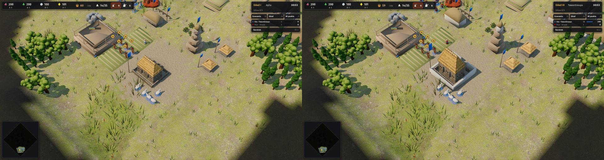 |
| Guaraníes, edad I y III: empalizada, horcones tallados | 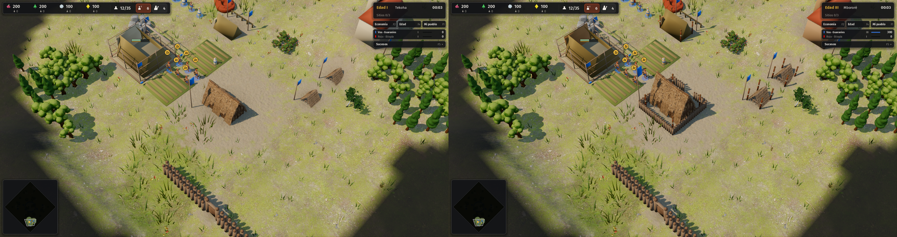 |
| Ayutthaya, edad I y III: techo de palma, después teja roja en tres pisos con oro y muro con *bai sema* | 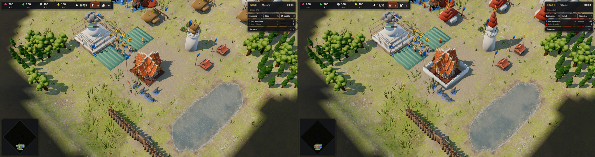 |
| Etiopía, edad I, III y IV: zócalo y muro de piedra; cruz y cúpula en Gondar | 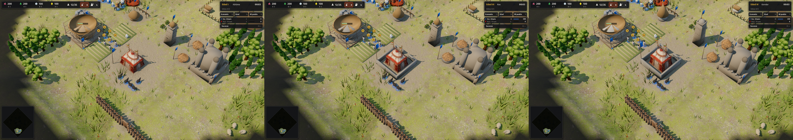 |
| Mapuches, edad I y III: rukas más grandes y rewe junto al lof | 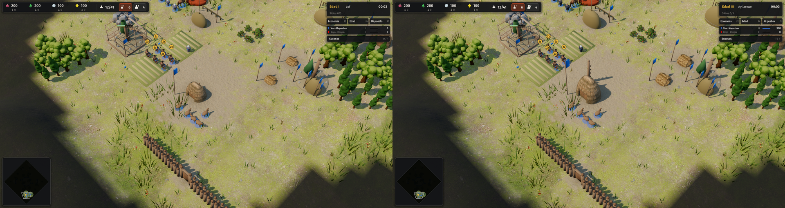 |
| Palmares, edad I, III y IV: la cerca crece y se dobla | 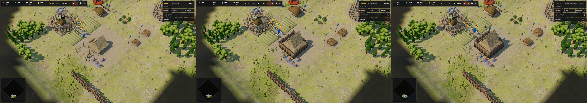 |
| Torres por pueblo (`--cam=b3,b8,10`) | 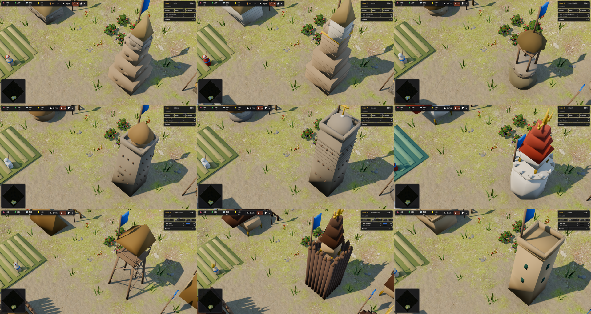 |
| Obras en tres etapas (`--demo=obras`): Tawantinsuyu, Etiopía y Ayutthaya | 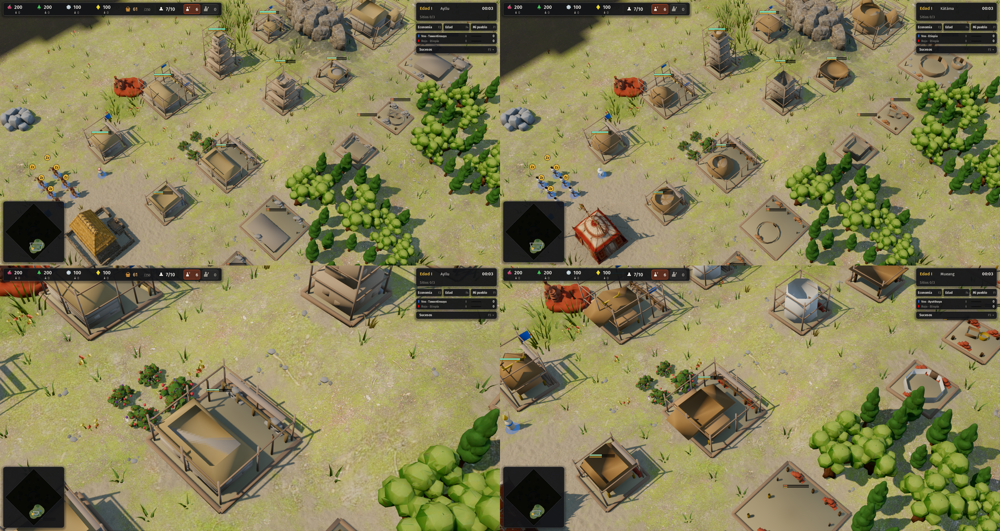 |
| Tropa inca, edad I y III: unku rojo, casco de cobre y escudo con borde dorado | 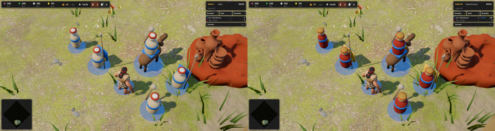 |
| IA contra IA (`--aivai --speed=8 --cam=b2,b2,38`), Tawantinsuyu a los 25:00, en la edad III | 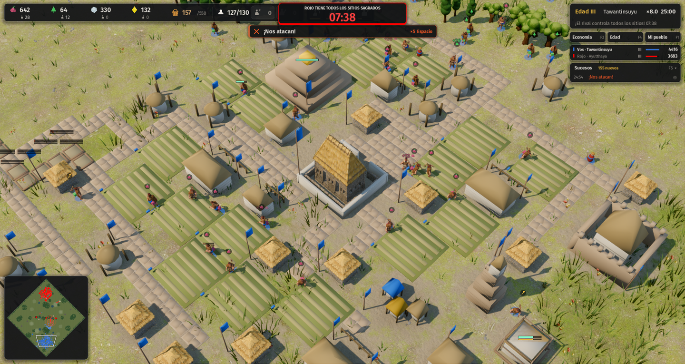 |
| IA contra IA, Ayutthaya a los 15:00, en la edad II (teja roja en dos pisos) | 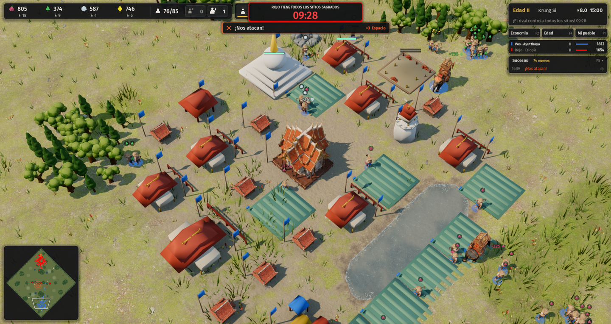 |

Las torres, de arriba a la izquierda:
- fila 1: pukara inca en la edad I y en la IV (con banda y aguja de oro), y fuerte de cresta caranqui;
- fila 2: torre de la amba en la edad I y en la IV (cúpula y cruz), y fortín de río;
- fila 3: mangrullo tupí, fuerte de troncos birmano y torre del Jugol.

## Tropiezos
- **Variables de forma en los comandos.** El aislamiento del worktree rechaza los comandos de Godot con variables de shell (bucles, `$S`). Cada captura va escrita entera.
- **`round` y `len`** son funciones de GDScript. Como nombres de variable, avisan por sombra; pasaron a `is_round` y `seg_len`.
- **La escala coherente borraba la edad.** `_stretch_to_scale` lleva cada edificio a la altura mínima de su categoría (hasta 170 %). Una casa más alta en la edad III terminaba igual de alta que en la I. Ahora el factor sale del alto de la edad I y se aplica igual a todas.
- **El remate dorado flotaba al costado** de las casas generadas. El alto del modelo incluía el estandarte del equipo, que se agrega antes de medir. Ahora el techo se mide antes del estandarte. El estirado sigue midiendo con el estandarte, como antes, para no cambiar la escala de los modelos.
- **El fortín de río, estirado a la altura de una torre (4,2 m),** parecía un silo. Pasa a `torres_bajas`: no se estira.
- **Estandartes de más.** Los dos estandartes mapuches de la edad IV salían también en cada casa. Ahora van solo en el centro.
- **La pirca caranqui salía azul**, porque usaba el color de acento del pueblo. Pasó a piedra.
- **Los postes de la obra quedaban en las esquinas de la huella,** donde va el pasillo. Ahora el andamio va en el borde del margen y solo desde la segunda etapa.
- Las partidas de IA contra IA llegan a la edad III cerca de los 20 minutos. A los 15:00 las dos seguían en la II. Etiopía contra guaraníes terminó por sitios sagrados justo a los 25:00 y la captura salió con la pantalla de fin, así que Etiopía en la edad III se ve en la escena de muestra.

## Pruebas
- `godot --headless --path . -s tests/test_determinism.gd`: **DETERMINISMO: OK**. No hay cambios en `src/sim`.
- `godot --path . -- --autotest --civ=guaranies --terreno=llano`: **AUTOTEST: OK**. También con `--civ=ayutthaya`.
- Capturas de los seis pueblos en la edad I y en la III, más los rivales con torre propia (Adal, Birmania, caranquis, tupíes), las obras y dos partidas de IA contra IA.

## Pendiente
- El tono por edad no le cambia la forma a los modelos generados: lo que cambia es la planta, el alto, el tono y los adornos. Para un cambio de forma real (cantería en la casa inca, techos más altos en el tukul) hacen falta variantes por edad con Meshy cuando haya créditos (`docs/07`: 7 modelos por edificio).
- Hitos y maravillas con arquitectura propia por edad (deseo 7 del informe de historia).
- Siluetas propias de los animales (error 2 del informe): queda para otro paso.
- Fuentes: las notas por pueblo llevan `[verificar]` hasta pasar a las fichas.
