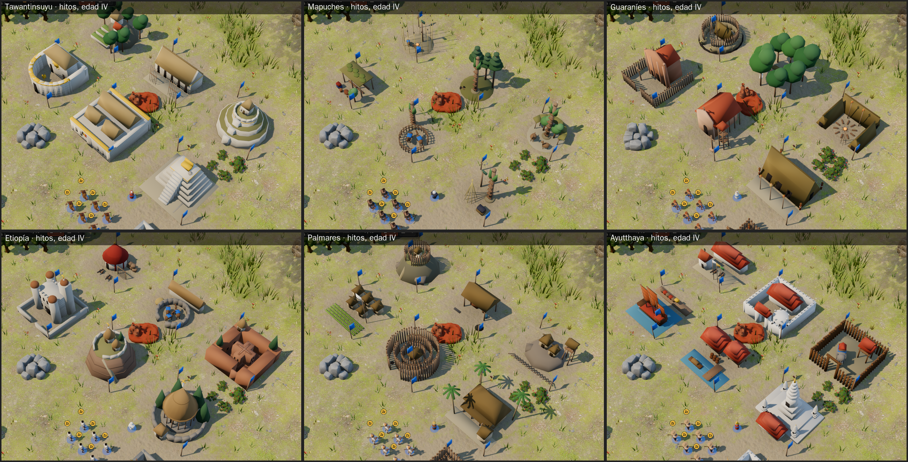
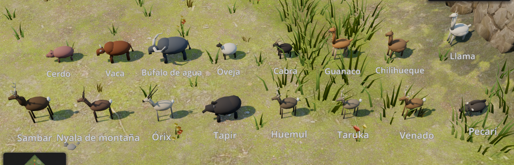
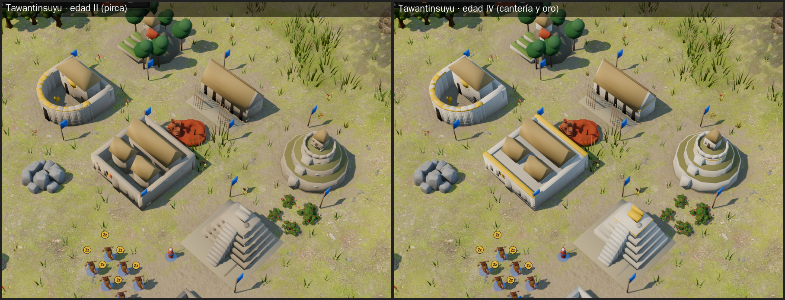
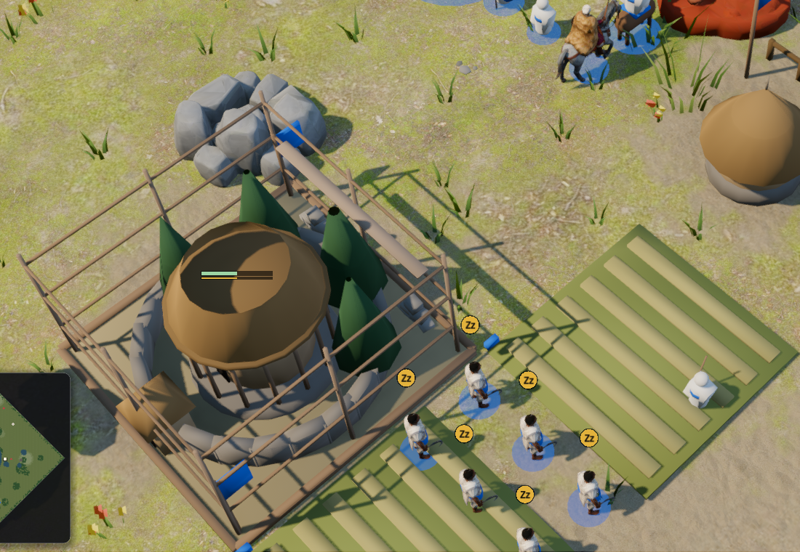
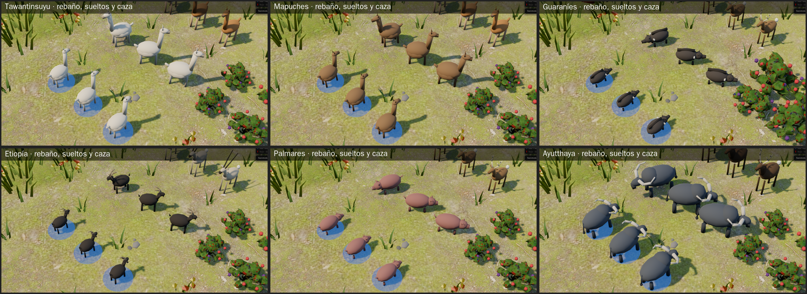

# 4d · Hitos con arquitectura propia y siluetas de los animales (paso 4, sin créditos)

## Pedido
La parte procedural del paso 4 (arte), sin gastar créditos de Meshy:

1. **Hitos con arquitectura propia.** Los 36 hitos de los seis pueblos (`"hito": true` en `data/civs/*.json`, seis por pueblo) con una silueta que se reconozca a la distancia, que sea fiel al pueblo y que no se confunda con sus edificios comunes. Los materiales salen del aspecto por edad del paso anterior ([4c](4c-arte-por-edad.md), `data/arte_edades.json`).
2. **Siluetas de los animales.** El rebaño de cada pueblo y la caza, cada uno con su forma: el cuello largo de los camélidos, los cuernos del búfalo, etc.

Lo piden los jugadores de prueba:
- la [síntesis de la segunda ronda](../22-testers/ronda-2/00-sintesis.md), punto 6;
- el informe de [historia y estética](../22-testers/ronda-2/03-historia-y-estetica.md): deseos 7 y 8 y el error 2 ("el cerdo y el búfalo parecen llamas de otro color, y el búfalo no tiene cuernos");
- la primera ronda: "la torre inca tiene almenas europeas y la iglesia etíope parece un hongo".

Ningún hito tenía modelo generado (GLB), así que no hubo nada que respetar: todos pasan a la forma procedural nueva.

## Diseño

### Dónde vive cada cosa
- **`data/arte_hitos.json`** (nuevo, solo imagen): por pueblo y por hito, la `forma` y sus pocos parámetros (`pisos`, `puertas`, `anillos`, `mastiles`, `alto_cm`), con la fuente en `_nota` y `[verificar]`.
- **`src/game/hitos_meshes.gd`** (`HitosMeshes`, nuevo): una función por forma, más piezas comunes (muro en arco, empalizada en arco, techo a dos y a cuatro aguas, vano trapezoidal, palmera, araucaria, fuego, agua, cañón). `CivMeshes.building` la llama para los hitos; si un hito no tiene forma propia (un mod), queda el monumento genérico de antes.
- **`data/arte_animales.json`** (nuevo, solo imagen):
  - `especies`: forma (camélido, cabra, bovino, cerdo, ciervo, tapir) y lo que distingue a cada animal (color, vientre, lana, cuello, patas, grosor, escala, cuernos o astas, crin);
  - `rebano_por_civ`, `sueltos_por_civ`, `caza_por_civ` y `caza_por_terreno`.
- **`src/game/animales.gd`** (`Animales`, nuevo): arma cada especie y guarda **una malla por especie**, compartida por todos los animales de esa especie.

### Reglas comunes de los hitos
- **Materiales por edad.** El hito usa el muro, el techo y el acento de la edad de su dueño, y además el `aparejo` (pirca, piedra, cantería), el `dorado`, los `pisos_techo` siameses, los `horcones` guaraníes, el `alto_pct` de las cercas palmaristas y el alto del rewe. Así el mismo hito se ve más noble al subir de edad (captura 3).
- **De frente a la cámara.** La cámara mira hacia +x+z (`RtsCamera.YAW_DEG`). Las formas se arman con el frente en +z y se giran media vuelta: la portada, la escalinata o el muro curvo quedan del lado que se ve.
- **Sin estirar.** El estirado a la altura mínima de la categoría (`reglas.escala_visual`, hasta 170 %) deformaba las formas bajas: el ushnu, Lalibela o el junco. Cada forma ya tiene su alto, así que `WorldView` no las estira.
- **Margen de 0,3 casillas.** El cuerpo queda dentro del margen (`docs/07`). Solo los estandartes y, en el kraal y la fortaleza, la cerca o la muralla llegan al borde.
- **Obra en tres etapas.** Funciona sin cambios: la malla se corta con `Meshes.clip_below` y lleva el andamio del pueblo (captura 4).

### Hitos por pueblo
Edad = edad a la que lleva el hito. Todo lo histórico va con `[verificar]` hasta tener la cita en la ficha (`docs/00-indice.md`, regla 5); las notas por hito están en `data/arte_hitos.json`.

**Tawantinsuyu.** Piedra del pueblo: pirca en las edades I y II, cantería clara desde la III, bandas de oro en la IV.

| Edad | Hito | Forma |
|---|---|---|
| II | Ushnu y plaza | Plataforma de cinco escalones frente a una plaza, con escalinata al frente, asiento de piedra (tiana, de oro en la IV), pileta y canal de libaciones (Vilcashuamán [verificar]) |
| II | Pukara de frontera | Cerro con tres muros concéntricos en terrazas, escalones en el frente, parapeto corrido **sin almenas** y una casita de vigía arriba [verificar] |
| III | Aqllawasi | Recinto de muro alto y una sola portada trapezoidal de doble jamba, hornacinas, galpones de paja asomando y un tejido de tocapu colgado [verificar] |
| III | Kallanka real | Galpón largo a dos aguas con hastiales de piedra, cinco portadas trapezoidales hacia la plaza y soportes de lanzas (Huánuco Pampa [verificar]) |
| IV | Qorikancha | **Muro curvo de cantería** con hiladas y banda de oro, el templo detrás con el disco del sol y el jardín de llamas y maíz de oro (Garcilaso [verificar]) |
| IV | Vilcabamba | Cerro en la ceja de selva con andenes, casas de techo empinado (una con teja, por Espíritu Pampa [verificar]) y monte alrededor |

**Mapuches** (huella de 3×3). El rewe, que es un poste escalonado tallado, con cara y canelos, crece con la edad (`rewe_cm`). Cada hito lo acompaña de otra cosa:

| Edad | Hito | Forma |
|---|---|---|
| II | Rewe del lonko | **Nguillatuwe:** el rewe y dos canelos en el centro de un campo, siete ramadas en media luna y chilihueques [verificar] |
| II | Rewe del toqui de malón | Rewe, la **toki kura** (el hacha de piedra del toqui) en su poste y un haz de lanzas de colihue [verificar] |
| III | Rewe del toqui de caballería | Rewe junto a un corral redondo con dos caballos |
| III | Rewe del toqui del monte | Rewe en un claro entre tres **araucarias** (tronco recto y copa en paraguas) y una trampa de foso |
| IV | Parlamento | Ramada grande sobre seis postes con bancos enfrentados, canelo (paz), agasajos (fardos, cántaro) y una vaca de la feria [verificar] |
| IV | Gran weichan | Anillo de catorce lanzas alrededor del fuego del consejo, la toki kura y dos caballos |

**Guaraníes.** Paja hasta el suelo y madera; con horcones desde la III.

| Edad | Hito | Forma |
|---|---|---|
| II | Casa del karai | **Oga guasu:** casa comunal enorme de paja hasta el suelo y, en la plaza, tres bastones rituales con plumas (yvyra'i), uno con el mbaraka [verificar] |
| II | Aty guasu | La plaza cerrada por tres casas largas, el fuego, la ronda de asientos y dos bastones con plumas [verificar] |
| III | Pueblo de misión | Iglesia de reducción: nave con **galerías sobre columnas**, teja, frontón, campanario de madera aparte y cruz en la plaza (San Ignacio Miní, Trinidad [verificar]) |
| III | Monte libre | Claro en la selva con siete árboles altos, dos refugios bajos (tapyi), hamaca y fuego |
| IV | Tava fortificada | Frente de piedra arenisca con pilastras, frontón, tres puertas y cruz, la nave detrás, la cruz de la plaza y la empalizada |
| IV | Ñande retã | Trinchera y terraplén redondo con empalizada, dos **cañones de tacuara**, casa larga y el estandarte (Sepé Tiarajú, guerra guaranítica [verificar]) |

**Etiopía.** Piedra y cal desde la III (aparejo de la edad), cruz en la IV.

| Edad | Hito | Forma |
|---|---|---|
| II | Iglesia | **Iglesia redonda de tres anillos:** zócalo, galería de postes bajo el alero, tambor con ventanas y techo cónico **más alto que ancho**, con borde del alero y cruz con huevos de avestruz; atrio de piedra con portería y bosque de la iglesia [verificar]. Deja de ser "un hongo": el techo era más ancho que alto y tapaba el tambor |
| II | Monasterio | **Lalibela:** iglesia en cruz tallada dentro de un foso en la roca roja, techo al ras con cruces en relieve, zanja de bajada, celdas en las paredes, tukul y enebros arriba (Bete Giyorgis [verificar]) |
| III | Amba fortificada | Meseta de laderas a pique con estratos, muro en el borde, dos tukules arriba y un solo camino de subida (Amba Geshen [verificar]) |
| III | Remonta | Corral de piedra con tres caballos, establo largo de paja y pila de heno |
| IV | Recinto de Gondar | Castillo de dos pisos con almenas, ventanas en arco, tres torres redondas con cúpula, una torre cuadrada más alta y muro bajo (Fasil Ghebbi [verificar]) |
| IV | Alianza con armas de fuego | Campamento de la corte: tienda real roja y blanca, cajones del comercio, mosquetes en su soporte y dos cañones |

**Palmares.** Palma y madera; la cerca crece con `alto_pct`.

| Edad | Hito | Forma |
|---|---|---|
| II | Macaco | Casa grande del rey con techo de palma a cuatro aguas y alpendre, capilla con cruz, plaza y tres **palmeras** (relatos de 1677 [verificar]) |
| II | Mocambo de guerra | Cerro con dos chozas, **estacas inclinadas** al frente y jirau de vigía con escalera |
| III | Cerca real en anillos | **Tres anillos** de cerca con las entradas desfasadas, fojos con púas entre anillos y la casa del medio [verificar] |
| III | Ferraria grande | Galpón de palma con la **fragua encendida**, chimenea, fuelles, yunque, tina, carbón y barras de hierro |
| IV | Pacto de Cucaú | Aldea en hileras, roças de maíz y la **bandera blanca** del pacto de 1678 [verificar] |
| IV | Guerra de Zumbi | La Serra da Barriga: cerro con dos anillos de cerca arriba, el tambor y el estandarte, y el camino de subida (1694 [verificar]) |

**Ayutthaya.** Techos escalonados según la edad (`pisos_techo`); remates de oro desde la III.

| Edad | Hito | Forma |
|---|---|---|
| II | Wat Mahathat | **Prang** central de mazorca sobre basamento y cuatro prangs chicos en las esquinas, con el viharn de techos escalonados al frente. Antes era un chedi de campana [verificar] |
| II | Kraal real | Empalizada de troncos de teca con portada, un elefante y el pabellón del rey sobre pilotes (phaniat [verificar]) |
| III | Puerto real | El río al frente, muelle, dos depósitos sobre pilotes, tinajas martaban y un sampán |
| III | Fortaleza de la isla | Muralla encalada con almenas en hoja (*bai sema*), **baluarte poligonal** con cañones (como el Pom Phet [verificar]), portada con techos escalonados y cuartel |
| IV | Junco de tributo | **Junco** con tres velas de listones, popa alta, ojo en la proa y el muelle con los cajones del tributo, uno de oro [verificar] |
| IV | Guardia extranjera | Cuartel siamés, casa a la europea con cruz, banderas de tres naciones (blanca, ocre y verde, ninguna de color de equipo) y dos cañones [verificar] |

### Animales
| Especie | Forma | Lo que la distingue | Dónde |
|---|---|---|---|
| Llama | Camélido | Cuello largo casi vertical, orejas en banana, vellón, cola alzada; crema | Rebaño inca y andino |
| Chilihueque | Camélido | Más bajo, ancho y lanudo; marrón [verificar] | Rebaño mapuche |
| Guanaco | Camélido | Esbelto, de patas largas, lomo canela y vientre blanco | Caza inca y mapuche, altiplano |
| Cabra | Cabra | Patas cortas, cuernos hacia atrás, barba, cola parada | Rebaño etíope y de Adal |
| Oveja | Cabra | Vellón ancho y cara oscura, sin cuernos | Por defecto e invasores |
| Búfalo de agua | Bovino | Ancho y pesado, cabeza baja, **cuernos grandes en media luna**; 118 % | Rebaño de Ayutthaya y Birmania |
| Vaca | Bovino | Cuernos cortos | Feria del parlamento mapuche |
| Cerdo | Cerdo | Barril sobre patas muy cortas, hocico de disco, orejas caídas | Rebaño de Palmares |
| Pecarí | Cerdo | Más chico, oscuro, **crin** en el lomo, collar claro, hocico largo | Caza guaraní, tupí y palmarista; lo que reclaman guaraníes y tupíes [verificar] |
| Venado | Ciervo | Patas largas, astas ramificadas, cola blanca | Caza por defecto, guaraní y palmarista |
| Taruka | Ciervo | Astas en horquilla, gris pardo [verificar] | Caza andina |
| Huemul | Ciervo | Robusto, astas en horquilla [verificar] | Caza mapuche |
| Tapir (mborevi) | Tapir | Redondo, grupa alta, **trompa corta**, crin | Caza guaraní y tupí, selva |
| Órix | Ciervo | Cuernos largos y rectos hacia atrás, cara oscura [verificar] | Caza etíope y de Adal |
| Nyala de montaña | Ciervo | Cuernos en espiral [verificar] | Caza etíope |
| Sambar | Ciervo | Grande y oscuro, melena en el cuello; 120 % | Caza de Ayutthaya y Birmania |

**La caza y los sueltos según la región.** La simulación no sabe de especies: es la vista la que elige.
- Para cada venado o animal suelto, `WorldView._resource_mesh` busca la base más cercana y toma la lista del pueblo de esa base.
- Entre varias especies (caza guaraní: venado, pecarí y tapir), decide el número del animal.
- Los terrenos con fauna propia pisan la lista: altiplano (guanaco y taruka) y selva (tapir, pecarí y venado).
- Los sueltos toman el animal del rebaño del pueblo vecino. Al reclamarlos, pasan a ser del rebaño de quien los toma.

**Rendimiento.** Cada especie tiene una sola malla (`Animales.mesh`), que se arma la primera vez y se comparte. Los hitos se guardan en la caché de `CivMeshes.building`, como antes (por pueblo, tipo, color y edad).

## Paso a paso
1. **Lectura.** `docs/00`, `04` y `07`; el paso [4c](4c-arte-por-edad.md); la síntesis y el informe de historia de las dos rondas. Listado de los 36 hitos con su edad y su huella (4×4; 3×3 los mapuches) y de los rebaños (`rebano` en cada civ). Ningún hito tiene GLB.
2. **Datos.** `data/arte_hitos.json` (forma y nota por hito) y `data/arte_animales.json` (especies y reparto por pueblo y terreno).
3. **`Animales`.** Seis formas con parámetros: camélido, cabra, bovino, cerdo, ciervo y tapir. `parts()` también sirve para sumar animales a un hito: las llamas de oro del Qorikancha, los chilihueques del nguillatuwe, la vaca del parlamento.
4. **`HitosMeshes`.** Treinta y seis formas y las piezas comunes. Usa `CivMeshes._hut`, `_aparejo`, `_horse`, `_elephant`, `_cerco` y `_pole` para no repetir código.
5. **Integración.**
   - `CivMeshes.building` llama a `HitosMeshes.build` para los hitos.
   - `WorldView` no estira los hitos con forma propia; además, `unit_mesh_for` (el rebaño) y `_resource_mesh` (la caza y los sueltos) usan `Animales`.
6. **`main.gd`.**
   - `--demo=hitos`: los seis hitos terminados, una fila por edad de destino. Con `--edad=N`.
   - `--demo=animales`: rebaño, sueltos y caza junto a la base, y una vitrina con todas las especies y su nombre (solo imagen; no son entidades).
7. **Capturas, ajustes y pruebas.**

## Capturas
| Qué | Captura |
|---|---|
| 1. Los 36 hitos, seis por pueblo, en la edad IV (`--demo=hitos --edad=4 --terreno=llano --seed=21 --nofog --shot-at=2`) |  |
| 2. Vitrina de las 16 especies (`--demo=animales --cam=b9.6,b16.8,15,46`) |  |
| 3. Hitos inca en la edad II (pirca) y en la IV (cantería y oro) |  |
| 4. La iglesia etíope en obra (`--demo=base --civ=etiopia --edad=2 --cam=b9,b6,20`): cortada a media altura, con andamio |  |
| 5. Rebaño propio (con disco), sueltos y caza junto a la base, por pueblo (`--demo=animales --cam=b5.5,b9,9,48`) |  |

En la captura 5:
- llamas, chilihueques, pecaríes, cabras, cerdos y búfalos;
- arriba, la caza de cada región: guanacos, órix, venados y sambar.

## Tropiezos
- **Clases nuevas sin registrar.** `Animales` y `HitosMeshes` no existían para el analizador hasta reimportar (`godot --headless --import`). Sin eso, `main.gd` no cargaba.
- **El frente quedaba de espaldas.** La cámara mira hacia +x+z, así que lo que está en +z (las puertas de todos los edificios comunes) no se ve. En la primera captura, la escalinata del ushnu y las portadas de la kallanka daban para el otro lado. Las formas se giran media vuelta. Los edificios comunes siguen como estaban; queda anotado en "Pendiente".
- **La iglesia etíope seguía pareciendo un hongo** con el primer intento: un cono de 1,14 de radio y 1,7 de alto, visto desde arriba, se lee como una cúpula. Ahora el cono es más alto que ancho (1,0 por 2,05), el alero sube a 1,42 y deja ver la galería y el tambor, con un anillo que marca el borde.
- **Variables de forma en los comandos.** Como en 4c, el aislamiento del worktree rechaza los bucles de shell con Godot o `magick`. Cada captura va escrita entera y las grillas las arma un script de Python.
- **Rótulos de la vitrina.** Flotando sobre el animal, en perspectiva caían sobre el animal de atrás. Pasaron al suelo, del lado de la cámara, y las filas se acomodaron a lo ancho de la pantalla. Con la semilla 21, una roca tapaba la llama y hubo que correr la vitrina.
- La inferencia de tipo desde arreglos sin tipo (`for s in [-1.0, 1.0]`) da avisos en GDScript. Los bucles quedaron tipados.

## Pruebas
- `godot --headless --path . -s tests/test_determinism.gd`: **DETERMINISMO: OK**. No hay cambios en `src/sim`.
- `godot --path . -- --autotest --civ=guaranies --terreno=llano`: **AUTOTEST: OK**.
- Capturas de los seis pueblos (hitos en la edad IV, el inca también en la II), de la obra de un hito, de los animales de los seis pueblos y de la vitrina.

## Pendiente
- **Puertas de los edificios comunes.** Están en +z, el lado que la cámara no ve. Conviene girarlas como los hitos, pero cambia todas las capturas de referencia y los modelos generados. Va en otro paso.
- **Hitos de los rivales de campaña.** Las facciones de IA no tienen hitos propios en sus datos; si se les agregan, necesitan su entrada en `data/arte_hitos.json`.
- **Animales sin animación.** Tampoco hay animación de caminar: se deslizan como antes.
- **Fuentes.** Todas las notas llevan `[verificar]` hasta pasar a las fichas. Las dudas más concretas:
  - el chilihueque como animal distinto de la llama;
  - el pecarí amansado;
  - el ojo en la proa del junco;
  - las tejas de Espíritu Pampa;
  - la cerca del Macaco.
