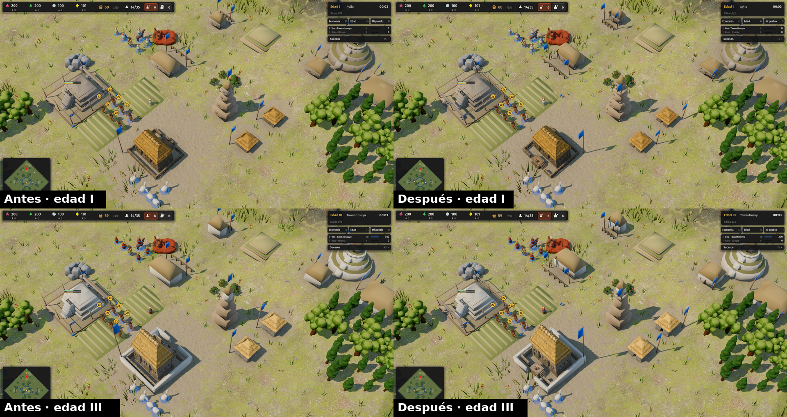
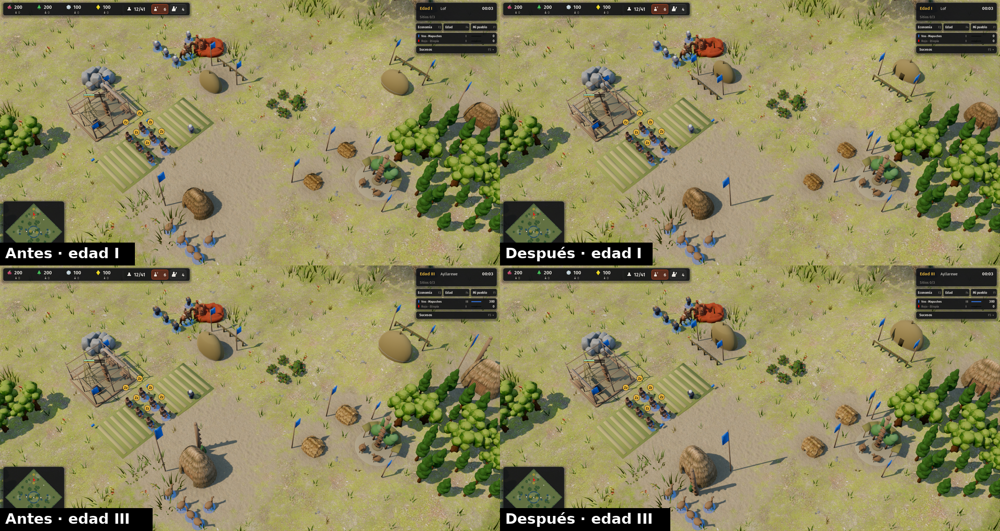
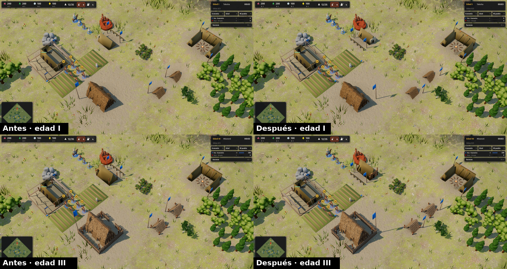
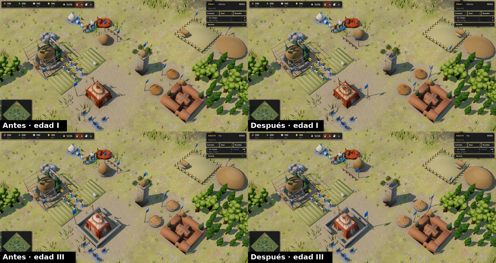
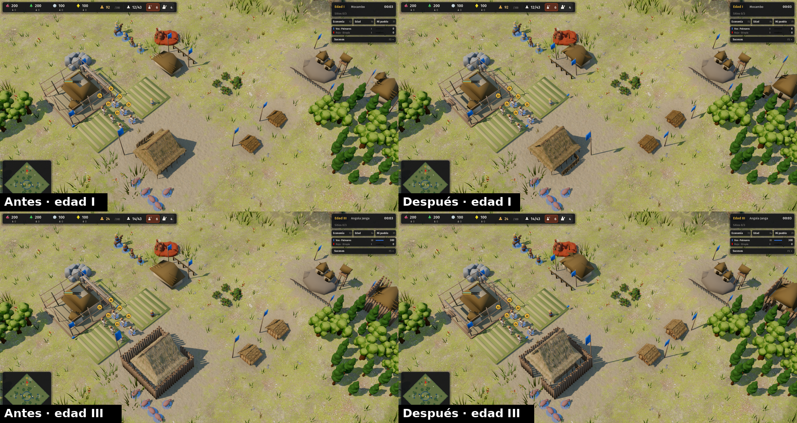
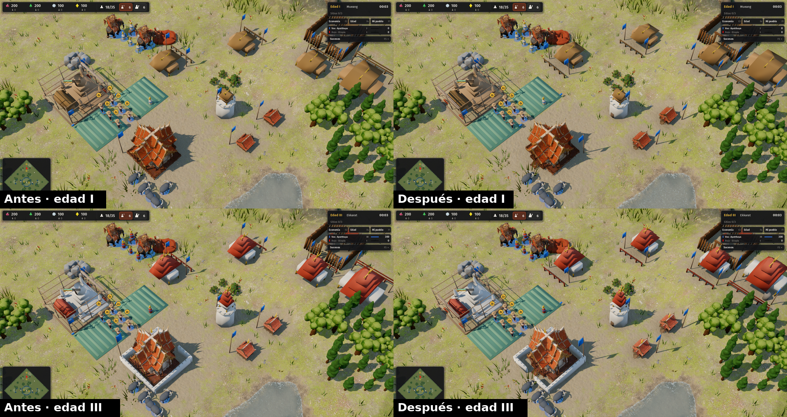
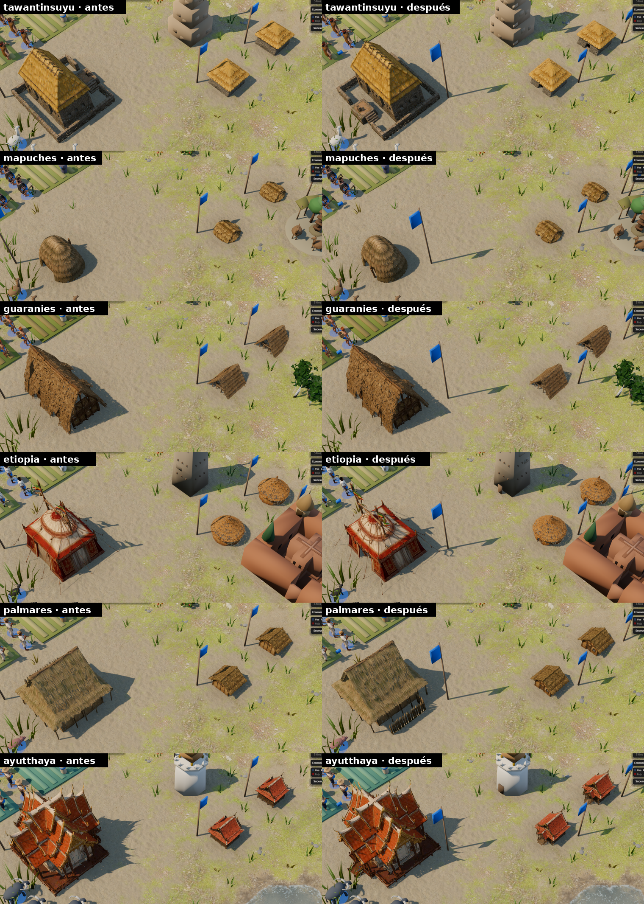

# 4e · Frentes de los edificios de cara a la cámara (pendiente del paso 4d)

## Pedido
Lo que quedó pendiente en [4d](4d-hitos-y-animales.md). Las puertas y los frentes de los edificios comunes (casas, chozas, cuarteles, almacenes, mercado, centros, torres) quedaban del lado que la cámara no ve. Hay que girarlos para que la puerta dé a la cámara por defecto, como ya se hizo con los hitos, y además:

- no romper el margen de 0,3 casillas en la huella ni el aspecto por edad (`data/arte_edades.json`);
- tocar solo la vista (`src/game`), nada de `src/sim`;
- revisar si los modelos generados (GLB) también quedan de espaldas.

## Diagnóstico
- La cámara mira hacia +x+z (`RtsCamera.YAW_DEG = 45`). Así se ven las caras que dan a -x (abajo a la derecha en pantalla) y a -z (abajo a la izquierda).
- Todas las mallas procedurales se arman con la puerta en +z: `CivMeshes._hut`, el cerco del centro (la entrada), la cerca del cuartel, la puerta de las torres, el tablón y las pilas de la obra, y en `Meshes.building_mesh` el centro, la casa, el granero y el portón del hito de guerra.
- **Los GLB también tienen el frente en +z**, que es la convención de glTF. Para comprobarlo, se giraron de prueba y se compararon de cerca (captura 2):
  - en las casas inca aparece la puerta, que antes no se veía;
  - en el centro inca aparecen la escalinata y el patio;
  - en el centro mapuche, la puerta de la ruka;
  - en el centro palmarista, la galería con la estacada;
  - en la casa de tukul etíope, la puerta;
  - en el pabellón siamés y en la casa larga guaraní, que son casi simétricos, se ve igual de un lado que del otro.

## Diseño
- **Media vuelta y no un cuarto.** Con 180° la huella w×d, el centro y el margen quedan igual, también en los edificios que no son cuadrados. Con 90° se cambiarían el ancho y el fondo. El frente queda en -z, del lado de la cámara, igual que los hitos.
- **`Meshes.face_camera(p, first)`** (nueva) gira las partes desde `first`. La usan:
  - `CivMeshes.building`, para todo menos los hitos con forma propia, que ya vienen girados de `HitosMeshes.build`. `HitosMeshes` también usa ahora esta función en lugar de su copia;
  - `CivMeshes.decor`: el cerco, el rewe y los estandartes que rodean a un GLB giran con el modelo, así que la entrada del cerco queda del lado de la cámara;
  - `CivMeshes.obra`: el tablón del andamio y las pilas de material, del lado de la puerta;
  - `Meshes.building_mesh`: los pueblos sin estilo, el portón y los muros.
- **GLB:** `WorldView.GLB_FRENTE_YAW = PI`, aplicado al nodo del modelo en `_build_struct` después de poner el estandarte, así que el estandarte también gira. El alto (`top`) y el estirado no cambian, porque el giro es sobre el eje vertical. Las unidades GLB no se tocan.
- **Retratos** (`tools/render_retratos.gd`). El retrato mira desde +z, así que a las mallas procedurales se les deshace la media vuelta y la ficha sigue mostrando el frente. Los GLB se dejan sin girar. **Los PNG no se regeneraron**: los de ahora ya muestran el frente.
- **Lo que no cambia:** el aspecto por edad, que sale del mismo `cfg`; el margen, porque la media vuelta conserva la huella; la caché, que tiene las mismas claves y queda girada desde que se arma la malla; y la simulación.

## Paso a paso
1. Lectura: `CLAUDE.md`, `docs/07-arte-y-ui.md`, [4c](4c-arte-por-edad.md) y [4d](4d-hitos-y-animales.md). Recorrido de `civ_meshes.gd`, `meshes.gd`, `hitos_meshes.gd` y de `_build_struct` y `_model_for` en `world_view.gd`.
2. Capturas "antes", con el código sin cambios, de los seis pueblos en las edades I y III (`--demo=base --terreno=llano --seed=21 --nofog --cam=b3,b7,30 --shot-at=3`, con `--edad=3`), más una de cerca de los GLB (`--cam=b-1,b5,16`).
3. `Meshes.face_camera` y su uso en `building`, `decor`, `obra` y `building_mesh`.
4. Prueba del giro de los GLB con las capturas de cerca de los seis pueblos. Se dejó `GLB_FRENTE_YAW = PI` para todos.
5. Retratos: ajuste del script, sin regenerar las imágenes.
6. Capturas "después" con los mismos comandos, la obra (`--demo=obras --cam=b6,b6,16`) y las pruebas.

## Capturas
| Qué | Captura |
|---|---|
| 1. Base de cada pueblo: antes y después, en las edades I y III |       |
| 2. De cerca: el centro y las casas (GLB) y las torres (procedurales), antes y después |  |

Qué mirar:
- en el cuartel, la cerca y el patio quedan delante y la galera detrás;
- las torres (pukara, amba, fortín de río) muestran la puerta abajo a la izquierda;
- en la edad III, el cerco del centro abre del lado de la cámara;
- los hitos ya estaban girados y no cambian.

## Tropiezos
- **No se sabía hacia dónde miraban los GLB.** Los modelos no dicen dónde tienen la puerta. Hubo que girarlos de prueba y comparar las capturas de cerca. En los modelos casi simétricos (el pabellón siamés, la casa larga guaraní y la tienda etíope) el giro no se nota.
- **El retrato quedaba de espaldas.** La primera idea fue mirar el retrato desde -x-z, como la cámara del juego. Pero la luz principal del estudio llega desde -x+z, así que la cara -z quedaba en sombra. Se optó por deshacer el giro en el retrato.
- Como en 4c y 4d, el aislamiento del worktree no deja usar variables de shell en los comandos de Godot. Cada captura va escrita entera, de a dos procesos como mucho, y las grillas las arma un script de Python.
- Al salir de una captura, Godot termina con "double free or corruption". La captura y el resultado ya se escribieron; no es de este cambio.

## Pruebas
- `godot --path . -- --autotest --civ=guaranies --terreno=llano`: **AUTOTEST: OK**.
- `godot --headless --path . -s tests/test_determinism.gd`: **DETERMINISMO: OK**. No hay cambios en `src/sim`.
- Capturas de los seis pueblos en las edades I y III, de cerca y de la obra.

## Pendiente
- **Regenerar los retratos de los edificios** (`tools/render_retratos.gd`) solo si se quiere confirmar que no cambian: con el ajuste, deberían salir iguales.
- **Si se generan GLB nuevos** con el frente en otra dirección, hay que hacer el giro por modelo en lugar de la constante. Por ahora, los 12 edificios GLB tienen el frente en +z o son simétricos.
