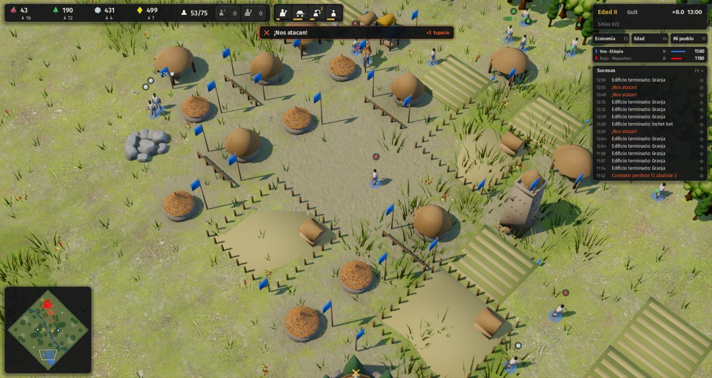

# 4g · Sonido propio de cada pueblo (paso 4, sonido)

> **Cambiado en [4h](4h-sonido-con-respeto.md):** ya no suenan el kultrun, la mbaraka, el takuapu, la begena ni el berimbau. Sus lugares los ocupan trutruka, kull-kull y kakelkultrun; mimby y angu'apu; krar; y ngoma, ngongi, marimba y kisanji. Lo de abajo describe el paso tal como se hizo.

## Pedido
La parte de sonido del paso 4, sin bajar audio de internet. Todo sonido nuevo se genera con código y queda como obra propia del proyecto:

1. **Un instrumento propio por pueblo**, sintetizado, que se reconozca sin caer en la caricatura: quena y siku (Tawantinsuyu), kultrun y trutruka (mapuches), mbaraka y takuapu (guaraníes), kebero y begena o masenqo (Etiopía), atabaque y berimbau (Palmares), khong wong y ranat (Ayutthaya).
2. Con esos instrumentos, para cada pueblo: **fanfarria de avance de edad**, **alarma de ataque** y un **sonido corto de entrenamiento u orden**. Se enganchan en el juego según el pueblo del jugador local, y qué archivo va con qué pueblo queda en `data/`.
3. **Etiopía (C-24):** un loop de música corto y respetuoso con kebero y begena o masenqo, en un modo etíope, que suene en partida como la música de los demás pueblos.

Lo piden los jugadores de prueba: la [síntesis de la segunda ronda](../22-testers/ronda-2/00-sintesis.md), punto 6 ("identidad visual y sonora"), y el informe de [historia y estética](../22-testers/ronda-2/03-historia-y-estetica.md), deseos 1 y 4 (voces, música para Etiopía). Las voces no entran en este paso (ver Pendiente).

## Qué suena ahora

| Momento | Antes | Ahora (jugador local) | Límite |
|---|---|---|---|
| Subís de edad | gong genérico (`ui_aviso_edad`) | **fanfarria** del pueblo | 4 s entre dos |
| Otro jugador sube de edad | gong genérico, bajo | igual | — |
| Te atacan (suceso `alert`) | cuerno genérico (`ui_alerta_ataque`) | **alarma** del pueblo | 10 s entre dos (la simulación ya espacia el suceso) |
| Una unidad tuya sale del edificio (`trained`) | nada | **entrenado**, bajo | 1,5 s entre dos |
| Clic derecho con tropas o aldeanos seleccionados | clic de interfaz | **orden**, muy corto y bajo | 0,35 s entre dos |
| Música de paz de Etiopía | solo las genéricas | **loop de begena, masenqo y kebero** (el doble de probable que las genéricas, como en los demás pueblos) | — |

Además, ningún sonido del pueblo suena más de **4 veces por segundo** sumando todos los tipos (`limite_por_segundo`). Un pueblo sin entrada en los datos (los rivales de campaña: Adal, birmanos, etc.) sigue con los genéricos.

## Diseño por pueblo

Cada instrumento es un modelo chico (`tools/audio/instrumentos.py`): parciales de una membrana o de una barra, una cuerda pulsada (Karplus-Strong), armónicos con vibrato y glissando, o granos de ruido. No imitan ninguna grabación. Las fuentes son las que usé para decidir el timbre, la afinación y el uso; donde no estoy seguro, van con **[verificar]**.

### Tawantinsuyu: quena, tropa de sikus y wankara
- **Quena** (flauta de muesca): casi senoidal, con soplo filtrado alrededor de la nota, un "chiff" de ataque y vibrato tardío y leve.
- **Siku** (zampoña): tubos cerrados, así que predominan los armónicos impares, con mucho más soplo y un golpe de aire al empezar cada nota. Se toca en **tropa**: dos mitades (ira y arka) se reparten las notas de la melodía (hoquetus), y la tropa duplica en octavas.
- **Wankara**: bombo de doble parche, con caída de altura al golpe [verificar el nombre según la región; en el altiplano también se le dice bombo].
- **Escala**: pentatónica sin semitonos (mi menor: mi, sol, la, si, re).
- **Fanfarria**: la tropa sube en hoquetus, la quena entra con una apoyatura y cierra en la tónica sobre la wankara. **Alarma**: una figura descendente y urgente de quena, dos veces, con golpes dobles de wankara. **Entrenado**: dos notas de siku (la → mi). **Orden**: una nota corta de quena.
- Fuentes: Thomas Turino, *Moving Away from Silence: Music of the Peruvian Altiplano and the Experience of Urban Migration* (1993), sobre las tropas de sikus y el tocar en pares ira/arka [verificar]. Raoul y Marguerite d'Harcourt, *La musique des Incas et ses survivances* (1925), sobre la pentatónica andina; su tesis de una música inca puramente pentatónica se discutió después [verificar].

### Mapuches: kultrun y trutruka
- **Kultrun**: timbal de cuenco de madera con un solo parche, golpeado con una baqueta. Modos de membrana circular (1; 1,59; 2,14; 2,30; 2,65…) sobre ~118 Hz, el cuenco que resuena y el chasquido del palo.
- **Trutruka**: trompa larga de colihue con un cuerno en la boca. Solo da los armónicos naturales de una fundamental muy grave, y acá se tocan los armónicos 3 a 6 de 58 Hz [verificar la fundamental: depende del largo, de 2 a 5 m]. La síntesis es de labio que vibra: los armónicos se abren con la fuerza del soplo, la nota sube un poco al atacar, y el cuerno realza la zona de 700 a 1300 Hz. Se recortan los agudos para que no sea estridente.
- **Fanfarria**: pulso parejo de kultrun y un llamado de trutruka que sube y baja (4-5-6-5-4). **Alarma**: kultrun que acelera y crece, con llamados cortos y repetidos en el armónico 6. **Entrenado**: dos golpes de kultrun y un toque breve de trutruka. **Orden**: un golpe de kultrun.
- Fuentes: María Ester Grebe, *Instrumentos musicales precolombinos de Chile* (1974) y sus trabajos sobre organología mapuche [verificar]; las fichas del Museo Chileno de Arte Precolombino sobre kultrun y trutruka [verificar]. El cuerno de vaca de la trutruka es posterior al contacto, pero entra en la época del juego (1400–1800).
- **Cuidado**: el kultrun es el instrumento de la machi y tiene un uso ritual fuerte. Acá no se imita ningún toque ceremonial; es un pulso simple. Como con la pifilka (`assets/audio/musica/README.md`), conviene confirmarlo con una organización mapuche antes de publicar (ver Pendiente).

### Guaraníes: mbaraka y takuapu
- **Mbaraka**: sonaja de porongo con semillas. No es una nota sino una nube de semillas: cada sacudida lanza un montón de chasquidos de ~1 ms que llegan juntos a la pared del porongo y se dispersan. El porongo colorea el conjunto con una resonancia ancha cerca de 1 kHz.
- **Takuapu**: bastón grueso de takuara que se golpea contra el suelo. Suena el golpe sordo en la tierra y el tubo (cerrado abajo) con sus armónicos impares. Hay dos largos, uno más agudo, y se alternan.
- Son instrumentos de ritmo, sin melodía, y así quedan: la identidad está en el pulso.
- **Fanfarria**: los takuapu alternan grave y agudo, acelerando y creciendo, con la mbaraka en cada golpe y en el contratiempo; cierre de los dos juntos. **Alarma**: takuapu rápido en grupos de cuatro y la mbaraka en trémolo. **Entrenado**: un takuapu y dos sacudidas. **Orden**: una sacudida.
- Fuentes: León Cadogan, *Ayvu Rapyta* (1959), sobre el mbaraka y el takuapu en el canto mbyá; Irma Ruiz, trabajos sobre la música ritual mbyá de Misiones (años ochenta) [verificar las dos]. Que el takuapu lo toquen las mujeres en el ritual [verificar].

### Etiopía: kebero y masenqo; begena en la música
- **Kebero**: tambor de dos parches tocado con las manos. El parche grande da un golpe grave con caída de altura y el chico, un golpe seco y más agudo. Patrón de 6/8: grave, —, agudo, grave, agudo, — [verificar: es un patrón común, no uno en particular].
- **Masenqo**: violín de una sola cuerda con caja en rombo cubierta de cuero, tocado con arco. Como la mano corre sobre una sola cuerda, se pasa de nota en nota con un pequeño glissando. El cuero da un timbre nasal (resonancias en 520, 1350 y 2600 Hz), sin el brillo del violín europeo, y hay un acento en cada arcada.
- **Begena**: lira grande de diez cuerdas gruesas, en registro grave. Cada cuerda zumba contra una tira de cuero, y ese zumbido es lo que la identifica: se modela como un roce que solo actúa de un lado de la oscilación.
- **Modos (qenet)** [verificar los cuatro en una sola fuente]: tezeta, bati, ambassel y anchihoye. En re, aproximados a la afinación temperada: **bati mayor** (re fa# sol la do#) para la fanfarria y **ambassel** (re mib sol la sib) para la alarma y la música.
- **Uso respetuoso**: la begena es un instrumento de devoción personal, asociado a la Cuaresma ortodoxa [verificar], y el kebero se usa también en la liturgia. Por eso:
  - la begena solo suena en la **música de paz**, nunca en la alarma ni en el combate;
  - la fanfarria y la alarma usan el masenqo, que es el instrumento secular de los azmari;
  - no hay voces ni nada que imite el zema (el canto litúrgico).
- **Fanfarria**: tres compases de kebero y una frase de masenqo que sube en bati y vuelve a la tónica. **Alarma**: kebero que se apura y una figura insistente de masenqo en ambassel. **Entrenado**: dos golpes del parche chico y uno del grande. **Orden**: un golpe del chico.
- **Música** (`musica_etiopia_begena_kebero_1.ogg`, 34,6 s): dieciséis compases de 6/8 a ~56 negras con puntillo, en ambassel sobre re:
  - compases 1 a 4: la begena sola, un ostinato grave de dos compases;
  - compases 3 a 14: el kebero suave;
  - compases 5 a 12: el masenqo, dos frases largas con glissandos;
  - compases 13 a 16: la begena sola otra vez, para cerrar.

  Está en estéreo: la begena a la izquierda y el masenqo a la derecha, con reverberación corta. La cola del final se suma al principio, así el loop empalma sin corte.
- Fuentes: Ashenafi Kebede, *The Music of Ethiopia: Its Development and Cultural Setting* (tesis, Wesleyan, 1971); Cynthia Tse Kimberlin, "Masinqo and the Nature of Qanat" (tesis, UCLA, 1976) [verificar las dos]; Timkehet Teffera, trabajos sobre los cordófonos de Etiopía [verificar].

### Palmares: berimbau con caxixi, y atabaque
- **Berimbau**: arco de alambre con una calabaza apoyada contra el vientre. El alambre golpeado con la baqueta es una cuerda metálica con poca pérdida, y suena brillante. La calabaza abre y cierra su boca contra el cuerpo: una resonancia que se mueve entre ~1,25 y ~2,6 veces la nota (el "uá"). Tiene tres sonidos:
  - **don**: abierto, 118 Hz;
  - **din**: con la piedra (dobrão), un tono arriba [verificar: el intervalo cambia de un instrumento a otro];
  - **chiado**: la piedra apenas apoyada, un zumbido.
  El **caxixi** (cestita con semillas) suena con cada golpe, porque va en la misma mano que la baqueta.
- **Atabaque**: tambor alto de un parche tocado con las manos, con tres golpes: grave (centro), aberto (borde, da la nota) y tapa (seco).
- **Toque**: la célula de angola, chi-chi DON din [verificar].
- **Fanfarria**: tres vueltas del toque con el atabaque y un cierre de don con grave y aberto juntos. **Alarma**: el toque más rápido (como un São Bento Grande) con el atabaque en semicorcheas. **Entrenado**: din → DON con caxixi. **Orden**: chiado con caxixi.
- Fuentes: J. Lowell Lewis, *Ring of Liberation: Deceptive Discourse in Brazilian Capoeira* (1992); Kay Shaffer, *O berimbau-de-barriga e seus toques* (1977) [verificar las dos].
- **Anacronismo posible**: el berimbau-de-barriga está documentado en Brasil sobre todo desde el siglo XIX (Debret, años 1830); para Palmares (siglo XVII) se justifica por los arcos musicales bantúes de Angola (hungu, mbulumbumba), que llegaron con los esclavizados [verificar]. Ya se usaba así en la música de Palmares de la etapa 19.

### Ayutthaya: khong wong yai, ranat ek y ching
- **Khong wong yai**: círculo de gongs de bulto. Cada gong tiene parciales inarmónicos (1; 2,02; 2,95; 4,2; 5,4…), con pares un poco desafinados que laten, el ataque brillante de la maza y una cola larga.
- **Ranat ek**: teclado de láminas de madera dura tocado con mazas duras. Tiene la fundamental reforzada por el cajón en forma de barco, los parciales de barra libre (2,76 y 5,40) y un decaimiento corto. Toca la melodía una octava arriba de los gongs.
- **Ching**: un par de platillos chicos que marcan el ciclo. Suena abierto ("ching") o cerrado ("chap").
- **Afinación**: siete pasos iguales por octava (~171 cents), con un subconjunto pentatónico de los siete grados para la melodía [verificar los dos].
- **Fanfarria**: corrida ascendente por el círculo de gongs, la melodía del ranat y un cierre con dos gongs y el ching. **Alarma**: el ranat en trémolo sobre dos notas altas, un gong grave insistente y chap secos. **Entrenado**: dos notas de ranat sobre un gong. **Orden**: una nota de ranat.
- Fuentes: David Morton, *The Traditional Music of Thailand* (1976), sobre la afinación de siete tonos iguales y el conjunto piphat; Simon de La Loubère, *Du Royaume de Siam* (1691), que describe instrumentos de la corte de Ayutthaya [verificar qué instrumentos nombra].

## Cómo se generó cada sonido
- **`tools/audio/dsp.py`**: osciladores aditivos con altura variable, modos amortiguados, Karplus-Strong por bloques (afinado exacto por remuestreo), filtros por espectro (pasabajos, pasaaltos, resonancias), reverberación por convolución con ruido que decae, paneo y exportación. Solo usa numpy, porque scipy no está instalado.
- **`tools/audio/instrumentos.py`**: un modelo por instrumento (los de arriba).
- **`tools/audio/generar_sonidos.py`**: la partitura de cada sonido, con los momentos humanizados (±8 ms) y las semillas fijas. Se corre con `python3 tools/audio/generar_sonidos.py [civ …]` y tarda unos 5 s.
- **Exportación**: WAV temporal → `ffmpeg` mide la sonoridad (`ebur128`) → ganancia hasta el objetivo, limitador de pico (hasta 6 dB en la percusión) → Ogg Vorbis calidad 4 con `bitexact` y número de serie fijo. Regenerar da **los mismos bytes**: se comprobó con md5.
- **Niveles**, alineados con lo que ya suena (gong de edad −17 LUFS, cuerno de alerta −13,5, música por pueblo −16):
  - fanfarria y alarma: −16 LUFS;
  - entrenado: −18;
  - orden: pico a −4,5 dBFS, porque es demasiado corta para medir LUFS;
  - música: −16 LUFS.

  Arriba de eso, el juego aplica el volumen de cada momento (`data/audio.json → momentos.*.db`). Las medidas de cada archivo están en `tools/audio/medidas.json`. Quedan un poco más bajas la fanfarria (−17,6) y el entrenado (−20) guaraníes: la sonaja tiene picos muy agudos y el limitador no se fuerza más.
- **Revisión sin oídos**: no pude escuchar los archivos, así que los revisé con espectrogramas ([lámina](capturas/4g-espectrogramas.jpg)). Ahí aparecieron dos defectos, que se arreglaron (ver Tropiezos).

## Cómo se engancha
- **`data/audio.json`** (nuevo):
  - `momentos`: volumen, mínimo entre dos y genérico que reemplaza cada sonido;
  - `limite_por_segundo`;
  - `civs.<civ>`: archivo de cada momento, y en Etiopía, `musica.paz`.
- **`src/game/audio.gd`**:
  - `GameAudio.cfg()` lee el JSON una sola vez;
  - `civ_sfx(kind)` toca el sonido del pueblo local y respeta los dos límites. Devuelve `false` si el pueblo no lo tiene, para que suene el genérico;
  - en `on_events`: `age` (propio) → fanfarria; `alert` → alarma; `trained` → entrenado;
  - `_civ_music` suma la música de los datos a la de `CIV_MUSIC`, y así Etiopía entra al mismo sorteo que los demás (la del pueblo pesa el doble).
- **`src/game/controller.gd`**: `_orden_ack()` en el clic derecho con unidades propias seleccionadas.
- No se tocó `src/sim/`.

## Pruebas
- **`tests/sonido_civ.gd`** (nueva, [salida](pruebas/4g-sonido_civ.txt)): **RESULTADO: OK**, 89 comprobaciones.
  - Los 24 sonidos y las 15 pistas de música por pueblo cargan y duran más de 0,05 s.
  - Los seis pueblos tienen los cuatro sonidos.
  - Tres partidas de IA contra IA de 12 minutos con un `GameAudio` por jugador. Los seis pueblos tocaron su alarma y su entrenado, y los cinco que subieron de edad, su fanfarria (Palmares no llegó a la II con esa semilla).
  - Una edad y un ataque forzados por pueblo tocan `<civ>_fanfarria.ogg` y `<civ>_alarma.ogg`.
  - Una ráfaga de 30 unidades entrenadas y 30 órdenes en el mismo cuadro da como mucho 2 sonidos.
  - Adal, sin sonidos propios, usa el genérico.
- **Autotest** `--autotest --civ=guaranies --terreno=llano` ([salida](pruebas/4g-autotest.txt)): **AUTOTEST: OK**, sin errores en la consola.
- **Partida real acelerada**: `--aivai --civ=etiopia --rival=mapuches --seed=77 --speed=8 --shot-at=780` ([salida](pruebas/4g-partida-etiopia.txt), [captura](capturas/4g-etiopia-edad-y-ataque.jpg)). Edad II y tres "¡Nos atacan!" sin un solo error ni aviso en la consola. Solo aparece al salir el `double free` conocido de `--shot` (error 6 del informe de historia).

## Tropiezos
- **Clics al final de las notas.** Una nota que todavía sonaba se cortaba en seco al terminar su buffer: se veía una raya vertical en el espectrograma del entrenado de Ayutthaya. Ahora `place()` cierra cada nota con un fundido de 15 ms.
- **La primera mbaraka era un siseo con tres tonos fijos.** Cada semilla era el mismo núcleo resonante, así que mil granos por segundo sonaban a un acorde con ruido. Se cambió por chasquidos de ruido de ~1 ms con una sola resonancia ancha del porongo.
- **Los Ogg no salían iguales** al regenerar: el número de serie del flujo es al azar. Se fijó con `-serial_offset 1` y `bitexact`.
- **La prueba headless no sonaba**: un `AudioStreamPlayer` fuera del árbol da "Playback can only happen when a node is inside the scene tree". La prueba corre en el primer cuadro (`call_deferred`).
- **La percusión con picos** (sonaja, berimbau) quedaba hasta 3 dB por debajo del objetivo. Se aceptan hasta 6 dB de limitador.
- **No pude escuchar** nada. Las decisiones de timbre salen de las fuentes y de los espectrogramas; falta que el autor los escuche.

## Pendiente
- **Que el autor los escuche** y diga cuáles suenan a caricatura o están fuera de nivel: se retocan en la partitura, sin tocar el juego.
- **Consultas posibles** (no las agregué a `CONSULTAS.md`):
  - confirmar el uso del kultrun con una organización mapuche, como ya estaba pendiente la pifilka;
  - si la begena en la música de paz es aceptable para alguien de la tradición ortodoxa etíope.
- **Voces** en la lengua de cada pueblo (deseo 1 de historia): no se pueden sintetizar con dignidad. Hace falta grabarlas.
- **Música propia** del resto de los pueblos con los mismos instrumentos: combate etíope, paz guaraní, combate andino.
- **Menú que suene al pueblo elegido** (deseo 4).
